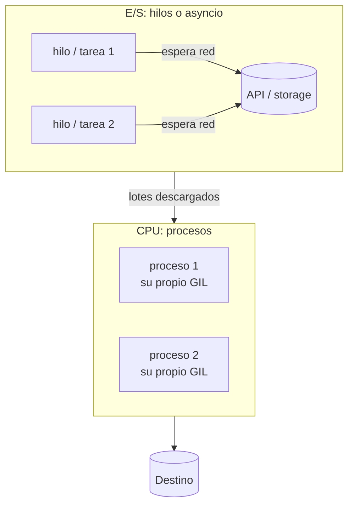

## 1. Resumen

En CPython, el **GIL** permite que un solo hilo ejecute bytecode de Python a la vez. De ahí sale la regla práctica:

- **E/S** (esperar a la red o al disco) → **hilos** o **asyncio**. Mientras se espera, otros avanzan.
- **CPU** en código Python → **procesos** (`ProcessPoolExecutor`), cada uno con su intérprete.

En la nube, el paralelismo de CPU además depende de cuántas vCPU asigna la plataforma: en Lambda es proporcional a la memoria, y en Cloud Run es 1 vCPU por instancia por defecto.

## 2. Qué es

- **Concurrencia:** varias tareas en curso que se turnan (por ejemplo, mientras una espera la red).
- **Paralelismo:** varias tareas ejecutando a la vez en distintos núcleos.
- **Herramientas de la biblioteca estándar:**
  - `concurrent.futures.ThreadPoolExecutor`: un pool de hilos con `map` y `submit`;
  - `concurrent.futures.ProcessPoolExecutor`: un pool de procesos; los argumentos y resultados deben ser picklables;
  - `asyncio`: corrutinas en un event loop. `TaskGroup` (3.11) agrupa tareas y cancela las demás si una falla. `Semaphore` limita cuántas corren a la vez, y `to_thread` lleva una función bloqueante a otro hilo.

## 3. Problema que resuelve

Un job que pide 500 páginas a una API, una tras otra, pasa casi todo el tiempo esperando. Con 8 o 16 peticiones en vuelo, termina varias veces antes. Un paso que hashea o parsea millones de registros en Python usa un solo núcleo aunque la máquina tenga más; repartido en procesos, usa varios. Elegir mal da lo peor de ambos: hilos para CPU no aceleran nada, y procesos para E/S cuestan memoria y arranque sin ganar casi nada.

## 4. Cómo funciona

1. **Hilos:** comparten memoria. El GIL se libera mientras un hilo hace E/S, así que otro puede avanzar. Para CPU en Python puro, solo uno avanza a la vez.
2. **Procesos:**
   - cada uno tiene su intérprete y su GIL;
   - los datos se envían por pickle, con costo de serialización;
   - el módulo principal se importa en los hijos, de ahí el `if __name__ == "__main__"`.
3. **asyncio:**
   - un hilo y un event loop;
   - cada `await` cede el control mientras se espera E/S;
   - una función de CPU dentro de una corrutina bloquea **todas** las demás. Se lleva a un executor o a `to_thread`.
4. **Límites:** la concurrencia útil la pone el destino (rate limits de la API, conexiones de la base) o la CPU disponible, no el número de hilos. Un `Semaphore` o `max_workers` lo fija explícitamente.

## 5. Cuándo utilizarlo

- Muchas llamadas de red o lecturas de object storage independientes: hilos o asyncio, con un límite.
- Transformaciones de CPU en Python sobre lotes independientes: procesos, con lotes grandes para amortizar el envío.
- Servicios con muchas peticiones concurrentes que esperan E/S: asyncio con bibliotecas asíncronas.

## 6. Cuándo no utilizarlo

- Cuando el cuello de botella es el destino (una base que acepta pocas conexiones): más concurrencia solo agrega errores y reintentos.
- Para CPU que ya corre en código nativo vectorizado (DataFrames, Arrow): la biblioteca puede ya usar varios núcleos, o liberar el GIL.
- Con orden o estado compartido entre tareas (secuencias, contadores globales) sin sincronización: aparecen condiciones de carrera.
- Cuando el volumen pide varias máquinas: un motor distribuido es más simple que procesos a mano (ver `pyspark-dataframes`).

## 7. Ejemplo sencillo

```python
import time
from concurrent.futures import ThreadPoolExecutor


def esperar(n: int) -> int:
    time.sleep(0.1)
    return n


inicio = time.perf_counter()
with ThreadPoolExecutor(max_workers=5) as pool:
    print(list(pool.map(esperar, range(5))), round(time.perf_counter() - inicio, 1))   # [0, 1, 2, 3, 4] 0.1
```

## 8. Ejemplo de producción

Un job descarga 2.000 archivos de object storage y los valida. La descarga usa un `ThreadPoolExecutor(max_workers=16)`, porque es E/S y el cliente del storage es síncrono. La validación, que parsea JSON y calcula hashes en Python, va a un `ProcessPoolExecutor` con tantos procesos como vCPU tenga el contenedor, en lotes de 50 archivos. En un servicio paralelo que consulta una API de terceros con límite de 10 peticiones por segundo, el código es asíncrono con `httpx.AsyncClient`, un `Semaphore(10)` y un `TaskGroup`.

## 9. Arquitectura



## 10. Código

```python
# Python 3.12 (ejecutado; mypy --strict sin errores): hilos para E/S, procesos para CPU y asyncio con límite.
import asyncio
import hashlib
import time
from concurrent.futures import ProcessPoolExecutor, ThreadPoolExecutor


def descargar(n: int) -> int:
    time.sleep(0.2)                 # simula esperar la red: el hilo libera el GIL mientras espera
    return n


def hashear(n: int) -> str:
    dato = str(n).encode()
    for _ in range(600_000):        # trabajo de CPU en un bucle de Python
        dato = hashlib.sha256(dato).digest()
    return dato.hex()[:8]


async def descargar_async(n: int, limite: asyncio.Semaphore) -> int:
    async with limite:              # como máximo 4 "peticiones" a la vez
        await asyncio.sleep(0.2)
        return n


async def todas(ns: list[int]) -> list[int]:
    limite = asyncio.Semaphore(4)
    async with asyncio.TaskGroup() as grupo:      # 3.11+: si una tarea falla, cancela las demás
        tareas = [grupo.create_task(descargar_async(n, limite)) for n in ns]
    return [t.result() for t in tareas]


def cronometrar(etiqueta: str, inicio: float) -> None:
    print(f"{etiqueta}: {time.perf_counter() - inicio:.1f}s")


if __name__ == "__main__":          # necesario con ProcessPoolExecutor: los procesos hijos importan este módulo
    ns = list(range(8))

    inicio = time.perf_counter()
    secuencial = [descargar(n) for n in ns]
    cronometrar("E/S secuencial", inicio)                    # ~1.6s (8 × 0.2s)

    inicio = time.perf_counter()
    with ThreadPoolExecutor(max_workers=8) as hilos:
        en_hilos = list(hilos.map(descargar, ns))            # map conserva el orden de entrada
    cronometrar("E/S con 8 hilos", inicio)                   # ~0.2s

    inicio = time.perf_counter()
    con_asyncio = asyncio.run(todas(ns))
    cronometrar("E/S con asyncio, límite 4", inicio)         # dos tandas de 4: 2 × sleep(0.2) como mínimo

    inicio = time.perf_counter()
    cpu_secuencial = [hashear(n) for n in ns[:4]]
    cronometrar("CPU secuencial", inicio)

    inicio = time.perf_counter()
    with ProcessPoolExecutor(max_workers=4) as procesos:
        cpu_procesos = list(procesos.map(hashear, ns[:4]))
    cronometrar("CPU con 4 procesos", inicio)                # menor que el secuencial si hay 4 núcleos libres

    print(secuencial == en_hilos == con_asyncio, cpu_secuencial == cpu_procesos)   # True True
```

Salida en esta máquina (Windows, 12 núcleos lógicos, Python 3.12.3): E/S secuencial 1.6 s; con 8 hilos 0.2 s; con asyncio y límite 4, 0.5 s; CPU secuencial 5.1 s; con 4 procesos 2.2 s; `True True`. Los tiempos varían según la máquina. Con tareas de CPU cortas, el costo de arrancar procesos se come la ganancia: con un tercio del trabajo por tarea, el resultado fue 1.3 s secuencial frente a 1.1 s con procesos.

## 11. GCP

En **Cloud Run**, cada instancia de un servicio tiene 1 vCPU por defecto. Se puede subir, y cada valor exige un mínimo de memoria (por ejemplo, 4 vCPU requieren entre 2 y 16 GiB). Un `ProcessPoolExecutor` con más procesos que vCPU no acelera el trabajo de CPU. Para E/S, en cambio, la vCPU no es el límite.

## 12. AWS

En **Lambda**, la CPU se asigna en proporción a la memoria configurada: con 1,769 MB, la función tiene el equivalente a una vCPU. Paralelizar CPU dentro de una función exige subir la memoria. Paralelizar E/S con hilos o asyncio funciona aunque la memoria sea baja.

## 13. Azure

En **Azure Functions** con Python:

- cada instancia del host tiene por defecto **un** proceso worker de lenguaje, y `FUNCTIONS_WORKER_PROCESS_COUNT` lo sube hasta 10. Para apps de CPU, la documentación recomienda igualarlo o superarlo al número de núcleos;
- las funciones síncronas corren en un pool de hilos (`PYTHON_THREADPOOL_THREAD_COUNT`) y las corrutinas en el event loop del worker. Para aprovechar `async`, la biblioteca de E/S también tiene que ser asíncrona.

## 14. Buenas prácticas

- Decidir por tipo de trabajo: E/S → hilos o asyncio; CPU en Python → procesos.
- Fijar siempre un límite explícito (`max_workers`, `Semaphore`) según el destino y la CPU disponible.
- `if __name__ == "__main__"` en todo script que use procesos.
- En asyncio, nada bloqueante dentro de corrutinas: `to_thread` o un executor.
- `TaskGroup` para que el fallo de una tarea cancele las demás y no queden huérfanas.
- **Seguridad:** más concurrencia contra una API o una base es también más carga sobre sistemas de terceros; respetar sus límites evita bloqueos de la cuenta. Credenciales compartidas entre hilos (un cliente) mejor que una por tarea.
- **Observabilidad:** registrar concurrencia efectiva, latencia por llamada y reintentos; si la latencia sube al aumentar `max_workers`, el cuello de botella es el destino.
- **Costo:** en servicios que cobran por tiempo y memoria, terminar antes con concurrencia de E/S suele bajar el costo; paralelizar CPU puede obligar a pedir más memoria o vCPU, lo que sube el precio por segundo.

## 15. Errores frecuentes

- Hilos para acelerar código de CPU en Python puro: tarda igual o más.
- `ProcessPoolExecutor` sin `if __name__ == "__main__"`, o con funciones o datos no picklables (lambdas, conexiones abiertas).
- `time.sleep` o una consulta síncrona dentro de una corrutina: congela el event loop.
- Concurrencia sin límite contra una API: errores 429 y reintentos en cascada.
- Procesos de más en un contenedor de 1 vCPU.

## 16. Trade-offs

- **Hilos:** simples y con memoria compartida, pero sin paralelismo de CPU en Python puro, y con riesgo de condiciones de carrera.
- **Procesos:** paralelismo real, a cambio de memoria por proceso, arranque y serialización.
- **asyncio:** maneja miles de esperas con poco costo, pero exige que toda la cadena sea asíncrona.

Más concurrencia también vuelve más difícil reproducir errores y mantener el orden de los resultados.

## 17. Conceptos relacionados

- `python-api-consumption` y `http-clients`: E/S de red.
- `python-generators`: el flujo que se reparte en lotes.
- `pyspark-dataframes`: paralelismo entre máquinas.

## 18. Preguntas técnicas abiertas

1. ¿Qué parte de tu job es E/S y qué parte es CPU, y cómo lo medirías antes de paralelizar?
2. ¿Qué límite de concurrencia usarías contra una API con 10 peticiones por segundo y latencia de 300 ms?
3. En tu plataforma, ¿cuántas vCPU tiene el proceso y cómo lo verificarías desde el código?

## 19. Laboratorio relacionado

Pendiente (F4).

## 20. Fuentes

- Python 3.12: *Glossary* (GIL), *threading*, *concurrent.futures*, *multiprocessing*, *Coroutines and Tasks* y *Developing with asyncio*.
- AWS: *Configure Lambda function memory*.
- Google Cloud: *Configure CPU limits for services* (Cloud Run).
- Microsoft Learn: *Improve throughput performance of Python apps in Azure Functions*.

El detalle de cada fuente está en `sources` del frontmatter.

## 21. Fecha de última verificación

2026-10-09. Pasa a `verified`: revisión B-F3.1 del lote F3b-03b aplicada, sin VERIFY pendientes.

## 22. Historial de cambios importantes

- 2026-10-08: creación (lote F3b-03b).
- 2026-10-09: revisión B-F3.1 del lote F3b-03b aplicada (docs/reviews/cards-f3b-03b.md): el comentario del asyncio en §10 ya no publica una cifra (`~0.4s`); la única medición publicada es la de esta máquina (0.5 s).
- 2026-10-09: `verification_status: verified` (sin VERIFY pendientes).
