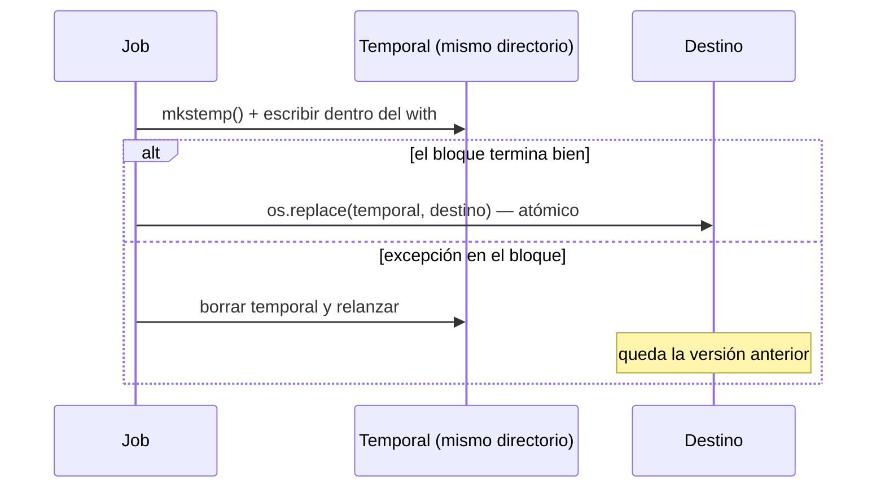

## 1. Resumen

Un context manager es un objeto que prepara algo al entrar a un bloque `with` y lo deshace al salir, **haya o no una excepción**. Archivos, conexiones, locks y archivos temporales se usan así para que nunca queden abiertos o a medias.

En pipelines hay tres usos que conviene dominar:

- `with open(...)`;
- escribir uno propio con `@contextmanager`, por ejemplo una escritura atómica: temporal más `os.replace`;
- `ExitStack` para abrir un número variable de recursos.

## 2. Qué es

Es cualquier objeto con dos métodos:

- `__enter__()`: se llama al entrar. Lo que devuelve queda en la variable del `as`.
- `__exit__(exc_type, exc_value, traceback)`: se llama al salir, con la excepción si la hubo. Si devuelve verdadero, la excepción se suprime; si no, sigue propagándose.

`contextlib` permite escribirlos sin clase. Con `@contextmanager`, el código antes del `yield` es la entrada y el de después es la salida. También ofrece utilidades: `ExitStack`, `suppress` y `closing`.

## 3. Problema que resuelve

Sin `with`, liberar un recurso exige un `try`/`finally` en cada uso, y es fácil olvidarlo en el camino del error. En un pipeline, esto deja:

- archivos abiertos;
- conexiones que se agotan;
- temporales que llenan el disco;
- archivos de salida escritos a medias que el siguiente paso lee como si estuvieran completos.

El context manager centraliza la limpieza en un solo lugar.

## 4. Cómo funciona

1. `with EXPR as x:` evalúa `EXPR`, obtiene el manager y llama a `__enter__()`. El resultado se asigna a `x`.
2. Se ejecuta el bloque.
3. Al salir, normalmente o por excepción, se llama a `__exit__`. Si hubo excepción y `__exit__` no devuelve verdadero, la excepción sigue su camino.
4. Con `@contextmanager`:
   - el `yield` entrega el valor del `as`;
   - si el bloque lanza una excepción, esta se relanza **en el punto del `yield`**, así que se maneja con `try`/`except`/`finally` alrededor del `yield`;
   - el objeto creado es de un solo uso.
5. `ExitStack` registra managers con `enter_context()` y callbacks con `callback()`. Al salir los cierra en orden inverso, aunque uno falle.

## 5. Cuándo utilizarlo

- Siempre para archivos, conexiones a bases de datos, sesiones HTTP y locks.
- Para operaciones "todo o nada" sobre archivos: escribir en un temporal y renombrar solo si el bloque terminó bien.
- Para cambios temporales de estado (directorio de trabajo, variables de entorno en tests) que deben revertirse.
- `ExitStack` cuando la cantidad de recursos se conoce en ejecución (abrir N archivos de partición).

## 6. Cuándo no utilizarlo

- Para suprimir errores de forma amplia: `suppress(Exception)` esconde fallos reales. Solo con excepciones específicas y esperadas (`suppress(FileNotFoundError)` al borrar un temporal).
- Para recursos que deben vivir todo el proceso (un pool de conexiones de la aplicación): se cierran en el ciclo de vida de la aplicación, no en cada bloque.
- Para transacciones de base de datos: usar el manejo de transacciones del driver o del motor, que sabe hacer commit y rollback.

## 7. Ejemplo sencillo

```python
from pathlib import Path

ruta = Path("salida.txt")
with ruta.open("w", encoding="utf-8") as f:
    f.write("hola\n")
print(f.closed)   # True: el archivo se cerró al salir del bloque
```

## 8. Ejemplo de producción

Un job escribe cada noche `clientes.csv`, que otro proceso lee a las 6:00. Si el job falla a mitad de la escritura, el lector no debe ver un archivo truncado. El job escribe con `escritura_atomica()`:

1. crea un temporal en el **mismo directorio**;
2. escribe ahí;
3. si el bloque termina bien, lo renombra con `os.replace`; si falla, borra el temporal.

El lector ve la versión de ayer o la de hoy completa, nunca una mezcla. Re-ejecutar el job no deja temporales huérfanos.

## 9. Arquitectura



## 10. Código

```python
# Python 3.12 (ejecutado; mypy --strict sin errores): escritura atómica como context manager y ExitStack.
import os
import tempfile
from collections.abc import Iterator
from contextlib import ExitStack, contextmanager
from pathlib import Path
from typing import TextIO


@contextmanager
def escritura_atomica(destino: Path) -> Iterator[TextIO]:
    """Escribe en un temporal del mismo directorio y lo renombra solo si el bloque terminó bien."""
    fd, temporal = tempfile.mkstemp(dir=destino.parent, suffix=".tmp")
    try:
        with os.fdopen(fd, "w", encoding="utf-8", newline="") as f:
            yield f
        os.replace(temporal, destino)      # si tiene éxito, el renombrado es atómico (POSIX); puede fallar entre sistemas de archivos
    except BaseException:
        Path(temporal).unlink(missing_ok=True)
        raise


base = Path(tempfile.mkdtemp())
destino = base / "ventas.csv"
destino.write_text("version anterior\n", encoding="utf-8")

try:
    with escritura_atomica(destino) as f:
        f.write("id,monto\n")
        raise RuntimeError("falló a mitad de la escritura")
except RuntimeError:
    pass
print(destino.read_text(encoding="utf-8").strip(), sorted(p.name for p in base.iterdir()))
# version anterior ['ventas.csv']: el destino no quedó a medias y no quedó el temporal

with escritura_atomica(destino) as f:
    f.write("id,monto\nv1,10\n")
print(destino.read_text(encoding="utf-8").splitlines())   # ['id,monto', 'v1,10']

partes = [base / f"parte_{i}.txt" for i in range(3)]
with ExitStack() as pila:                                  # cierra todos aunque falle uno a mitad
    archivos = [pila.enter_context(p.open("w", encoding="utf-8")) for p in partes]
    for i, a in enumerate(archivos):
        a.write(f"parte {i}\n")
print(all(not a.closed for a in archivos), [p.read_text(encoding="utf-8").strip() for p in partes])
# False ['parte 0', 'parte 1', 'parte 2']
```

Aquí `except BaseException` es correcto porque **no suprime** nada: borra el temporal y relanza, así que también limpia si el proceso se interrumpe con Ctrl+C. La documentación de `os.replace` dice que, si tiene éxito, el renombrado es una operación atómica (requisito de POSIX), y que puede fallar si origen y destino están en sistemas de archivos distintos. Por eso el temporal se crea en `destino.parent`. El ejemplo se ejecutó en Windows (NTFS); esa ejecución no es la garantía de la documentación.

## 11. GCP

No aplica de forma específica: `with` y `contextlib` son del lenguaje. La escritura atómica con `os.replace` vale para el sistema de archivos local del proceso. Las diferencias del sistema de archivos local por runtime están en `python-file-handling`.

## 12. AWS

No aplica de forma específica (ver §11 y `python-file-handling`).

## 13. Azure

No aplica de forma específica (ver §11 y `python-file-handling`).

## 14. Buenas prácticas

- `with` para todo recurso que se abre; nunca depender de que el recolector de basura cierre archivos o conexiones.
- En `@contextmanager`, rodear el `yield` con `try`/`finally` (o `except ...: limpiar; raise`) para que la limpieza corra también con excepciones.
- Temporal en el mismo directorio que el destino, para que `os.replace` no falle por estar en sistemas de archivos distintos.
- `suppress` solo con excepciones específicas.
- **Seguridad:** `mkstemp` crea el temporal sin condiciones de carrera y legible solo por el usuario que lo crea; no armar nombres de temporales a mano en directorios compartidos, y borrar los temporales que puedan contener datos sensibles también en el camino del error.
- **Observabilidad:** si el `__exit__` o el bloque de limpieza falla, registrar ese fallo sin ocultar la excepción original; un temporal huérfano o una conexión sin cerrar es una señal de un camino de error sin limpieza.
- **Costo:** recursos que no se cierran (conexiones, archivos temporales) se acumulan en procesos de larga vida y obligan a reiniciar o a pagar más memoria y disco; el `with` lo evita sin costo adicional.

## 15. Errores frecuentes

- Abrir sin `with` y cerrar solo en el camino feliz.
- `@contextmanager` sin `try` alrededor del `yield`: si el bloque falla, el código de limpieza después del `yield` no se ejecuta.
- Reutilizar el objeto de un `@contextmanager` en un segundo `with`: `RuntimeError`.
- Crear el temporal en `/tmp` y renombrarlo a otro disco o volumen: `os.replace` puede fallar si origen y destino están en sistemas de archivos distintos.
- `__exit__` que devuelve `True` sin querer y suprime todas las excepciones.

## 16. Trade-offs

La escritura atómica duplica el espacio en disco durante la escritura (temporal más versión anterior) y agrega un renombrado, a cambio de que nadie lea un archivo a medias. `@contextmanager` es más corto que una clase con `__enter__`/`__exit__`, pero de un solo uso y algo más difícil de extender. `ExitStack` resuelve cantidades variables de recursos, a costa de un flujo menos visible que varios `with` anidados.

## 17. Conceptos relacionados

- `python-file-handling`: el uso más común de `with`.
- `python-exceptions`: cómo se propagan los errores a través del `with`.
- `python-generators`: base de `@contextmanager`.
- `idempotency`: re-ejecutar sin dejar estado intermedio.

## 18. Preguntas técnicas abiertas

1. ¿Qué recursos de tu pipeline se abren hoy sin `with` y qué pasa con ellos cuando hay un error?
2. ¿Cómo harías atómica la publicación de un conjunto de archivos (varias particiones), no solo de uno?
3. ¿Cuándo un `__exit__` debería suprimir una excepción, si es que alguna vez debería?

## 19. Laboratorio relacionado

Pendiente (F4).

## 20. Fuentes

- Python: *Compound statements* y *Data model* (referencia del lenguaje), *contextlib*, *os* y *tempfile*.

El detalle de cada fuente está en `sources` del frontmatter.

## 21. Fecha de última verificación

2026-10-08. Pasa a `verified`: revisión B-F3.1 del lote F3b-03a aplicada, sin VERIFY pendientes.

## 22. Historial de cambios importantes

- 2026-10-08: creación (lote F3b-03a).
- 2026-10-08: revisión B-F3.1 del lote F3b-03a aplicada (docs/reviews/cards-f3b-03a.md): la documentación de Python se cita en `/3.12/`, la versión con la que se ejecutó el código; `os.replace` con la frase de la documentación (atómico si tiene éxito, requisito de POSIX; puede fallar entre sistemas de archivos), sin «deja de ser atómico»; se quita la frase de Cloud Storage.
- 2026-10-08: `verification_status: verified` (sin VERIFY pendientes).
- 2026-10-13: `page_title` en cada cita, con el título de la página citada (ADR-012); sin cambios de contenido.
