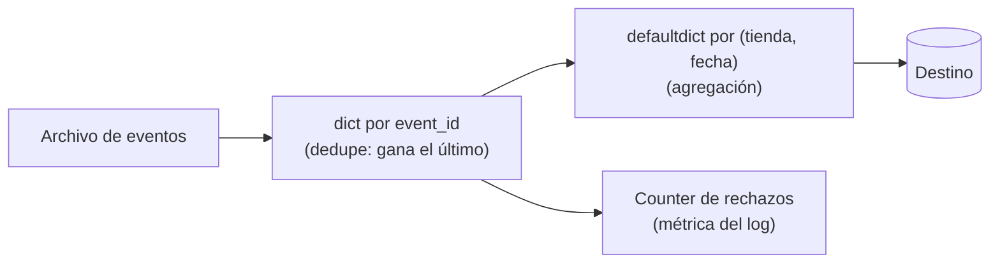

## 1. Resumen

Casi todo el código de un pipeline en Python mueve datos entre cuatro estructuras: `list`, `tuple`, `dict` y `set`, más algunas de `collections` (`deque`, `Counter`, `defaultdict`). Elegir bien cambia el costo de las operaciones y la claridad del código:

- `dict` para buscar por clave;
- `set` para pertenencia y duplicados;
- `list` para secuencias ordenadas;
- `tuple` para registros inmutables y claves compuestas.

## 2. Qué es

- **list:** secuencia mutable y ordenada. Agregar al final es barato; insertar o sacar del principio no lo es.
- **tuple:** secuencia inmutable. Si contiene solo valores inmutables, sirve como clave de un `dict` o elemento de un `set`.
- **dict:** mapeo de claves hashables a valores. **Conserva el orden de inserción**: actualizar una clave no la mueve, y una clave borrada y vuelta a agregar queda al final.
- **set:** colección no ordenada de elementos hashables distintos.
- **collections:**
  - `deque` es una cola doble con operaciones en ambos extremos de costo aproximadamente O(1), y puede ser acotada con `maxlen`.
  - `Counter` cuenta ocurrencias.
  - `defaultdict` crea el valor que falta al primer acceso.

## 3. Problema que resuelve

Los errores típicos de rendimiento en scripts de datos vienen de la estructura equivocada, no del algoritmo:

- buscar en una lista con `in` dentro de un bucle (recorre la lista cada vez);
- usar `list.pop(0)` como cola (mueve todos los elementos);
- deduplicar con listas anidadas.

La estructura correcta resuelve estos casos sin código extra.

## 4. Cómo funciona

1. **Hashable:** `dict` y `set` ubican cada elemento por su hash. Por eso sus claves deben ser hashables: números, cadenas y tuplas de valores inmutables sí; listas y dicts no.
2. **Orden:** el `dict` itera en orden de inserción. El `set` no garantiza ningún orden: si la salida debe ser estable, hay que ordenarla (`sorted`).
3. **Último gana:** asignar dos veces la misma clave en un `dict` deja el último valor sin cambiar la posición de la clave. Es la base de una deduplicación "gana el registro más reciente".
4. **Extremos:** `deque.append`/`appendleft`/`pop`/`popleft` son aproximadamente O(1). En `list`, `pop(0)` e `insert(0, v)` son O(n).
5. **Copias:** `list.copy()`, `dict.copy()` y `seq[:]` son copias superficiales: los objetos internos se comparten.

## 5. Cuándo utilizarlo

- `dict` para índices en memoria (clave de negocio → registro), lookups de dimensiones pequeñas y agregaciones por clave.
- `set` para "¿ya vi este id?" y para comparar conjuntos de claves entre origen y destino.
- `tuple` como clave compuesta (`(tienda, fecha)`) y para registros que no deben cambiar.
- `deque(maxlen=n)` para ventanas de los últimos n eventos.
- `Counter` para perfiles rápidos (conteo por estado o por código de error).

## 6. Cuándo no utilizarlo

- Cuando los datos no caben en memoria: estas estructuras viven en la RAM del proceso. Para volúmenes grandes, procesar en flujo (ver `python-generators`) o usar un motor (SQL, DataFrames).
- Cuando un `dict` representa un registro con campos fijos y tipos conocidos: una dataclass o un modelo de validación documenta y protege mejor la forma.
- Para análisis tabular con muchas columnas y operaciones vectorizadas: una biblioteca de DataFrames es más clara y eficiente (pendiente de ficha: `python-dataframes`).

## 7. Ejemplo sencillo

```python
eventos = [{"id": "e1", "v": 1}, {"id": "e2", "v": 1}, {"id": "e1", "v": 2}]
ultimo_por_id = {e["id"]: e for e in eventos}   # gana el último; el orden es el de la primera aparición
print(list(ultimo_por_id))                      # ['e1', 'e2']
print(ultimo_por_id["e1"]["v"])                 # 2
```

## 8. Ejemplo de producción

Un job de ingesta recibe archivos de eventos de varias tiendas, con reenvíos. Antes de cargar:

1. deduplica por `event_id` con un `dict` (gana la versión más reciente);
2. agrega montos por `(tienda, fecha)` con un `defaultdict(int)`;
3. lleva un `Counter` de motivos de rechazo para el log de la ejecución;
4. guarda en un `deque(maxlen=100)` los últimos ids procesados, para diagnosticar dónde se detuvo.

El volumen por archivo es de miles de filas, así que todo cabe en memoria. Si fuera de millones, el mismo diseño se movería a SQL.

## 9. Arquitectura



## 10. Código

```python
# Python 3.12 (ejecutado; mypy --strict sin errores): deduplicar, filtrar, agregar por clave compuesta y contar.
from collections import Counter, defaultdict, deque

eventos = [
    {"id": "e1", "tienda": "T1", "dia": "2026-10-07", "monto": 100},
    {"id": "e2", "tienda": "T2", "dia": "2026-10-07", "monto": 40},
    {"id": "e1", "tienda": "T1", "dia": "2026-10-07", "monto": 120},  # reenvío del mismo id
    {"id": "e3", "tienda": "T1", "dia": "2026-10-08", "monto": 60},
]

# dict: la última versión de cada id gana; conserva el orden de inserción de la primera aparición.
ultimo: dict[str, dict[str, object]] = {}
for e in eventos:
    ultimo[str(e["id"])] = e

# set: pertenencia para filtrar ids ya cargados.
ya_cargados = {"e3"}
nuevos = [e for e in ultimo.values() if e["id"] not in ya_cargados]

# tupla como clave compuesta (hashable): total por (tienda, día).
totales: defaultdict[tuple[str, str], int] = defaultdict(int)
for e in nuevos:
    totales[(str(e["tienda"]), str(e["dia"]))] += int(str(e["monto"]))

# Counter: frecuencia; deque con maxlen: los últimos N ids vistos.
por_tienda = Counter(str(e["tienda"]) for e in eventos)
recientes: deque[str] = deque(maxlen=2)
for e in eventos:
    recientes.append(str(e["id"]))

print(list(ultimo))            # ['e1', 'e2', 'e3']
print(dict(totales))           # {('T1', '2026-10-07'): 120, ('T2', '2026-10-07'): 40}
print(por_tienda.most_common(1), list(recientes))   # [('T1', 3)] ['e1', 'e3']
```

Los valores del registro se anotan como `object` porque vienen de un dict genérico; por eso se convierten con `str()` antes de usarlos. Un registro tipado (ver `python-typing` y `python-classes`) evita esas conversiones. `dict` y `set` conservan su ventaja mientras los datos caben en memoria.

## 11. GCP

No aplica de forma específica: son estructuras del lenguaje y se comportan igual en cualquier runtime de Python. Lo que cambia por plataforma es cuánta memoria tiene el proceso, que limita cuántos datos caben en estas estructuras.

## 12. AWS

No aplica de forma específica (ver §11).

## 13. Azure

No aplica de forma específica (ver §11).

## 14. Buenas prácticas

- Elegir la estructura por la operación dominante: búsqueda por clave → `dict`; pertenencia → `set`; orden y posición → `list`.
- Claves compuestas como tuplas de valores inmutables, no como cadenas concatenadas (evita colisiones del tipo `"a_b" + "c"` vs `"a" + "b_c"`).
- Ordenar explícitamente cualquier salida que venga de un `set` antes de escribirla o compararla en tests.
- Anotar el contenido (`dict[str, Pedido]`) para que el tipo documente la intención.
- **Seguridad:** no guardar secretos ni datos personales en estructuras globales que luego se vuelcan enteras en logs o mensajes de error; registrar conteos y claves, no registros completos.
- **Observabilidad:** un `Counter` de motivos de rechazo o de estados por ejecución es una métrica barata que conviene registrar al cierre de cada lote.
- **Costo:** todo lo que se carga en estas estructuras ocupa memoria del proceso; en servicios que cobran por memoria asignada, cargar el archivo completo puede obligar a pedir más memoria que procesarlo en flujo.

## 15. Errores frecuentes

- `if x in lista` dentro de un bucle sobre otra lista grande: O(n·m) en lugar de O(n) con un `set`.
- Usar `list.pop(0)` como cola: cada llamada mueve todos los elementos; `deque.popleft()` no.
- Asumir orden en un `set` (tests que pasan en una máquina y fallan en otra).
- Usar una lista o un dict como clave: `TypeError: unhashable type`.
- Creer que `.copy()` copia los objetos internos: es superficial; modificar un dict interno se ve en ambas copias.

## 16. Trade-offs

`dict` y `set` cambian memoria por velocidad de búsqueda: guardan la tabla de hash además de los datos. Las tuplas protegen contra cambios accidentales pero obligan a crear un registro nuevo para "modificarlo". Las estructuras en memoria son simples y rápidas para miles o cientos de miles de filas. Más allá de eso, el límite es la RAM y conviene un motor que trabaje fuera de memoria o en flujo.

## 17. Conceptos relacionados

- `python-comprehensions`: construir estas estructuras en una expresión.
- `python-typing` y `python-classes`: describir y proteger la forma de los registros.
- `python-generators`: procesar en flujo cuando no cabe en memoria.
- `deduplication`: el patrón general, más allá de la memoria del proceso.
- Del blueprint, pendiente de ficha: `python-dataframes`.

## 18. Preguntas técnicas abiertas

1. ¿Con qué estructura deduplicarías por clave conservando la primera aparición en lugar de la última, y qué cambia en el código?
2. ¿Cuántas filas tendría que tener un archivo para que ya no te sirva un `dict` en memoria en el runtime donde corre tu job?
3. ¿Cuándo preferirías una tupla con nombre (`namedtuple`) a una dataclass para representar un registro?

## 19. Laboratorio relacionado

Pendiente (F4).

## 20. Fuentes

- Python: *Data Structures* (tutorial), *Built-in Types* y *collections — Container datatypes*.

El detalle de cada fuente está en `sources` del frontmatter.

## 21. Fecha de última verificación

2026-10-08. Pasa a `verified`: revisión B-F3.1 del lote F3b-03a aplicada, sin VERIFY pendientes.

## 22. Historial de cambios importantes

- 2026-10-08: creación (lote F3b-03a).
- 2026-10-08: revisión B-F3.1 del lote F3b-03a aplicada (docs/reviews/cards-f3b-03a.md): la documentación de Python se cita en `/3.12/`, la versión con la que se ejecutó el código.
- 2026-10-08: `verification_status: verified` (sin VERIFY pendientes).
