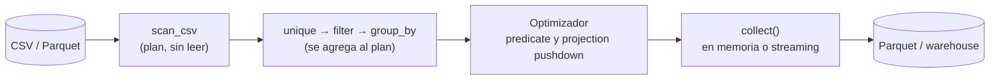

## 1. Resumen

Un DataFrame es una tabla en memoria con columnas tipadas y operaciones vectorizadas: filtrar, agrupar, unir y calcular sin escribir bucles. En Python, las dos bibliotecas principales son:

- **pandas:** la más usada. La versión 3.0 trae Copy-on-Write y un tipo `str` por defecto.
- **Polars:** usa Arrow en memoria y tiene un modo **lazy** que optimiza la consulta antes de leer los datos.

Ambas trabajan en una sola máquina. Para volúmenes que no caben ahí, Spark u otro motor.

## 2. Qué es

- **DataFrame:** colección de columnas del mismo largo, cada una con un tipo.
- **pandas:**
  - DataFrame con índice;
  - operaciones eager (se ejecutan al llamarlas);
  - desde 3.0, Copy-on-Write: modificar un objeto derivado no modifica el original, y la asignación encadenada (`df["a"][0] = 1`) ya no funciona; se usa `loc`.
- **Polars:**
  - sin índice;
  - expresiones (`pl.col("monto").sum()`);
  - dos modos: eager (`read_csv`) y lazy (`scan_csv` → plan → `collect`). En lazy, el planificador aplica predicate pushdown (filtra al leer) y projection pushdown (lee solo las columnas usadas).

## 3. Problema que resuelve

Limpiar y agregar unos millones de filas con bucles de Python es lento y verboso. El DataFrame expresa la operación por columnas, en código nativo, y trae lectores y escritores para CSV, JSON, Parquet y bases de datos. Es la herramienta habitual para transformaciones de tamaño medio, para validar y perfilar datos, y para preparar cargas.

## 4. Cómo funciona

1. **Lectura:**
   - fijar columnas (`usecols`) y tipos (`dtype`) evita inferencias costosas o erróneas, como ceros a la izquierda perdidos o montos como `float`;
   - en pandas 3.0, el texto se infiere como `str`, respaldado por PyArrow si está instalado.
2. **Transformación:**
   - en pandas cada paso se ejecuta al llamarlo y crea un objeto nuevo (Copy-on-Write evita copias innecesarias);
   - en Polars lazy, los pasos se acumulan en un plan.
3. **Ejecución en Polars lazy:** `collect()` optimiza el plan (pushdowns, orden de operaciones) y lo ejecuta en paralelo. Con `engine="streaming"`, procesa por lotes datos que no caben en memoria.
4. **Memoria:** todo lo que no es streaming vive en la RAM del proceso. Leer menos columnas, tipos más compactos y procesar por partes (`chunksize` en pandas) son las palancas.

## 5. Cuándo utilizarlo

- Transformaciones batch de miles a decenas de millones de filas en un job de Python.
- Validación y perfilado de archivos antes de cargarlos.
- Preparación de datos para cargar a un warehouse o para un modelo.
- Polars lazy cuando la entrada es grande y solo se necesitan algunas columnas o filas.

## 6. Cuándo no utilizarlo

- Cuando los datos ya están en un warehouse y la transformación es SQL: llevarlos a un DataFrame agrega movimiento de datos y memoria.
- Para volúmenes que no caben en la máquina ni en streaming: Spark u otro motor distribuido (ver `pyspark-dataframes`).
- Para procesar pocas filas con lógica simple: una lista de dicts basta (ver `python-data-structures`).
- Para lógica fila a fila con muchas ramas: `apply` con funciones de Python pierde la ventaja vectorizada.

## 7. Ejemplo sencillo

```python
import pandas as pd

df = pd.DataFrame({"tienda": ["T1", "T2", "T1"], "monto": [100, 40, 20]})
print(df.groupby("tienda", as_index=False)["monto"].sum().to_dict("records"))
# [{'tienda': 'T1', 'monto': 120}, {'tienda': 'T2', 'monto': 40}]
```

## 8. Ejemplo de producción

Un job diario recibe un CSV de 3 millones de filas de ventas con reenvíos. Lo lee con Polars en modo lazy, con solo las cinco columnas necesarias. Deduplica por `venta_id` (gana la última), filtra las pagadas, agrega por tienda y escribe Parquet. El plan lee solo esas columnas y aplica el filtro al leer. El proceso corre en un contenedor con memoria fija, y si un día el archivo crece más de lo previsto, el mismo plan se ejecuta con `engine="streaming"`.

## 9. Arquitectura



## 10. Código

```python
# Python 3.12, pandas 3.0.6 y Polars 2.0.0 (ejecutado): la misma limpieza y agregación en las dos bibliotecas.
import tempfile
from pathlib import Path

import pandas as pd
import polars as pl

ruta = Path(tempfile.mkdtemp()) / "ventas.csv"
ruta.write_text(
    "venta_id,tienda,fecha,monto,estado\n"
    "v1,T1,2026-10-07,100,pagado\n"
    "v2,T2,2026-10-07,40,pagado\n"
    "v1,T1,2026-10-07,120,pagado\n"          # reenvío corregido de v1
    "v3,T1,2026-10-08,,anulado\n"
    "v4,T2,2026-10-08,75,pagado\n",
    encoding="utf-8",
)

# pandas: lectura con columnas y tipos explícitos; Copy-on-Write es el modo por defecto en 3.0.
ventas = pd.read_csv(ruta, usecols=["venta_id", "tienda", "fecha", "monto", "estado"],
                     dtype={"monto": "Int64"}, parse_dates=["fecha"])
ultimas = ventas.drop_duplicates("venta_id", keep="last")
pagadas = ultimas.loc[ultimas["estado"] == "pagado"]
por_tienda_pd = pagadas.groupby("tienda", as_index=False).agg(total=("monto", "sum"), ventas=("venta_id", "count"))
print(por_tienda_pd.to_dict("records"))
# [{'tienda': 'T1', 'total': 120, 'ventas': 1}, {'tienda': 'T2', 'total': 115, 'ventas': 2}]
print(ventas.dtypes["tienda"], ventas.dtypes["monto"])   # str Int64

# Polars, modo lazy: el plan se optimiza antes de leer (solo las columnas y filas necesarias).
consulta = (
    pl.scan_csv(ruta, try_parse_dates=True)
    .unique(subset="venta_id", keep="last", maintain_order=True)
    .filter(pl.col("estado") == "pagado")
    .group_by("tienda")
    .agg(total=pl.col("monto").sum(), ventas=pl.col("venta_id").count())
    .sort("tienda")
)
por_tienda_pl = consulta.collect()
print(por_tienda_pl.to_dicts())
# [{'tienda': 'T1', 'total': 120, 'ventas': 1}, {'tienda': 'T2', 'total': 115, 'ventas': 2}]
print(por_tienda_pd.to_dict("records") == por_tienda_pl.to_dicts())   # True
```

Las dos versiones dan el mismo resultado. En pandas, `monto` se lee como `Int64` (entero con nulos) y no como `float`. La columna `tienda` sale como `str`, el tipo de texto por defecto de pandas 3.0. Ejecutado con pandas 3.0.6 y Polars 2.0.0 en el entorno de pruebas. No se pasó por `mypy --strict`, porque el resultado depende de los stubs de cada biblioteca.

## 11. GCP

Para leer tablas grandes de BigQuery hacia un DataFrame sin exportarlas, la **BigQuery Storage Read API** entrega los datos de una sesión serializados en Apache Avro o Apache Arrow. Arrow es el mismo formato en memoria que usa Polars (ver `arrow-columnar-memory`).

## 12. AWS

En **Lambda**, la memoria se configura entre 128 MB y 10,240 MB y la CPU se asigna en proporción a ella: con 1,769 MB, la función tiene el equivalente a una vCPU. Un DataFrame que necesita más memoria, o un procesamiento que aprovecha varios núcleos, obliga a subir la memoria configurada aunque los datos no la necesiten.

## 13. Azure

Esta ficha no cita una fuente de Azure específica para DataFrames: pandas y Polars se comportan igual en cualquier runtime de Python. Los límites del sistema de archivos local por plataforma están en `python-file-handling`.

## 14. Buenas prácticas

- Leer solo las columnas necesarias y con tipos explícitos.
- Polars lazy (`scan_*` + `collect`) para entradas grandes; revisar el plan con `explain()`.
- En pandas 3.0, usar `loc` para asignar; no depender de la asignación encadenada.
- Tipos con nulos explícitos (`Int64` en pandas) para no convertir enteros en flotantes.
- Probar las transformaciones con DataFrames pequeños construidos en el test.
- **Seguridad:** al exportar para terceros, revisar qué columnas salen (datos personales) y no escribir columnas completas a logs o mensajes de error al depurar.
- **Observabilidad:** registrar filas de entrada, filas descartadas en cada filtro y filas de salida; un `drop_duplicates` o un join que cambian el conteo sin aviso son la fuente típica de pérdidas silenciosas.
- **Costo:** la memoria del proceso es el límite: en servicios que cobran por memoria asignada, leer menos columnas o usar streaming permite instancias más pequeñas.

## 15. Errores frecuentes

- Dejar que `read_csv` infiera tipos: códigos con ceros a la izquierda convertidos en números, montos con nulos como `float`.
- Asignación encadenada en pandas 3.0: no modifica el DataFrame.
- `apply` con una función de Python por fila sobre millones de filas.
- Joins que multiplican filas por claves duplicadas en la dimensión.
- Cargar el archivo entero en pandas cuando solo se necesitaban tres columnas.

## 16. Trade-offs

pandas tiene el ecosistema más grande y una API conocida, y ejecuta cada paso al llamarlo (eager). Polars optimiza y paraleliza, y su modo streaming supera la memoria disponible. A cambio, su API es distinta y menos integrada con algunas bibliotecas. Ambas son más simples que un motor distribuido y quedan limitadas a una máquina.

## 17. Conceptos relacionados

- `arrow-columnar-memory`: el formato en memoria de Polars.
- `pyspark-dataframes`: DataFrames distribuidos.
- `deduplication` y `data-transformation`: lo que hace el ejemplo.
- `python-data-structures`: la alternativa sin dependencias.
- `python-file-processing`: procesar carpetas de archivos antes o en lugar de un DataFrame.
- `row-vs-columnar-formats`: por qué los formatos columnares encajan con DataFrames.

## 18. Preguntas técnicas abiertas

1. ¿Qué volumen de entrada te haría pasar de pandas a Polars lazy, y de Polars a un motor distribuido?
2. ¿Cómo verificarías que una migración de pandas a Polars produce exactamente el mismo resultado?
3. ¿Qué tipos de columna fijarías siempre al leer los archivos de tu fuente principal?

## 19. Laboratorio relacionado

Pendiente (F4).

## 20. Fuentes

- pandas 3.0: *Copy-on-Write*, *What's new in 3.0.0* y *Scaling to large datasets*.
- Polars: *Lazy API*, *Streaming* y *Coming from pandas*.
- Google Cloud: *BigQuery Storage Read API*.
- AWS: *Configure Lambda function memory*.

El detalle de cada fuente está en `sources` del frontmatter.

## 21. Fecha de última verificación

2026-10-09. Pasa a `verified`: revisión B-F3.1 del lote F3b-03b aplicada, sin VERIFY pendientes.

## 22. Historial de cambios importantes

- 2026-10-08: creación (lote F3b-03b).
- 2026-10-09: revisión B-F3.1 del lote F3b-03b aplicada (docs/reviews/cards-f3b-03b.md): filas aprobadas sin cambios en esta ficha.
- 2026-10-09: `verification_status: verified` (sin VERIFY pendientes).
- 2026-10-13: `page_title` en cada cita, con el título de la página citada (ADR-012); sin cambios de contenido.
