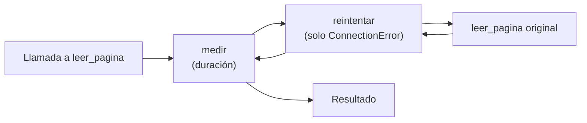

## 1. Resumen

Un decorador es una función que recibe una función y devuelve otra, aplicada con `@`. Sirve para agregar comportamiento transversal sin tocar el cuerpo de cada función: medir, registrar, reintentar, cachear. Hay dos reglas que evitan casi todos los problemas:

- `functools.wraps`, para que la función decorada conserve nombre y documentación;
- `ParamSpec`, para que conserve la firma ante mypy.

Bien usados, reducen código repetido. Usados en exceso, esconden lo que pasa en cada llamada.

## 2. Qué es

- `@decorador` sobre `def f` equivale a `f = decorador(f)`. Se evalúa una vez, al definir la función.
- **Decorador con parámetros:** `@reintentar(intentos=3)` llama primero a `reintentar(...)`, que devuelve el decorador real.
- **Varios decoradores:** se aplican de abajo hacia arriba. El más cercano a `def` envuelve primero.
- **Biblioteca estándar:**
  - `functools.wraps` copia nombre, docstring y otros atributos, y deja la original en `__wrapped__`;
  - `functools.cache` y `lru_cache` memoizan resultados;
  - `property`, `staticmethod` y `classmethod` son decoradores de clases.

## 3. Problema que resuelve

En un pipeline, muchas funciones necesitan lo mismo alrededor de su lógica: registrar cuánto tardan, reintentar errores transitorios, contar llamadas, cachear consultas a una dimensión pequeña. Copiar ese código en cada función lo duplica y lo desincroniza. Un decorador lo escribe una vez y lo aplica con una línea.

## 4. Cómo funciona

1. Python ejecuta `def f`, crea la función y llama al decorador con ella.
2. El decorador define una **envoltura** que recibe `*args, **kwargs`, hace algo antes y después, y llama a la función original.
3. El nombre `f` pasa a apuntar a la envoltura. Sin `wraps`, `f.__name__` sería el de la envoltura y se perdería la docstring.
4. Con `ParamSpec` (`Callable[P, R] -> Callable[P, R]`), mypy sabe que la envoltura acepta los mismos parámetros que la original.
5. **`functools.cache`:**
   - guarda en un diccionario el resultado por argumentos, que por eso deben ser hashables;
   - es un caché sin límite: cada combinación de argumentos queda en memoria hasta `cache_clear()` o el fin del proceso.

## 5. Cuándo utilizarlo

- Medición y logging uniformes de funciones de extracción o carga.
- Reintentos acotados de llamadas a servicios externos, con errores explícitos.
- Memoizar consultas puras a datos pequeños y estables dentro de una ejecución (región por tienda).
- Registro de funciones en un catálogo (por ejemplo, transformaciones disponibles por nombre).

## 6. Cuándo no utilizarlo

- Para lógica de negocio central: si el decorador cambia qué devuelve la función, quien la lea no lo verá.
- Para cachear datos que cambian durante la ejecución, o con argumentos sin límite de valores: `cache` crece sin tope.
- Apilando muchos decoradores en una función: el orden importa y depurar se vuelve difícil.
- Cuando basta una función que recibe otra función como parámetro y es más explícita.

## 7. Ejemplo sencillo

```python
import functools
from collections.abc import Callable


def anunciar(func: Callable[[int], int]) -> Callable[[int], int]:
    @functools.wraps(func)
    def envoltura(n: int) -> int:
        print(f"llamando a {func.__name__}")
        return func(n)
    return envoltura


@anunciar
def doble(n: int) -> int:
    return n * 2


print(doble(4), doble.__name__)   # llamando a doble / 8 doble
```

## 8. Ejemplo de producción

En un job de ingesta, `@medir` envuelve cada etapa (`extraer`, `transformar`, `cargar`) y registra su duración con el `run_id`. Las llamadas a la API externa llevan `@reintentar(intentos=3, errores=(ConnectionError,))`, que solo reintenta errores de conexión. Un 400 o un error de validación sale a la primera. La región de cada tienda viene de una función con `@functools.cache`: dentro de una ejecución se consulta una sola vez por tienda, y el caché muere con el proceso.

## 9. Arquitectura



## 10. Código

```python
# Python 3.12 (ejecutado; mypy --strict sin errores): decorador con wraps, decorador con parámetros y caché.
import functools
import time
from collections.abc import Callable
from typing import ParamSpec, TypeVar

P = ParamSpec("P")
R = TypeVar("R")
llamadas: list[str] = []


def medir(func: Callable[P, R]) -> Callable[P, R]:
    """Registra nombre y duración de cada llamada, sin cambiar la firma de la función."""
    @functools.wraps(func)                     # conserva __name__, __doc__ y __wrapped__
    def envoltura(*args: P.args, **kwargs: P.kwargs) -> R:
        inicio = time.perf_counter()
        try:
            return func(*args, **kwargs)
        finally:
            llamadas.append(f"{func.__name__} {time.perf_counter() - inicio:.3f}s")
    return envoltura


def reintentar(intentos: int, errores: tuple[type[Exception], ...]) -> Callable[[Callable[P, R]], Callable[P, R]]:
    """Decorador con parámetros: una función que devuelve el decorador."""
    def decorador(func: Callable[P, R]) -> Callable[P, R]:
        @functools.wraps(func)
        def envoltura(*args: P.args, **kwargs: P.kwargs) -> R:
            for intento in range(1, intentos + 1):
                try:
                    return func(*args, **kwargs)
                except errores:
                    if intento == intentos:
                        raise
            raise AssertionError("inalcanzable")
        return envoltura
    return decorador


fallos = iter([ConnectionError("timeout"), ConnectionError("timeout")])


@medir
@reintentar(intentos=3, errores=(ConnectionError,))
def leer_pagina(numero: int) -> list[int]:
    """Lee una página de la fuente (simulada: falla dos veces y luego responde)."""
    error = next(fallos, None)
    if error is not None:
        raise error
    return [numero * 10, numero * 10 + 1]


@functools.cache                                # memoiza: la segunda llamada no vuelve a calcular
def region_de(tienda: str) -> str:
    llamadas.append(f"consulta {tienda}")
    return {"T1": "norte", "T2": "sur"}.get(tienda, "desconocida")


print(leer_pagina(3), leer_pagina.__name__, leer_pagina.__doc__)
# [30, 31] leer_pagina Lee una página de la fuente (simulada: falla dos veces y luego responde).
print([region_de(t) for t in ["T1", "T2", "T1", "T1"]], region_de.cache_info().hits)   # ['norte', 'sur', 'norte', 'norte'] 2
print([c.split()[0] for c in llamadas])          # ['leer_pagina', 'consulta', 'consulta']
```

`@medir` está arriba, así que mide la llamada completa, incluidos los dos reintentos. Por eso hay una sola línea `leer_pagina` en `llamadas`. Con el orden inverso se registraría cada intento por separado. `region_de` solo consulta dos veces, una por tienda: las otras dos llamadas son aciertos del caché.

## 11. GCP

No aplica de forma específica: los decoradores son del lenguaje y se comportan igual en cualquier runtime de Python.

## 12. AWS

No aplica de forma específica (ver §11).

## 13. Azure

No aplica de forma específica (ver §11).

## 14. Buenas prácticas

- Siempre `functools.wraps` en la envoltura.
- Tipar con `ParamSpec` y `TypeVar` para conservar la firma.
- Decoradores que no cambian el resultado (medir, registrar), o que lo cambian de forma explícita y documentada (reintentar, cachear).
- Reintentos solo para errores transitorios y con un número máximo de intentos.
- `cache` solo para funciones puras con pocos valores de argumentos posibles; si no, `lru_cache(maxsize=...)`.
- **Seguridad:** un decorador de logging que registra `args` y `kwargs` puede escribir tokens o datos personales; registrar nombres de parámetros o valores seleccionados, no todo.
- **Observabilidad:** los decoradores son el lugar natural para medir duración, contar reintentos y registrar errores de forma uniforme; `cache_info()` muestra aciertos y fallos del caché.
- **Costo:** un caché que evita repetir una consulta a un servicio pagado por llamada ahorra costo; uno sin límite puede, en cambio, hacer crecer la memoria de un proceso de larga vida.

## 15. Errores frecuentes

- Olvidar `wraps`: logs y trazas con el nombre `envoltura` en lugar del de la función.
- Reintentar `Exception` en general: se repiten errores permanentes y se tarda más en fallar.
- `@functools.cache` en un método de instancia: `self` entra en la clave y mantiene viva la instancia.
- Decorador que traga excepciones y devuelve `None`.
- Confundir el orden de decoradores apilados.

## 16. Trade-offs

Los decoradores eliminan código repetido y hacen uniforme el comportamiento transversal. A cambio, agregan una capa invisible en el cuerpo de la función. La firma real, los errores que se reintentan y lo que se cachea quedan lejos de donde se lee la lógica. Para uno o dos usos, una llamada explícita suele ser más clara.

## 17. Conceptos relacionados

- `python-functions`: funciones como valores.
- `python-error-handling-and-retries`: qué errores reintentar.
- `python-logging`: qué registrar.
- `python-typing`: `ParamSpec` para conservar la firma.

## 18. Preguntas técnicas abiertas

1. ¿Qué comportamiento transversal se repite hoy en tus funciones de ingesta y valdría un decorador?
2. ¿Dónde pondrías el decorador de reintento respecto del de medición, y qué métrica querrías ver?
3. ¿Qué pasa con un `@functools.cache` en un proceso que vive días, como un worker o un servicio?

## 19. Laboratorio relacionado

Pendiente (F4).

## 20. Fuentes

- Python 3.12: *Glossary*, *Compound statements*, *functools* y *typing*.

El detalle de cada fuente está en `sources` del frontmatter.

## 21. Fecha de última verificación

2026-10-08. `review_required`: pendiente de revisión B-F3.1 del lote F3b-03b.

## 22. Historial de cambios importantes

- 2026-10-08: creación (lote F3b-03b).
