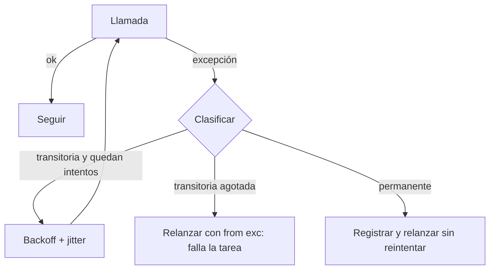

## 1. Resumen

En un pipeline en Python, manejar errores bien significa tres cosas: capturar solo las excepciones que se saben tratar, separar las transitorias (que vale la pena reintentar) de las permanentes (que no), y no perder la causa original al relanzar. Los SDK de las nubes ya traen reintentos configurables: conviene usarlos y no apilar otro bucle de reintento encima.

## 2. Qué es

Es la implementación en Python del patrón `retries`, con sus piezas propias del lenguaje:

- `try` / `except` con excepciones **específicas**, no `except Exception` para todo;
- `else` para el código que solo corre si no hubo error, y `finally` para liberar recursos;
- `raise ... from exc` para encadenar la causa cuando se transforma una excepción;
- una clasificación explícita de qué errores son transitorios;
- la configuración de reintentos de cada SDK (Boto3, google-api-core, Azure SDK).

## 3. Problema que resuelve

Dos fallos opuestos y frecuentes: el `except Exception: pass` que oculta errores de datos y deja el pipeline "verde" con resultados incompletos, y el bucle de reintentos propio que reintenta errores permanentes (credenciales, validación) o se suma a los reintentos del SDK y multiplica los intentos.

## 4. Cómo funciona

1. **Capturar lo específico.** La documentación de Python recomienda ser lo más específico posible con las excepciones que se manejan y dejar propagar las inesperadas. `except Exception` se usa, si acaso, para registrar y relanzar.
2. **Clasificar.** Transitorias: `TimeoutError`, `ConnectionError` (y sus subclases), HTTP 429 y 5xx. Permanentes: validación, 400, 401, 403, 404.
3. **Reintentar solo lo transitorio**, con backoff exponencial, jitter y límite (ver `retries`).
4. **Encadenar la causa** al relanzar: `raise ErrorDelPipeline("...") from exc` conserva el error original en el traceback.
5. **Delegar en el SDK** cuando existe: Boto3, google-api-core y el Azure SDK ya reintentan errores transitorios con backoff.

## 5. Cuándo utilizarlo

- Tareas de ingesta que llaman a APIs o servicios externos.
- Escrituras a servicios cloud mediante sus SDK.
- Cualquier tarea de pipeline que pueda fallar por red o por limitación de tasa.

## 6. Cuándo no utilizarlo

- Para esconder errores de datos: un registro inválido no se "reintenta", se registra y se aparta.
- Para reintentar operaciones no idempotentes sin clave de idempotencia.
- Cuando el orquestador ya reintenta la tarea completa: reintentar también dentro multiplica los intentos (por ejemplo, 3 × 3 = 9).

## 7. Ejemplo sencillo

Una función descarga un archivo por HTTP. Si hay `TimeoutError`, reintenta hasta 4 veces con esperas crecientes. Si hay un 404, falla de inmediato con un mensaje claro y la causa original encadenada.

## 8. Ejemplo de producción

Una tarea de Airflow lee de una API y escribe en S3 con Boto3. El cliente HTTP propio reintenta 429 y 5xx respetando el límite; el cliente de Boto3 usa el modo `standard` con un número de intentos fijado en la configuración del entorno, no en el código. La tarea tiene `retries=2` en el orquestador solo para fallos de infraestructura. Los errores de validación se registran con el id del registro y no se reintentan. La escritura en S3 usa una clave determinista por período, así que un reintento sobrescribe el mismo objeto en lugar de crear otro.

## 9. Arquitectura



## 10. Código

```python
# Python 3.12, solo biblioteca estándar: reintento de errores transitorios con causa encadenada.
import logging
import random
import time
from collections.abc import Callable
from typing import TypeVar

T = TypeVar("T")
log = logging.getLogger(__name__)

TRANSIENT = (TimeoutError, ConnectionError)  # ambas son subclases de OSError


class PipelineError(Exception):
    """Error de la tarea, con la causa original encadenada."""


def call_with_retries(operation: Callable[[], T], attempts: int = 4, base: float = 1.0, cap: float = 30.0) -> T:
    for attempt in range(1, attempts + 1):
        try:
            result = operation()
        except TRANSIENT as exc:
            if attempt == attempts:
                raise PipelineError(f"agotados {attempts} intentos") from exc
            delay = random.uniform(0, min(cap, base * 2 ** (attempt - 1)))  # backoff con jitter completo
            log.warning("intento %d falló (%s); reintento en %.1f s", attempt, exc, delay)
            time.sleep(delay)
        else:
            return result
    raise AssertionError("inalcanzable")
```

Los errores que no están en `TRANSIENT` no se capturan: se propagan de inmediato con su traceback. La operación debe ser idempotente para que reintentarla no duplique su efecto.

## 11. GCP

Las bibliotecas cliente de Google Cloud para Python se apoyan en **google-api-core**. Su `Retry` es un decorador de reintento exponencial que, por defecto, reintenta errores transitorios de la API con `initial=1.0`, `maximum=60.0`, `multiplier=2.0` y `timeout=120.0` segundos. El parámetro `deadline` está deprecado a favor de `timeout`. Conviene ajustar ese objeto en lugar de envolver la llamada en otro bucle.

## 12. AWS

**Boto3** tiene tres modos de reintento:

- `legacy`: el modo por defecto, con 5 intentos máximos incluida la petición inicial;
- `standard`: 3 intentos por defecto, circuit breaking y reintento de 429, 500, 502, 503, 504 y 509 con backoff exponencial de base 2 hasta 20 segundos;
- `adaptive`: experimental, suma limitación de tasa del lado del cliente.

Detalle a cuidar: `max_attempts` **incluye** la petición inicial si se define en el archivo de configuración o en `AWS_MAX_ATTEMPTS`, y la **excluye** si se define en un objeto `Config`. El mismo número da comportamientos distintos según dónde se escriba.

## 13. Azure

La mayoría de los clientes del **Azure SDK para Python** reintentan por defecto errores de conexión y ciertos códigos HTTP, con backoff exponencial y jitter. `RetryPolicy` (`retry_total`, `retry_backoff_factor`) lo personaliza. Las excepciones de `azure.core.exceptions` ayudan a clasificar: `ServiceRequestError` (no se pudo enviar la petición), `ServiceResponseError` (respuesta inesperada) y `HttpResponseError` (4xx y 5xx, con `status_code`). A diferencia de Boto3, no se elige un "modo" de reintento sino que se configura la política del pipeline del cliente.

## 14. Buenas prácticas

- Capturar excepciones específicas y dejar propagar las inesperadas.
- Usar `else` para el código posterior al éxito, así un error ahí no se confunde con el de la llamada.
- Relanzar con `from exc` para no perder la causa.
- Reintentar en una sola capa: la del SDK, la propia o la del orquestador, no las tres.
- **Seguridad:** no registrar credenciales ni cuerpos completos de peticiones en los mensajes de error; tratar 401 y 403 como permanentes.
- **Observabilidad:** registrar cada reintento con el número de intento, la espera y el tipo de error; medir la tasa de reintentos por destino.
- **Costo:** cada reintento vuelve a consumir cómputo y, en APIs de pago, vuelve a facturar; limitar los intentos y el tiempo total.

## 15. Errores frecuentes

- `except Exception: pass` o `except: pass`, que ocultan errores de datos.
- Reintentar errores permanentes (validación, autenticación).
- Perder la causa original al relanzar sin `from`.
- Configurar `max_attempts` de Boto3 sin saber si incluye la petición inicial.
- Reintentos anidados en SDK, código propio y orquestador.

## 16. Trade-offs

Delegar en el SDK da reintentos probados y coherentes, a cambio de menos control fino. Un bucle propio permite reglas específicas (por ejemplo, respetar `Retry-After`), a cambio de más código que mantener y del riesgo de duplicar los reintentos del SDK.

## 17. Conceptos relacionados

- `retries`: el patrón general (backoff, jitter, límite).
- `idempotency`: condición para reintentar sin duplicar.
- `api-ingestion`: el caso de uso más habitual.
- Del blueprint, pendientes de ficha: `python-exceptions`, `python-api-consumption`, `python-logging`.

## 18. Preguntas técnicas abiertas

1. ¿Qué excepciones de tu cliente HTTP clasificarías como transitorias y por qué?
2. ¿Cómo evitarías que el SDK, tu código y el orquestador reintenten los tres a la vez?
3. ¿Qué información registrarías en cada reintento sin exponer datos sensibles?

## 19. Laboratorio relacionado

Pendiente (F4): snippet "ingesta API con reintentos" (A-F3.2) y lab de tipo A.

## 20. Fuentes

- Python: *Errors and Exceptions* (tutorial) y *Built-in Exceptions*.
- AWS: *Retries* (Boto3).
- Google Cloud: *Retry* (google-api-core).
- Microsoft Learn: *Handle errors produced by the Azure SDK for Python*.

El detalle de cada fuente está en `sources` del frontmatter.

## 21. Fecha de última verificación

2026-10-01. Pasa a `verified`: revisión B-F3.1 del lote 3 aplicada, sin VERIFY pendientes.

## 22. Historial de cambios importantes

- 2026-09-30: creación (lote 3 de F3).
- 2026-10-01: `verification_status: verified` (revisión B-F3.1 del lote 3 aplicada; sin VERIFY pendientes).
