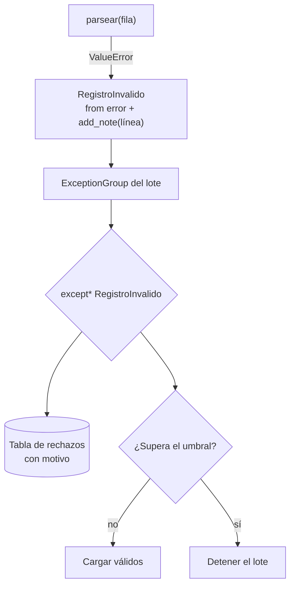

## 1. Resumen

Las excepciones son cómo el código de un pipeline dice "esto falló". Para que el fallo sea diagnosticable y manejable hace falta:

- una **jerarquía propia** (`ErrorDePipeline` y subclases), que se captura sin atrapar todo;
- **`raise ... from error`**, que conserva la causa original;
- **`add_note`**, que agrega contexto (línea, archivo, lote);
- **`ExceptionGroup`**, que reporta todos los registros inválidos de un lote de una vez, en vez de solo el primero.

## 2. Qué es

Una excepción es un objeto que interrumpe el flujo normal y sube por la pila de llamadas hasta un `except` que la maneje. Si nadie la maneja, termina el programa con un traceback. Estructura:

- `BaseException`: la raíz. Incluye `KeyboardInterrupt` y `SystemExit`, que **no** son errores del programa.
- `Exception`: base de todos los errores "normales". Las excepciones propias derivan de aquí.
- Bloques: `try` / `except` / `else` (si no hubo excepción) / `finally` (siempre).
- `ExceptionGroup` + `except*` (3.11): varias excepciones juntas, manejadas por tipo.

## 3. Problema que resuelve

En un pipeline, "falló" no basta: hay que saber qué registro, de qué archivo, por qué y si vale la pena reintentar. Además, a veces conviene seguir procesando el resto del lote y reportar todos los errores juntos. Las excepciones bien modeladas llevan esa información y permiten que cada capa decida si maneja, enriquece o propaga.

## 4. Cómo funciona

1. `raise X(...)` lanza la excepción. Python busca, subiendo por la pila, el primer `except` cuyo tipo coincide (incluye las subclases).
2. **Encadenamiento:** dentro de un `except`, `raise Nueva(...) from error` guarda la original en `__cause__`, y el traceback muestra ambas. Sin `from`, la original queda en `__context__`.
3. **Notas:** `error.add_note("línea 42")` agrega texto a `__notes__`. El traceback lo muestra después del mensaje.
4. **Grupos:** `raise ExceptionGroup("msg", [e1, e2])` lanza varias juntas. `except* TipoA` maneja las del tipo A y deja que el resto siga propagándose.
5. **finally:** se ejecuta siempre, haya excepción o no. Si el `finally` ejecuta `return`, `break` o `continue`, la excepción en curso no se relanza.
6. **BaseException:** `KeyboardInterrupt` hereda de `BaseException` justamente para que `except Exception` no la capture. Capturar `BaseException`, o usar un `except:` desnudo, impide detener el proceso.

## 5. Cuándo utilizarlo

- Una excepción base por pipeline o paquete, con subclases por tipo de fallo: `RegistroInvalido`, `FuenteNoDisponible`, `ContratoRoto`.
- `raise ... from` al traducir un error de bajo nivel (`ValueError`, `KeyError`, error del driver) a uno del dominio.
- `add_note` para agregar contexto en la capa que lo conoce (número de línea, archivo, `batch_id`) sin cambiar el tipo.
- `ExceptionGroup` para validar un lote completo y reportar todos los inválidos.

## 6. Cuándo no utilizarlo

- No usar excepciones para el flujo normal: un registro que no cumple un filtro de negocio se descarta o se separa, no se "lanza".
- No capturar `Exception` para silenciarla (`except Exception: pass`): el pipeline sigue con datos incompletos y nadie se entera.
- No reintentar errores permanentes, como un registro mal formado. La decisión de reintentar está en `python-error-handling-and-retries`.

## 7. Ejemplo sencillo

```python
try:
    monto = int("12,5")
except ValueError as error:
    raise RuntimeError("monto inválido en la línea 3") from error
```

El traceback muestra el `ValueError` original y luego el `RuntimeError`, unidos por *The above exception was the direct cause of the following exception*.

## 8. Ejemplo de producción

La validación de un archivo de ventas recorre todas las filas:

1. Cada error de conversión se traduce a `RegistroInvalido` con `from` y una nota con el número de línea.
2. Al final, si hubo errores, se lanza un `ExceptionGroup` con todos.
3. El orquestador maneja `except* RegistroInvalido`: escribe las filas inválidas con su motivo en una tabla de rechazos, registra el conteo y decide según un umbral si el lote se carga o se detiene.

Un `FuenteNoDisponible`, que no es parte del grupo manejado, sigue propagándose hacia la lógica de reintentos.

## 9. Arquitectura



## 10. Código

```python
# Python 3.12 (ejecutado; mypy --strict sin errores): jerarquía propia, causa encadenada, notas y grupo de errores.
class ErrorDePipeline(Exception):
    """Base de los errores del pipeline: se capturan juntos sin atrapar todo Exception."""


class RegistroInvalido(ErrorDePipeline):
    pass


def parsear(numero_linea: int, texto: str) -> int:
    try:
        return int(texto)
    except ValueError as error:
        nuevo = RegistroInvalido(f"monto no numérico: {texto!r}")
        nuevo.add_note(f"línea {numero_linea}")
        raise nuevo from error           # conserva la causa original en __cause__


def validar_lote(lineas: list[str]) -> list[int]:
    montos: list[int] = []
    errores: list[Exception] = []
    for n, texto in enumerate(lineas, start=1):
        try:
            montos.append(parsear(n, texto))
        except RegistroInvalido as error:
            errores.append(error)
    if errores:
        raise ExceptionGroup("lote con registros inválidos", errores)
    return montos


try:
    validar_lote(["10", "x", "30", ""])
except* RegistroInvalido as grupo:
    for error in grupo.exceptions:
        print(error, getattr(error, "__notes__", []), type(error.__cause__).__name__)
# monto no numérico: 'x' ['línea 2'] ValueError
# monto no numérico: '' ['línea 4'] ValueError
```

`ExceptionGroup`, `except*` y `add_note` se agregaron en Python 3.11. El runtime donde corre el pipeline tiene que ser 3.11 o posterior; el ejemplo se ejecutó con 3.12.

## 11. GCP

No aplica de forma específica: el manejo de excepciones es del lenguaje y se comporta igual en cualquier runtime de Python 3.11 o posterior. Los reintentos, incluidos los que ofrece cada servicio, se tratan en `python-error-handling-and-retries`.

## 12. AWS

No aplica de forma específica (ver §11).

## 13. Azure

No aplica de forma específica (ver §11).

## 14. Buenas prácticas

- Excepciones propias derivadas de `Exception`, con una base común por pipeline.
- `raise ... from error` siempre que se traduzca una excepción; nunca perder la causa.
- Contexto con `add_note` o en el mensaje; el tipo dice qué pasó y la nota dice dónde.
- `except` lo más específico posible, en la capa que puede hacer algo útil con el error.
- **Seguridad:** los mensajes y notas de excepciones terminan en logs y alertas; no incluir valores sensibles (tokens, RUT, montos de clientes) en el texto, sino identificadores técnicos como el número de línea o el id del registro.
- **Observabilidad:** registrar con `log.exception` en la capa que maneja el error (no en cada capa que lo propaga) y contar los rechazos por tipo de excepción como métrica del lote.
- **Costo:** fallar rápido ante errores permanentes evita reprocesar y reintentar lotes que van a volver a fallar; separar los registros inválidos permite cargar el resto sin reprocesar todo el archivo.

## 15. Errores frecuentes

- `except:` desnudo o `except BaseException`: captura también `KeyboardInterrupt` y `SystemExit`.
- `except Exception: pass`: errores silenciados y datos incompletos.
- `raise NuevoError(str(e))` sin `from`: se pierde el traceback original.
- `return` en `finally`: la excepción en curso no se relanza.
- Detener el lote en el primer registro inválido, sin saber cuántos más había.

## 16. Trade-offs

Una jerarquía propia es más código, pero permite manejar errores por categoría. `ExceptionGroup` da un reporte completo, pero obliga a recorrer todo el lote antes de fallar. En lotes enormes, conviene cortar al superar un umbral. Fallar rápido protege los datos del destino, mientras que separar los inválidos y seguir protege la disponibilidad. El umbral entre ambos es una decisión de negocio, no técnica.

## 17. Conceptos relacionados

- `python-error-handling-and-retries`: qué se reintenta y cómo.
- `python-logging`: registrar excepciones con traceback.
- `python-context-managers`: limpieza garantizada.
- `dead-letter-queue`: separar lo que no se pudo procesar.

## 18. Preguntas técnicas abiertas

1. ¿Qué tipos de excepción propios necesitaría tu pipeline para que el orquestador decida reintentar, separar o detener?
2. ¿Con qué umbral de registros inválidos detendrías un lote, y quién debería decidirlo?
3. ¿Qué información pondrías en una nota y cuál nunca debería aparecer en un mensaje de error?

## 19. Laboratorio relacionado

Pendiente (F4).

## 20. Fuentes

- Python: *Errors and Exceptions* (tutorial) y *Built-in Exceptions*.

El detalle de cada fuente está en `sources` del frontmatter.

## 21. Fecha de última verificación

2026-10-08. Pasa a `verified`: revisión B-F3.1 del lote F3b-03a aplicada, sin VERIFY pendientes.

## 22. Historial de cambios importantes

- 2026-10-08: creación (lote F3b-03a).
- 2026-10-08: revisión B-F3.1 del lote F3b-03a aplicada (docs/reviews/cards-f3b-03a.md): la documentación de Python se cita en `/3.12/`, la versión con la que se ejecutó el código; el `SyntaxWarning` del `finally` (3.14) queda con su propia fuente en `/3/`.
- 2026-10-08: `verification_status: verified` (sin VERIFY pendientes).
- 2026-10-13: `page_title` en cada cita, con el título de la página citada (ADR-012); sin cambios de contenido.
- 2026-10-13: se quita la cita a la URL genérica `/3/` (regla de URLs versionadas) y, con ella, la frase sobre el `SyntaxWarning` de 3.14, que solo esa cita sustentaba; el comportamiento de `finally` queda citado de `/3.12/`.
- 2026-10-25: §9 con el estándar de diagramas (máximo 8 nodos, CLAUDE.md): la fila entra en el nodo de parseo.
