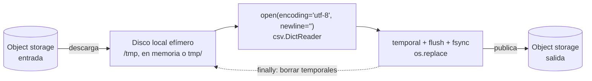

## 1. Resumen

Tres reglas cubren casi todos los problemas de archivos en pipelines:

- **`encoding="utf-8"` siempre explícito.** El valor por defecto depende de la plataforma, y leer con el encoding equivocado no da error: da texto corrupto.
- **`newline=""` al usar el módulo `csv`.**
- **Escribir la salida de forma atómica:** un temporal en el mismo directorio y `os.replace`, para que nadie lea un archivo a medias.

Además, en la nube el disco local es distinto en cada plataforma:

- **Lambda:** `/tmp` configurable.
- **Cloud Run:** un sistema de archivos en memoria.
- **Azure Functions:** un `tmp/` que no persiste.

## 2. Qué es

Es el uso de `open()`, `pathlib.Path` y módulos como `csv`, `os` y `tempfile` para leer y escribir archivos locales:

- **Modo texto vs binario:** en texto, Python decodifica bytes a `str` con un `encoding`. En binario (`"rb"`/`"wb"`) entrega `bytes` sin interpretar.
- **pathlib:** rutas como objetos (`base / "entrada" / "clientes.csv"`), con `read_text`, `write_text`, `mkdir(parents=True)`, `glob` y `rglob`.
- **with:** cierra el archivo al salir del bloque, aunque haya una excepción.

## 3. Problema que resuelve

Los archivos son la frontera más común de un pipeline: llegan de sistemas de origen, se generan para otros sistemas y se usan como etapa intermedia. Los fallos típicos son silenciosos:

- tildes y eñes corruptas por un encoding implícito;
- CSV con un CR extra por fila o campos multilínea mal leídos por no usar `newline=""`;
- archivos de salida truncados porque el proceso falló a mitad;
- en la nube, disco local que se llena, se borra o consume memoria sin aviso.

## 4. Cómo funciona

1. **Encoding:** sin `encoding`, `open()` usa el de la plataforma (`locale.getencoding()`), que no es necesariamente UTF-8. Un archivo UTF-8 leído como `latin-1` no falla: `Muñoz` se convierte en `Muñoz`.
2. **CSV:** el módulo `csv` hace su propio manejo de saltos de línea. Sin `newline=""`, los saltos dentro de campos entre comillas no se interpretan bien y, en plataformas con fin de línea CRLF, la escritura agrega un CR extra.
3. **Lectura en flujo:** `for linea in f` lee línea a línea sin cargar todo.
4. **Escritura durable y atómica:**
   1. escribir en un temporal **en el mismo directorio**;
   2. `flush()` y `os.fsync()` para que los datos lleguen a disco;
   3. `os.replace(temporal, destino)`. Si tiene éxito, el renombrado es una operación atómica (requisito de POSIX); puede fallar si origen y destino están en sistemas de archivos distintos.
5. **Disco local en la nube:** es efímero en todas las plataformas de esta ficha. Lo que se escribe ahí es de trabajo, no un resultado.

## 5. Cuándo utilizarlo

- Leer archivos que llegan de sistemas de origen (CSV, JSON lines, texto de ancho fijo).
- Escribir salidas locales que otro proceso tomará, siempre con escritura atómica.
- Archivos intermedios de trabajo dentro de una ejecución: descargar un objeto, descomprimirlo y procesarlo.

## 6. Cuándo no utilizarlo

- Como almacenamiento persistente en servicios serverless: el disco local no sobrevive a la instancia. Los resultados van a object storage o a una base de datos (ver `file-ingestion`, `gcs-buckets-and-objects`).
- Para compartir datos entre invocaciones o instancias: no está garantizado que el archivo siga ahí.
- Para archivos columnares (Parquet) o comprimidos a mano: usar la biblioteca del formato, no parsear bytes (ver `parquet-format`).

## 7. Ejemplo sencillo

```python
from pathlib import Path

ruta = Path("clientes.txt")
ruta.write_text("Muñoz\n", encoding="utf-8")
print(ruta.read_text(encoding="utf-8"))     # Muñoz
print(ruta.read_text(encoding="latin-1"))   # Muñoz: sin error, pero corrupto
```

## 8. Ejemplo de producción

Una función serverless recibe la notificación de un archivo nuevo en object storage:

1. Lo descarga al disco local de trabajo.
2. Lo lee con `encoding="utf-8"` y `newline=""`, y valida cada fila.
3. Escribe el resultado limpio en un temporal local y lo publica de vuelta en object storage.
4. Borra los temporales al final, también en el camino del error, con un `with` o un `finally`.

El tamaño máximo del archivo se decide según el disco efímero de la plataforma: en Lambda se configura `/tmp`, y en Cloud Run el disco consume la memoria de la instancia. Si el archivo puede superar ese límite, se procesa en flujo sin pasar por disco.

## 9. Arquitectura



## 10. Código

```python
# Python 3.12 (ejecutado; mypy --strict sin errores): encoding explícito, csv con newline="", pathlib y escritura atómica.
import csv
import os
import tempfile
from pathlib import Path

base = Path(tempfile.mkdtemp())
entrada = base / "entrada" / "clientes.csv"
entrada.parent.mkdir(parents=True, exist_ok=True)
entrada.write_bytes("id;nombre\n1;Muñoz\n2;Ñuñoa SpA\n".encode("utf-8"))   # bytes UTF-8 de origen

# 1) Leer con encoding y newline explícitos (csv pide newline="").
with entrada.open(encoding="utf-8", newline="") as f:
    filas = list(csv.DictReader(f, delimiter=";"))
print(filas[0]["nombre"], filas[1]["nombre"])            # Muñoz Ñuñoa SpA

# 2) Leer con otro encoding produce texto incorrecto sin ningún error.
print(entrada.read_text(encoding="latin-1").splitlines()[1])   # 1;Muñoz

# 3) Escribir la salida de forma atómica: temporal en el mismo directorio y os.replace.
salida = base / "salida" / "clientes.csv"
salida.parent.mkdir(parents=True, exist_ok=True)
temporal = salida.with_suffix(".csv.tmp")
with temporal.open("w", encoding="utf-8", newline="") as f:
    escritor = csv.DictWriter(f, fieldnames=["id", "nombre"])
    escritor.writeheader()
    escritor.writerows(filas)
    f.flush()
    os.fsync(f.fileno())                                 # asegura que los datos lleguen al disco antes del renombrado
os.replace(temporal, salida)
print(sorted(p.name for p in salida.parent.iterdir()))   # ['clientes.csv']
print(sorted(p.relative_to(base).as_posix() for p in base.rglob("*.csv")))
# ['entrada/clientes.csv', 'salida/clientes.csv']
```

El ejemplo usa un nombre de temporal fijo para que se lea fácil. Si pueden correr dos ejecuciones a la vez, `tempfile.mkstemp(dir=...)` da un nombre único (ver `python-context-managers`). La documentación de `os.replace` dice que, si tiene éxito, el renombrado es una operación atómica (requisito de POSIX), y que puede fallar si origen y destino están en sistemas de archivos distintos. El ejemplo se ejecutó en Windows (NTFS); esa ejecución no es la garantía de la documentación.

## 11. GCP

En **Cloud Run**, el sistema de archivos del contenedor es escribible, pero **en memoria**:

- lo escrito consume la memoria de la instancia;
- no persiste cuando la instancia se detiene;
- no tiene límite de tamaño configurable, así que llenarlo puede agotar la memoria y hacer fallar la instancia.

La documentación propone un volumen en memoria dedicado con límite de tamaño. Diferencia con Lambda: en Cloud Run el "disco" compite con la memoria del proceso, porque un archivo descargado ocupa memoria de la instancia. En Lambda, en cambio, la documentación presenta `/tmp` como alternativa al procesamiento en memoria.

## 12. AWS

En **Lambda**, el almacenamiento efímero está en `/tmp` y se configura entre **512 MB y 10,240 MB**, en incrementos de 1 MB. La documentación lo propone, por ejemplo, para descargar objetos de S3 a `/tmp` y procesar objetos más grandes sin hacerlo en memoria. Igual que en las otras plataformas, es almacenamiento efímero: los resultados se publican en S3 u otro destino.

## 13. Azure

En **Azure Functions** con Python, los archivos temporales se guardan en `tmp/`. La documentación aclara que **no está garantizado** que persistan entre invocaciones ni entre instancias cuando la aplicación escala, y lo mismo vale para el estado en variables globales. Sirven como espacio de trabajo dentro de una invocación, no como caché confiable ni como salida.

## 14. Buenas prácticas

- `encoding="utf-8"` explícito en cada `open`, `read_text` y `write_text`; si el origen usa otro encoding, declararlo en el contrato de la fuente y usarlo explícitamente.
- `newline=""` siempre que se use `csv.reader`/`csv.writer`.
- Escritura atómica (temporal en el mismo directorio + `os.replace`) para toda salida que otro proceso lea.
- `pathlib` para construir rutas; nunca concatenar cadenas con `/` o `\\`.
- Dimensionar archivos según el disco efímero de la plataforma, o procesar en flujo.
- **Seguridad:** validar nombres y rutas que vienen de datos de entrada (evitar `../` fuera del directorio de trabajo), crear temporales con `tempfile` y borrar los que contienen datos sensibles al terminar, también si hay error.
- **Observabilidad:** registrar tamaño, número de filas leídas y escritas y encoding usado por archivo; un conteo distinto entre entrada y salida es la primera señal de una fila perdida o de un salto de línea mal interpretado.
- **Costo:** en Cloud Run los archivos locales consumen la memoria asignada a la instancia, y en Lambda el tamaño de `/tmp` es una configuración de la función que hay que dimensionar según el archivo más grande esperado; procesar en flujo evita sobredimensionar memoria o disco.

## 15. Errores frecuentes

- `open(ruta)` sin `encoding`: funciona en el laptop y corrompe tildes en el servidor, o al revés.
- CSV escrito sin `newline=""`: un CR extra al final de cada fila en plataformas con fin de línea CRLF, y campos con saltos de línea mal interpretados al leer.
- Escribir directo sobre el archivo final: si el proceso falla, queda truncado y el siguiente paso lo lee como si estuviera completo.
- Temporal en otro volumen que el destino: `os.replace` puede fallar si origen y destino están en sistemas de archivos distintos.
- Usar el disco local de una función como caché entre invocaciones y depender de que el archivo siga ahí.
- En Cloud Run, descargar archivos grandes al disco local sin contar que consumen memoria.

## 16. Trade-offs

El disco local es rápido y simple, pero efímero y limitado. Object storage es durable y compartido, pero cada lectura es una llamada de red. La escritura atómica cuesta espacio extra temporal y un `fsync`, a cambio de que nadie lea un archivo a medias. Leer el archivo completo simplifica el código, mientras que procesarlo en flujo mantiene la memoria constante y evita los límites de disco de cada plataforma.

## 17. Conceptos relacionados

- `python-context-managers`: `with` y la escritura atómica reutilizable.
- `python-generators`: lectura en flujo.
- `csv-format` y `file-ingestion`: el formato y el patrón de ingesta.
- `gcs-buckets-and-objects`: object storage como destino durable.
- `python-file-processing`: procesar una carpeta de archivos con rechazos y manifiesto.

## 18. Preguntas técnicas abiertas

1. ¿Cómo detectarías automáticamente que un archivo de origen dejó de venir en UTF-8?
2. Si el archivo de entrada puede pesar más que el disco efímero o la memoria de tu plataforma, ¿qué cambiarías del diseño?
3. ¿Cómo publicarías de forma atómica una salida que son varios archivos, no uno?

## 19. Laboratorio relacionado

Pendiente (F4).

## 20. Fuentes

- Python: *Input and Output* (tutorial), *Built-in Functions* (open), *io*, *csv*, *pathlib* y *os*.
- AWS: *Configure ephemeral storage for Lambda functions*.
- Google Cloud: *Container runtime contract* (Cloud Run).
- Microsoft Learn: *Python developer reference for Azure Functions*.

El detalle de cada fuente está en `sources` del frontmatter.

## 21. Fecha de última verificación

2026-10-08. Pasa a `verified`: revisión B-F3.1 del lote F3b-03a aplicada, sin VERIFY pendientes.

## 22. Historial de cambios importantes

- 2026-10-08: creación (lote F3b-03a).
- 2026-10-08: revisión B-F3.1 del lote F3b-03a aplicada (docs/reviews/cards-f3b-03a.md): la documentación de Python se cita en `/3.12/`, la versión con la que se ejecutó el código; `os.replace` con la frase de la documentación (atómico si tiene éxito, requisito de POSIX; puede fallar entre sistemas de archivos), sin «deja de ser atómico».
- 2026-10-08: `verification_status: verified` (sin VERIFY pendientes).
- 2026-10-09: §17 enlaza `python-file-processing`, que ya tiene ficha (lote F3b-03b); antes figuraba como pendiente de ficha.
