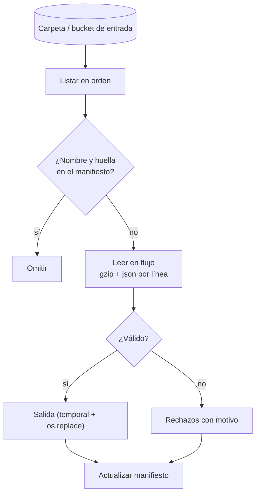

## 1. Resumen

Procesar los archivos que deja una fuente es uno de los trabajos más comunes de un pipeline en Python. Un diseño robusto tiene cuatro piezas:

1. **Leer en flujo**, incluso archivos comprimidos, sin cargarlos completos.
2. **Validar registro a registro**, y mandar los inválidos a un archivo de rechazos con su motivo.
3. **Escribir cada salida de forma atómica**.
4. **Llevar un manifiesto** de lo procesado, por nombre y huella del contenido, para que re-ejecutar no reprocese ni duplique.

En la nube, los SDK de cada almacenamiento ofrecen lectura en flujo.

## 2. Qué es

Es un job que toma una carpeta, prefijo o bucket con archivos de entrada (CSV, JSON Lines, comprimidos) y produce, por cada uno:

- una salida validada;
- un archivo de rechazos;
- una entrada en el manifiesto.

Se compone de las piezas de `python-file-handling` (encoding, escritura atómica) y `python-generators` (lectura en flujo), más dos decisiones de diseño:

- qué identifica a un archivo ya procesado: nombre, huella o ambos;
- qué hacer con los registros inválidos.

## 3. Problema que resuelve

Las fuentes de archivos fallan de formas repetidas:

- llegan archivos con algunas líneas rotas;
- se reenvía el mismo archivo;
- un proceso cae a mitad de la carpeta.

Sin diseño, cada caso termina en datos duplicados, registros perdidos sin rastro o un job que no se puede volver a ejecutar sin limpiar a mano. Este patrón hace que cualquier re-ejecución sea segura.

## 4. Cómo funciona

1. Se listan los archivos de entrada en orden estable (`sorted(glob(...))`).
2. Para cada archivo se calcula la **huella** del contenido (SHA-256 leyendo por bloques). Si el manifiesto ya tiene ese nombre con esa huella, se omite.
3. Se lee en flujo: `gzip.open(..., "rt", encoding="utf-8")` descomprime mientras itera. Cada línea se parsea dentro de un `try`.
4. Los registros válidos van a la salida y los inválidos al archivo de rechazos, con archivo, línea y motivo.
5. Cada salida se escribe en un temporal y se renombra con `os.replace`. Si tiene éxito, el renombrado es atómico (requisito de POSIX); puede fallar si origen y destino están en sistemas de archivos distintos, por eso el temporal va en el mismo directorio.
6. El manifiesto se actualiza **después** de escribir las salidas. Si el proceso cae antes, el archivo se reprocesa entero en la siguiente ejecución y sus salidas se reemplazan.

## 5. Cuándo utilizarlo

- Fuentes que entregan archivos por SFTP, object storage o carpetas compartidas.
- Cargas diarias o por llegada de archivos, con reenvíos posibles.
- Preprocesamiento antes de cargar a un warehouse (validar, normalizar, convertir de formato).

## 6. Cuándo no utilizarlo

- Cuando el warehouse puede cargar los archivos directamente con su validación y su tabla de errores: menos código propio.
- Para volúmenes que piden paralelismo distribuido: el mismo diseño se implementa en un motor (ver `pyspark-dataframes`, `beam-programming-model`).
- Si la fuente puede entregar por API o CDC, con garantías mejores que los archivos.

## 7. Ejemplo sencillo

```python
import gzip
import json
import tempfile
from pathlib import Path

ruta = Path(tempfile.mkdtemp()) / "eventos.jsonl.gz"
with gzip.open(ruta, "wt", encoding="utf-8") as f:
    f.write('{"id": 1}\n{"id": 2}\n')
with gzip.open(ruta, "rt", encoding="utf-8") as f:
    print([json.loads(linea)["id"] for linea in f])   # [1, 2]: descomprime mientras itera
```

## 8. Ejemplo de producción

Un proveedor deja cada noche un `ventas-AAAA-MM-DD.jsonl.gz` en un bucket, y a veces reenvía el del día anterior corregido. El job:

1. lista el prefijo;
2. omite los archivos cuya huella ya está en el manifiesto;
3. procesa en flujo los nuevos o corregidos;
4. escribe la salida y los rechazos por archivo;
5. carga la salida al warehouse reemplazando la partición del día.

Un archivo corregido tiene otra huella, así que se reprocesa y reemplaza su partición. Si los rechazos superan un umbral, el job falla con el conteo y no carga el archivo.

## 9. Arquitectura



## 10. Código

```python
# Python 3.12, solo biblioteca estándar (ejecutado; mypy --strict sin errores): procesa una carpeta de
# archivos gzip JSON Lines en flujo, separa rechazos, escribe la salida de forma atómica y lleva un manifiesto
# para que re-ejecutar no reprocese lo ya cargado.
import csv
import gzip
import hashlib
import json
import os
import tempfile
from collections.abc import Iterator
from pathlib import Path


def huella(ruta: Path) -> str:
    h = hashlib.sha256()
    with ruta.open("rb") as f:
        for bloque in iter(lambda: f.read(1 << 20), b""):   # de a 1 MiB: no carga el archivo entero
            h.update(bloque)
    return h.hexdigest()


def registros(ruta: Path) -> Iterator[tuple[int, dict[str, object] | None, str]]:
    with gzip.open(ruta, "rt", encoding="utf-8") as f:     # descomprime en flujo
        for n, linea in enumerate(f, start=1):
            try:
                yield n, json.loads(linea), ""
            except json.JSONDecodeError as error:
                yield n, None, f"JSON inválido: {error.msg}"


def escribir_atomico(destino: Path, filas: list[list[object]]) -> None:
    temporal = destino.with_name(destino.name + ".tmp")
    with temporal.open("w", encoding="utf-8", newline="") as f:
        csv.writer(f).writerows(filas)
    os.replace(temporal, destino)   # si tiene éxito, el renombrado es atómico (POSIX); puede fallar entre sistemas de archivos


def procesar(entrada: Path, salida: Path) -> dict[str, int]:
    manifiesto_ruta = salida / "_procesados.json"
    manifiesto: dict[str, str] = json.loads(manifiesto_ruta.read_text(encoding="utf-8")) if manifiesto_ruta.exists() else {}
    conteo = {"archivos": 0, "omitidos": 0, "validos": 0, "rechazos": 0}
    for ruta in sorted(entrada.glob("*.jsonl.gz")):
        digest = huella(ruta)
        if manifiesto.get(ruta.name) == digest:
            conteo["omitidos"] += 1                          # mismo archivo, mismo contenido: ya cargado
            continue
        validos: list[list[object]] = []
        rechazos: list[list[object]] = [["archivo", "linea", "motivo"]]
        for n, reg, motivo in registros(ruta):
            if reg is not None and not motivo and isinstance(reg.get("monto"), int):
                validos.append([reg["venta_id"], reg["monto"]])
            else:
                rechazos.append([ruta.name, n, motivo or "monto ausente o no entero"])
        escribir_atomico(salida / ruta.name.replace(".jsonl.gz", ".csv"), [["venta_id", "monto"], *validos])
        escribir_atomico(salida / ruta.name.replace(".jsonl.gz", ".rechazos.csv"), rechazos)
        manifiesto[ruta.name] = digest
        manifiesto_ruta.write_text(json.dumps(manifiesto, indent=1), encoding="utf-8")   # después de escribir las salidas
        conteo["archivos"] += 1
        conteo["validos"] += len(validos)
        conteo["rechazos"] += len(rechazos) - 1
    return conteo


base = Path(tempfile.mkdtemp())
entrada, salida = base / "entrada", base / "salida"
entrada.mkdir()
salida.mkdir()
for nombre, lineas in {
    "ventas-2026-10-07.jsonl.gz": ['{"venta_id": "v1", "monto": 120}', '{"venta_id": "v2", "monto": "40"}', "{roto"],
    "ventas-2026-10-08.jsonl.gz": ['{"venta_id": "v3", "monto": 75}'],
}.items():
    with gzip.open(entrada / nombre, "wt", encoding="utf-8") as f:
        f.write("\n".join(lineas) + "\n")

print(procesar(entrada, salida))   # {'archivos': 2, 'omitidos': 0, 'validos': 2, 'rechazos': 2}
print(procesar(entrada, salida))   # {'archivos': 0, 'omitidos': 2, 'validos': 0, 'rechazos': 0}
print((salida / "ventas-2026-10-07.rechazos.csv").read_text(encoding="utf-8").splitlines()[1:])
# ['ventas-2026-10-07.jsonl.gz,2,monto ausente o no entero', 'ventas-2026-10-07.jsonl.gz,3,JSON inválido: Expecting property name enclosed in double quotes']
```

Se ejecutó con Python 3.12.3 y pasó `mypy --strict`. La segunda ejecución omite los dos archivos porque su huella ya está en el manifiesto. La línea con `"monto": "40"` se rechaza como no entera, en lugar de convertirse en silencio. Las salidas se escriben con `os.replace`: si tiene éxito, el renombrado es atómico (requisito de POSIX), y puede fallar entre sistemas de archivos distintos. Se ejecutó en Windows (NTFS).

## 11. GCP

Para leer desde **Cloud Storage** sin descargar primero, la biblioteca cliente de Python ofrece `Blob.open()`, un manejador tipo archivo que se usa con `with` como `open()`. Un detalle de la documentación de *streaming reads* importa para este patrón: suelen usar la cabecera `Range` y Cloud Storage no devuelve checksums de una porción arbitraria. Si hay que validar el checksum **antes** de procesar, no conviene leer en flujo. La huella del manifiesto se puede calcular en el mismo recorrido, pero recién se conoce al terminar.

## 12. AWS

En **S3**, `get_object` devuelve en `Body` un `StreamingBody`, con `iter_lines()` e `iter_chunks()` para recorrer el objeto sin cargarlo completo, y `close()` para cerrar la respuesta HTTP. Para un `.gz`, el stream se puede pasar a `gzip.GzipFile(fileobj=...)` y leer en flujo igual que un archivo local.

## 13. Azure

En **Blob Storage**, `BlobClient.download_blob` devuelve un `StorageStreamDownloader`. La biblioteca divide la descarga en partes, cada una con su propia petición, y `chunks()` las itera sin cargar todo en memoria. Diferencia con S3 y Cloud Storage: la iteración es por partes de bytes, no por líneas. Si se necesitan líneas, hay que reconstruirlas sobre esos bytes.

## 14. Buenas prácticas

- Manifiesto con nombre **y** huella del contenido; actualizarlo solo después de escribir las salidas.
- Rechazos en un archivo o tabla con archivo, línea y motivo, nunca descartados en silencio.
- Umbral de rechazos por archivo que detenga la carga si la fuente cambió.
- Lectura en flujo y escritura atómica por archivo.
- Orden estable de procesamiento para que los logs y las re-ejecuciones sean reproducibles.
- **Seguridad:** permisos de solo lectura sobre la entrada y de escritura solo sobre la salida; los archivos de rechazos contienen datos de la fuente y requieren el mismo control de acceso; no registrar líneas completas en logs.
- **Observabilidad:** registrar por archivo la huella, las líneas leídas, válidas y rechazadas, y si se omitió; alertar si un día no llega archivo o si los rechazos superan el umbral.
- **Costo:** omitir archivos ya procesados evita reprocesar y releer del almacenamiento; leer en flujo evita descargar a disco y pagar más memoria o almacenamiento efímero.

## 15. Errores frecuentes

- Manifiesto solo por nombre: un archivo corregido con el mismo nombre no se reprocesa.
- Actualizar el manifiesto antes de escribir la salida: si el proceso cae, el archivo queda marcado y sin datos.
- Convertir tipos en silencio (`"40"` → `40`) sin decidirlo en el contrato.
- Cargar el `.gz` completo en memoria con `read()` y luego descomprimir.
- Mover o borrar los archivos de entrada como única marca de procesado, sin poder reprocesar.

## 16. Trade-offs

Calcular la huella obliga a leer cada archivo dos veces: una para la huella y otra para procesarlo. A cambio, se detectan correcciones con el mismo nombre. Un manifiesto en un archivo es simple pero no sirve para varios procesos a la vez; en una tabla, admite concurrencia, con una dependencia más. Rechazar en lugar de corregir protege la calidad, pero obliga a un proceso para revisar los rechazos.

## 17. Conceptos relacionados

- `python-file-handling`: encoding, newline y escritura atómica.
- `file-ingestion`: el patrón completo de ingesta de archivos.
- `idempotency`: re-ejecutar sin duplicar.
- `dead-letter-queue`: la salida de rechazos.
- `python-generators`: lectura en flujo.
- `beam-programming-model` y `pyspark-dataframes`: el mismo diseño en un motor distribuido (§6).

## 18. Preguntas técnicas abiertas

1. ¿Qué harías si el proveedor reenvía un archivo corregido que ya se cargó al warehouse?
2. ¿Dónde guardarías el manifiesto si el job corre en varias instancias a la vez?
3. ¿Qué umbral de rechazos usarías y quién debería decidirlo?

## 19. Laboratorio relacionado

Pendiente (F4).

## 20. Fuentes

- Python 3.12: *gzip*, *json* y *os*.
- Google Cloud: *Streaming reads* y la referencia de `Blob` de la biblioteca cliente de Cloud Storage.
- AWS: `S3.Client.get_object` (Boto3) y `StreamingBody` (botocore).
- Microsoft Learn: *Download a blob with Python*.

El detalle de cada fuente está en `sources` del frontmatter.

## 21. Fecha de última verificación

2026-10-09. Pasa a `verified`: revisión B-F3.1 del lote F3b-03b aplicada, sin VERIFY pendientes.

## 22. Historial de cambios importantes

- 2026-10-08: creación (lote F3b-03b).
- 2026-10-09: revisión B-F3.1 del lote F3b-03b aplicada (docs/reviews/cards-f3b-03b.md): filas aprobadas sin cambios en esta ficha.
- 2026-10-09: `verification_status: verified` (sin VERIFY pendientes).
- 2026-10-13: `page_title` en cada cita, con el título de la página citada (ADR-012); sin cambios de contenido.
- 2026-10-14: lote F3b-rel (regla del §17): relations incluye `beam-programming-model`, `pyspark-dataframes`; el §17 nombra `beam-programming-model`, `pyspark-dataframes`, que el cuerpo ya citaba.
- 2026-10-20: `page_title` sin la versión de parche del SDK (*Class Blob*), según la regla de CLAUDE.md de no citar versiones de parche de SDKs ni CLIs; sin cambios de contenido.
