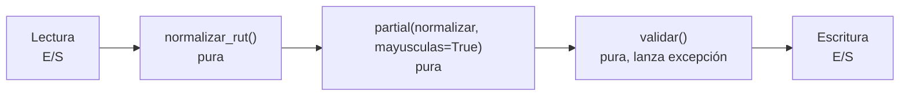

## 1. Resumen

En un pipeline en Python, las funciones son la unidad de transformación: `normalizar(registro) -> registro`. Hay tres reglas que evitan la mayoría de los problemas:

- funciones pequeñas y puras (sin estado global ni E/S escondida);
- flags y opciones como parámetros **solo por nombre** (después de `*`);
- nunca un objeto mutable como valor por defecto, porque se evalúa una sola vez y se comparte entre llamadas.

## 2. Qué es

Una función se define con `def`, recibe parámetros y devuelve un valor (o `None`). Python permite:

- **Valores por defecto:** `def f(x, sep=",")`.
- **Solo por nombre:** los parámetros después de `*` solo se pasan como `nombre=valor`.
- **Solo posicionales:** los anteriores a `/` solo se pasan por posición.
- **Argumentos arbitrarios:** `*args` y `**kwargs`.
- **Funciones como valores:** se pasan, se guardan y se combinan; `functools.partial` fija algunos argumentos y devuelve una función nueva.

## 3. Problema que resuelve

Un script que hace todo en el nivel superior no se puede probar, reutilizar ni componer. Separar en funciones con entradas y salidas claras permite:

- probar cada transformación con pytest;
- reordenar o reutilizar pasos;
- leer el pipeline como una secuencia de llamadas con nombre.

## 4. Cómo funciona

1. **Definición:** `def` se ejecuta y crea el objeto función. En ese momento se evalúan los valores por defecto, **una sola vez**.
2. **Llamada:** los argumentos se asignan a los parámetros por posición y por nombre. Un argumento posicional donde se espera uno solo por nombre es un `TypeError` en la llamada.
3. **Default mutable:** si el valor por defecto es una lista, es la misma lista en cada llamada; lo que una llamada le agrega lo ve la siguiente. La solución es `None` como centinela y crear el objeto dentro.
4. **Retorno:** `return` sin valor, o llegar al final, devuelve `None`.
5. **partial:** `partial(f, sep=";")` devuelve una función que llama a `f` con ese argumento ya fijado.

## 5. Cuándo utilizarlo

- Una función por paso de transformación o validación, con tipos en la firma.
- Parámetros solo por nombre para flags booleanos y opciones (`normalizar(t, mayusculas=True)`), así la llamada se lee sola.
- `partial` para crear variantes configuradas de una función sin duplicarla (por fuente, por formato).

## 6. Cuándo no utilizarlo

- No envolver cada línea en una función: una función que solo llama a otra sin agregar significado es ruido.
- No usar funciones con mucho estado compartido por variables globales: si necesitan estado entre llamadas, una clase lo hace explícito (ver `python-classes`).
- No ocultar E/S (lecturas de archivos, llamadas a APIs) dentro de funciones con nombre de transformación pura.

## 7. Ejemplo sencillo

```python
def limpiar(texto: str, *, mayusculas: bool = False) -> str:
    t = texto.strip()
    return t.upper() if mayusculas else t


print(limpiar("  cl  "), limpiar(" ar ", mayusculas=True))   # cl AR
```

## 8. Ejemplo de producción

La etapa de limpieza de una ingesta de clientes es una lista de funciones puras `registro -> registro`: normalizar RUT, normalizar nombre y normalizar comuna. Cada una tiene sus tests con casos límite. La configuración por fuente (separador, mayúsculas, formato de fecha) se fija con `partial` al armar el pipeline, no con `if fuente == ...` dentro de cada función. La E/S queda en los extremos: leer al principio, escribir al final.

## 9. Arquitectura



## 10. Código

```python
# Python 3.12 (ejecutado; mypy --strict sin errores): el default mutable, parámetros solo por nombre y partial.
from functools import partial


def agregar_mal(fila: str, lote: list[str] = []) -> list[str]:   # el error que se muestra
    lote.append(fila)
    return lote


def agregar(fila: str, lote: list[str] | None = None) -> list[str]:
    lote = [] if lote is None else lote
    lote.append(fila)
    return lote


def normalizar(texto: str, *, mayusculas: bool = False, quitar_espacios: bool = True) -> str:
    """Los flags van después de * : solo por nombre, para que la llamada se lea sola."""
    t = texto.strip() if quitar_espacios else texto
    return t.upper() if mayusculas else t


print(agregar_mal("a"), agregar_mal("b"))   # ['a', 'b'] ['a', 'b']: la lista por defecto se comparte
print(agregar("a"), agregar("b"))           # ['a'] ['b']
a_mayusculas = partial(normalizar, mayusculas=True)
print([a_mayusculas(t) for t in ["  cl ", "ar"]])   # ['CL', 'AR']
try:
    normalizar(" x ", True)  # type: ignore[call-arg]  # error de llamada: mayusculas es solo por nombre
except TypeError as error:
    print("TypeError:", error)
# TypeError: normalizar() takes 1 positional argument but 2 were given
```

La primera línea impresa muestra las dos llamadas con `['a', 'b']`. Ambas devuelven la misma lista por defecto, que ya tiene los dos elementos cuando se imprime.

## 11. GCP

No aplica de forma específica: es semántica del lenguaje y se comporta igual en cualquier runtime de Python.

## 12. AWS

No aplica de forma específica (ver §11).

## 13. Azure

No aplica de forma específica (ver §11).

## 14. Buenas prácticas

- Firmas con tipos y nombres que describen la transformación (`normalizar_rut(rut: str) -> str`).
- `None` como valor por defecto para listas, dicts y sets; crear el objeto dentro de la función.
- Parámetros solo por nombre para flags y opciones.
- E/S en los extremos del pipeline; funciones puras en el medio.
- Docstring breve cuando el contrato no es obvio por el nombre y los tipos.
- **Seguridad:** no pasar credenciales como valores por defecto ni leerlas en el momento de definir la función; recibirlas como parámetro o leerlas en el punto de entrada desde el gestor de secretos.
- **Observabilidad:** registrar en la función que orquesta los pasos (entrada, salida, filas descartadas), no dentro de cada transformación pura; así las funciones siguen siendo fáciles de probar.
- **Costo:** un valor por defecto mutable que acumula datos entre llamadas no solo da resultados incorrectos: en procesos que reutilizan el intérprete entre ejecuciones, la memoria crece en cada llamada.

## 15. Errores frecuentes

- Default mutable (`def f(x, acc=[])`): resultados que dependen de llamadas anteriores.
- Flags booleanos posicionales (`procesar(df, True, False)`): ilegibles y fáciles de invertir.
- Funciones que modifican el argumento recibido sin decirlo (mutan el dict de entrada) y además lo devuelven.
- Capturar variables de un bucle en lambdas creadas dentro del bucle y esperar el valor de cada vuelta.

## 16. Trade-offs

Las funciones puras son fáciles de probar y de componer, a cambio de pasar explícitamente todo lo que necesitan. Esto da firmas más largas, que `partial` o un objeto de configuración pueden acortar. Los parámetros solo por nombre hacen las llamadas más largas pero imposibles de confundir. Partir el código en muchas funciones pequeñas ayuda a probar, pero en exceso fragmenta la lectura.

## 17. Conceptos relacionados

- `python-typing`: el contrato de la firma.
- `python-exceptions`: cómo una función comunica un fallo.
- `testing-with-pytest`: probar cada función.
- `data-transformation`: transformaciones como composición de funciones.
- Del blueprint, pendiente de ficha: `python-decorators`.

## 18. Preguntas técnicas abiertas

1. ¿Qué parámetros de tus funciones de pipeline harías solo por nombre y cuáles dejarías posicionales?
2. ¿Cómo detectarías en revisión de código, o con un linter, un valor por defecto mutable?
3. ¿Cuándo preferirías `partial` y cuándo un objeto de configuración pasado a todas las funciones?

## 19. Laboratorio relacionado

Pendiente (F4).

## 20. Fuentes

- Python: *More Control Flow Tools* (tutorial), *Compound statements* (referencia del lenguaje) y *functools*.

El detalle de cada fuente está en `sources` del frontmatter.

## 21. Fecha de última verificación

2026-10-08. `review_required`: pendiente de revisión B-F3.1 del lote F3b-03a.

## 22. Historial de cambios importantes

- 2026-10-08: creación (lote F3b-03a).
