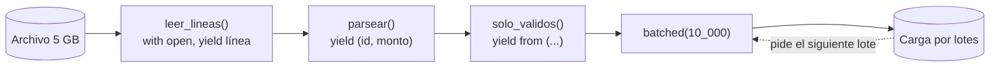

## 1. Resumen

Un generador es una función que usa `yield` para entregar valores de a uno en lugar de devolver una lista. Encadenando generadores se procesa un archivo de millones de líneas en flujo, con la memoria de una fila o de un lote: leer → parsear → filtrar → agrupar en lotes. Nada se lee hasta que alguien pide el primer valor. Si el generador abre un recurso dentro de un `with`, el recurso se cierra al agotarlo o al llamar a `close()`.

## 2. Qué es

Una **función generadora** es una función con `yield` en su cuerpo. Al llamarla no se ejecuta: devuelve un **generador**, que es un iterador.

- Cada `next()` ejecuta la función hasta el siguiente `yield`, entrega ese valor y **pausa**, conservando variables locales y la posición.
- Al terminar la función (o con `return`), el generador lanza `StopIteration` y queda agotado.
- `yield from otro` delega en otro iterable.
- `close()` lanza `GeneratorExit` en el punto pausado, para que el generador termine y limpie.

## 3. Problema que resuelve

La versión ingenua de un paso de pipeline lee todo el archivo en una lista, la transforma en otra lista y la filtra en una tercera. La memoria crece con el tamaño del archivo, y nada sale hasta que todo terminó. Con generadores, cada paso consume y produce un elemento a la vez. La memoria es constante, el primer lote sale apenas está listo y cada paso sigue siendo una función pequeña y fácil de probar.

## 4. Cómo funciona

1. `flujo = filtrar(parsear(leer(ruta)))` solo crea tres generadores; todavía no se leyó nada.
2. El consumidor (un `for`, `batched`, `sum`) pide un valor a `filtrar`. Este pide a `parsear`, que pide a `leer`, que lee **una** línea del archivo.
3. El valor sube por la cadena; cada generador queda pausado en su `yield`.
4. Al agotarse `leer`, la condición de fin se propaga y todos terminan. El `with` dentro de `leer` cierra el archivo.
5. Si el consumidor deja de pedir antes del final, el generador queda pausado con el archivo abierto. `close()` (que Python también llama al finalizar el generador, por ejemplo al quedarse sin referencias) lanza `GeneratorExit` en el `yield`, y el `with` (o un `finally`) cierra el recurso.

## 5. Cuándo utilizarlo

- Leer archivos grandes, resultados de consultas o APIs paginadas, y transformarlos en flujo.
- Separar un paso de procesamiento en etapas pequeñas encadenables y probables por separado.
- Producir lotes para cargas por partes (`batched` sobre el generador).
- Fuentes potencialmente infinitas (leer de una cola mientras haya mensajes).

## 6. Cuándo no utilizarlo

- Cuando hay que recorrer los datos más de una vez o acceder por posición: el generador es de una sola pasada.
- Cuando los datos son pocos y caben de sobra en memoria: una lista es más simple de depurar e inspeccionar.
- Para paralelizar CPU: un pipeline de generadores corre en un solo hilo, un elemento a la vez (ver `python-concurrency`).
- Para transformaciones tabulares pesadas (joins, agregaciones grandes): un motor (SQL, DataFrames, Spark) lo hace mejor.

## 7. Ejemplo sencillo

```python
from collections.abc import Iterator


def pares(limite: int) -> Iterator[int]:
    for n in range(limite):
        if n % 2 == 0:
            yield n


g = pares(10)
print(next(g), next(g), list(g))   # 0 2 [4, 6, 8]
```

## 8. Ejemplo de producción

Un job diario procesa un archivo de ventas de 5 GB en una instancia con 1 GB de memoria. El pipeline es una cadena de generadores:

1. `leer_lineas` abre el archivo con `with` y entrega línea por línea.
2. `parsear` convierte cada línea en una tupla tipada.
3. `solo_validos` descarta montos no positivos y lleva la cuenta de descartados.
4. `batched(flujo, 10_000)` entrega lotes al cargador.

La memoria máxima es la de un lote. Si el cargador falla a mitad, el generador se cierra y el archivo también.

## 9. Arquitectura



## 10. Código

```python
# Python 3.12 (ejecutado; mypy --strict sin errores): pipeline de generadores con cierre del recurso garantizado.
import tempfile
from collections.abc import Generator, Iterable, Iterator
from itertools import batched
from pathlib import Path


def leer_lineas(ruta: Path) -> Generator[str, None, None]:
    with ruta.open(encoding="utf-8") as f:     # el archivo se cierra al agotar o cerrar el generador
        for linea in f:                        # el objeto archivo ya entrega una línea a la vez
            yield linea.rstrip("\n")


def parsear(lineas: Iterable[str]) -> Iterator[tuple[str, int]]:
    for linea in lineas:
        id_, monto = linea.split(",")
        yield id_, int(monto)


def solo_validos(registros: Iterable[tuple[str, int]]) -> Iterator[tuple[str, int]]:
    yield from (r for r in registros if r[1] > 0)


ruta = Path(tempfile.mkdtemp()) / "ventas.csv"
ruta.write_text("".join(f"v{i},{i % 5 - 1}\n" for i in range(100_000)), encoding="utf-8")

flujo = solo_validos(parsear(leer_lineas(ruta)))   # nada se lee todavía: los generadores son perezosos
lotes = batched(flujo, 10_000)
primero = next(lotes)
print(len(primero), primero[:2])                    # 10000 (('v2', 1), ('v3', 2))
total = len(primero) + sum(len(lote) for lote in lotes)
print(total)                                        # 60000: 3 de cada 5 montos son positivos

parcial = leer_lineas(ruta)
next(parcial)
parcial.close()                                     # cierra el generador: el with interno cierra el archivo
print(next(parcial, "agotado"))                     # agotado: un generador cerrado no entrega más valores
```

`leer_lineas` se anota como `Generator[str, None, None]` y no como `Iterator[str]` para que el type checker acepte `close()`. Los demás pasos solo se recorren, y `Iterator` basta.

## 11. GCP

No aplica de forma específica: los generadores son del lenguaje. En cualquier runtime, el beneficio es el mismo: la memoria necesaria deja de depender del tamaño de la entrada. Ver `python-file-handling` para los límites de disco y memoria de cada plataforma.

## 12. AWS

No aplica de forma específica (ver §11).

## 13. Azure

No aplica de forma específica (ver §11).

## 14. Buenas prácticas

- Abrir el recurso **dentro** del generador con `with`, no afuera: así el generador es dueño de su ciclo de vida.
- Un generador por responsabilidad (leer, parsear, validar), con tipos `Iterable[T]` de entrada e `Iterator[U]` de salida.
- Cerrar explícitamente (`close()`, o `contextlib.closing`) los generadores que se abandonan antes de agotarlos.
- Probar cada etapa con una lista pequeña como entrada: un generador acepta cualquier iterable.
- **Seguridad:** un generador pausado mantiene abiertos archivos, conexiones o sesiones con credenciales; cerrarlo apenas no se necesite en lugar de dejarlo vivo en una variable.
- **Observabilidad:** contar en cada etapa (leídos, válidos, descartados, lotes) y registrar al cerrar; en un flujo no hay un `len()` que consultar al final.
- **Costo:** procesar en flujo permite asignar memoria según el tamaño del lote y no del archivo, lo que baja el costo en servicios que cobran por memoria asignada.

## 15. Errores frecuentes

- Esperar que la función generadora se ejecute al llamarla: no hace nada hasta el primer `next()`. Las validaciones de argumentos tampoco corren antes.
- Consumir el mismo generador dos veces.
- Abrir el archivo fuera del generador y cerrarlo antes de consumirlo: `ValueError: I/O operation on closed file`.
- Abandonar un generador a mitad y dejar el archivo abierto en un proceso de larga vida.
- Capturar `GeneratorExit` y seguir haciendo `yield`: `close()` lanza `RuntimeError`.

## 16. Trade-offs

La memoria es constante y el primer resultado sale antes. A cambio:

- el flujo de control es menos visible (el trabajo ocurre "cuando alguien pide");
- los errores aparecen lejos de donde se armó la cadena;
- no se puede volver atrás.

Para reanudar un proceso fallido a mitad hace falta guardar un checkpoint (número de línea u offset) además de los generadores.

## 17. Conceptos relacionados

- `python-iterators`: el protocolo y la regla de una sola pasada.
- `python-file-handling`: abrir archivos con encoding explícito.
- `python-context-managers`: `@contextmanager` también se escribe con `yield`.
- `data-pipeline`: el mismo diseño a escala de sistema.
- `python-concurrency`: repartir lotes entre hilos o procesos.
- `python-file-processing`: el caso real de procesar una carpeta de archivos en flujo.

## 18. Preguntas técnicas abiertas

1. ¿Cómo agregarías un checkpoint a este pipeline para reanudar desde el último lote cargado?
2. ¿Dónde pondrías el conteo de descartados para que no rompa la pereza del pipeline?
3. ¿Qué pasa con el archivo abierto si el cargador lanza una excepción entre dos lotes?

## 19. Laboratorio relacionado

Pendiente (F4).

## 20. Fuentes

- Python: *Classes* (tutorial, Generators), *Expressions* (Yield expressions), *Functional Programming HOWTO*, *Input and Output* (tutorial) e *itertools*.

El detalle de cada fuente está en `sources` del frontmatter.

## 21. Fecha de última verificación

2026-10-08. Pasa a `verified`: revisión B-F3.1 del lote F3b-03a aplicada, sin VERIFY pendientes.

## 22. Historial de cambios importantes

- 2026-10-08: creación (lote F3b-03a).
- 2026-10-08: revisión B-F3.1 del lote F3b-03a aplicada (docs/reviews/cards-f3b-03a.md): la documentación de Python se cita en `/3.12/`, la versión con la que se ejecutó el código; §7 anota el retorno de `pares` (`-> Iterator[int]`) y pasa `mypy --strict`.
- 2026-10-08: `verification_status: verified` (sin VERIFY pendientes).
- 2026-10-09: §17 enlaza `python-concurrency` y `python-file-processing`, que ya tienen ficha (lote F3b-03b); antes figuraban como pendientes de ficha.
