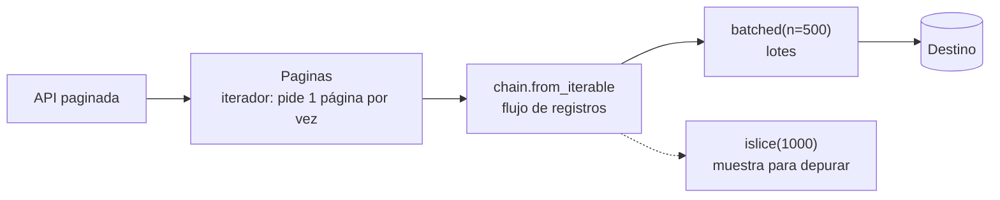

## 1. Resumen

Un **iterable** es algo que se puede recorrer, como una lista, un archivo o un dict. Un **iterador** es el objeto que hace el recorrido y recuerda dónde va. La diferencia importa en pipelines: una lista se puede recorrer muchas veces, pero un iterador (un archivo abierto, un generador, una página de resultados) se recorre **una sola vez**. La segunda vez está agotado y parece vacío, sin ningún error. Con `itertools` (`batched`, `islice`, `chain`) se procesan flujos en lotes sin cargarlos completos.

## 2. Qué es

El protocolo de iteración son dos métodos:

- `__iter__()`: devuelve un iterador. En un iterador, se devuelve a sí mismo.
- `__next__()`: devuelve el siguiente elemento o lanza `StopIteration` cuando no hay más.

`for x in algo` llama a `iter(algo)` y luego a `next()` hasta `StopIteration`.

- Un contenedor (lista, dict) entrega un **iterador nuevo** en cada `for`.
- Un iterador se entrega **a sí mismo**: lo que ya consumió no vuelve.

## 3. Problema que resuelve

Muchas fuentes de datos no se pueden ni conviene tener completas en memoria: un archivo de varios GB, una API paginada, el resultado de una consulta grande. El protocolo de iteración permite tratarlas igual que una lista en un `for`, pero pidiendo un elemento o una página a la vez. `itertools` agrega las operaciones típicas (cortar, encadenar, agrupar en lotes) sobre esos flujos.

## 4. Cómo funciona

1. `iter(x)` obtiene un iterador; `next(it)` pide el siguiente elemento.
2. Al terminar, `__next__` lanza `StopIteration`; el `for` la captura y termina el bucle.
3. **Agotamiento:** un iterador agotado sigue lanzando `StopIteration`. Recorrerlo de nuevo no da error, da cero elementos.
4. **Pereza:** las herramientas de `itertools` devuelven iteradores. No hacen trabajo hasta que alguien pide elementos.
   - `islice(it, 4)` pide solo 4 elementos.
   - `chain.from_iterable(paginas)` aplana página por página.
   - `batched(it, n)` arma tuplas de `n` elementos; el último lote puede ser más corto.
5. **groupby:** agrupa elementos **consecutivos** con la misma clave. A diferencia del `GROUP BY` de SQL, necesita los datos ordenados por esa clave.

## 5. Cuándo utilizarlo

- Leer fuentes grandes o paginadas elemento a elemento o página a página.
- Cargar en lotes de tamaño fijo (`batched`) cuando el destino tiene límites por petición.
- Muestrear los primeros N registros para validar o depurar (`islice`).
- Unir varias fuentes en un solo flujo (`chain`).

## 6. Cuándo no utilizarlo

- Cuando hay que recorrer los datos varias veces (validar y luego cargar): materializar en una lista si cabe en memoria, o volver a abrir la fuente.
- Cuando se necesita `len()` o acceso por posición: un iterador no los tiene.
- `groupby` sobre datos no ordenados: produce grupos repetidos y resultados incorrectos. Ordenar antes, o agregar con un `dict`.
- `tee` para "copiar" un iterador grande: puede guardar en memoria todo lo que una copia lleva de ventaja sobre la otra.

## 7. Ejemplo sencillo

```python
filas = iter(["a", "b", "c"])
print(list(filas))   # ['a', 'b', 'c']
print(list(filas))   # []: el iterador ya está agotado, sin error
```

## 8. Ejemplo de producción

Un job de ingesta lee una API paginada de 2 millones de registros y los carga en un destino que acepta hasta 500 filas por petición. El cliente de la API es un iterador de páginas que pide la siguiente solo cuando la anterior se consumió. `chain.from_iterable` lo aplana en un flujo de registros, y `batched(flujo, 500)` arma los lotes de carga. En memoria hay como máximo una página y un lote. Para depurar, el mismo código corre con `islice(flujo, 1000)` y solo pide las páginas necesarias.

## 9. Arquitectura



## 10. Código

```python
# Python 3.12 (ejecutado; mypy --strict sin errores): protocolo de iterador, agotamiento e itertools.
from collections.abc import Iterator
from itertools import batched, chain, islice


class Paginas:
    """Iterador sobre páginas de una API simulada: pide la siguiente solo cuando se necesita."""

    def __init__(self, total: int, tamano: int) -> None:
        self.total, self.tamano, self.offset = total, tamano, 0

    def __iter__(self) -> Iterator[list[int]]:
        return self

    def __next__(self) -> list[int]:
        if self.offset >= self.total:
            raise StopIteration
        pagina = list(range(self.offset, min(self.offset + self.tamano, self.total)))
        self.offset += self.tamano
        return pagina


registros = chain.from_iterable(Paginas(total=7, tamano=3))   # aplana página a página, sin cargar todo
print(list(islice(registros, 4)))        # [0, 1, 2, 3]: solo se pidieron 2 páginas
print(list(registros))                    # [4, 5, 6]: el iterador sigue donde quedó
print(list(registros))                    # []: un iterador agotado no vuelve a empezar
print(list(batched(range(7), 3)))         # [(0, 1, 2), (3, 4, 5), (6,)]
```

La misma clase se escribe en menos líneas como generador (ver `python-generators`). Aquí se usa la clase para mostrar el protocolo explícito.

## 11. GCP

El protocolo es del lenguaje y no cambia por nube. Lo que sí depende de la plataforma es la **versión de Python** del runtime: `itertools.batched` existe desde 3.12 y su parámetro `strict` desde 3.13. En **funciones de Cloud Run**, el runtime se elige al desplegar. La documentación lista `python312` con deprecación el 2028-10-02, además de `python313` y `python314`. Fijar el runtime explícitamente evita que una función despliegue con una versión donde el código no existe.

## 12. AWS

En **Lambda**, la tabla de runtimes incluye `python3.12` (Amazon Linux 2023), con deprecación proyectada para el 31 de octubre de 2028. Como en GCP, el código que use `batched` necesita 3.12 o posterior. Las fechas de la tabla son proyecciones de AWS y conviene revisarlas al planificar actualizaciones.

## 13. Azure

En **Azure Functions**, la versión de Python es una configuración de la function app. Diferencia práctica que señala la documentación: cambiarla **no** reconstruye los artefactos ni las dependencias ya desplegados. Hay que reconstruir y volver a desplegar para que el código y sus dependencias correspondan a la nueva versión.

## 14. Buenas prácticas

- Saber en cada función si se recibe un iterable reutilizable o un iterador de una sola pasada; anotarlo (`Iterable[T]` vs `Iterator[T]`).
- Si hay que recorrer dos veces, decidirlo explícitamente: materializar (`list`) o reabrir la fuente.
- Ordenar antes de `groupby`, por la misma clave.
- Fijar la versión del runtime de Python en cada plataforma y probar con esa versión en la CI.
- **Seguridad:** un iterador sobre una API mantiene viva la sesión y su token mientras se consume; acotar su vida (consumirlo dentro de un `with` o de una función) y no guardarlo en estado global.
- **Observabilidad:** contar elementos y lotes a medida que pasan (no con `len`, que no existe) y registrar el total al final; un total cero puede ser un iterador agotado por error, no una fuente vacía.
- **Costo:** procesar en flujo mantiene constante la memoria necesaria, lo que permite usar instancias o funciones con menos memoria asignada que si se cargara todo.

## 15. Errores frecuentes

- Recorrer dos veces un iterador (por ejemplo, contar y luego cargar): la segunda pasada procesa cero filas y nadie lo nota.
- `groupby` sin ordenar: grupos repetidos.
- Llamar `list()` sobre un flujo enorme "para ver cuántos hay".
- Usar `batched` en un runtime 3.11: `ImportError` al desplegar.
- Lanzar `StopIteration` dentro de un generador para terminarlo: se convierte en `RuntimeError`. En un generador basta con `return`.

## 16. Trade-offs

Los iteradores mantienen la memoria constante y permiten empezar a procesar antes de tener todo. A cambio, son de una sola pasada, no tienen longitud ni acceso por posición, y un error a mitad de camino obliga a pensar desde dónde se reanuda. Materializar en una lista es más simple y permite varias pasadas, mientras quepa en memoria.

## 17. Conceptos relacionados

- `python-generators`: iteradores escritos como funciones.
- `python-comprehensions`: generator expressions.
- `batch-ingestion`: cargar por lotes.
- `python-api-consumption`: paginación como iteración.

## 18. Preguntas técnicas abiertas

1. Si un job falla en el lote 37 de 400, ¿cómo harías que el iterador retome desde ahí sin volver a pedir todo?
2. ¿Qué funciones de tu código reciben un iterador pero lo recorren dos veces sin que nadie lo haya notado?
3. ¿Qué tamaño de lote elegirías y qué lo limita: memoria, límites de la API o del destino?

## 19. Laboratorio relacionado

Pendiente (F4).

## 20. Fuentes

- Python: *Built-in Types* (Iterator Types), *Glossary*, *itertools* y *collections.abc*.
- AWS: *Lambda runtimes*.
- Google Cloud: *The Python runtime* (Cloud Run).
- Microsoft Learn: *Python developer reference for Azure Functions*.

El detalle de cada fuente está en `sources` del frontmatter.

## 21. Fecha de última verificación

2026-10-08. `review_required`: pendiente de revisión B-F3.1 del lote F3b-03a.

## 22. Historial de cambios importantes

- 2026-10-08: creación (lote F3b-03a).
