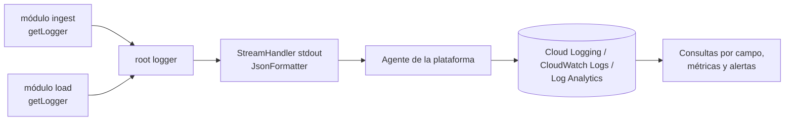

## 1. Resumen

En un pipeline, el log es lo primero que se mira cuando algo falla a las 3 a. m. El módulo `logging` de la biblioteca estándar basta para hacerlo bien con cuatro reglas:

- un logger por módulo (`getLogger(__name__)`);
- configuración solo en el punto de entrada;
- `log.exception` dentro de los `except`;
- salida estructurada en JSON, una línea por evento.

Así, la plataforma de logs (Cloud Logging, CloudWatch, Azure Monitor) puede filtrar por `batch_id` en lugar de buscar texto.

## 2. Qué es

`logging` es el sistema de registro de eventos de la biblioteca estándar de Python. Sus piezas:

- **Logger:** el objeto al que el código le habla (`log.info(...)`). Los loggers forman una jerarquía por nombre con puntos.
- **Handler:** decide adónde va el registro (stdout, archivo, red).
- **Formatter:** decide cómo se escribe.
- **LogRecord:** el evento, con nivel, mensaje, módulo, línea, excepción y los campos de `extra`.

## 3. Problema que resuelve

`print` no tiene niveles, no dice de qué módulo viene, no se puede apagar por partes y produce texto libre que no se consulta bien. En un pipeline que corre sin supervisión, hace falta saber qué lote, qué intento y qué error, poder filtrar por esos campos y alertar sobre ellos.

## 4. Cómo funciona

1. **Cada módulo pide su logger:** `log = logging.getLogger(__name__)`. El nombre refleja el paquete y permite ajustar niveles por módulo.
2. **La aplicación configura una vez**, en el punto de entrada: nivel, handler y formatter. Las bibliotecas **no** configuran handlers (como mucho `NullHandler`): esa decisión es de la aplicación que las usa.
3. **Niveles:** `DEBUG` (detalle para diagnosticar), `INFO` (hitos normales: lote recibido, lote cargado), `WARNING` (algo raro pero recuperable: un reintento), `ERROR` (falló una operación), `CRITICAL` (el proceso no puede seguir).
4. **Formato diferido:** `log.info("cargadas %d filas", n)` pasa los argumentos aparte; el texto solo se arma si el evento se emite. Para argumentos caros de calcular, `isEnabledFor`.
5. **Excepciones:** `log.exception("...")` registra en `ERROR` con el traceback y solo debe usarse dentro de un `except`. En otros niveles: `exc_info=True`.
6. **Contexto:** `extra={"batch_id": ...}` agrega campos al registro. Sus claves no deben chocar con los atributos estándar del `LogRecord` (`name`, `message`, `args`, etc.).
7. **Estructura:** un formatter que serializa cada registro a JSON produce logs que la plataforma indexa por campo.

## 5. Cuándo utilizarlo

- Siempre que el código corra sin una persona mirando: tareas de Airflow, jobs en Cloud Run, Lambdas, contenedores.
- Para registrar hitos (inicio, fin, filas procesadas), reintentos y errores con su contexto.
- Como base para métricas derivadas de logs y alertas.

## 6. Cuándo no utilizarlo

- Como canal de datos: los registros rechazados o los resultados van a una tabla o a una dead letter queue, no al log.
- Para métricas de alta frecuencia (una línea por fila procesada): mejor contadores agregados o métricas del sistema de monitoreo.
- Para auditoría con requisitos legales: requiere almacenamiento y retención específicos, no el log de la aplicación.

## 7. Ejemplo sencillo

```python
import logging

log = logging.getLogger(__name__)

def procesar(filas: list[dict]) -> None:
    log.info("procesando %d filas", len(filas))
```

Si nadie configuró `logging`, los `INFO` no se ven: el nivel por defecto del root es `WARNING`. Configurar es responsabilidad del punto de entrada.

## 8. Ejemplo de producción

Un job de ingesta en Cloud Run escribe a stdout una línea JSON por evento, con `run_id`, `batch_id`, `source` y `attempt`. Cloud Logging guarda cada línea como log estructurado. Una métrica basada en logs cuenta los eventos `ERROR` por `source` y alerta si supera un umbral, y desde la alerta se filtra por `run_id` para ver la ejecución completa. Los tokens de API y los datos personales nunca se registran: el log tiene más lectores y más retención que la tabla de origen.

## 9. Arquitectura



## 10. Código

```python
# Python 3.12, solo biblioteca estándar: logs estructurados en JSON (una línea por evento) a stdout.
import json
import logging
import sys
from datetime import UTC, datetime

STANDARD = set(vars(logging.makeLogRecord({}))) | {"message", "asctime"}  # atributos propios de LogRecord


class JsonFormatter(logging.Formatter):
    def format(self, record: logging.LogRecord) -> str:
        entry = {
            "timestamp": datetime.fromtimestamp(record.created, UTC).isoformat(),
            "severity": record.levelname,
            "logger": record.name,
            "message": record.getMessage(),
        }
        entry.update({k: v for k, v in vars(record).items() if k not in STANDARD})  # campos de extra
        if record.exc_info:
            entry["exception"] = self.formatException(record.exc_info)
        return json.dumps(entry, ensure_ascii=False, default=str)


def configure_logging(level: str = "INFO") -> None:
    """Se llama una vez, en el punto de entrada de la aplicación (nunca en una biblioteca)."""
    handler = logging.StreamHandler(sys.stdout)
    handler.setFormatter(JsonFormatter())
    logging.basicConfig(level=level, handlers=[handler], force=True)


log = logging.getLogger(__name__)


def load_batch(batch_id: str, rows: list[dict]) -> int:
    log.info("lote recibido", extra={"batch_id": batch_id, "rows": len(rows)})
    try:
        loaded = sum(1 for row in rows if row["amount"] >= 0)
    except KeyError:
        log.exception("fila sin amount", extra={"batch_id": batch_id})  # ERROR con traceback
        raise
    log.info("lote cargado", extra={"batch_id": batch_id, "loaded": loaded})
    return loaded


if __name__ == "__main__":
    configure_logging()
    load_batch("2026-10-01T10", [{"amount": 10}, {"amount": -1}])
```

Salida (una línea por evento): `{"timestamp": "...", "severity": "INFO", "logger": "__main__", "message": "lote recibido", "batch_id": "2026-10-01T10", "rows": 2}`. El nombre de cada campo es una decisión del equipo. Cada plataforma tiene sus propias convenciones de campos especiales, que conviene revisar antes de fijarlos.

## 11. GCP

**Cloud Logging** trata como *log estructurado* un registro cuyo payload es un objeto JSON guardado en `jsonPayload`: se consulta por rutas JSON y se pueden indexar campos. En GKE, App Engine flexible y Cloud Run functions, un agente integrado envía lo que la aplicación escribe en stdout y stderr. Por eso basta con escribir una línea JSON serializada por evento, como en la sección 10. También existen bibliotecas cliente de Cloud Logging, aunque la documentación recomienda usar un agente cuando está disponible.

## 12. AWS

En **CloudWatch Logs**, Logs Insights descubre los campos de los eventos en JSON y permite consultarlos con notación de punto (`detail.batch_id`). Diferencia a tener en cuenta en Lambda: Logs Insights descubre automáticamente solo el **primer** fragmento JSON de cada evento. Si un evento mezcla texto y varios JSON, hay que extraer los campos con `parse`. Una línea JSON limpia por evento evita el problema.

## 13. Azure

**Azure Monitor Logs** guarda los registros en tablas de un **Log Analytics workspace** y se consultan con **KQL**. A diferencia de Cloud Logging y CloudWatch, el modelo es explícitamente tabular: el JSON se lleva a columnas al ingerir o se interpreta en la consulta. Además, los planes de tabla cambian qué se puede consultar y cuánto cuesta.

## 14. Buenas prácticas

- `getLogger(__name__)` en cada módulo; configuración solo en el punto de entrada.
- Pasar argumentos aparte (`log.info("x=%s", x)`), no f-strings, para diferir el formateo.
- `log.exception` en los `except` que no relanzan sin contexto; no registrar y relanzar el mismo error en cada capa (se duplica).
- Incluir identificadores de correlación (`run_id`, `batch_id`) en todos los eventos.
- Una línea JSON por evento, a stdout, en plataformas con agente.
- **Seguridad:** nunca registrar secretos, tokens, cabeceras de autorización ni datos personales; los logs tienen más lectores y retención que la fuente. Revisar también qué incluyen los tracebacks y las URLs registradas.
- **Observabilidad:** los logs son una señal, no toda la observabilidad: derivar de ellos métricas (errores por fuente, lotes procesados) y alertas, y vigilar que el propio logging no se detenga (un job que deja de escribir logs también es un fallo).
- **Costo:** la ingesta y la retención de logs se cobran; `DEBUG` en producción o una línea por fila puede costar más que el propio pipeline.

## 15. Errores frecuentes

- Llamar a `basicConfig` o agregar handlers dentro de una biblioteca.
- Usar `print` en tareas que corren en la nube: sin nivel ni estructura.
- `log.error(str(exc))` en vez de `log.exception(...)`: se pierde el traceback.
- Claves de `extra` que chocan con atributos de `LogRecord` (`message`, `name`): la documentación pide evitarlo porque pisan campos que el sistema de logging usa.
- Registrar el payload completo de una API "para depurar" y filtrar datos sensibles.

## 16. Trade-offs

Los logs estructurados cuestan un poco más de código y de bytes, a cambio de consultas y alertas confiables. Más detalle ayuda a diagnosticar pero aumenta costo y riesgo de exponer datos. Las bibliotecas cliente de cada nube dan integración más rica, a cambio de acoplar el código a esa plataforma; stdout con JSON es portable.

## 17. Conceptos relacionados

- `python-error-handling-and-retries`: qué registrar en cada reintento y error.
- `python-api-consumption`: logging de la ingesta desde APIs.
- `data-pipeline`: correlación de eventos de una ejecución.
- Del blueprint, pendiente de ficha: `observability-logs`.

## 18. Preguntas técnicas abiertas

1. ¿Qué campos mínimos debería tener cada evento de log de un pipeline para diagnosticar un fallo sin abrir el código?
2. ¿Cómo evitarías que un traceback registre un token que venía en la URL de la petición?
3. ¿Qué alertas definirías a partir de logs y cuáles preferirías como métricas?

## 19. Laboratorio relacionado

Pendiente (F4).

## 20. Fuentes

- Python: *logging — Logging facility for Python*, *Logging HOWTO* y *Logging Cookbook*.
- Google Cloud: *Structured logging* (Cloud Logging).
- AWS: *Supported logs and discovered fields* (CloudWatch Logs Insights).
- Microsoft Learn: *Azure Monitor Logs overview*.

El detalle de cada fuente está en `sources` del frontmatter.

## 21. Fecha de última verificación

2026-10-04. Pasa a `verified`: revisión B-F3.1 del lote 5 aplicada, sin VERIFY pendientes.

## 22. Historial de cambios importantes

- 2026-10-02: creación (lote 5 de F3).
- 2026-10-04: revisión B-F3.1 del lote 5 aplicada (docs/reviews/cards-lote5.md): viñeta de Observabilidad en §14.
- 2026-10-04: `verification_status: verified` (revisión B-F3.1 del lote 5 aplicada; sin VERIFY pendientes).
- 2026-10-13: `page_title` en cada cita, con el título de la página citada (ADR-012); sin cambios de contenido.
