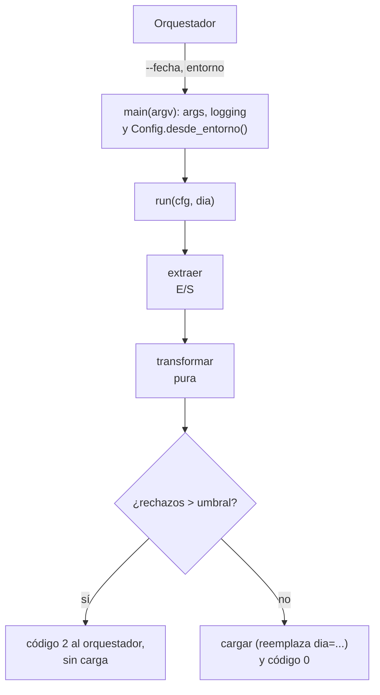

## 1. Resumen

Un job de datos en Python es fácil de escribir y difícil de operar si todo vive en un script de arriba abajo. La estructura que funciona en producción:

- **configuración desde el entorno**, validada al inicio;
- **fecha lógica como argumento**, no "hoy";
- **extraer, transformar y cargar** como funciones separadas y probables;
- **salida por partición** que se reemplaza al re-ejecutar;
- un **umbral de calidad**, y un **código de salida** que el orquestador entiende.

El mismo código corre como Cloud Run job, en un contenedor de un orquestador o, con un handler delgado, en una función.

## 2. Qué es

Es un patrón de organización del código, no una biblioteca:

```text
ventas_job/
├── config.py      # Config.desde_entorno(): falla al inicio si falta algo
├── extract.py     # extraer(cfg, dia) -> Iterator[str]
├── transform.py   # transformar(lineas) -> (validos, rechazos): pura, sin E/S
├── load.py        # cargar(cfg, dia, filas): reemplaza la partición del día
├── main.py        # main(argv) -> int: argumentos, logging, umbral, código de salida
└── tests/         # pytest por etapa y del job completo con main([...])
```

En el ejemplo de la §10 todo está en un archivo para que se lea de una vez. La separación en módulos es la misma.

## 3. Problema que resuelve

Los scripts que crecen sin estructura acumulan problemas:

- leen configuración en cualquier parte;
- usan la fecha del sistema, así que reprocesar ayer exige editar el código;
- mezclan E/S y lógica, y no se pueden probar;
- agregan datos al destino en cada ejecución (duplicados);
- terminan siempre con código 0, aunque hayan fallado.

El patrón ataca cada uno: el job se re-ejecuta para cualquier fecha, se prueba por partes y el orquestador sabe si salió bien.

## 4. Cómo funciona

1. `main(argv)` parsea los argumentos (`--fecha` como `date`) y configura el logging. Es el único lugar con efectos globales.
2. `Config.desde_entorno()` lee las variables obligatorias con `os.environ[...]`, y falla al inicio si falta una. Las opcionales tienen valor por defecto.
3. `run(cfg, dia)` encadena `extraer` → `transformar` → `cargar`:
   - la transformación es pura;
   - la extracción y la carga son las únicas con E/S.
4. Si la proporción de rechazos supera el umbral, no se carga y se devuelve un código distinto de 0.
5. `cargar` escribe la partición `dia=AAAA-MM-DD` en un temporal y la reemplaza con `os.replace`. Re-ejecutar el mismo día deja el mismo resultado.
6. El proceso termina con el código de `main`: 0 si salió bien y distinto de 0 si falló.

## 5. Cuándo utilizarlo

- Todo job batch que un orquestador ejecute por fecha o por partición.
- Jobs que hoy son notebooks o scripts y van a pasar a producción.
- Equipos donde varias personas mantienen los mismos pipelines y necesitan una forma común.

## 6. Cuándo no utilizarlo

- Para exploración puntual en un notebook: la estructura pesa más que el valor.
- Cuando la plataforma impone su propio modelo (un DAG de dbt, un pipeline de Beam): se sigue el de la herramienta, aunque las ideas de configuración, fecha lógica y código de salida aplican igual.
- Para servicios que atienden peticiones: se estructuran como aplicación (ver `data-apis-with-fastapi`), no como job.

## 7. Ejemplo sencillo

```python
import argparse
from datetime import date


def main(argv: list[str] | None = None) -> int:
    parser = argparse.ArgumentParser()
    parser.add_argument("--fecha", type=date.fromisoformat, required=True)
    args = parser.parse_args(argv)
    print(f"procesando {args.fecha}")
    return 0


print(main(["--fecha", "2026-10-07"]))   # procesando 2026-10-07 / 0
```

## 8. Ejemplo de producción

El job `ventas_job` corre cada día a las 02:00. El orquestador le pasa `--fecha` con la fecha lógica del intervalo, no la del sistema. La configuración llega por variables de entorno del despliegue, y los secretos por el gestor de secretos. Si el proveedor reenvía el archivo del lunes, el equipo relanza `--fecha 2026-10-05` y la partición se reemplaza sin duplicar. Un día con 8 % de rechazos termina con código 2: el orquestador marca la tarea como fallida y alerta, y nada llega al destino. Los tests de la CI llaman a `main([...])` con un directorio temporal.

## 9. Arquitectura



## 10. Código

```python
# Python 3.12, solo biblioteca estándar (ejecutado; mypy --strict sin errores): punto de entrada de un job.
# Configuración desde el entorno, fecha lógica por argumento, extraer → transformar → cargar como funciones
# separadas, salida por partición (re-ejecutar el mismo día la reemplaza) y código de salida para el orquestador.
import argparse
import json
import logging
import os
import tempfile
from collections.abc import Iterable, Iterator
from dataclasses import dataclass
from datetime import date
from pathlib import Path

log = logging.getLogger("ventas_job")


@dataclass(frozen=True)
class Config:
    entrada: Path
    salida: Path
    umbral_rechazos: float

    @classmethod
    def desde_entorno(cls) -> "Config":
        return cls(
            entrada=Path(os.environ["VENTAS_ENTRADA"]),                     # obligatorio: falla al inicio si falta
            salida=Path(os.environ["VENTAS_SALIDA"]),
            umbral_rechazos=float(os.environ.get("VENTAS_UMBRAL_RECHAZOS", "0.05")),
        )


def extraer(cfg: Config, dia: date) -> Iterator[str]:
    with (cfg.entrada / f"{dia:%Y-%m-%d}.jsonl").open(encoding="utf-8") as f:
        yield from f


def transformar(lineas: Iterable[str]) -> tuple[list[dict[str, object]], int]:
    validos, rechazos = [], 0
    for linea in lineas:
        reg = json.loads(linea)
        if isinstance(reg.get("monto"), int) and reg["monto"] >= 0:
            validos.append({"venta_id": reg["venta_id"], "monto": reg["monto"]})
        else:
            rechazos += 1
    return validos, rechazos


def cargar(cfg: Config, dia: date, filas: list[dict[str, object]]) -> Path:
    destino = cfg.salida / f"dia={dia:%Y-%m-%d}" / "ventas.jsonl"           # una partición por fecha lógica
    destino.parent.mkdir(parents=True, exist_ok=True)
    temporal = destino.with_name("ventas.jsonl.tmp")
    temporal.write_text("".join(json.dumps(f) + "\n" for f in filas), encoding="utf-8")
    os.replace(temporal, destino)                                           # re-ejecutar reemplaza, no duplica
    return destino


def run(cfg: Config, dia: date) -> int:
    validos, rechazos = transformar(extraer(cfg, dia))
    total = len(validos) + rechazos
    if total and rechazos / total > cfg.umbral_rechazos:
        log.error("demasiados rechazos: %d de %d", rechazos, total)
        return 2                                                             # error de datos: no cargar
    destino = cargar(cfg, dia, validos)
    log.info("cargadas %d filas en %s (%d rechazos)", len(validos), destino.parent.name, rechazos)
    return 0


def main(argv: list[str] | None = None) -> int:
    parser = argparse.ArgumentParser(description="Carga diaria de ventas")
    parser.add_argument("--fecha", type=date.fromisoformat, required=True, help="fecha lógica AAAA-MM-DD")
    args = parser.parse_args(argv)
    logging.basicConfig(level=logging.INFO, format="%(levelname)s %(name)s %(message)s")
    return run(Config.desde_entorno(), args.fecha)


if __name__ == "__main__":
    base = Path(tempfile.mkdtemp())                                          # solo para la demostración
    (base / "entrada").mkdir()
    (base / "entrada" / "2026-10-07.jsonl").write_text(
        '{"venta_id": "v1", "monto": 120}\n{"venta_id": "v2", "monto": 40}\n', encoding="utf-8")
    (base / "entrada" / "2026-10-08.jsonl").write_text(
        '{"venta_id": "v3", "monto": -5}\n{"venta_id": "v4", "monto": 75}\n', encoding="utf-8")
    os.environ |= {"VENTAS_ENTRADA": str(base / "entrada"), "VENTAS_SALIDA": str(base / "salida")}
    codigos = [main(["--fecha", "2026-10-07"]), main(["--fecha", "2026-10-07"]), main(["--fecha", "2026-10-08"])]
    print(codigos, sorted(p.parent.name for p in (base / "salida").rglob("*.jsonl")))
    # [0, 0, 2] ['dia=2026-10-07']: re-ejecutar el 07 no duplica; el 08 supera el umbral y no se carga
```

Se ejecutó con Python 3.12.3 y pasó `mypy --strict`. Las dos ejecuciones del 07 dejan una sola partición con 2 filas. La del 08 tiene 1 rechazo de 2 filas (50 %, por encima del 5 %) y devuelve 2 sin escribir. El bloque bajo `if __name__ == "__main__"` solo arma datos de demostración: en producción, el punto de entrada sería `raise SystemExit(main())`. El reemplazo usa `os.replace`: si tiene éxito, el renombrado es atómico (requisito de POSIX), y puede fallar entre sistemas de archivos distintos.

## 11. GCP

En **Cloud Run jobs**, el contenedor debe terminar con código 0 si completó bien y distinto de 0 si falló, y no debe levantar un servidor web. Es exactamente el `main() -> int` de este patrón. Cada tarea recibe `CLOUD_RUN_TASK_INDEX`, `CLOUD_RUN_TASK_COUNT` y `CLOUD_RUN_TASK_ATTEMPT`. Para repartir el trabajo entre tareas paralelas, por ejemplo una tienda o un archivo por tarea, `run` puede filtrar por índice. Con paralelismo mayor que 1, las tareas pueden no ejecutarse en orden de índice.

## 12. AWS

En **Lambda**, el punto de entrada es un handler (`lambda_handler(event, context)`) que corre hasta que responde, sale o vence el timeout. La documentación recomienda inicializar clientes y logger fuera del handler para aprovechar la reutilización del entorno. Con este patrón, el handler es una capa delgada: toma la fecha del evento, arma la `Config` y llama a `run`. En lugar de un código de salida, comunica el fallo lanzando una excepción o en la respuesta.

## 13. Azure

En **Azure Functions** con el modelo v2, cada función es un método global y sin estado en `function_app.py`, con triggers y bindings declarados con decoradores. Igual que en Lambda, la función es una capa delgada sobre `run`. La documentación aclara que las variables globales y los archivos de `tmp/` no tienen persistencia garantizada entre invocaciones, así que la idempotencia tiene que vivir en el destino (la partición), no en el proceso.

## 14. Buenas prácticas

- Todo lo variable por entorno o por argumento; nada de rutas, fechas ni credenciales en el código.
- Validar la configuración al inicio y fallar rápido con un mensaje claro.
- Fecha lógica siempre explícita; nunca `date.today()` dentro de la lógica.
- Transformaciones puras y E/S en los extremos, para probar sin infraestructura.
- Salida por partición que se reemplaza; códigos de salida distintos para error de datos y error de sistema.
- **Seguridad:** secretos desde el gestor de la plataforma en variables de entorno o al inicio, nunca en argumentos (quedan en el historial y en la definición del job); permisos mínimos para la identidad del job.
- **Observabilidad:** un log al inicio con la fecha lógica y la versión del código, y uno al final con filas leídas, cargadas y rechazadas; el código de salida como señal para el orquestador y las alertas.
- **Costo:** fallar rápido por configuración o por umbral evita ejecutar y cargar trabajo que habrá que rehacer; reprocesar solo la partición afectada es más barato que recargar todo.

## 15. Errores frecuentes

- Usar la fecha del sistema y no poder reprocesar sin editar el código.
- `except Exception: pass` en `main`, que termina con código 0 aunque haya fallado.
- Configuración leída en mitad del proceso: el job falla tarde, después de haber escrito algo.
- Agregar al destino en lugar de reemplazar la partición: duplicados al re-ejecutar.
- Transformaciones que leen o escriben archivos por dentro: imposibles de probar sin infraestructura.

## 16. Trade-offs

La estructura agrega archivos y algo de ceremonia a un job que podría ser un script de 50 líneas. A cambio, se puede probar, re-ejecutar por fecha y operar sin leer el código. Reemplazar particiones completas es simple e idempotente, pero reescribe toda la partición aunque cambie una fila. Para cambios pequeños sobre particiones grandes conviene un upsert (ver `python-database-io`).

## 17. Conceptos relacionados

- `data-pipeline` y `data-orchestration`: el contexto del job.
- `testing-with-pytest`: probar etapas y `main`.
- `python-logging`: logging configurado en el punto de entrada.
- `idempotency`: reemplazar la partición.
- `python-file-processing` y `python-database-io`: casos concretos de extracción y carga.
- `data-apis-with-fastapi`: servicios que atienden peticiones (§6).

## 18. Preguntas técnicas abiertas

1. ¿Qué códigos de salida usarías para distinguir un error de datos de un error de infraestructura, y qué haría el orquestador con cada uno?
2. ¿Cómo repartirías el trabajo de un día entre tareas paralelas sin que dos escriban la misma partición?
3. ¿Qué parte de tu job actual depende de la fecha del sistema?

## 19. Laboratorio relacionado

Pendiente (F4).

## 20. Fuentes

- Python 3.12: *argparse*, *os* y *logging*.
- Google Cloud: *Container runtime contract* (Cloud Run jobs).
- AWS: *Define Lambda function handler in Python*.
- Microsoft Learn: *Python developer reference for Azure Functions*.

El detalle de cada fuente está en `sources` del frontmatter.

## 21. Fecha de última verificación

2026-10-09. Pasa a `verified`: revisión B-F3.1 del lote F3b-03b aplicada, sin VERIFY pendientes.

## 22. Historial de cambios importantes

- 2026-10-08: creación (lote F3b-03b).
- 2026-10-09: revisión B-F3.1 del lote F3b-03b aplicada (docs/reviews/cards-f3b-03b.md): filas aprobadas sin cambios en esta ficha.
- 2026-10-09: `verification_status: verified` (sin VERIFY pendientes).
- 2026-10-13: `page_title` en cada cita, con el título de la página citada (ADR-012); sin cambios de contenido.
- 2026-10-14: lote F3b-rel (regla del §17): relations incluye `python-database-io`, `data-apis-with-fastapi`; el §17 nombra `data-apis-with-fastapi`, que el cuerpo ya citaba.
- 2026-10-25: §9 con el estándar de diagramas (máximo 8 nodos, CLAUDE.md): TB (la cadena tiene 7 nodos); Config en el nodo de main; sin las flechas de vuelta al orquestador: el código de salida va en la etiqueta.
