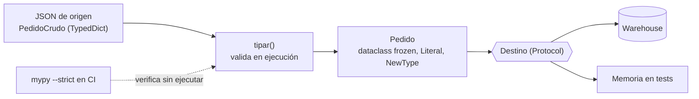

## 1. Resumen

Las anotaciones de tipo (`def total(montos: list[int]) -> int`) documentan qué espera y qué devuelve el código. Un type checker como mypy encuentra errores antes de ejecutar. Python **no** las hace cumplir en ejecución: un `str` donde se esperaba `int` pasa la llamada y falla más adelante, o no falla. Por eso los tipos sirven para el código propio. Los datos que vienen de afuera (JSON, CSV, APIs) se validan aparte, con código o con Pydantic.

## 2. Qué es

Es un sistema de anotaciones opcionales y el módulo `typing`, que da soporte en ejecución a esas anotaciones. Construcciones útiles en pipelines:

- **Tipos genéricos de colecciones:** `list[str]`, `dict[str, int]`, `tuple[str, int]`.
- **`X | None`:** el valor puede faltar (antes `Optional[X]`).
- **`Literal["pagado", "anulado"]`:** solo esos valores.
- **`NewType("PedidoId", str)`:** un tipo distinto para el checker, sin costo en ejecución.
- **`TypedDict`:** la forma esperada de un dict (por ejemplo, un JSON de origen). En ejecución es un `dict` común.
- **`Protocol`:** "cualquier objeto con estos métodos" (subtipado estructural, sin herencia).
- **dataclasses:** registros con campos tipados y métodos generados.

## 3. Problema que resuelve

En código de datos, muchos errores son de forma:

- un campo que puede venir `None`;
- un monto que llega como texto;
- un id de pedido pasado donde se esperaba un id de cliente;
- un estado mal escrito.

Sin tipos, se descubren en producción. Con tipos y mypy en la CI, muchos aparecen al revisar el código.

## 4. Cómo funciona

1. Se anotan parámetros, retornos, variables y campos.
2. Un **type checker** (mypy, entre otros) analiza el código sin ejecutarlo y reporta incompatibilidades. Por ejemplo, pasar `list[str]` a una función que pide `list[int]`, o usar un `str | None` sin comprobar `None`.
3. En **ejecución**, Python guarda las anotaciones pero no las verifica. `NewType` devuelve el mismo valor y un `TypedDict` es un `dict`.
4. **Narrowing:** después de `if x is None: raise ...`, el checker sabe que `x` ya no es `None`. Pasar un `str` a un `Literal` requiere comprobar el valor, por ejemplo con un dict de valores válidos.
5. **Frontera:** los datos externos se tipan como "crudos" (`TypedDict` con `str`) y se convierten a registros validados (dataclass con `int`, `Literal`) en una función de validación.

## 5. Cuándo utilizarlo

- En todo código de pipeline que vaya a mantenerse: firmas tipadas y `mypy --strict` en la CI.
- Para distinguir el registro crudo del validado (tipos distintos, función de conversión entre ambos).
- Con `Protocol` para que un componente acepte cualquier destino (BigQuery, archivo, memoria en tests) sin herencia.
- Con `Literal` o `Enum` para estados y códigos con un conjunto cerrado de valores.

## 6. Cuándo no utilizarlo

- No como validación de datos de entrada: las anotaciones no se verifican en ejecución. Para eso, validación explícita o Pydantic (ver `data-validation-with-pydantic`).
- No llenar el código de `Any` o de `# type: ignore` para "pasar" mypy: se pierde la verificación sin decirlo.
- En notebooks de exploración, el costo de tipar todo suele no pagar; sí en el código que pasa a producción.

## 7. Ejemplo sencillo

```python
def total(montos: list[int]) -> int:
    return sum(montos)


print(total(["10", "20"]))   # Python ejecuta la llamada y falla dentro de sum con TypeError
```

Ejecutado con Python 3.12: termina con `TypeError` dentro de `sum`. `mypy` reporta antes de ejecutar dos errores `[list-item]`: `List item 0 has incompatible type "str"; expected "int"`, y lo mismo para el ítem 1.

## 8. Ejemplo de producción

Una ingesta de pedidos tipa el JSON de origen como `PedidoCrudo` (`TypedDict`, todo `str`) y el registro validado como `Pedido` (dataclass inmutable con `PedidoId`, `int` y `Literal`). La única forma de pasar de uno a otro es `tipar()`, que valida y lanza una excepción si el estado es desconocido. El cargador recibe un `Destino` (`Protocol`): en producción escribe en el warehouse y en los tests es una lista en memoria. `mypy --strict` corre en la CI junto con pytest.

## 9. Arquitectura



## 10. Código

```python
# Python 3.12 (ejecutado; mypy --strict sin errores): registro crudo vs validado, Literal, NewType y Protocol.
from dataclasses import dataclass
from typing import Literal, NewType, Protocol, TypedDict

PedidoId = NewType("PedidoId", str)
Estado = Literal["pagado", "anulado"]
ESTADOS: dict[str, Estado] = {"pagado": "pagado", "anulado": "anulado"}


class PedidoCrudo(TypedDict):          # forma del JSON de origen
    id: str
    monto: str
    estado: str


@dataclass(frozen=True)
class Pedido:                          # registro ya validado
    id: PedidoId
    monto: int
    estado: Estado
    cupon: str | None = None


class Destino(Protocol):               # cualquier objeto con este método sirve, sin herencia
    def escribir(self, pedidos: list[Pedido]) -> int: ...


def tipar(crudo: PedidoCrudo) -> Pedido:
    estado = ESTADOS.get(crudo["estado"])   # str → Literal: el diccionario hace la validación
    if estado is None:
        raise ValueError(f"estado desconocido: {crudo['estado']!r}")
    return Pedido(PedidoId(crudo["id"]), int(crudo["monto"]), estado)


class EnMemoria:
    def __init__(self) -> None:
        self.filas: list[Pedido] = []

    def escribir(self, pedidos: list[Pedido]) -> int:
        self.filas.extend(pedidos)
        return len(pedidos)


def cargar(destino: Destino, crudos: list[PedidoCrudo]) -> int:
    return destino.escribir([tipar(c) for c in crudos])


print(cargar(EnMemoria(), [{"id": "A1", "monto": "1250", "estado": "pagado"}]))   # 1
```

`EnMemoria` no hereda de `Destino`: cumple el protocolo porque tiene el método `escribir` con la firma correcta, y mypy lo verifica.

## 11. GCP

No aplica de forma específica: las anotaciones son del lenguaje y el runtime no las verifica en ninguna plataforma.

## 12. AWS

No aplica de forma específica (ver §11).

## 13. Azure

No aplica de forma específica (ver §11).

## 14. Buenas prácticas

- `mypy --strict` (o el checker del equipo) en la CI, no solo en el editor.
- Separar tipos crudos y validados; una sola función de conversión entre ambos.
- `X | None` explícito donde un campo puede faltar, y tratar el `None` antes de usarlo.
- Cada `# type: ignore` lleva su código de error (`[call-arg]`) y un motivo.
- **Seguridad:** los tipos no protegen contra datos maliciosos o mal formados de entrada; validar en la frontera (tamaño, formato, valores permitidos) antes de usar los datos en consultas, rutas o comandos.
- **Observabilidad:** cuando la validación en la frontera rechaza un registro, registrar el campo y el motivo; los errores de tipo que mypy no pudo ver aparecen ahí.
- **Costo:** el chequeo estático corre en la CI y no agrega costo en ejecución; la validación en ejecución sí cuesta CPU por registro, por eso se hace una vez en la frontera y no en cada paso.

## 15. Errores frecuentes

- Creer que las anotaciones validan datos en ejecución.
- Tipar como `dict[str, Any]` todo lo que viene de un JSON y perder la verificación de ahí en adelante.
- Usar `cast()` para "convertir" un valor: no convierte nada en ejecución, solo le dice al checker que confíe.
- Anotar `Optional`/`X | None` y luego usar el valor sin comprobar `None`.

## 16. Trade-offs

Tipar cuesta tiempo al escribir y a veces obliga a reestructurar código dinámico. A cambio, da documentación verificable y menos errores de forma en producción. El chequeo estático no ve los datos reales, y la validación en ejecución (Pydantic) sí, pero cuesta CPU. En la práctica se usan ambos: tipos para el código y validación en la frontera para los datos.

## 17. Conceptos relacionados

- `data-validation-with-pydantic`: validación en ejecución con las mismas anotaciones.
- `python-classes`: dataclasses como registros tipados.
- `python-functions`: firmas tipadas.
- `data-contracts`: el contrato de datos fuera del código.

## 18. Preguntas técnicas abiertas

1. ¿En qué punto exacto de tu pipeline pasa un dato de "crudo" a "validado", y qué tipo lo representa en cada lado?
2. ¿Qué harías con una biblioteca sin anotaciones que usas en el código tipado?
3. ¿Cuándo preferirías `Literal` y cuándo un `Enum` para un estado?

## 19. Laboratorio relacionado

Pendiente (F4).

## 20. Fuentes

- Python: *typing — Support for type hints* y *dataclasses — Data Classes*.

El detalle de cada fuente está en `sources` del frontmatter.

## 21. Fecha de última verificación

2026-10-08. Pasa a `verified`: revisión B-F3.1 del lote F3b-03a aplicada, sin VERIFY pendientes.

## 22. Historial de cambios importantes

- 2026-10-08: creación (lote F3b-03a).
- 2026-10-08: revisión B-F3.1 del lote F3b-03a aplicada (docs/reviews/cards-f3b-03a.md): la documentación de Python se cita en `/3.12/`, la versión con la que se ejecutó el código.
- 2026-10-08: `verification_status: verified` (sin VERIFY pendientes).
