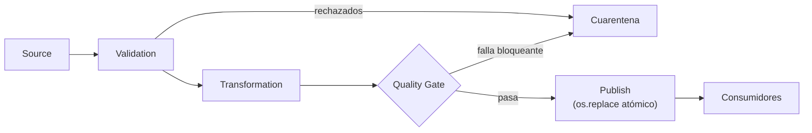

## 1. Resumen

Un **quality gate** es un paso que decide si una salida se publica. Va entre la transformación y la publicación:

**Source → Validation → Transformation → Quality Gate → Publish**

- La **validación** de entrada rechaza registros que no cumplen el schema o las reglas por registro.
- La **transformación** produce la salida.
- El **gate** evalúa reglas sobre la salida y el lote completo. Si una regla bloqueante falla, **no publica**: lo que ven los consumidores sigue siendo la versión anterior, y el lote va a cuarentena con el motivo.
- La **publicación** es atómica: los consumidores ven la versión vieja o la nueva, nunca una a medias.

## 2. Qué es

- **Regla bloqueante:** si falla, el lote no se publica (severidad `error`).
- **Regla de aviso:** si falla, se publica y se avisa (severidad `warn`).
- **Cuarentena:** donde queda el lote bloqueado, con las fallas y los registros rechazados.
- **Publicación atómica:** se escribe aparte y se reemplaza de una vez; en un sistema de archivos, `os.replace`, que si tiene éxito es atómico (*os — Miscellaneous operating system interfaces*).

## 3. Problema que resuelve

Un proceso nocturno publica ventas por tienda. Una noche, el origen manda la mitad de las filas con montos `abc`. El pipeline descarta lo que no puede leer, publica totales a la mitad y el tablero de la mañana muestra una caída del 50 %. Con un gate, el lote se bloquea por exceso de rechazos, el tablero sigue con los datos de ayer (marcados como de ayer) y el equipo recibe el motivo.

## 4. Cómo funciona

1. **Source:** el lote llega y se guarda tal cual.
2. **Validation:** se separan registros válidos y rechazados.
3. **Transformation:** se calcula la salida con los válidos.
4. **Quality Gate:** se evalúan reglas sobre el lote y la salida, por ejemplo:
   - proporción de rechazos bajo un umbral;
   - la salida cuadra con la entrada válida (suma de montos);
   - la salida no está vacía.
5. **Publish:** si no falla ninguna regla bloqueante, se escribe a un archivo temporal y se reemplaza el publicado con `os.replace`. Si falla, el publicado no se toca y el lote va a cuarentena.
6. Re-ejecutar el mismo lote da el mismo resultado: publicar es reemplazar, no agregar.

## 5. Cuándo utilizarlo

- Antes de publicar a consumidores que toman decisiones con los datos (tableros, finanzas, modelos).
- Cuando una publicación mala cuesta más que una publicación atrasada.
- Al final de cada etapa que produce una tabla que otros leen.

## 6. Cuándo no utilizarlo

- Con reglas que bloquean por cualquier caso: el gate se vuelve un obstáculo y se desactiva.
- Cuando publicar tarde es peor que publicar con fallas conocidas: usar reglas de aviso y marcar la calidad.
- Como sustituto de validar en la entrada: el gate llega tarde para explicar qué registro falló.

## 7. Ejemplo sencillo

Dos lotes de ventas:

| Lote | Rechazos | Cuadra | Resultado | Lo publicado |
|---|---|---|---|---|
| `lote-1` | 0/3 | Sí | Publicado | `{"norte": 45, "sur": 10}` |
| `lote-2` | 2/3 (tienda vacía, monto `abc`) | Sí | Bloqueado: rechazos sobre el 20 % | Sigue `{"norte": 45, "sur": 10}` |

## 8. Ejemplo de producción

Un pipeline diario de ventas con dbt y un orquestador:

- ingesta con validación de schema; los rechazados van a una tabla de cuarentena;
- modelos de dbt con data tests: `unique` y `not_null` en la clave con severidad `error`, y una regla de proporción de rechazos con `warn_if: "> 0"` y `error_if: "> 100"` (*severity, error_if, and warn_if*);
- `dbt build` corre modelos y tests en orden y salta lo que depende de un test fallido (*About dbt build command*);
- la vista que leen los tableros apunta a la última versión que pasó el gate.

## 9. Arquitectura



## 10. Código

```python
"""Source -> Validation -> Transformation -> Quality Gate -> Publish, con publicación atómica."""
import csv
import json
import os
import sys
from pathlib import Path

BASE = Path(sys.argv[1] if len(sys.argv) > 1 else "work")
PUBLICADO = BASE / "publicado" / "ventas_por_tienda.json"
MAX_RECHAZOS = 0.2   # el gate bloquea si se rechaza más del 20 % del lote


def validar(filas: list[dict[str, str]]) -> tuple[list[dict[str, str]], list[dict[str, str]]]:
    ok = [f for f in filas if f["tienda"] and f["monto"].isdigit()]
    return ok, [f for f in filas if f not in ok]


def transformar(filas: list[dict[str, str]]) -> dict[str, int]:
    total: dict[str, int] = {}
    for f in filas:
        total[f["tienda"]] = total.get(f["tienda"], 0) + int(f["monto"])
    return total


def gate(validas: list[dict[str, str]], rechazadas: list[dict[str, str]], salida: dict[str, int]) -> list[str]:
    fallas = []
    if len(rechazadas) / (len(validas) + len(rechazadas)) > MAX_RECHAZOS:
        fallas.append(f"rechazos {len(rechazadas)}/{len(validas) + len(rechazadas)}")
    if sum(salida.values()) != sum(int(f["monto"]) for f in validas):
        fallas.append("la salida no cuadra con la entrada válida")
    if not salida:
        fallas.append("salida vacía")
    return fallas


def correr(lote: str, csv_text: str) -> None:
    origen = BASE / "origen" / f"{lote}.csv"
    origen.parent.mkdir(parents=True, exist_ok=True)
    origen.write_text(csv_text, encoding="utf-8")
    with origen.open(encoding="utf-8", newline="") as f:
        validas, rechazadas = validar(list(csv.DictReader(f)))
    salida = transformar(validas)
    fallas = gate(validas, rechazadas, salida)
    if fallas:
        cuarentena = BASE / "cuarentena" / f"{lote}.json"
        cuarentena.parent.mkdir(parents=True, exist_ok=True)
        cuarentena.write_text(json.dumps({"fallas": fallas, "rechazadas": rechazadas}), encoding="utf-8")
        print(f"{lote}: BLOQUEADO ({'; '.join(fallas)}); se mantiene lo publicado")
        return
    staging = PUBLICADO.with_suffix(".tmp")
    staging.parent.mkdir(parents=True, exist_ok=True)
    staging.write_text(json.dumps(salida, sort_keys=True), encoding="utf-8")
    os.replace(staging, PUBLICADO)   # los lectores ven el archivo viejo o el nuevo, nunca uno a medias
    print(f"{lote}: publicado {salida}")


correr("lote-1", "tienda,monto\nnorte,40\nsur,10\nnorte,5\n")
correr("lote-2", "tienda,monto\nnorte,40\n,10\nsur,abc\n")
print("lo publicado:", PUBLICADO.read_text(encoding="utf-8"))
```

El script se **ejecuta en la CI** y pasa `mypy --strict`. Imprime `lote-1: publicado {'norte': 45, 'sur': 10}`, `lote-2: BLOQUEADO (rechazos 2/3); se mantiene lo publicado` y `lo publicado: {"norte": 45, "sur": 10}`. El test comprueba también que `cuarentena/lote-2.json` existe.

## 11. GCP

En GCP, **Knowledge Catalog** corre escaneos de calidad, que se pueden lanzar desde Airflow. Según *Use auto data quality* y *Google Knowledge Catalog Operators* (no ejecutado):

| | Gate en el pipeline (este patrón) | Knowledge Catalog desde Airflow |
|---|---|---|
| Evaluación | En el mismo proceso, antes de publicar | Un escaneo de calidad sobre la tabla (`DataplexRunDataQualityScanOperator`) |
| Decisión | El código no publica si falla una regla bloqueante | Un sensor comprueba que el job terminó y otro operador obtiene el resultado; las páginas no describen que la tarea falle por una regla incumplida: esa decisión la escribe el DAG |
| Aviso | Lo implementa el equipo | Reportes por correo según el puntaje y alertas sobre Cloud Logging |

## 12. AWS

En AWS, **AWS Glue Data Quality** en ETL jobs. Según *AWS Glue Data Quality* y *Data Quality for ETL jobs in AWS Glue Studio notebooks* (no ejecutado):

| | Gate en el pipeline (este patrón) | AWS Glue Data Quality en ETL jobs |
|---|---|---|
| Momento | Antes de publicar | Proactivo: identificar y filtrar datos malos antes de cargarlos al lake |
| Granularidad | Por lote: publica todo o nada | Por fila: `rowLevelOutcomes`; el ejemplo escribe solo las filas `Passed` |
| Sobre el Data Catalog | — | Evalúa tablas ya catalogadas; no identifica registros fallidos |

Escribir solo las filas que pasan es un filtro, no un gate: el lote se publica incompleto. Las dos cosas se combinan con una regla de proporción de rechazos.

## 13. Azure

En Azure, **Microsoft Purview Unified Catalog**. Según *Overview of data quality in Microsoft Purview Unified Catalog* (no ejecutado):

| | Gate en el pipeline (este patrón) | Microsoft Purview |
|---|---|---|
| Evaluación | En el pipeline, antes de publicar | Escaneos de calidad programados sobre los activos |
| Resultado | Publicar o no | Puntajes por regla, activo, data product y dominio, y alertas a dueños y data stewards |
| Bloqueo | Sí | La página describe puntajes y alertas; no describe detener un pipeline |

## 14. Buenas prácticas

- Pocas reglas bloqueantes, elegidas con los consumidores; el resto, avisos.
- Publicación atómica: escribir aparte y reemplazar.
- La cuarentena guarda el motivo y los datos para reprocesar.
- Mostrar a los consumidores la fecha de la última versión publicada.
- **Seguridad:** la cuarentena tiene los mismos permisos que el destino.
- **Observabilidad:** registrar cada decisión del gate (lote, reglas, valores, publicado o no) y alertar por bloqueos.
- **Costo:** un lote bloqueado se reprocesa completo; validar en la entrada reduce cuántos llegan al gate.

## 15. Errores frecuentes

- Publicar y después validar: los consumidores ya leyeron los datos malos.
- Escribir directamente sobre el archivo publicado: un fallo a mitad deja un archivo roto.
- Gates que solo avisan, en canales que nadie mira.
- Un umbral de rechazos en cero para fuentes que siempre traen algún registro malo.

## 16. Trade-offs

Bloquear protege a los consumidores y atrasa la publicación. Filtrar por fila publica a tiempo y publica incompleto. Un gate dentro del pipeline decide con todo el contexto del lote; una herramienta de catálogo da visibilidad central y, según sus páginas, avisa en lugar de bloquear.

## 17. Conceptos relacionados

- `data-reconciliation`: la cuadratura con la entrada.
- `schema-validation`: validación en la entrada.
- `custom-data-validators`: reglas y severidades.
- `data-quality-dimensions`: qué mide cada regla.
- `sql-quality-checks`: reglas en SQL.
- `dbt-core-concepts`: `dbt build` y los tests.
- `idempotency`: re-ejecutar sin duplicar.
- `dead-letter-queue`: la cuarentena.

## 18. Preguntas técnicas abiertas

1. ¿Qué regla, si fallara, debería impedir publicar tu tabla más usada?
2. ¿Tus consumidores saben de qué fecha es lo que están viendo?
3. ¿Tu publicación es atómica?

## 19. Laboratorio relacionado

Pendiente (F4).

## 20. Fuentes

- dbt: *About dbt build command* y *severity, error_if, and warn_if*.
- Python 3.12: *os — Miscellaneous operating system interfaces*.
- Google Cloud: *Use auto data quality*. Apache Airflow: *Google Knowledge Catalog Operators*.
- AWS: *AWS Glue Data Quality* y *Data Quality for ETL jobs in AWS Glue Studio notebooks*.
- Microsoft Learn: *Overview of data quality in Microsoft Purview Unified Catalog*.

El detalle de cada fuente está en `sources` del frontmatter.

## 21. Fecha de última verificación

2026-10-20. Pasa a `verified`: revisión B-F3.1 del lote F3b-15a sin hallazgos, sin VERIFY pendientes.

## 22. Historial de cambios importantes

- 2026-10-20: creación (lote F3b-15a).
- 2026-10-20: revisión B-F3.1 del lote F3b-15a (docs/reviews/cards-f3b-15a.md), sin hallazgos que corregir.
- 2026-10-20: `verification_status: verified` (sin VERIFY pendientes).
