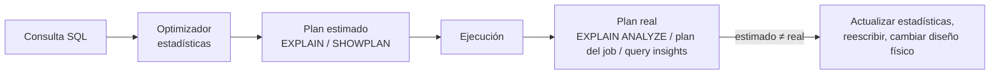

## 1. Resumen

El plan de ejecución es la secuencia de operaciones con que el motor resuelve una consulta: qué lee, en qué orden une, dónde filtra y cuántas filas espera en cada paso. Es la herramienta para responder "¿por qué esta consulta es lenta o cara?" con datos en lugar de intuición.

Cada motor lo expone distinto:

- **antes de ejecutar**, como `EXPLAIN` en PostgreSQL y Redshift o `SHOWPLAN_XML` en T-SQL, con estimaciones;
- **después o durante la ejecución**, como `EXPLAIN ANALYZE` en PostgreSQL o el plan de cada job en BigQuery, con valores reales.

## 2. Qué es

| Motor | Plan estimado (sin ejecutar) | Plan real |
|---|---|---|
| PostgreSQL | `EXPLAIN` | `EXPLAIN ANALYZE` (ejecuta la consulta) |
| Redshift | `EXPLAIN [VERBOSE]` | No detallado en esta ficha |
| BigQuery | — (el *dry run* estima bytes, no da plan) | Plan y línea de tiempo del job: etapas, pasos y slot-time |
| Fabric Warehouse | `SET SHOWPLAN_XML ON` | Vistas `queryinsights.*` |

## 3. Problema que resuelve

Dos consultas que devuelven lo mismo pueden costar órdenes de magnitud distintos. El plan muestra dónde se va el tiempo o los bytes:

- un escaneo completo donde se esperaba poda de particiones;
- un join que redistribuye una tabla grande;
- una estimación de filas muy lejos de la realidad, que lleva al motor a una mala estrategia.

## 4. Cómo funciona

1. **El optimizador elige un plan** según el SQL, las estadísticas de las tablas y la distribución de los datos.
2. **Lectura del plan:** es un árbol (o un grafo de etapas, en BigQuery) que se lee de las hojas, las lecturas, hacia la raíz, el resultado.
3. **Costos:** PostgreSQL y Redshift dan costos relativos, útiles para comparar operaciones dentro de un mismo plan, no entre consultas ni como tiempo real.
4. **Estimado frente a real:** PostgreSQL señala que lo más importante es comparar filas estimadas y reales. Una diferencia grande suele venir de estadísticas desactualizadas; Redshift basa sus estimaciones en `ANALYZE`.
5. **Señales típicas:**
   - lecturas de particiones que deberían haberse podado;
   - `DS_BCAST_INNER` o `DS_DIST_BOTH` en Redshift;
   - etapas con mucho shuffle o sesgo de particiones en BigQuery.

## 5. Cuándo utilizarlo

- Antes de poner en producción una consulta recurrente sobre tablas grandes.
- Cuando una consulta se vuelve lenta o cara sin cambios en el SQL: el volumen o la distribución cambiaron.
- Para confirmar que la poda de particiones, el clustering o una clave de distribución funcionan como se espera.

## 6. Cuándo no utilizarlo

- `EXPLAIN ANALYZE` sobre sentencias que modifican datos en producción: ejecuta la sentencia. En PostgreSQL se puede envolver en una transacción que se revierte.
- Para comparar costos entre motores o entre consultas distintas: los costos son relativos a cada plan.
- Para optimizar consultas que corren una vez y son baratas.

## 7. Ejemplo sencillo

```sql
-- PostgreSQL (ejecutado).
EXPLAIN SELECT count(*) FROM eventos WHERE ocurrido >= '2026-10-05' AND ocurrido < '2026-10-06';
```

El plan muestra que solo se lee la partición de octubre.

## 8. Ejemplo de producción

Un modelo diario en Redshift pasó de 5 a 40 minutos. `EXPLAIN` mostró `DS_BCAST_INNER` en el join con una dimensión que había crecido de miles a millones de filas: el motor copiaba la tabla completa a todos los nodos. Al distribuir la dimensión por la clave del join (ver `join-optimization`), el plan cambió a `DS_DIST_NONE`.

En BigQuery, otro modelo marcó *partition skew* en una etapa del grafo de ejecución: unas pocas claves concentraban la mayoría de las filas del join.

## 9. Arquitectura



## 10. Código

```sql
-- PostgreSQL (ejecutado) sobre una tabla particionada por mes.
-- 1) Plan estimado: se lee solo la partición de octubre (poda).
EXPLAIN (COSTS OFF)
SELECT count(*) FROM eventos WHERE ocurrido >= '2026-10-05' AND ocurrido < '2026-10-06';
--  Aggregate
--    ->  Seq Scan on eventos_2026_10 eventos
--          Filter: ((ocurrido >= '2026-10-05'::date) AND (ocurrido < '2026-10-06'::date))

-- 2) Una función sobre la columna de partición impide la poda: se leen ambas particiones.
EXPLAIN (COSTS OFF)
SELECT count(*) FROM eventos WHERE to_char(ocurrido, 'YYYY-MM') = '2026-10';
--  Aggregate
--    ->  Append
--          ->  Seq Scan on eventos_2026_09 eventos_1  (Filter: to_char(...) = '2026-10')
--          ->  Seq Scan on eventos_2026_10 eventos_2  (Filter: to_char(...) = '2026-10')

-- 3) Estimado frente a real: EXPLAIN ANALYZE ejecuta la consulta.
EXPLAIN (ANALYZE, TIMING OFF, SUMMARY OFF)
SELECT count(*) FROM eventos WHERE usuario = 7;
```

La consulta 3 muestra, por cada partición, `rows=` estimado y `actual rows=` reales, además de *Rows Removed by Filter*. En la prueba, las estimaciones fueron del mismo orden que las reales (8 frente a 8 y 4 frente a 4); los números exactos varían con los datos aleatorios de la prueba.

## 11. GCP

**BigQuery** no tiene `EXPLAIN` previo. Cada job de consulta incluye un plan de diagnóstico y su línea de tiempo, comparables a `EXPLAIN` según la documentación, en la pestaña *Execution graph* y por la API (`jobs.get`). Es un grafo de etapas con pasos (`READ`, `COMPUTE`, `FILTER`, `JOIN`, …) unidas por shuffle, con el slot-time de cada etapa. Se actualiza periódicamente en consultas largas.

Los *dry runs* y los resultados en caché no incluyen ese diagnóstico. Las *query insights* marcan contención de slots, exceso de shuffle y sesgo de particiones en la etapa afectada.

## 12. AWS

En **Redshift**, `EXPLAIN` muestra el plan sin ejecutar la consulta. El costo es relativo y las filas estimadas dependen de las estadísticas de `ANALYZE`. En los joins, las etiquetas de redistribución indican el movimiento de datos:

- `DS_DIST_NONE` y `DS_DIST_ALL_NONE` son buenas, porque el join está colocalizado;
- `DS_BCAST_INNER` copia la tabla interna a todos los nodos;
- `DS_DIST_BOTH` redistribuye ambas tablas.

## 13. Azure

En **Fabric Warehouse** y en el pool SQL dedicado de Synapse, `SET SHOWPLAN_XML ON` devuelve el plan estimado en XML sin ejecutar las sentencias: costos, filas, operadores y orden de los joins. Fabric agrega vistas `queryinsights.*` con el historial de consultas, las de larga duración y las frecuentes, para encontrar qué consultas revisar.

## 14. Buenas prácticas

- Mirar primero las hojas del plan: qué se lee y cuánto.
- Comparar filas estimadas y reales; si difieren mucho, actualizar estadísticas antes de reescribir.
- Guardar el plan de las consultas críticas para comparar cuando se vuelvan lentas.
- No usar `EXPLAIN ANALYZE` con sentencias de modificación fuera de una transacción revertida.
- **Seguridad:** los planes y el historial de consultas pueden incluir literales del SQL (por ejemplo, un RUT en un filtro); restringir el acceso a esas vistas.
- **Observabilidad:** revisar periódicamente las consultas más largas y más frecuentes (`queryinsights` en Fabric, historial de jobs en BigQuery) y no solo cuando alguien reclama.
- **Costo:** el plan muestra los bytes o filas leídos por etapa; es el lugar para confirmar que una optimización redujo lo que se paga.

## 15. Errores frecuentes

- Comparar costos de `EXPLAIN` entre consultas distintas como si fueran tiempos.
- Optimizar el SQL cuando el problema son estadísticas desactualizadas.
- Ejecutar `EXPLAIN ANALYZE` de un `DELETE` en producción.
- Buscar un `EXPLAIN` previo en BigQuery: el plan viene con el job; el *dry run* solo estima bytes.

## 16. Trade-offs

El plan estimado es gratis y seguro, pero puede equivocarse si las estadísticas están mal. El plan real es exacto, a cambio de ejecutar la consulta. Ajustar consultas una a una mejora casos puntuales; cambiar el diseño físico (particiones, distribución, clustering) mejora muchas consultas a la vez, a cambio de una migración.

## 17. Conceptos relacionados

- `partition-pruning`: lo primero que hay que confirmar en el plan.
- `sql-joins`: estrategias y movimiento de datos.
- `clustering`: menos datos leídos.
- Del blueprint, en este lote: `scan-reduction`, `predicate-pushdown` y `join-optimization`.

## 18. Preguntas técnicas abiertas

1. ¿Qué consultas de tu pipeline revisarías primero con el plan y por qué?
2. ¿Cómo detectarías que las estadísticas de una tabla quedaron desactualizadas?
3. ¿Qué señal del plan te haría cambiar el diseño físico de una tabla en lugar de la consulta?

## 19. Laboratorio relacionado

Pendiente (F4).

## 20. Fuentes

- PostgreSQL: *Using EXPLAIN*.
- AWS: *EXPLAIN*, *Query plan* y *Evaluating the query plan* (Amazon Redshift).
- Google Cloud: *Query plan and timeline* y *Query insights* (BigQuery).
- Microsoft Learn: *SET SHOWPLAN_XML (Transact-SQL)* y *Query insights in Fabric Data Warehouse*.

El detalle de cada fuente está en `sources` del frontmatter.

## 21. Fecha de última verificación

2026-10-07. En `review_required` hasta la revisión B-F3.1 del lote F3b-02b.

## 22. Historial de cambios importantes

- 2026-10-05: esqueleto creado desde el blueprint (rama `f/sql`).
- 2026-10-07: ficha completa (lote F3b-02b, dominio 02-sql).
