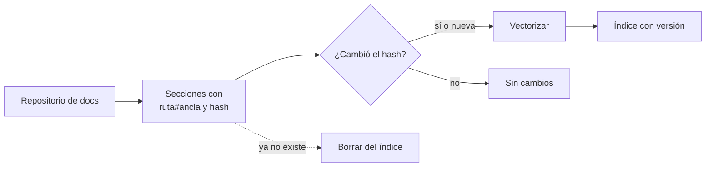

## 1. Resumen

El caso de RAG más útil para un equipo de datos es el más cercano: **su propia documentación**. Runbooks, contratos de datos, decisiones de arquitectura, guías del warehouse. El problema técnico no es el modelo, es el **pipeline de indexación**. Los documentos cambian todos los días, tienen versiones (el runbook de la versión 1.x dice otra cosa que el de 2.x) y la respuesta tiene que citar la sección exacta.

Eso se resuelve como cualquier pipeline: dividir por sección con su ruta y ancla (`chunking`), guardar la versión como metadata para filtrar (`metadata-filtering`) y **reindexar de forma idempotente** (`idempotency`). Con el hash de cada sección, se vectoriza solo lo que cambió y se borra lo que ya no existe. Azure AI Search, por ejemplo, divide un Markdown en un documento por sección (*Index Markdown blobs and files in Azure AI Search*).

## 2. Qué es

- **Sección como unidad:** cada encabezado `##` es un fragmento con clave `ruta#ancla`.
- **Metadata:** versión del producto, dueño, fecha.
- **Huella:** hash del texto de la sección; si no cambió, no se vuelve a vectorizar.
- **Sincronización:** vectorizar lo nuevo o cambiado, borrar lo que desapareció.
- **Cita:** la respuesta cita `ruta#ancla`, que se abre en el repositorio.

## 3. Problema que resuelve

El asistente de guardia responde con el runbook de la versión anterior porque nadie reindexó; o reindexa todo cada noche, paga embeddings de 10 000 secciones que no cambiaron y deja vivas las secciones borradas. Con sincronización por hash, la primera carga indexa todo, la segunda no hace nada y una edición toca solo lo editado.

## 4. Cómo funciona

1. Se leen los documentos del repositorio con su versión.
2. Se dividen por sección con clave `ruta#ancla` y hash del texto.
3. Se comparan con el índice: nuevas o cambiadas se vectorizan; las que no están se borran.
4. La búsqueda filtra por la versión que usa quien pregunta.
5. La respuesta cita la clave de la sección (`rag`).

## 5. Cuándo utilizarlo

- Documentación en Markdown versionada en un repositorio.
- Runbooks que la guardia consulta de madrugada.
- Contratos de datos y decisiones de arquitectura con varias versiones vigentes.

## 6. Cuándo no utilizarlo

- Documentación que nadie mantiene: el asistente repetirá lo desactualizado con seguridad.
- Sitios de terceros sin autorización: Bedrock pide indexar solo páginas propias o autorizadas y respeta robots.txt (*Crawl web pages for your knowledge base*).
- Cuando una búsqueda en el repositorio basta.

## 7. Ejemplo sencillo

| Paso | Vectorizadas | Borradas | Total |
|---|---|---|---|
| Primera carga | 3 | 0 | 3 |
| La misma carga otra vez | 0 | 0 | 3 |
| Tras editar un documento y quitar una sección | 1 | 1 | 2 |

La pregunta «qué hago con un timeout al escribir» cita `runbooks/ventas_diarias.md#timeout-al-escribir` en 2.x y `runbooks/ventas_diarias_v1.md#timeout-al-escribir` en 1.x.

## 8. Ejemplo de producción

Indexación de la documentación de la plataforma:

- un job en cada merge a la rama principal del repositorio de documentación;
- secciones con `ruta#ancla`, versión y dueño; sincronización por hash;
- índice con filtro por versión y búsqueda híbrida para códigos de error (`hybrid-rag`);
- el asistente de guardia usa la búsqueda como herramienta de lectura (`llm-agents`);
- en la nube (no ejecutado): Agent Search con layout parser y chunking, Bedrock Knowledge Bases o un indexer de Markdown en Azure AI Search.

## 9. Arquitectura



## 10. Código

```python
# Python 3.12 y numpy (ejecutado en la CI; ADR-025, opción A): el pipeline de indexación de la documentación técnica.
# Divide cada documento Markdown por sección, guarda la ruta, el ancla y la versión del producto, y reindexa de forma
# idempotente: con el hash de cada sección, solo vuelve a vectorizar lo que cambió y borra lo que ya no existe. La
# búsqueda filtra por versión y devuelve la cita como ruta#ancla. Vectores léxicos (opción A).
import hashlib
import re
import zlib
from dataclasses import dataclass

import numpy as np
import numpy.typing as npt


@dataclass(frozen=True)
class Seccion:
    clave: str  # ruta#ancla
    version: str
    texto: str
    huella: str


def vectorizar(texto: str, dim: int = 256) -> npt.NDArray[np.float64]:
    limpio = f" {texto.lower()} "
    v = np.zeros(dim)
    for i in range(len(limpio) - 2):
        v[zlib.crc32(limpio[i:i + 3].encode()) % dim] += 1.0
    return v / np.linalg.norm(v)


def secciones(ruta: str, version: str, markdown: str) -> list[Seccion]:
    out = []
    for bloque in re.split(r"\n(?=## )", markdown.strip())[1:]:
        titulo, _, cuerpo = bloque.partition("\n")
        ancla = re.sub(r"[^a-z0-9]+", "-", titulo.removeprefix("## ").lower()).strip("-")
        texto = f"{titulo.removeprefix('## ')}: {cuerpo.strip()}"
        out.append(Seccion(f"{ruta}#{ancla}", version, texto, hashlib.sha256(texto.encode()).hexdigest()[:12]))
    return out


class Indice:
    def __init__(self) -> None:
        self.filas: dict[str, tuple[Seccion, npt.NDArray[np.float64]]] = {}

    def sincronizar(self, actuales: list[Seccion]) -> dict[str, int]:
        nuevas = {s.clave: s for s in actuales}
        cambiadas = [s for s in actuales if s.clave not in self.filas or self.filas[s.clave][0].huella != s.huella]
        borradas = [k for k in self.filas if k not in nuevas]
        for s in cambiadas:
            self.filas[s.clave] = (s, vectorizar(s.texto))  # solo se vectoriza lo que cambió
        for k in borradas:
            del self.filas[k]
        return {"vectorizadas": len(cambiadas), "borradas": len(borradas), "total": len(self.filas)}

    def buscar(self, pregunta: str, version: str) -> tuple[str, float]:
        q = vectorizar(pregunta)
        candidatas = [(s.clave, float(v @ q)) for s, v in self.filas.values() if s.version == version]
        return max(candidatas, key=lambda c: c[1])


DOCS = {
    "runbooks/ventas_diarias.md": ("2.x", "# ventas_diarias\n## Timeout al escribir\nReintentar una vez con --reintento.\n"
                                          "## Dueño\nIngeniería de ventas."),
    "runbooks/ventas_diarias_v1.md": ("1.x", "# ventas_diarias (v1)\n## Timeout al escribir\nReiniciar el worker y relanzar a mano."),
}
indice = Indice()
todas = [s for ruta, (ver, md) in DOCS.items() for s in secciones(ruta, ver, md)]
print("primera carga:", indice.sincronizar(todas))
print("misma carga otra vez:", indice.sincronizar(todas))
ver, md = DOCS["runbooks/ventas_diarias.md"]
DOCS["runbooks/ventas_diarias.md"] = (ver, md.replace("Reintentar una vez", "Reintentar dos veces").replace("\n## Dueño\nIngeniería de ventas.", ""))
todas = [s for ruta, (ver, md) in DOCS.items() for s in secciones(ruta, ver, md)]
print("tras editar un documento:", indice.sincronizar(todas))
print("timeout en 2.x:", indice.buscar("qué hago con un timeout al escribir", "2.x")[0])
print("timeout en 1.x:", indice.buscar("qué hago con un timeout al escribir", "1.x")[0])
```

El script se **ejecuta en la CI** con numpy (opción A, ADR-025) y pasa `mypy --strict`. Imprime las tres sincronizaciones del §7 y las dos citas por versión. Los vectores son léxicos; la mecánica de sincronización es la misma con un modelo de embeddings.

## 11. GCP

En GCP, **Agent Search** (la página dice que Vertex AI Search se está renombrando Agent Search). Según *Parse and chunk documents* (no ejecutado):

| | Este concepto | Agent Search |
|---|---|---|
| Dividir | Por sección `##` | Chunking de documentos para RAG |
| Estructura | Encabezados del Markdown | Layout parser para secciones, tablas, imágenes y listas |

## 12. AWS

En AWS, **Amazon Bedrock Knowledge Bases**. Según *Crawl web pages for your knowledge base* (no ejecutado):

| | Este concepto | Bedrock Knowledge Bases |
|---|---|---|
| Fuente | Repositorio propio | Web Crawler, solo sitios propios o autorizados, con robots.txt |
| Conector | El pipeline propio | Desde el 2026-09-30, sin conectores Web Crawler nuevos en knowledge bases administradas por el cliente |

## 13. Azure

En Azure, **Azure AI Search**. Según *Index Markdown blobs and files in Azure AI Search* (no ejecutado):

| | Este concepto | Azure AI Search |
|---|---|---|
| Dividir | Por sección | Parsing `markdown`, submodo `oneToMany`: un documento por sección |
| Fuente | Repositorio | Blob Storage, Azure Files u OneLake |

## 14. Buenas prácticas

- Reindexar por hash de sección, no todo cada vez.
- Borrar del índice lo que ya no existe en el repositorio.
- Versión del producto como metadata y filtro obligatorio.
- Citas a `ruta#ancla` que se puedan abrir.
- **Seguridad:** no indexar en un índice abierto documentos con acceso restringido; heredar los permisos del repositorio.
- **Observabilidad:** secciones vectorizadas, borradas y totales por corrida.
- **Costo:** vectorizar solo lo cambiado; reindexar todo multiplica el costo sin cambiar el resultado.

## 15. Errores frecuentes

- Reindexar todo cada noche.
- Dejar secciones borradas vivas en el índice.
- Mezclar versiones sin filtro.
- Citar el documento entero en lugar de la sección.

## 16. Trade-offs

Sincronizar por hash ahorra costo y exige mantener la clave estable de cada sección; renombrar un encabezado cuenta como borrar y crear. Dividir por sección da citas precisas y fragmentos de tamaño desparejo. Un servicio administrado trae conectores y parsers, con sus reglas sobre qué se puede indexar.

## 17. Conceptos relacionados

- `rag`: el patrón.
- `chunking`: por sección.
- `metadata-filtering`: la versión.
- `idempotency`: reindexar sin duplicar.
- `llm-agents`: el asistente de guardia.
- `hybrid-rag`: búsqueda híbrida para códigos de error.

## 18. Preguntas técnicas abiertas

1. ¿Dónde vive hoy la documentación de tu plataforma y quién la mantiene?
2. ¿Qué versiones conviven y cómo sabría el asistente cuál usa quien pregunta?
3. ¿Cuántas secciones cambian por semana?

## 19. Laboratorio relacionado

Pendiente (F4).

## 20. Fuentes

- Google Cloud: *Parse and chunk documents* (Agent Search).
- AWS: *Crawl web pages for your knowledge base*.
- Microsoft Learn: *Index Markdown blobs and files in Azure AI Search*.

El detalle de cada fuente está en `sources` del frontmatter.

## 21. Fecha de última verificación

2026-10-26. `review_required`: pendiente de revisión B-F3.1 del lote F3b-21d.

## 22. Historial de cambios importantes

- 2026-10-26: creación (lote F3b-21d).
