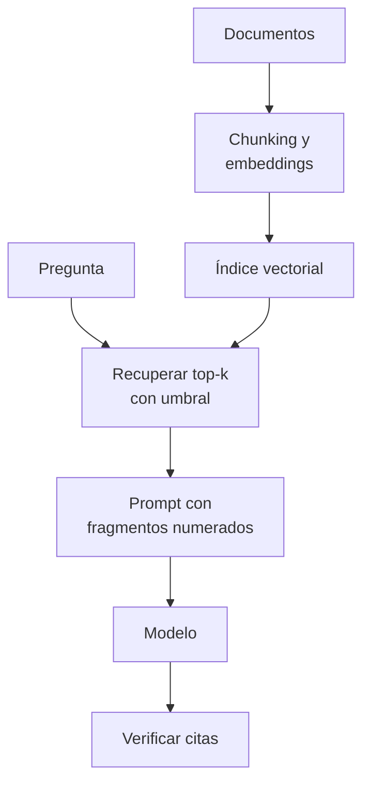

## 1. Resumen

Un modelo no conoce los documentos internos de una organización. **RAG** (retrieval-augmented generation) recupera los fragmentos relevantes de esos documentos y los pone en el prompt para que el modelo responda **con esa información** y la cite. Es el problema que describe Google para RAG Engine: los LLM no entienden el conocimiento privado, y RAG enriquece su contexto con él (*RAG Engine… overview*).

Para un data engineer, RAG es sobre todo un **pipeline de datos**: ingesta de documentos, `chunking`, `embeddings`, un índice (`vector-databases`), recuperación con umbral y verificación de la respuesta. Lo que más pesa en la calidad está antes de llamar al modelo.

## 2. Qué es

- **Indexación:** documentos, fragmentos, vectores e índice, con vínculo al origen.
- **Recuperación:** los k fragmentos más cercanos a la pregunta, por encima de un umbral.
- **Aumento:** el prompt lleva los fragmentos numerados y la regla de citar.
- **Generación:** el modelo responde con ese contexto.
- **Verificación:** la respuesta cita solo fragmentos recuperados; sin contexto suficiente, no se llama al modelo.

## 3. Problema que resuelve

Un asistente de guardia que responde con conocimiento general inventa un procedimiento que no existe. Con RAG responde con el runbook real, lo cita, y si la pregunta no está en la documentación, lo dice.

## 4. Cómo funciona

1. Se fragmentan e indexan los documentos (`chunking`, `embeddings`, `vector-databases`).
2. La pregunta se vectoriza con el mismo modelo.
3. Se recuperan los k fragmentos más cercanos que superan el umbral.
4. Si ninguno lo supera, se responde que no hay información, sin llamar al modelo.
5. Se arma el prompt con los fragmentos numerados (`prompt-engineering`), dentro de la ventana (`context-windows`).
6. Se verifica que las citas de la respuesta correspondan a fragmentos recuperados.

## 5. Cuándo utilizarlo

- Preguntas sobre documentación propia: runbooks, catálogo, políticas, contratos de datos.
- Cuando la información cambia y no conviene ajustar un modelo cada vez.
- Cuando la respuesta tiene que poder verificarse contra una fuente.

## 6. Cuándo no utilizarlo

- Preguntas que se responden con una consulta SQL a una tabla.
- Documentos con permisos distintos en un solo índice sin filtro por usuario (`metadata-filtering`).
- Si el corpus cabe entero en la ventana y cambia poco, puede bastar con enviarlo o cachearlo.

## 7. Ejemplo sencillo

Pregunta: «¿Qué hago si ventas_diarias falla por timeout?». Se recuperan dos fragmentos; la respuesta cita `[1]` y la verificación la acepta. Una respuesta que cita `[3]`, que no se recuperó, se rechaza. Una pregunta sobre el wifi de la oficina no supera el umbral y no llega al modelo.

Con otras palabras («¿qué hago si el proceso de ventas no responde a tiempo?»), los vectores léxicos no encuentran el runbook de timeout; el modelo local de embeddings sí (opción B del §10).

## 8. Ejemplo de producción

Un asistente sobre la documentación de la plataforma de datos:

- ingesta diaria de los documentos cambiados, fragmentados por sección;
- embeddings con un modelo fijado por versión; reindexación completa al cambiarlo;
- filtro por permisos del usuario antes de recuperar;
- prompt con citas obligatorias y verificación de las citas;
- en la nube (no ejecutado): RAG Engine, Bedrock Knowledge Bases o Azure AI Search con un modelo;
- los fragmentos viajan al proveedor del modelo: el flujo se registra como cualquier otro (`processors-and-international-transfers`).

## 9. Arquitectura



## 10. Código

Opción A, RAG mínimo con vectores léxicos (ADR-025):

```python
# Python 3.12 y numpy (ejecutado en la CI; ADR-025, opción A): un RAG mínimo de punta a punta. Recupera los
# fragmentos más parecidos a la pregunta, arma el prompt con fragmentos numerados y verifica que la respuesta cite
# solo fragmentos recuperados. Si nada supera el umbral, no se llama al modelo. La respuesta del modelo es fija y
# los vectores son léxicos (hashing de n-gramas), no semánticos.
import re
import zlib

import numpy as np
import numpy.typing as npt

Vector = npt.NDArray[np.float64]
FRAGMENTOS = {
    "runbook-ventas#timeout": "Si ventas_diarias falla por timeout, reintenta una vez con --reintento y luego escala a la guardia.",
    "runbook-ventas#dueno": "El equipo de ingeniería de ventas es dueño del job ventas_diarias.",
    "catalogo#pedidos": "silver.pedidos se carga a las 02:00 desde el sistema de órdenes, particionada por día.",
    "politica#retencion": "Las tablas bronze se conservan 90 días y luego se eliminan.",
}


def vectorizar(texto: str, dimensiones: int = 256) -> Vector:
    limpio = f" {texto.lower()} "
    v = np.zeros(dimensiones)
    for i in range(len(limpio) - 2):
        v[zlib.crc32(limpio[i:i + 3].encode()) % dimensiones] += 1.0
    return v / np.linalg.norm(v)


ids = list(FRAGMENTOS)
matriz = np.vstack([vectorizar(FRAGMENTOS[i]) for i in ids])


def recuperar(pregunta: str, k: int = 2, umbral: float = 0.35) -> list[tuple[str, float]]:
    puntajes = matriz @ vectorizar(pregunta)
    orden = np.argsort(-puntajes)[:k]
    return [(ids[i], float(puntajes[i])) for i in orden if puntajes[i] >= umbral]


def armar_prompt(pregunta: str, recuperados: list[tuple[str, float]]) -> str:
    contexto = "\n".join(f"[{n}] {FRAGMENTOS[i]}" for n, (i, _) in enumerate(recuperados, start=1))
    return ("Responde solo con el contexto y cita los fragmentos como [n]. Si no está en el contexto, dilo.\n"
            f"{contexto}\nPregunta: {pregunta}")


def citas_validas(respuesta: str, recuperados: list[tuple[str, float]]) -> bool:
    citas = {int(n) for n in re.findall(r"\[(\d+)\]", respuesta)}
    return bool(citas) and citas <= set(range(1, len(recuperados) + 1))


pregunta = "¿Qué hago si ventas_diarias falla por timeout?"
recuperados = recuperar(pregunta)
print("recuperados:", [(i, round(p, 2)) for i, p in recuperados])
print(armar_prompt(pregunta, recuperados))
respuesta = "Reintenta una vez con --reintento y, si falla, escala a la guardia [1]."  # respuesta fija del "modelo"
print("respuesta:", respuesta, "| citas válidas:", citas_validas(respuesta, recuperados))
print("una respuesta que cita [3]:", citas_validas("Lo dice el fragmento [3].", recuperados))
print("pregunta fuera del corpus:", recuperar("¿Cuál es la contraseña del wifi de la oficina?") or "sin contexto: no se llama al modelo")
```

Opción B, la recuperación con un modelo local de embeddings (ADR-025):

```python
# Python 3.12, fastembed 0.9.0 y un modelo local (ejecutado en la CI si la descarga funciona; ADR-025, opción B):
# la misma recuperación con una pregunta que usa otras palabras. El modelo de embeddings encuentra el fragmento
# correcto; los vectores léxicos de la opción A, no. Sin API pagada; el modelo va fijado por revisión.
import os
import zlib

import numpy as np
import numpy.typing as npt
from fastembed import TextEmbedding
from huggingface_hub import snapshot_download

FRAGMENTOS = {
    "runbook-ventas#timeout": "Si ventas_diarias falla por timeout, reintenta una vez con --reintento y luego escala a la guardia.",
    "runbook-ventas#dueno": "El equipo de ingeniería de ventas es dueño del job ventas_diarias.",
    "catalogo#pedidos": "silver.pedidos se carga a las 02:00 desde el sistema de órdenes, particionada por día.",
    "politica#retencion": "Las tablas bronze se conservan 90 días y luego se eliminan.",
}
PREGUNTA = "¿Qué hago si el proceso de ventas no responde a tiempo?"
CACHE = os.environ.get("DEKH_MODEL_CACHE", os.path.expanduser("~/.cache/dekh-models"))


def normalizar(m: npt.NDArray[np.float64]) -> npt.NDArray[np.float64]:
    return m / np.linalg.norm(m, axis=-1, keepdims=True)


def lexico(texto: str, dimensiones: int = 256) -> npt.NDArray[np.float64]:
    limpio = f" {texto.lower()} "
    v = np.zeros(dimensiones)
    for i in range(len(limpio) - 2):
        v[zlib.crc32(limpio[i:i + 3].encode()) % dimensiones] += 1.0
    return normalizar(v)


ruta = snapshot_download("Qdrant/paraphrase-multilingual-MiniLM-L12-v2-onnx-Q",
                         revision="faf4aa4225822f3bc6376869cb1164e8e3feedd0", cache_dir=CACHE)
modelo = TextEmbedding("sentence-transformers/paraphrase-multilingual-MiniLM-L12-v2", specific_model_path=ruta)
ids = list(FRAGMENTOS)
semantica = normalizar(np.vstack([np.asarray(v, dtype=np.float64) for v in modelo.embed(list(FRAGMENTOS.values()))]))
lexica = np.vstack([lexico(FRAGMENTOS[i]) for i in ids])

consulta_sem = normalizar(np.asarray(next(iter(modelo.embed([PREGUNTA]))), dtype=np.float64))
for nombre, matriz, consulta in (("modelo local", semantica, consulta_sem),
                                 ("léxico (opción A)", lexica, lexico(PREGUNTA))):
    puntajes = matriz @ consulta
    top = [ids[i] for i in np.argsort(-puntajes)[:2]]
    print(f"{nombre}: top 2 = {top}; recupera el runbook de timeout: {'runbook-ventas#timeout' in top}")
```

Los dos scripts se **ejecutan en la CI** sin API pagada y pasan `mypy --strict`. La opción A recupera `runbook-ventas#timeout` (0.62) y `runbook-ventas#dueno` (0.42), imprime el prompt, `citas válidas: True` para la respuesta fija, `False` para una que cita `[3]` y `sin contexto: no se llama al modelo` para la pregunta fuera del corpus. La opción B imprime `modelo local: … recupera el runbook de timeout: True` y `léxico (opción A): … False`. Si la descarga del modelo falla en la CI, el test de la opción B queda «no ejecutado» y no rompe el build (ADR-025).

## 11. GCP

En GCP, **RAG Engine** de Gemini Enterprise Agent Platform. Según *RAG Engine on Gemini Enterprise Agent Platform overview* (no ejecutado):

| | Este concepto | RAG Engine |
|---|---|---|
| Qué es | Un pipeline propio | Un componente que facilita RAG y un marco de datos para aplicaciones con contexto aumentado |
| Problema | Conocimiento privado | El mismo: enriquecer el contexto del modelo con información propia |

## 12. AWS

En AWS, **Amazon Bedrock Knowledge Bases**. Según *Retrieve data and generate AI responses with Amazon Bedrock Knowledge Bases* (no ejecutado):

| | Este concepto | Bedrock Knowledge Bases |
|---|---|---|
| Qué es | Un pipeline propio | Integración de información propia en aplicaciones de IA generativa |
| Objetivo | Respuestas con fuente | Mejorar relevancia y exactitud con datos de fuentes propias |

## 13. Azure

En Azure, **Azure AI Search** con un modelo de Foundry. Según *Chunk large documents for RAG and vector search in Azure AI Search* (no ejecutado):

| | Este concepto | Azure AI Search |
|---|---|---|
| Fragmentos | Por estructura o tamaño | Punto de partida: 512 tokens, 25 % de solape |

## 14. Buenas prácticas

- Umbral de similitud: sin contexto suficiente, no se llama al modelo.
- Citas obligatorias y verificadas contra lo recuperado.
- El mismo modelo de embeddings para indexar y preguntar, fijado por versión.
- Un conjunto de preguntas de control con su fragmento esperado (`llm-evaluation`).
- **Seguridad:** filtrar por permisos antes de recuperar; seudonimizar datos personales antes de indexar (`chilean-identifier-pseudonymization`).
- **Observabilidad:** preguntas sin contexto, citas rechazadas y fragmentos recuperados por pregunta.
- **Costo:** cada fragmento recuperado es entrada del modelo; k y el tamaño del fragmento fijan el costo por pregunta.

## 15. Errores frecuentes

- Recuperar siempre k fragmentos aunque no sean relevantes.
- Confiar en que el modelo cita bien sin verificarlo.
- Un solo índice con documentos de distintos permisos.
- Cambiar el modelo de embeddings sin reindexar.

## 16. Trade-offs

Más fragmentos dan más contexto y más ruido y costo. Un umbral alto evita respuestas sin base y deja preguntas sin responder. Un servicio administrado acelera el comienzo y fija sus defaults de fragmentación y recuperación; un pipeline propio da control y hay que operarlo.

## 17. Conceptos relacionados

- `embeddings`, `chunking` y `vector-databases`: la indexación.
- `hybrid-rag`, `reranking` y `metadata-filtering`: la recuperación.
- `prompt-engineering` y `context-windows`: el prompt.
- `processors-and-international-transfers`: el proveedor del modelo.
- `chilean-identifier-pseudonymization`: seudonimizar antes de indexar.
- `llm-evaluation`: el conjunto de control.
- `rag-over-technical-docs`: el caso de la documentación de la plataforma.

## 18. Preguntas técnicas abiertas

1. ¿Qué documentos de tu plataforma responderían preguntas frecuentes de guardia?
2. ¿Con qué preguntas de control medirías la recuperación?
3. ¿Cómo filtrarías por permisos antes de recuperar?

## 19. Laboratorio relacionado

Pendiente (F4).

## 20. Fuentes

- Google Cloud: *RAG Engine on Gemini Enterprise Agent Platform overview*.
- AWS: *Retrieve data and generate AI responses with Amazon Bedrock Knowledge Bases*.
- Microsoft Learn: *Chunk large documents for RAG and vector search in Azure AI Search*.
- FastEmbed: *⚡️ What is FastEmbed?* (README, v0.9.0); Hugging Face: el repositorio del modelo en la revisión fijada.

El detalle de cada fuente está en `sources` del frontmatter.

## 21. Fecha de última verificación

2026-10-25. Pasa a `verified` el 2026-10-26: revisión B-F3.1 del lote F3b-21b sin hallazgos (docs/reviews/cards-f3b-21b.md) y CI en verde (run 40364714269).

## 22. Historial de cambios importantes

- 2026-10-25: creación (lote F3b-21b).
- 2026-10-26: §17 y `relations` enlazan `llm-evaluation`, creada en el lote F3b-21c (regla del §17); sin otros cambios.
- 2026-10-26: §17 y `relations` enlazan `rag-over-technical-docs`, creada en el lote F3b-21d (regla del §17); sin otros cambios.
- 2026-10-26: `verification_status: verified` (revisión sin hallazgos; CI en verde, run 40364714269).
