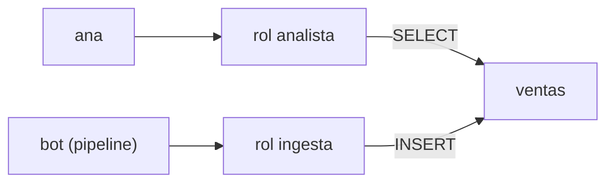

## 1. Resumen

**RBAC** (role-based access control) da los permisos a **roles por función** y no a personas: el rol `analista` lee las tablas de consumo, el rol `ingesta` escribe en staging. Las personas y los procesos **reciben roles**. Así:

- dar acceso a alguien nuevo es darle un rol;
- quitar el rol quita todos sus permisos juntos;
- la pregunta «¿qué puede hacer un analista?» tiene una respuesta: los permisos del rol.

En PostgreSQL, un rol de grupo agrupa privilegios y los miembros los heredan (*21.3. Role Membership*).

## 2. Qué es

- **Rol de función:** un conjunto de permisos con nombre de negocio (analista, ingesta, auditor).
- **Membresía:** una persona o proceso pertenece a uno o más roles.
- **Herencia:** el miembro usa los privilegios del rol (en PostgreSQL, con la opción `INHERIT`).
- **Revocación:** quitar la membresía quita los permisos del rol.

## 3. Problema que resuelve

Ana cambia de equipo. Tenía 30 permisos dados uno por uno; se le quitan 25 y quedan 5 olvidados. Con RBAC, Ana tenía el rol `analista_ventas`; al cambiar, se le quita ese rol y se le da el del nuevo equipo.

## 4. Cómo funciona

1. Se crean roles de grupo por función, sin login.
2. Se conceden privilegios a esos roles (`GRANT SELECT ON ventas TO analista`).
3. Personas y procesos reciben la membresía (`GRANT analista TO ana`).
4. Al cambiar de función, se cambia la membresía.

## 5. Cuándo utilizarlo

- Siempre que haya grupos de personas con las mismas necesidades.
- Como base; ABAC agrega condiciones encima cuando hace falta.

## 6. Cuándo no utilizarlo

- Creando un rol por persona: es volver a los permisos sueltos.
- Cuando el acceso depende de atributos que cambian por fila o por contexto (área, clasificación, red): ahí entran ABAC o RLS.

## 7. Ejemplo sencillo

| Persona | Rol | Leer `ventas` | Escribir `ventas` |
|---|---|---|---|
| ana | analista | sí | no |
| bot | ingesta | no | sí |
| ana, sin el rol | — | no | no |

## 8. Ejemplo de producción

- Roles por función y dominio (`analista_ventas`, `ingesta_ventas`, `auditor`).
- Las membresías salen del proveedor de identidad (grupos), no se dan a mano.
- Los privilegios de cada rol están en el repositorio de infraestructura.
- Revisión trimestral: miembros de cada rol con su dueño.

## 9. Arquitectura



## 10. Código

```python
# Python 3.12 y psycopg contra PostgreSQL 17 (ejecutado en la CI con el servicio postgres:17): RBAC con roles de grupo.
# Los permisos se dan a roles por función (analista, ingesta) y las personas o procesos reciben el rol, no el permiso.
# PG_HOST, PG_PORT, PG_USER, PG_PASSWORD y PG_DB: base vacía temporal; los roles llevan su nombre como sufijo y se borran.
import os

import psycopg
from psycopg import errors

S = os.environ["PG_DB"]                          # los roles son del clúster: el sufijo evita choques entre corridas
ROLES = [f"analista_{S}", f"ingesta_{S}", f"ana_{S}", f"bot_{S}"]

with psycopg.connect(host=os.environ["PG_HOST"], port=os.environ["PG_PORT"], user=os.environ["PG_USER"],
                     password=os.environ["PG_PASSWORD"], dbname=S, autocommit=True) as conn:
    try:
        conn.execute("CREATE TABLE ventas (id int, monto numeric)")
        for r in ROLES:
            conn.execute(f"CREATE ROLE {r}")
        conn.execute(f"GRANT SELECT ON ventas TO analista_{S}")              # permisos al rol de grupo
        conn.execute(f"GRANT INSERT ON ventas TO ingesta_{S}")
        conn.execute(f"GRANT analista_{S} TO ana_{S}")                       # personas y procesos reciben el rol
        conn.execute(f"GRANT ingesta_{S} TO bot_{S}")

        def puede(rol: str, sql: str) -> str:
            conn.execute(f"SET ROLE {rol}")
            try:
                conn.execute(sql)
                return "sí"
            except errors.InsufficientPrivilege:
                return "no"
            finally:
                conn.execute("RESET ROLE")

        for persona in ("ana", "bot"):
            leer = puede(f"{persona}_{S}", "SELECT * FROM ventas")
            escribir = puede(f"{persona}_{S}", "INSERT INTO ventas VALUES (1, 10)")
            print(f"{persona}: leer={leer}, escribir={escribir}")
        conn.execute(f"REVOKE analista_{S} FROM ana_{S}")                    # quitar el rol quita todo junto
        print("ana sin el rol analista, leer:", puede(f"ana_{S}", "SELECT * FROM ventas"))
    finally:
        conn.execute("DROP TABLE IF EXISTS ventas")
        for r in reversed(ROLES):
            conn.execute(f"DROP ROLE IF EXISTS {r}")
```

El script se **ejecuta en la CI contra el servicio postgres:17** y pasa `mypy --strict`. Imprime `ana: leer=sí, escribir=no`, `bot: leer=no, escribir=sí` y, tras quitar el rol, `ana sin el rol analista, leer: no`. Los roles son del clúster: llevan como sufijo el nombre de la base temporal y se borran al final.

## 11. GCP

En GCP, **IAM**. Según *21.3. Role Membership* y *Roles overview* (no ejecutado):

| | Roles en PostgreSQL | Roles de Google Cloud |
|---|---|---|
| Tipos | Roles de grupo propios | Básicos, predefinidos (gestionados por Google) y personalizados |
| Quién los recibe | Roles de usuario | Usuarios, grupos y cuentas de servicio, en un alcance |

## 12. AWS

En AWS, **IAM**. Según *21.3. Role Membership* e *IAM roles* (no ejecutado):

| | Roles en PostgreSQL | Roles de AWS IAM |
|---|---|---|
| Qué es un rol | Un conjunto de privilegios con miembros | Una identidad con permisos que se asume, con credenciales temporales |
| Agrupar personas | Membresía | Grupos de IAM (o federación); los roles se asumen |

En AWS, «rol» no significa lo mismo que en PostgreSQL: es una identidad que se asume, no una lista de miembros.

## 13. Azure

En Azure, **Azure RBAC**. Según *21.3. Role Membership* y *What is Azure role-based access control (Azure RBAC)?* (no ejecutado):

| | Roles en PostgreSQL | Azure RBAC |
|---|---|---|
| Unir rol y persona | `GRANT rol TO usuario` | Asignación de rol: principal, definición de rol y ámbito |
| Denegar | Revocar | Además, deny assignments |

## 14. Buenas prácticas

- Roles por función, con nombres de negocio.
- Membresías desde grupos del proveedor de identidad.
- Privilegios de cada rol, como código.
- **Seguridad:** nadie con privilegios dados directamente fuera de su rol.
- **Observabilidad:** miembros por rol, revisados por el dueño.
- **Costo:** pocos roles bien definidos se revisan rápido.

## 15. Errores frecuentes

- Un rol por persona.
- Roles «comodín» con todo.
- Olvidar que en AWS un rol es una identidad que se asume.

## 16. Trade-offs

Pocos roles amplios son fáciles de administrar y dan de más; muchos roles finos son precisos y difíciles de revisar. RBAC es simple de entender; no expresa reglas por atributo sin combinarse con ABAC.

## 17. Conceptos relacionados

- `iam-fundamentals`: el modelo.
- `abac`: atributos.
- `least-privilege`: lo justo.
- `gcp-iam-for-data`: roles en Google Cloud.

## 18. Preguntas técnicas abiertas

1. ¿Cuántos roles tienes y cuántos miembros directos sin rol?
2. ¿Qué pasa con los accesos de alguien que cambia de equipo?
3. ¿Tus roles tienen nombres que un dueño de datos entiende?

## 19. Laboratorio relacionado

Pendiente (F4).

## 20. Fuentes

- PostgreSQL 17: *21.3. Role Membership* y *5.8. Privileges*.
- Google Cloud: *Roles overview*.
- AWS: *IAM roles*.
- Microsoft Learn: *What is Azure role-based access control (Azure RBAC)?*.

El detalle de cada fuente está en `sources` del frontmatter.

## 21. Fecha de última verificación

2026-10-21. Pasa a `verified`: revisión B-F3.1 del lote F3b-18a aplicada y CI en verde (run 39677322697).

## 22. Historial de cambios importantes

- 2026-10-21: creación (lote F3b-18a).
- 2026-10-21: `verification_status: verified` (revisión aplicada; CI en verde, run 39677322697).
