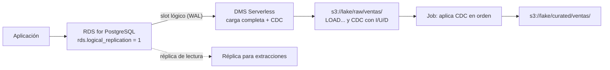

## 1. Resumen

Una base de **Amazon RDS** que atiende una aplicación no debería cargar con las consultas del pipeline. Según la documentación de AWS, hay varias salidas:

- **Réplica de lectura:** copia de solo lectura, actualizada de forma asíncrona; las extracciones leen de ahí.
- **Exportación de snapshots a S3:** Parquet consistente de un snapshot, sin tocar la instancia.
- **Integraciones zero-ETL:** RDS hacia Redshift o SageMaker AI, administradas.
- **AWS DMS:** carga completa más **CDC** continuo hacia S3 u otros destinos, con replicación lógica en PostgreSQL. En S3, cada registro de CDC empieza con **I**, **U** o **D**.

Con DMS, el consumidor aplica los cambios en orden. Un archivo aplicado dos veces deja el mismo estado.

## 2. Qué es

- **Réplica de lectura:** recibe los cambios del primario de forma asíncrona; se cobra como una instancia.
- **Exportación de snapshot:** de un snapshot manual, automático o de AWS Backup, a Parquet en S3; completo o por bases, esquemas o tablas.
- **Zero-ETL:** integración administrada con Redshift y SageMaker AI, casi en tiempo real.
- **DMS:**
  - *tarea:* carga completa, carga completa más CDC, o solo CDC;
  - *origen PostgreSQL en RDS:* `rds.logical_replication = 1` (estático, requiere reinicio), slots lógicos con `test_decoding` o `pglogical`;
  - *destino S3:* CSV por defecto o Parquet; archivos de carga completa `LOAD00001...` y de CDC con marca de tiempo; el primer campo de cada registro de CDC es `I`, `U` o `D`;
  - *reglas de selección:* esquemas y tablas con `object-locator`;
  - *Serverless:* sin instancias de replicación, con capacidad en DCU (una DCU son 2 GB de RAM).
- **No es tiempo real:** su página dice que DMS CDC no es replicación en tiempo real.

## 3. Problema que resuelve

Llevar los datos de una base operacional al lake o al warehouse sin afectar a la aplicación, y mantenerlos al día sin recargar todo cada vez.

## 4. Cómo funciona

1. Se activa `rds.logical_replication` en el grupo de parámetros y se reinicia la instancia.
2. Una replicación de DMS (por ejemplo, Serverless) hace la carga completa de las tablas elegidas y deja archivos `LOAD...` en S3.
3. Después, DMS lee los cambios del WAL con un slot lógico y escribe archivos de CDC con marca de tiempo.
4. El consumidor aplica los archivos de CDC en el orden de sus nombres: `I` y `U` reemplazan la fila por id, `D` la borra.
5. Si una tarea se reinicia (no se reanuda), el slot se recrea.

## 5. Cuándo utilizarlo

- **Réplica:** extracciones por lotes con SQL, sin cargar al primario.
- **Exportación de snapshot:** copias completas periódicas en Parquet.
- **DMS con CDC:** mantener el lake al día con inserciones, actualizaciones y borrados.
- **Zero-ETL:** cuando el destino es Redshift o SageMaker AI y basta la integración administrada.

## 6. Cuándo no utilizarlo

- CDC con latencia de segundos garantizada: DMS no es tiempo real.
- Activar replicación lógica sin consumidores: aumenta el WAL.
- Consultas pesadas del pipeline sobre el primario.

## 7. Ejemplo sencillo

La carga completa trae a Bob en New York. Los archivos de CDC traen `U` (Bob a Los Angeles), `I` (Ana) y luego `U` (Bob a Dallas) y `D` (Ana). Aplicados en orden, queda Bob en Dallas. Aplicados dos veces, el resultado es el mismo.

## 8. Ejemplo de producción

Una base RDS for PostgreSQL 17 alimenta el lake:

- grupo de parámetros con `rds.logical_replication = 1`, aplicado en una ventana de mantenimiento con reinicio;
- DMS Serverless, de 2 a 16 DCU, con carga completa más CDC del esquema `ventas` hacia S3 en Parquet;
- un job por hora aplica los archivos de CDC nuevos sobre la tabla curada, en orden de nombre;
- una alarma vigila el retraso de la replicación.

## 9. Arquitectura



## 10. Código

```python
# Python 3.12, solo biblioteca estándar (ejecutado en la CI; mypy --strict sin errores): aplica los archivos CSV de
# CDC que AWS DMS deja en S3 sobre el estado actual de una tabla. Cada fila empieza con I, U o D (la operación en el
# origen) y trae la fila como quedó; los archivos de CDC se nombran con una marca de tiempo, así que se aplican en el
# orden de sus nombres. Aplicar dos veces el mismo archivo deja el mismo estado.
from __future__ import annotations

import csv
import io

Row = dict[str, str]


def apply_cdc(state: dict[str, Row], files: dict[str, str], columns: list[str]) -> dict[str, Row]:
    """state: filas actuales por id. files: nombre del archivo de CDC -> contenido CSV sin encabezado."""
    result = dict(state)
    for name in sorted(files):
        for record in csv.reader(io.StringIO(files[name])):
            op, values = record[0], record[1:]
            row = dict(zip(columns, values, strict=True))
            if op in ("I", "U"):
                result[row["id"]] = row
            elif op == "D":
                result.pop(row["id"], None)
            else:
                raise ValueError(f"{name}: operación desconocida {op!r}")
    return result


if __name__ == "__main__":
    cols = ["id", "nombre", "oficina"]
    full_load = {"1": {"id": "1", "nombre": "Bob", "oficina": "New York"}}
    cdc = {
        "20261001-0900000000.csv": "U,1,Bob,Los Angeles\nI,2,Ana,Santiago\n",
        "20261001-1000000000.csv": "U,1,Bob,Dallas\nD,2,Ana,Santiago\n",
    }
    once = apply_cdc(full_load, cdc, cols)
    twice = apply_cdc(once, cdc, cols)
    print(once)
    print("idempotente:", once == twice)
```

```hcl
# Terraform (validado en la CI con terraform validate, sin credenciales; no se aplicó): grupo de parámetros de RDS
# for PostgreSQL con replicación lógica activada (requiere reiniciar la instancia) y una replicación de DMS Serverless
# de carga completa más CDC hacia S3. Requiere: provider hashicorp/aws ~> 6.0; endpoints de origen y destino,
# grupo de subredes de replicación y security group existentes.
terraform {
  required_providers {
    aws = {
      source  = "hashicorp/aws"
      version = "~> 6.0"
    }
  }
}

provider "aws" {
  region = "us-east-1"
}

variable "source_endpoint_arn" {
  type = string
}

variable "s3_target_endpoint_arn" {
  type = string
}

variable "replication_subnet_group_id" {
  type = string
}

variable "security_group_id" {
  type = string
}

resource "aws_db_parameter_group" "pg_cdc" {
  name   = "pg17-cdc"
  family = "postgres17"

  parameter {
    name         = "rds.logical_replication"
    value        = "1"
    apply_method = "pending-reboot" # parámetro estático
  }
}

resource "aws_dms_replication_config" "ventas" {
  replication_config_identifier = "ventas-a-s3"
  replication_type              = "full-load-and-cdc"
  source_endpoint_arn           = var.source_endpoint_arn
  target_endpoint_arn           = var.s3_target_endpoint_arn

  table_mappings = jsonencode({
    rules = [{
      "rule-type"      = "selection"
      "rule-id"        = "1"
      "rule-name"      = "ventas"
      "object-locator" = { "schema-name" = "ventas", "table-name" = "%" }
      "rule-action"    = "include"
    }]
  })

  compute_config {
    replication_subnet_group_id = var.replication_subnet_group_id
    vpc_security_group_ids      = [var.security_group_id]
    max_capacity_units          = 16
    min_capacity_units          = 2
  }
}
```

El script en Python 3.12, solo con biblioteca estándar, se **ejecuta en la CI** y pasa `mypy --strict`. Aplica el ejemplo de §7 y comprueba que aplicarlo dos veces da el mismo estado. **No leyó archivos reales de DMS:** el formato (`I`, `U`, `D` en el primer campo; archivos con marca de tiempo) es el de *Using Amazon S3 as a target*.

El bloque de Terraform se valida en la CI con `terraform validate`, sin credenciales (`make validate-terraform`), y **no se aplicó**. moto no simula una replicación de DMS (ADR-011).

## 11. GCP

No aplica de forma específica: esta ficha describe RDS y DMS. En GCP, el caso equivalente es Cloud SQL con Datastream (ver `cloud-sql-as-source`), con otros pasos y otro destino por defecto; no son lo mismo.

## 12. AWS

**Amazon RDS y AWS DMS.** Las réplicas, la exportación de snapshots, zero-ETL, la replicación lógica, las tareas de CDC, el formato en S3, las reglas de selección y DMS Serverless son los de sus páginas.

## 13. Azure

No aplica de forma específica.

## 14. Buenas prácticas

- Nunca extraer del primario; réplica, snapshot o CDC.
- Activar `rds.logical_replication` solo si hay un consumidor de slots, y vigilar el WAL retenido.
- Aplicar el CDC en orden de archivo y de forma idempotente.
- Elegir tablas con reglas de selección explícitas.
- **Seguridad:** el usuario de DMS solo con los permisos de replicación que pide su página; el destino en S3 con su rol y cifrado.
- **Observabilidad:** seguir el retraso de la replicación, el WAL retenido por el slot y los archivos de CDC sin aplicar.
- **Costo:** una réplica se cobra como una instancia; DMS Serverless cobra las DCU en uso; la exportación y el almacenamiento en S3 aparte.

## 15. Errores frecuentes

- Un slot lógico abandonado que retiene WAL y llena el disco.
- Aplicar archivos de CDC en otro orden que el de sus nombres.
- Tratar `U` como inserción y duplicar filas.
- Reiniciar una tarea de DMS y no saber que el slot se recrea.

## 16. Trade-offs

La réplica es simple y da SQL completo, pero cada extracción lee todo lo que pide. La exportación de snapshots es consistente y en Parquet, con la frescura del snapshot. DMS con CDC mantiene el lake al día con borrados incluidos, a cambio de operar slots y aplicar cambios en orden. Zero-ETL quita el pipeline, para los destinos que admite.

## 17. Conceptos relacionados

- `database-ingestion` y `change-data-capture`: el patrón.
- `incremental-load` e `idempotency`: aplicar solo cambios, sin duplicar.
- `cloud-sql-as-source`: el caso en GCP.
- `s3-data-lake`: el destino.
- Del blueprint, pendiente de ficha: `cdc-architecture` (arquitectura de F4).

## 18. Preguntas técnicas abiertas

1. ¿Qué tablas de tu base necesitan borrados en el lake, y cuáles solo inserciones?
2. ¿Cómo vigilas el WAL retenido por un slot?
3. ¿Cuándo te bastaría una exportación de snapshot diaria?

## 19. Laboratorio relacionado

Pendiente (F4).

## 20. Fuentes

- AWS, Amazon RDS User Guide: *What is Amazon RDS?*, *Working with DB instance read replicas*, *Performing logical replication for RDS for PostgreSQL*, *Exporting DB snapshot data to Amazon S3* y *Amazon RDS zero-ETL integrations*.
- AWS, AWS DMS User Guide: *What is AWS DMS?*, *Creating tasks for ongoing replication*, *Using a PostgreSQL database as an AWS DMS source*, *Using Amazon S3 as a target*, *Selection rules and actions*, *Working with AWS DMS Serverless* y *AWS DMS Serverless components*.

El detalle de cada fuente está en `sources` del frontmatter.

## 21. Fecha de última verificación

2026-10-13. Pasa a `verified`: revisión B-F3.1 del lote F3b-09b aplicada, sin VERIFY pendientes.

## 22. Historial de cambios importantes

- 2026-10-12: creación (lote F3b-09b).
- 2026-10-13: revisión B-F3.1 del lote F3b-09b aplicada (docs/reviews/cards-f3b-09b.md): filas aprobadas sin cambios en esta ficha.
- 2026-10-13: `verification_status: verified` (sin VERIFY pendientes).
