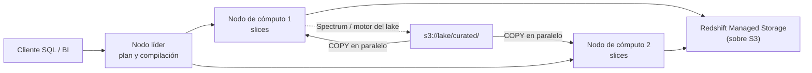

## 1. Resumen

**Amazon Redshift** es un data warehouse de procesamiento paralelo masivo (MPP). Su documentación lo describe así:

- un **nodo líder** recibe la consulta, arma el plan y reparte el trabajo;
- los **nodos de cómputo**, divididos en **slices**, ejecutan en paralelo;
- en los nodos **RG** y **RA3**, los datos viven en **Redshift Managed Storage**, sobre S3, separado del cómputo;
- **Redshift Serverless** quita los nodos: se configura un **workgroup** con capacidad en **RPU**.

El diseño de tablas importa: el **estilo de distribución** decide en qué slice cae cada fila y la **sort key** permite saltar bloques. La carga típica es **COPY** desde S3, en paralelo, seguida de **MERGE**.

## 2. Qué es

- **Clúster provisionado:**
  - un nodo líder y nodos de cómputo de un tipo (se recomienda RG o RA3);
  - RG: instancias Graviton, con un motor de consulta del lake en el propio clúster;
  - RA3: consultan el lake con Redshift Spectrum.
- **Redshift Serverless:**
  - **namespace:** esquemas, tablas, usuarios, claves de KMS;
  - **workgroup:** RPU, red, security groups y límites de uso;
  - una RPU da 16 GB de memoria; la base por defecto es de 128 RPU, ajustable de 4 a 512.
- **Distribución:**
  - `AUTO`: Redshift elige según el tamaño y puede cambiar el estilo en segundo plano;
  - `EVEN`: round-robin; para tablas que no participan en joins;
  - `KEY`: filas con el mismo valor en el mismo slice; dos tablas con la misma clave de join quedan colocalizadas;
  - `ALL`: una copia completa en cada nodo; para tablas chicas.
- **Sort key:** orden físico; cada bloque guarda su mínimo y máximo. `COMPOUND` favorece predicados sobre un prefijo de las columnas; `INTERLEAVED` da el mismo peso a cada una; `AUTO` la elige Redshift.
- **COPY:** carga desde S3 en paralelo entre slices; admite Parquet y ORC.
- **Spectrum:** consulta archivos en S3 sin cargarlos.

## 3. Problema que resuelve

Un warehouse con terabytes de hechos necesita joins y agregaciones rápidas sobre muchas filas. Redshift reparte los datos entre slices y ejecuta cada paso en paralelo; con una buena distribución, los joins se hacen sin mover filas entre nodos, y con una buena sort key, se leen solo los bloques del rango pedido.

## 4. Cómo funciona

1. El cliente envía la consulta al nodo líder.
2. El líder arma el plan, compila el código y lo envía a los nodos de cómputo.
3. Cada slice procesa sus filas. Si las tablas del join están distribuidas por la misma clave, el join es local; si no, hay que redistribuir.
4. Los bloques cuyo mínimo y máximo no cumplen el filtro se saltan.
5. Los resultados intermedios vuelven al líder para la agregación final.

## 5. Cuándo utilizarlo

- Warehouse con consultas recurrentes y modelos dimensionales estables.
- Cargas por lotes desde S3 con COPY.
- Cargas variables sin administrar nodos: Serverless.

## 6. Cuándo no utilizarlo

- Consultas esporádicas sobre archivos que no se quieren cargar: Athena es más simple (ver `athena-serverless-queries`).
- Muchas escrituras de filas sueltas: es OLAP, no OLTP.
- Equipos que no quieren pensar en distribución ni en sort keys en tablas grandes, si `AUTO` no alcanza.

## 7. Ejemplo sencillo

`dim_tienda` tiene 500 filas: va con `DISTSTYLE ALL` y cada nodo tiene una copia. `fact_ventas` se distribuye por `id_tienda`, la clave de su join más frecuente, y se ordena por `fecha`. Una consulta de una semana lee solo los bloques de esa semana.

## 8. Ejemplo de producción

Cada noche, un job deja Parquet en `s3://lake/curated/ventas/dt=<día>/`, en varios archivos:

1. `COPY` carga el día a una tabla temporal, en paralelo entre slices.
2. `MERGE` actualiza las ventas existentes e inserta las nuevas; re-ejecutar el día no duplica.
3. Los informes leen `fact_ventas` con filtros por fecha.

El histórico de más de dos años queda en S3 y se consulta con Spectrum (RA3) o con el motor del lake de RG cuando hace falta.

## 9. Arquitectura



## 10. Código

```sql
-- Amazon Redshift SQL (no ejecutado): hecho distribuido por la clave del join más frecuente y ordenado por fecha;
-- dimensión pequeña copiada a todos los nodos; carga con COPY desde Parquet en S3 a una tabla staging y MERGE.
CREATE TABLE IF NOT EXISTS dim_tienda (
  id_tienda INT PRIMARY KEY,
  region    VARCHAR(32)
)
DISTSTYLE ALL;

CREATE TABLE IF NOT EXISTS fact_ventas (
  id_venta   BIGINT,
  id_tienda  INT,
  fecha      DATE,
  monto      DECIMAL(12,2)
)
DISTKEY (id_tienda)
COMPOUND SORTKEY (fecha);

CREATE TEMP TABLE stg_ventas (LIKE fact_ventas);

-- Varios archivos Parquet bajo el prefijo: COPY los carga en paralelo entre los slices.
COPY stg_ventas
FROM 's3://mi-data-lake/curated/ventas/dt=2026-10-01/'
IAM_ROLE 'arn:aws:iam::123456789012:role/redshift-copy'
FORMAT AS PARQUET;

-- Re-ejecutar el día actualiza las mismas filas en lugar de duplicarlas.
MERGE INTO fact_ventas
USING stg_ventas s
ON fact_ventas.id_venta = s.id_venta
WHEN MATCHED THEN UPDATE SET id_tienda = s.id_tienda, fecha = s.fecha, monto = s.monto
WHEN NOT MATCHED THEN INSERT (id_venta, id_tienda, fecha, monto) VALUES (s.id_venta, s.id_tienda, s.fecha, s.monto);
```

**No ejecutado:** el SQL de Redshift no se corrió (no hay Redshift en local ni en la CI, y moto no ejecuta SQL; ADR-011). La sintaxis sigue *CREATE TABLE*, los parámetros de formato y autorización de COPY, y *MERGE*. El rol de IAM y las rutas son ilustrativos.

## 11. GCP

No aplica de forma específica: esta ficha describe Redshift. El warehouse de GCP, BigQuery, tiene otro modelo de cómputo y capacidad (ver `bigquery-architecture` y `bigquery-slots`); la distribución por slices y las sort keys de Redshift no tienen un equivalente directo allí.

## 12. AWS

**Amazon Redshift.** La arquitectura, los tipos de nodo RG y RA3, Serverless (namespaces, workgroups, RPU), la distribución, las sort keys, COPY, MERGE y Spectrum son los de sus páginas. Los precios de nodos, RPU, almacenamiento y Spectrum se consultan en la página de precios.

## 13. Azure

No aplica de forma específica: los warehouses de Azure tienen su propio modelo.

## 14. Buenas prácticas

- Dimensiones chicas con `ALL`; hechos por la clave del join más frecuente; `AUTO` si no hay un patrón claro.
- Sort key por la columna de los filtros de rango (casi siempre la fecha).
- COPY desde varios archivos de tamaño parecido, no desde uno grande comprimido con GZIP.
- Carga a staging y MERGE para que re-ejecutar no duplique.
- **Seguridad:** COPY con un rol de IAM, no con claves en el SQL; cifrado con KMS en el namespace o el clúster; accesos por esquema y rol.
- **Observabilidad:** seguir el tiempo de carga y de consulta, las redistribuciones en los planes y el uso de RPU en Serverless.
- **Costo:** en provisionado se paga por nodo; en Serverless, por capacidad usada, con límites por workgroup. Los montos se consultan en la página de precios.

## 15. Errores frecuentes

- Distribuir un hecho por una columna con pocos valores y concentrar filas en unos pocos slices.
- Cargar con INSERT fila a fila en lugar de COPY.
- Un solo archivo comprimido que obliga a una carga serial.
- Sort key en una columna que nunca se filtra.
- Re-ejecutar una carga con INSERT y duplicar el día.

## 16. Trade-offs

Redshift da control sobre la distribución física y el orden, lo que permite joins locales y lecturas por rango muy eficientes, a cambio de diseñar las tablas. Serverless quita la administración de nodos y cobra por uso, con menos control fino de la capacidad. Spectrum o el motor del lake evitan cargar el histórico, con lecturas más lentas que las tablas locales.

## 17. Conceptos relacionados

- `data-warehouse` y `oltp-vs-olap`: el tipo de sistema.
- `bigquery-architecture` y `bigquery-slots`: el warehouse de GCP y su capacidad, con otro modelo.
- `star-schema`: cómo se distribuyen hechos y dimensiones.
- `upsert`: MERGE desde staging.
- `s3-data-lake` y `athena-serverless-queries`: el lake del que carga y la alternativa sin warehouse.

## 18. Preguntas técnicas abiertas

1. ¿Por qué columna distribuirías tu tabla de hechos más grande, y qué consultas se benefician?
2. ¿Qué datos dejarías en S3 en lugar de cargarlos a Redshift?
3. ¿Cuándo elegirías Serverless en lugar de un clúster provisionado?

## 19. Laboratorio relacionado

Pendiente (F4).

## 20. Fuentes

- AWS, Amazon Redshift Database Developer Guide: *Data warehouse system architecture*, *Distribution styles*, *Sort keys*, *CREATE TABLE*, *Loading data files*, *Data format parameters*, *Authorization parameters*, *MERGE* y *Amazon Redshift Spectrum*.
- AWS, Amazon Redshift Management Guide: *Amazon Redshift provisioned clusters*, *Workgroups and namespaces* y *Compute capacity for Amazon Redshift Serverless*; *Amazon Redshift pricing*.

El detalle de cada fuente está en `sources` del frontmatter.

## 21. Fecha de última verificación

2026-10-12. `review_required`: pendiente de revisión B-F3.1 del lote F3b-09a.

## 22. Historial de cambios importantes

- 2026-10-12: creación (lote F3b-09a).
