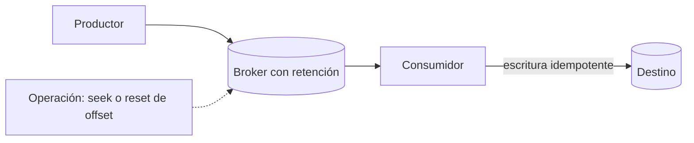

## 1. Resumen

Replay es volver a leer o volver a entregar eventos ya capturados desde un punto anterior de un log o broker, para reprocesarlos: tras corregir un bug, para poblar un consumidor nuevo o para recuperarse de un fallo. Solo es posible mientras los eventos sigan retenidos, y solo es seguro si el consumidor es idempotente.

## 2. Qué es

Es mover el cursor de lectura hacia atrás (a un offset, un timestamp o un snapshot) sobre datos que el broker todavía conserva. Se distingue de `backfill`, que recalcula un rango histórico desde las fuentes o desde la capa raw, aunque el stream ya no retenga esos datos.

## 3. Problema que resuelve

Un consumidor procesó mal durante horas (un bug, un esquema mal interpretado) o se agrega un consumidor nuevo que necesita la historia reciente. Sin replay, los eventos confirmados se pierden para ese consumidor y solo quedaría reconstruir desde otra fuente.

## 4. Cómo funciona

El broker conserva los eventos durante una **retención** y mantiene, por consumidor, una **posición** (offset, estado de confirmación). El replay reposiciona esa posición:

- en logs particionados (Kinesis, Event Hubs, Kafka), leyendo desde un offset o un timestamp anterior;
- en **Pub/Sub**, con *seek* a un snapshot o a un timestamp, siempre que el tópico retenga mensajes o la suscripción retenga los ya confirmados.

Después, el consumidor procesa de nuevo los eventos. Por eso debe escribir de forma idempotente.

## 5. Cuándo utilizarlo

- Corregir el resultado de un consumidor tras un bug, dentro de la retención.
- Poblar un consumidor o una vista nueva con la historia reciente.
- Recuperarse de un fallo del destino que perdió escrituras confirmadas.

## 6. Cuándo no utilizarlo

- Cuando los eventos ya salieron de la retención: hay que hacer un backfill desde la capa raw o el origen.
- Cuando el consumidor no es idempotente: el replay duplicará efectos.
- Cuando otros consumidores comparten la misma posición: el replay los afectaría también (en Pub/Sub, el seek es por suscripción).

## 7. Ejemplo sencillo

Un consumidor escribió montos en centavos como si fueran pesos durante dos horas. Tras corregirlo, se reposiciona su lectura a las 10:00 y se reprocesan las dos horas. Como la escritura es un `MERGE` por id de evento, el resultado queda correcto y sin duplicados.

## 8. Ejemplo de producción

En Pub/Sub, antes de cada despliegue del consumidor se crea un snapshot de la suscripción. Si el despliegue introduce un error, se revierte el código y se hace seek al snapshot: se reentregan los mensajes posteriores y el destino, idempotente por `message_id`, queda consistente. El tópico retiene mensajes para poder hacer seek por timestamp si el snapshot no alcanza.

## 9. Arquitectura



## 10. Código

```bash
# Pub/Sub (gcloud): snapshot antes de desplegar y seek para reentregar desde ese punto.
# Requiere: suscripción "orders-sub"; para seek por timestamp a mensajes ya confirmados,
# retención de mensajes en el tópico o retain-acked-messages en la suscripción (ver fuente).
gcloud pubsub snapshots create pre-deploy-2026-09-30 --subscription=orders-sub
# ... despliegue con error, rollback del código ...
gcloud pubsub subscriptions seek orders-sub --snapshot=pre-deploy-2026-09-30
```

Tras el seek, los mensajes retenidos en el snapshot se entregan **al menos una vez**: el consumidor debe tolerar duplicados.

## 11. GCP

En **Pub/Sub**, el replay se hace con *seek*:

- a un **snapshot**: un punto en el tiempo del estado de confirmación de una suscripción. Dura 7 días menos la antigüedad del mensaje sin confirmar más antiguo;
- a un **timestamp**: para reentregar mensajes ya confirmados, hay que retener mensajes en el tópico o configurar la suscripción para que retenga los confirmados.

El seek afecta a una suscripción, no a las demás.

## 12. AWS

En **Kinesis Data Streams** los registros se retienen 24 horas por defecto, ampliable hasta 365 días. Dentro de esa ventana, un consumidor puede volver a leer desde una posición anterior. La retención define hasta dónde llega el replay.

## 13. Azure

En **Event Hubs**, la retención depende del tier: 1 hora por defecto, hasta 7 días en Standard y hasta 90 días en Premium y Dedicated. Los consumidores leen desde un offset, un timestamp o el inicio o fin del stream, y guardan su posición con *checkpointing*. Para hacer replay, se reinicia la lectura desde un offset o un timestamp anterior al checkpoint.

## 14. Buenas prácticas

- Configurar la retención pensando en el replay que se quiera poder hacer (horas o días).
- Tomar un punto de retorno (snapshot, offset registrado) antes de despliegues de consumidores.
- Hacer idempotentes las escrituras del consumidor (id de evento, `MERGE` con versión).
- Documentar el procedimiento y quién puede ejecutarlo.
- **Seguridad:** la operación de seek o reset de offset debe estar restringida: afecta a todo lo que ese consumidor escribe.
- **Observabilidad:** registrar cada replay (desde dónde, por qué, cuántos eventos) y vigilar el retraso mientras se reprocesa.
- **Costo:** retener más tiempo cuesta almacenamiento del broker, y el replay vuelve a pagar el procesamiento y la escritura de esos eventos.

## 15. Errores frecuentes

- Descubrir que la retención ya venció justo cuando se necesita el replay.
- Hacer replay sobre un consumidor que hace `INSERT` ciego.
- Reposicionar un grupo de consumidores compartido y afectar a otros procesos.
- No tomar un punto de retorno antes de un despliegue riesgoso.

## 16. Trade-offs

Más retención da más margen de recuperación, a cambio de costo de almacenamiento. Replay desde el broker es rápido y fiel al orden original; un backfill desde la capa raw no depende de la retención, pero es más lento y requiere que la raw exista.

## 17. Conceptos relacionados

- `idempotency`: requisito para reprocesar sin duplicar.
- `backfill`: alternativa cuando los eventos ya no están retenidos.
- `dead-letter-queue`: su redrive es un replay acotado.
- `pubsub-delivery-semantics`: seek, retención y reentrega en Pub/Sub.
- `checkpoints`: la posición desde la que se reanuda o se vuelve atrás.
- `failure-recovery`: cómo se combinan reintentos, checkpoints, DLQ, replay y backfill para volver a un estado correcto.
- `offsets`: reiniciar el offset del grupo para volver a leer.

## 18. Preguntas técnicas abiertas

1. ¿Qué retención configurarías para un stream de pedidos y cómo lo justificarías?
2. ¿Cómo harías replay de un solo consumidor sin afectar a los demás que leen el mismo stream?
3. ¿Qué harías si el error se detecta cuando los eventos ya salieron de la retención?

## 19. Laboratorio relacionado

Pendiente (F4): arquitectura "Streaming pipeline" (§24).

## 20. Fuentes

- Google Cloud: *Replay and purge messages with seek* y *Replay a message* (Pub/Sub).
- AWS: *Change the data retention period* (Kinesis Data Streams).
- Microsoft Learn: *Event Hubs features and terminology*.

El detalle de cada fuente está en `sources` del frontmatter.

## 21. Fecha de última verificación

2026-09-30. Los comandos de `gcloud` coinciden con la documentación oficial de Pub/Sub. Pasa a `verified`: revisión B-F3.1 del lote 2 aplicada, sin VERIFY pendientes.

## 22. Historial de cambios importantes

- 2026-09-30: creación (lote 2 de F3).
- 2026-09-30: `verification_status: verified` (revisión B-F3.1 del lote 2 aplicada; sin VERIFY pendientes).
- 2026-10-13: `page_title` en cada cita, con el título de la página citada (ADR-012); sin cambios de contenido.
- 2026-10-14: lote F3b-rel (regla del §17): relations incluye `checkpoints`, `failure-recovery`; el §17 enlaza `checkpoints`, `failure-recovery`, que ya tienen ficha.
- 2026-10-19: lote F3b-14a (regla del §17): relations y el §17 enlazan `offsets`, que ya tiene ficha; antes figuraba como pendiente de ficha.
