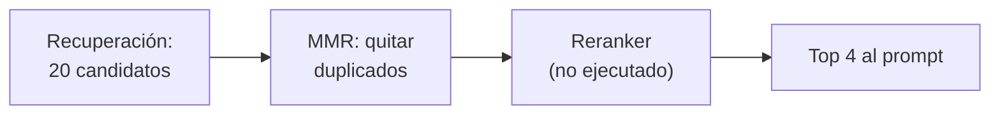

## 1. Resumen

La recuperación (`rag`, `hybrid-rag`) trae candidatos rápido y con un criterio grueso. **Reranking** es un segundo paso sobre esos pocos candidatos con un criterio más fino, antes de que entren al prompt. Puede ser un **modelo reranker**, que puntúa cada par pregunta-fragmento, o una **regla** como MMR (maximal marginal relevance), que equilibra relevancia y diversidad.

Las nubes lo ofrecen como servicio: en RAG Engine, un ranking API de menos de 100 ms o un reranker con LLM de 1 a 2 s (*Reranking for RAG Engine…*); en Azure AI Search, un ranking semántico sobre los 50 primeros resultados (*Semantic ranking in Azure AI Search*); en Bedrock Knowledge Bases, un modelo reranker que se elige en la configuración.

## 2. Qué es

- **Candidatos:** el top de la recuperación, por ejemplo 20 o 50.
- **Reranker:** un modelo que lee la pregunta y cada fragmento y devuelve un puntaje de relevancia.
- **MMR:** elige uno a uno; puntaje = λ·relevancia − (1 − λ)·parecido con lo ya elegido.
- **λ:** 1 es solo relevancia; valores más bajos, más diversidad.

## 3. Problema que resuelve

Un runbook está copiado en tres páginas con mínimas diferencias. El top 3 por similitud son las tres copias, y el fragmento que dice cuándo escalar a la guardia queda afuera. El modelo recibe tres veces lo mismo.

## 4. Cómo funciona

1. Se recuperan más candidatos que los que entrarán al prompt.
2. Con MMR: se elige el más relevante; después, en cada paso, el que mejor equilibra relevancia y diferencia con lo elegido.
3. Con un reranker: se envían los pares pregunta-fragmento y se ordena por su puntaje.
4. Se pasan al prompt los k primeros del nuevo orden.

## 5. Cuándo utilizarlo

- Corpus con duplicados o versiones casi iguales: MMR.
- Cuando la recuperación trae el fragmento correcto, pero no primero: un reranker.
- Cuando el prompt admite pocos fragmentos y cada uno cuenta.

## 6. Cuándo no utilizarlo

- Si la recuperación no trae el fragmento correcto entre los candidatos: reordenar no lo crea.
- Con latencias estrictas y un reranker con LLM, que agrega 1 a 2 s según Google.
- Si los candidatos ya son pocos y distintos.

## 7. Ejemplo sencillo

| Orden | Top 3 |
|---|---|
| Por similitud | 2, 0, 1: tres versiones del mismo «reintenta con --reintento» |
| MMR, λ = 0.7 | 2, 3, 1: entra el 3, «escala a la guardia de datos» |

## 8. Ejemplo de producción

En el asistente de guardia:

- recuperación híbrida de 20 candidatos;
- deduplicación con MMR (λ = 0.7) para quitar copias;
- reranker administrado sobre los 10 que quedan (no ejecutado);
- los 4 primeros al prompt.

## 9. Arquitectura



## 10. Código

```python
# Python 3.12 y numpy (ejecutado en la CI; ADR-025, opción A): reranking del top-k recuperado con MMR (maximal
# marginal relevance). El top-k por similitud trae tres copias casi iguales del mismo fragmento; MMR premia la
# relevancia y castiga el parecido con lo ya elegido, y deja espacio para el fragmento distinto que también responde.
# Un reranker administrado (un modelo que puntúa cada par pregunta-fragmento) queda «no ejecutado».
import zlib

import numpy as np
import numpy.typing as npt

Vector = npt.NDArray[np.float64]
CANDIDATOS = [
    "ventas_diarias falla por timeout: reintenta una vez con --reintento",
    "ventas_diarias falla por timeout: reintenta una vez con --reintento.",
    "Si ventas_diarias falla por timeout, reintenta una vez con --reintento",
    "Tras dos timeouts de ventas_diarias, escala a la guardia de datos",
    "silver.pedidos se carga a las 02:00, particionada por día",
]


def vectorizar(texto: str, dimensiones: int = 256) -> Vector:
    limpio = f" {texto.lower()} "
    v = np.zeros(dimensiones)
    for i in range(len(limpio) - 2):
        v[zlib.crc32(limpio[i:i + 3].encode()) % dimensiones] += 1.0
    return v / np.linalg.norm(v)


def mmr(consulta: Vector, docs: Vector, k: int, lam: float) -> list[int]:
    relevancia = docs @ consulta
    elegidos: list[int] = []
    while len(elegidos) < k:
        restantes = [i for i in range(len(docs)) if i not in elegidos]
        parecido = [max((float(docs[i] @ docs[j]) for j in elegidos), default=0.0) for i in restantes]
        puntaje = [lam * relevancia[i] - (1 - lam) * p for i, p in zip(restantes, parecido, strict=True)]
        elegidos.append(restantes[int(np.argmax(puntaje))])
    return elegidos


consulta = vectorizar("qué hago si ventas_diarias falla por timeout")
docs = np.vstack([vectorizar(c) for c in CANDIDATOS])
por_similitud = list(np.argsort(-(docs @ consulta))[:3])
print("top 3 por similitud:", [int(i) for i in por_similitud])
print("top 3 con MMR (λ=0.7):", mmr(consulta, docs, k=3, lam=0.7))
print("¿el top por similitud incluye la escalada (3)?", 3 in por_similitud, "| ¿y con MMR?", 3 in mmr(consulta, docs, 3, 0.7))
```

El script se **ejecuta en la CI** con numpy y pasa `mypy --strict`. Imprime `top 3 por similitud: [2, 0, 1]`, `top 3 con MMR (λ=0.7): [2, 3, 1]` y que solo MMR incluye el fragmento de escalada. Los vectores son léxicos (opción A, ADR-025); un reranker administrado queda «no ejecutado».

## 11. GCP

En GCP, **RAG Engine** de Gemini Enterprise Agent Platform. Según *Reranking for RAG Engine on Gemini Enterprise Agent Platform* (no ejecutado):

| | Este concepto | RAG Engine |
|---|---|---|
| Reranker rápido | Un modelo de ranking | Ranking API, menos de 100 ms |
| Reranker con LLM | — | Llamada aparte a Gemini, 1 a 2 s, costo por tokens |

## 12. AWS

En AWS, **Amazon Bedrock Knowledge Bases**. Según *Configure and customize queries and response generation* (no ejecutado):

| | Este concepto | Bedrock Knowledge Bases |
|---|---|---|
| Reranker | Un modelo de ranking | Un modelo reranker elegido en la sección Reranking |

## 13. Azure

En Azure, **Azure AI Search**. Según *Semantic ranking in Azure AI Search* (no ejecutado):

| | Este concepto | Azure AI Search |
|---|---|---|
| Sobre qué | Los candidatos recuperados | Resultados puntuados con BM25 o RRF |
| Cuántos | Los que se elijan | Los 50 primeros |
| Entrada por documento | El fragmento | Hasta 2000 tokens |

## 14. Buenas prácticas

- Recuperar más candidatos que los que entran al prompt.
- Deduplicar antes de usar un reranker pagado.
- Medir si el reranking mejora el acierto en preguntas de control (`llm-evaluation`).
- **Seguridad:** el reranker administrado recibe la pregunta y los fragmentos; mismas reglas que el modelo.
- **Observabilidad:** latencia del reranking y cuántas veces cambia el primer resultado.
- **Costo:** un reranker con LLM cobra tokens por cada candidato.

## 15. Errores frecuentes

- Esperar que el reranking arregle una recuperación que no trae el fragmento.
- Reranker con LLM sobre 50 candidatos en cada pregunta.
- λ demasiado bajo en MMR: entran fragmentos diversos pero irrelevantes.

## 16. Trade-offs

Un reranker mejora el orden a cambio de latencia y costo por candidato. MMR es barato y quita duplicados, pero no entiende la pregunta mejor que la recuperación. Más candidatos dan más chances al reranker y más costo.

## 17. Conceptos relacionados

- `rag`: el contexto.
- `hybrid-rag`: la fusión previa.
- `embeddings`: los vectores que compara MMR.
- `llm-evaluation`: medir si el reranking mejora.

## 18. Preguntas técnicas abiertas

1. ¿Tu corpus tiene copias del mismo contenido?
2. ¿Cuánta latencia admite tu caso para el reranking?
3. ¿Cómo medirías que el reranking ayuda?

## 19. Laboratorio relacionado

Pendiente (F4).

## 20. Fuentes

- Google Cloud: *Reranking for RAG Engine on Gemini Enterprise Agent Platform*.
- AWS: *Configure and customize queries and response generation*.
- Microsoft Learn: *Semantic ranking in Azure AI Search*.

El detalle de cada fuente está en `sources` del frontmatter.

## 21. Fecha de última verificación

2026-10-25. `review_required`: pendiente de revisión B-F3.1 del lote F3b-21b.

## 22. Historial de cambios importantes

- 2026-10-25: creación (lote F3b-21b).
- 2026-10-26: §17 y `relations` enlazan `llm-evaluation`, creada en el lote F3b-21c (regla del §17); sin otros cambios.
