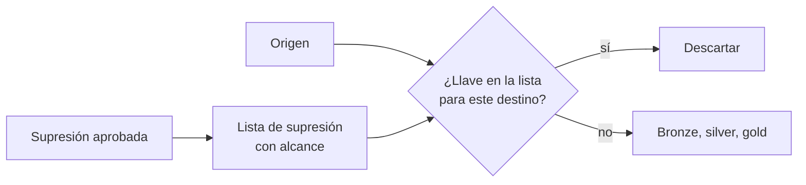
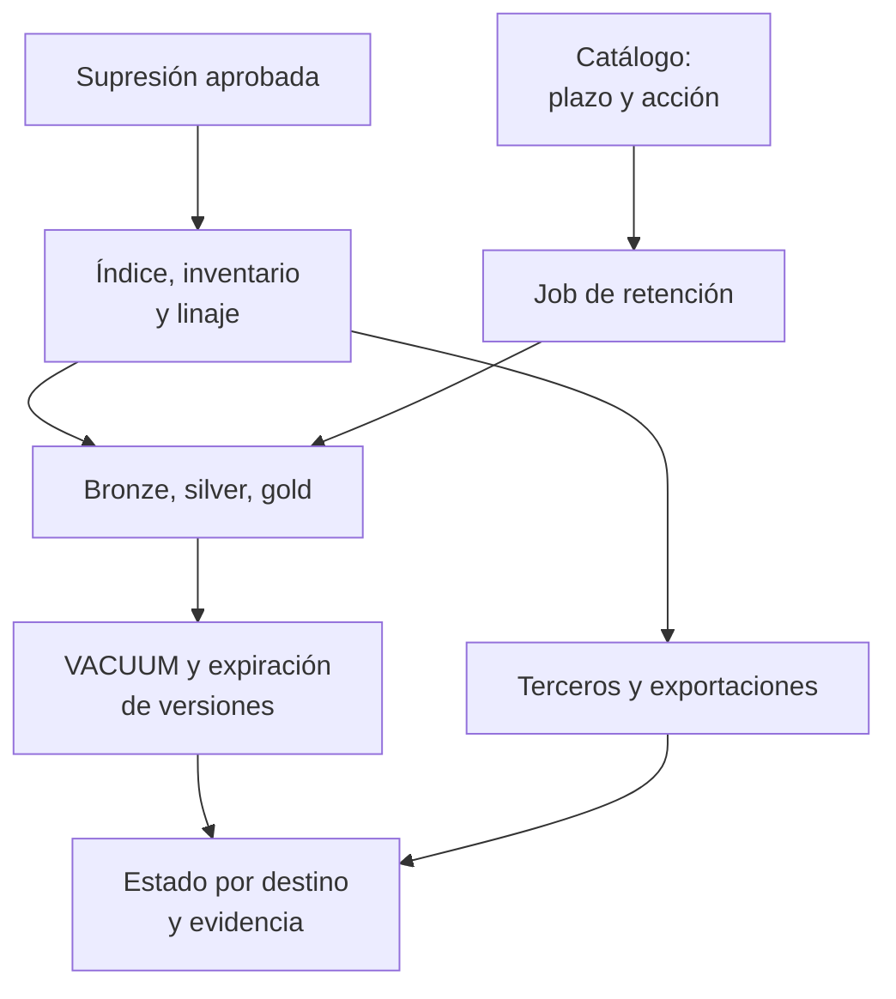

## 1. Resumen

Esta ficha no es asesoría legal: qué datos se conservan, por cuánto tiempo, con qué excepciones y si una supresión procede lo deciden el área legal y el responsable; aquí se explica cómo ejecutarlo de forma consistente y demostrable. Los plazos de los ejemplos son ilustrativos, no obligaciones legales.

**Cómo leerla.** *Comprender* (§1–6): qué distingue retención, supresión, bloqueo y anonimización, y por qué un DELETE no es una eliminación. *Aplicar* (§7–13): plazos por actividad, supresión por destino, versiones físicas y reintroducciones. *Demostrar*: la evidencia del §8, el código del §10 y los criterios del §18.

La **retención** define hasta cuándo se conserva un dato para una finalidad aprobada; la **supresión**, qué se elimina, de dónde, cuándo y cómo se comprueba. En una plataforma moderna, un dato personal no está en una tabla: está en el origen, en bronze, silver y gold, en features, en exportaciones, en el historial de versiones (time travel), en respaldos y en sistemas de terceros. Retener y suprimir bien significa que el plazo se aplique sin intervención manual, que una supresión alcance todas las copias que corresponde, que **ningún reprocesamiento la deshaga** y que la evidencia distinga lo verificado de lo que aún depende de una ventana de recuperación.

## 2. Qué es

- **[Obligación legal · art. 3]** **Retención:** cada dato se conserva solo el tiempo necesario para su finalidad y luego se suprime o anonimiza (letra c)).
- **[Obligación legal · art. 2]** **Eliminación:** es la destrucción de los datos, cualquiera sea el procedimiento (letra h)); un borrado lógico que deja el dato recuperable no lo es.
- **[Obligación legal · art. 7]** **Supresión a pedido:** procede por causales; hay excepciones, como una obligación legal de conservar.
- **[Obligación legal · art. 8 ter]** **Bloqueo:** suspensión temporal del tratamiento sin borrar.
- **[Buena práctica]** Cinco nociones que conviene no mezclar:

| Noción | Qué es | Qué no es | Etiqueta |
|---|---|---|---|
| Regla de retención | Evento de inicio, duración, finalidad, acción al vencer y excepciones aprobadas | Un plazo único por tabla para todo | **[Buena práctica]** |
| Supresión | Ejecución de una decisión de eliminar sobre los destinos alcanzados | Un DELETE en una tabla | **[Buena práctica]** |
| Borrado lógico | La fila ya no se ve, pero puede quedar recuperable en versiones o respaldos | Eliminación (art. 2 h)) | **[Buena práctica]** |
| Bloqueo | Restringir el tratamiento sin borrar | Supresión | **[Buena práctica]** |
| Anonimización | Transformación evaluada contra los medios razonables de reidentificación | Quitar el RUT o seudonimizar | **[Buena práctica]** |

- **[Buena práctica]** Los datos de una misma persona no tienen un solo plazo: una reserva, una preferencia comercial y un comprobante tributario responden a finalidades y reglas distintas.
- **[Decisión de arquitectura]** **Lista de supresión con alcance:** registro de llaves de titulares suprimidos y de los destinos que abarca la decisión, que la ingesta aplica para no reintroducirlos. Una lista global que descarte siempre a la persona puede interferir con tratamientos posteriores legítimos.
- **[Decisión de arquitectura]** **Crypto-shredding:** cifrar los datos de cada titular con una llave propia y destruirla para volver ilegibles todas las copias, incluidos los respaldos.

## 3. Problema que resuelve

**[Buena práctica]** Una aerolínea elimina a un pasajero de `silver.pasajeros`, pero el registro sigue en `bronze.reservas`, en un feature store, en un CSV exportado y en una versión histórica; al día siguiente un backfill lo vuelve a cargar. La consulta fue exitosa; la supresión fracasó. La salida no es agregar más DELETE, sino gestionar el ciclo completo de copias y dependencias.

**[Buena práctica]** Otras fallas típicas: el dato sigue recuperable por time travel o en un respaldo; la evidencia guarda el RUT del titular, lo que crea un tratamiento nuevo; nadie sabe qué tablas debían borrarse a los 90 días.

## 4. Cómo funciona

1. **[Decisión de arquitectura]** El área legal define plazo, evento de inicio, acción (suprimir o anonimizar) y excepciones por actividad de tratamiento; el catálogo lo propaga a cada tabla.
2. **[Obligación legal · art. 14 quáter]** La protección por defecto considera el plazo de conservación. **[Decisión de arquitectura]** Un job diario aplica la retención: particiones vencidas se eliminan o se anonimizan.
3. **[Obligación legal · art. 14]** Los datos de medidas precontractuales (leads, cotizaciones) tienen plazo propio y se suprimen o anonimizan (letra d)).
4. **[Buena práctica]** Ante una supresión aprobada, descubrir el alcance: identificar al titular con su llave, localizarlo con el índice de titulares, el inventario de actividades y el linaje, e incluir copias, exportaciones y encargados. El linaje ayuda a descubrir dependencias, pero no encuentra todas las copias ni los archivos descargados.
5. **[Buena práctica]** Planificar cada destino como eliminar, conservar por excepción, restringir o gestionar según la política de respaldos; ejecutar con operaciones idempotentes y registrar el estado por destino.
6. **[Buena práctica]** Purgar las versiones físicas: VACUUM en Delta, expiración de snapshots en Iceberg, ventana de time travel en BigQuery, versiones de objetos en almacenamiento. Mientras corre la ventana, el destino queda en `pendiente_expiracion_copias`, no en `verificado`. En Iceberg, la prueba es que ningún snapshot vigente devuelva al titular; en copias que no se reescriben, como los respaldos, la alternativa es destruir la llave del titular (crypto-shredding). Los dos ejemplos están en el §10.
7. **[Decisión de arquitectura]** Agregar la llave del titular a la lista de supresión con su alcance; la ingesta, el CDC, los backfills y las restauraciones la aplican antes de escribir.
8. **[Obligación legal · art. 11]** Comunicar la supresión a los destinatarios que recibieron los datos.
9. **[Obligación legal · art. 15 bis]** Al terminar el servicio, el encargado suprime o devuelve los datos. **[Buena práctica]** Exigir y guardar la constancia.
10. **[Buena práctica]** Cerrar con evidencia, con identificadores internos y conteos por tabla, sin datos del titular: solo cuando las acciones obligatorias estén verificadas y las excepciones documentadas.

## 5. Cuándo utilizarlo

- En toda tabla con datos personales, desde su creación.
- Al diseñar la ingesta incremental y los procesos de backfill y restauración.
- Ante solicitudes aprobadas de supresión, y al migrar plataformas, retirar sistemas, terminar contratos o restaurar respaldos.

## 6. Cuándo no utilizarlo

- Para decidir si una supresión procede o si aplica una excepción del art. 7: lo decide el área legal.
- Como política global de «borrar todo sobre una persona» sin revisar actividades, obligaciones de conservación y alcance.
- En datos realmente anonimizados (art. 2 k)): ya no son datos personales. Verificarlo antes (`chilean-identifier-pseudonymization`); anonimizar, bloquear o seudonimizar no equivale a eliminar.

## 7. Ejemplo sencillo

| Tabla | Plazo (ilustrativo) | Al vencer | Excepción |
|---|---|---|---|
| `bronze.reservas` | 90 días desde la ingesta | Suprimir | — (revisar copias y versiones) |
| `silver.pasajeros` | 2 años | Anonimizar | — |
| `silver.preferencias` | Hasta la revocación o el plazo aprobado | Suprimir o restringir según la decisión | Evitar que el origen la recargue |
| `gold.facturas` | Según obligación tributaria | Suprimir | Obligación legal: no se borra a pedido |
| Exportación a un proveedor | Vigencia del encargo | Pedir la supresión y la constancia | La plataforma no controla el destino |

## 8. Ejemplo de producción

Una aerolínea recibe una solicitud de supresión aprobada por el área legal:

| Paso | Qué hace ingeniería | Resultado |
|---|---|---|
| Identificar | Calcula la llave HMAC del RUT | Llave interna, sin RUT en los logs |
| Localizar | Consulta el índice de titulares, el inventario y el linaje | 7 tablas, 1 feature store, 1 exportación semanal a un proveedor |
| Clasificar | Separa facturas (obligación legal) del resto | 6 tablas a borrar, 1 a conservar |
| Ejecutar | DELETE por llave, idempotente por solicitud y destino | Filas lógicas eliminadas |
| Purgar | VACUUM y expiración de versiones según la ventana configurada | `pendiente_expiracion_copias` hasta que se cumpla la ventana |
| Proteger | Agrega la llave y su alcance a la lista de supresión | Los backfills la descartan en esos destinos |
| Propagar | Notifica al proveedor de la exportación | Constancia del encargado |
| Evidenciar | Registro con id de solicitud, llave, conteos, estado por destino y fecha | Prueba sin datos del titular |

**Estados por destino:** `pendiente`, `en_ejecucion`, `verificado`, `excepcion_aprobada`, `fallido`, `pendiente_expiracion_copias`. Lo que todavía depende de la expiración de versiones o respaldos no se declara `verificado`.

### Evidencia de cumplimiento

| Evidencia | Dónde queda | Quién la produce | Qué demuestra | Qué no demuestra |
|---|---|---|---|---|
| Plazo y acción por tabla | Catálogo | Área legal, dueño del dato | Qué regla rige cada tabla | Que la regla se aplique |
| Ejecución diaria de retención | Log del job | Orquestador | Qué particiones se eliminaron o anonimizaron | Que no haya copias fuera del catálogo |
| Registro de cada supresión, con estado por destino | Log de solicitudes, sin datos del titular | Pipeline de derechos | Qué se borró, qué se conservó por excepción y qué falta | Que el inventario de destinos esté completo |
| Historial de VACUUM o expiración | Historial de la tabla, logs de auditoría | Plataforma | Cuándo dejaron de existir las versiones | Que los respaldos externos se rotaron |
| Lectura en los snapshots vigentes tras expirar | Log del job de supresión | Pipeline de derechos | Que ninguna versión vigente devuelve al titular | Que los archivos de datos se borraron del almacenamiento |
| Llave del titular destruida | Auditoría del KMS o del key store | Seguridad | Que sus registros cifrados ya no se descifran, incluidos los respaldos | Que no quedaran copias en claro fuera del cifrado |
| Prueba de no reintroducción | Test de la CI sobre la ingesta | CI | Que un backfill no vuelve a cargar al titular | Que una restauración manual la respete |
| Constancia del encargado | Gestión de contratos | Encargado | Que declaró suprimir o devolver | La eliminación física en su sistema |

## 9. Arquitectura

**La ingesta respeta la supresión.**



**Supresión y retención en cada copia.**



## 10. Código

```python
# Python 3.12+, biblioteca estándar. Supresión consistente en un lakehouse simulado (Bronze, Silver, Gold):
# 1) el titular se identifica con una llave seudónima (HMAC del RUT con una llave separada),
# 2) la supresión borra en todas las capas salvo donde hay una obligación legal de conservar,
# 3) la llave queda en una lista de supresión, con su alcance, que la ingesta aplica para que un backfill no la
#    reintroduzca,
# 4) la evidencia registra conteos e identificadores internos, nunca el RUT,
# 5) el caso no queda verificado mientras un destino esté pendiente o falten copias por expirar.
import hashlib
import hmac
import secrets
from dataclasses import dataclass
from datetime import date

LLAVE_HMAC = secrets.token_bytes(32)   # en producción: desde un KMS o gestor de secretos, nunca en el código


def llave_titular(rut: str) -> str:
    rut_normalizado = rut.replace(".", "").replace("-", "").upper()
    return hmac.new(LLAVE_HMAC, rut_normalizado.encode(), hashlib.sha256).hexdigest()[:16]


@dataclass
class Fila:
    titular: str        # llave seudónima, no el RUT
    dato: str
    fecha: date


@dataclass(frozen=True)
class Tabla:
    nombre: str
    retencion_dias: int
    al_vencer: str                  # "suprimir" o "anonimizar"
    conservacion_legal: bool        # p. ej. documentos tributarios: art. 7 ii (obligación legal)


TABLAS = {
    "bronze.reservas": Tabla("bronze.reservas", 90, "suprimir", False),
    "silver.pasajeros": Tabla("silver.pasajeros", 730, "anonimizar", False),
    "gold.facturas": Tabla("gold.facturas", 2190, "suprimir", True),
}

ORIGEN = [  # lo que devuelve el sistema fuente en un backfill; RUT ficticios (dígitos repetidos)
    ("11.111.111-1", "reserva SCL-LIM", date(2026, 10, 1)),
    ("22.222.222-2", "reserva SCL-PMC", date(2026, 10, 3)),
]

LISTA_SUPRESION: dict[str, set[str]] = {}   # llave del titular → tablas alcanzadas por la decisión
VERIFICABLES = {"verificado", "excepcion_aprobada"}


def ingestar(origen: list[tuple[str, str, date]], destino: str) -> list[Fila]:
    """La ingesta seudonimiza y descarta los titulares cuya supresión alcanza a este destino."""
    filas = [Fila(llave_titular(rut), dato, f) for rut, dato, f in origen]
    return [f for f in filas if destino not in LISTA_SUPRESION.get(f.titular, set())]


def suprimir(datos: dict[str, list[Fila]], rut: str, solicitud: str) -> dict[str, object]:
    t = llave_titular(rut)
    borradas: dict[str, int] = {}
    conservadas: dict[str, int] = {}
    for nombre, filas in datos.items():
        if TABLAS[nombre].conservacion_legal:
            conservadas[nombre] = sum(f.titular == t for f in filas)
            continue
        antes = len(filas)
        datos[nombre] = [f for f in filas if f.titular != t]
        borradas[nombre] = antes - len(datos[nombre])
    LISTA_SUPRESION[t] = set(borradas)   # alcance: no descarta al titular de tratamientos fuera de la decisión
    # En producción, además: VACUUM / expiración de time travel, backups y exportaciones a terceros.
    return {"solicitud": solicitud, "titular": t, "borradas": borradas,
            "conservadas_por_obligacion_legal": conservadas, "en_lista_supresion": True}


def vencidas(datos: dict[str, list[Fila]], hoy: date) -> dict[str, tuple[int, str]]:
    """Retención como código: filas que superan el plazo y la acción que corresponde."""
    salida: dict[str, tuple[int, str]] = {}
    for nombre, filas in datos.items():
        t = TABLAS[nombre]
        n = sum((hoy - f.fecha).days > t.retencion_dias for f in filas)
        if n:
            salida[nombre] = (n, t.al_vencer)
    return salida


def pendientes(estados: dict[str, tuple[str, str | None]]) -> list[str]:
    """Lo que impide dar el caso por verificado: estado no final o destino sin evidencia."""
    salida = [f"{d}: {e}" for d, (e, _) in estados.items() if e not in VERIFICABLES]
    return salida + [f"{d}: falta evidencia" for d, (_, ev) in estados.items() if ev is None]


def main() -> None:
    bronze = ingestar(ORIGEN, "bronze.reservas")
    datos = {
        "bronze.reservas": bronze,
        "silver.pasajeros": [Fila(f.titular, "pasajero frecuente", f.fecha) for f in bronze],
        "gold.facturas": [Fila(f.titular, "factura emitida", f.fecha) for f in bronze],
    }
    datos["bronze.reservas"].append(Fila(llave_titular("5.555.555-5"), "reserva antigua", date(2026, 5, 1)))

    evidencia = suprimir(datos, "11.111.111-1", "SOL-2026-0042")
    print("evidencia:", {k: v for k, v in evidencia.items() if k != "titular"})
    print("llave del titular en la evidencia:", len(str(evidencia["titular"])), "caracteres hex, sin RUT")
    assert "11.111.111-1" not in str(evidencia), "la evidencia no debe contener el RUT"
    print("alcance en la lista de supresión:", sorted(LISTA_SUPRESION[str(evidencia["titular"])]))

    print("retención vencida al 2026-10-22:", vencidas(datos, date(2026, 10, 22)))

    # Backfill: se vuelve a leer el origen completo.
    datos["bronze.reservas"] = ingestar(ORIGEN, "bronze.reservas")
    reaparece = any(f.titular == evidencia["titular"] for f in datos["bronze.reservas"])
    print("¿el backfill reintroduce al titular?:", reaparece)

    estados: dict[str, tuple[str, str | None]] = {   # destino → (estado, evidencia)
        "bronze.reservas": ("verificado", "job-105"),
        "silver.pasajeros": ("pendiente_expiracion_copias", "job-106"),   # sigue en la ventana de time travel
        "gold.facturas": ("excepcion_aprobada", "decision-22"),
        "proveedor_email": ("pendiente", None),
    }
    print("SOL-2026-0042 aún no verificada:", pendientes(estados))


if __name__ == "__main__":
    main()
```

El script se **ejecuta en la CI** con la biblioteca estándar y pasa `mypy --strict`. La llave HMAC se genera con `secrets` y los RUT son ficticios (dígitos repetidos). Imprime la evidencia de la supresión (1 fila en `bronze.reservas` y 1 en `silver.pasajeros`, la factura conservada por obligación legal), que la llave del titular es un valor hex de 16 caracteres sin RUT, el alcance de la lista de supresión, la reserva de mayo vencida a los 90 días, que el backfill no reintroduce al titular y qué impide dar el caso por verificado:

```text
alcance en la lista de supresión: ['bronze.reservas', 'silver.pasajeros']
SOL-2026-0042 aún no verificada: ['silver.pasajeros: pendiente_expiracion_copias', 'proveedor_email: pendiente', 'proveedor_email: falta evidencia']
```

**Limitaciones:** este ejemplo no ejecuta borrados físicos ni acredita la eliminación en versiones, respaldos o terceros; las ventanas de cada servicio están en §11–13. Los dos ejemplos siguientes cubren las versiones de una tabla Iceberg y las copias que no se reescriben.

**Versiones de una tabla Iceberg.** El DELETE no basta: el dato sigue legible por time travel hasta que se expiran los snapshots que lo contienen.

```python
# Python 3.12, PyIceberg 0.12 y PyArrow (ejecutado en la CI en Linux; ADR-018): un DELETE en Iceberg crea un snapshot
# nuevo, pero el dato sigue legible por time travel desde el snapshot anterior. Hay que expirar los snapshots que lo
# contienen y comprobar que ningún snapshot vigente lo devuelve. Si la versión fijada no soporta un paso, se imprime
# «no ejecutado» con el mensaje de la biblioteca. Uso: iceberg_supresion.py <carpeta de trabajo>
import sys
import tempfile
from pathlib import Path

import pyarrow as pa  # type: ignore[import-untyped]  # pyarrow no publica stubs de tipos
from pyiceberg.catalog.sql import SqlCatalog
from pyiceberg.table import Table

base = Path(sys.argv[1] if len(sys.argv) > 1 else tempfile.mkdtemp())
(base / "warehouse").mkdir(parents=True, exist_ok=True)
catalogo = SqlCatalog("local", uri=f"sqlite:///{(base / 'catalog.db').as_posix()}", warehouse=(base / "warehouse").as_uri())
catalogo.create_namespace("silver")
tabla = catalogo.create_table("silver.pasajeros", schema=pa.schema([("titular", pa.string()), ("ruta", pa.string())]),
                              properties={"format-version": "2"})
tabla.append(pa.table({"titular": ["a1b2c3", "d4e5f6"], "ruta": ["SCL-LIM", "SCL-PMC"]}))  # llaves seudónimas
TITULAR = "a1b2c3"


def lo_lee(t: Table, snapshot_id: int) -> bool:
    return TITULAR in t.scan(snapshot_id=snapshot_id).to_arrow().column("titular").to_pylist()


tabla.delete(f"titular = '{TITULAR}'")
tabla = catalogo.load_table("silver.pasajeros")
anteriores = [s.snapshot_id for s in tabla.metadata.snapshots if s.snapshot_id != tabla.metadata.current_snapshot_id]
print("lectura actual tras el DELETE:", TITULAR in tabla.scan().to_arrow().column("titular").to_pylist())
print("time travel al snapshot anterior:", any(lo_lee(tabla, s) for s in anteriores))

try:
    expirar = tabla.maintenance.expire_snapshots()
    for snapshot_id in anteriores:
        expirar = expirar.by_id(snapshot_id)
    expirar.commit()
    tabla = catalogo.load_table("silver.pasajeros")
    vigentes = [s.snapshot_id for s in tabla.metadata.snapshots]
    print("snapshots vigentes tras expirar:", len(vigentes))
    print("¿algún snapshot vigente lo devuelve?:", any(lo_lee(tabla, s) for s in vigentes))
except (AttributeError, NotImplementedError, ValueError) as exc:
    print(f"expire_snapshots: no ejecutado ({exc})")
```

El script se **ejecuta en la CI en Linux** con PyIceberg 0.12 y catálogo SQLite (ADR-018) y pasa `mypy --strict`. PyIceberg 0.12 soporta `expire_snapshots`, así que no queda nada «no ejecutado»:

```text
lectura actual tras el DELETE: False
time travel al snapshot anterior: True
snapshots vigentes tras expirar: 1
¿algún snapshot vigente lo devuelve?: False
```

Expirar saca el snapshot de la metadata; según *Maintenance*, los archivos de datos no se borran mientras algún snapshot que sirva para time travel o rollback los referencie, y los archivos huérfanos se limpian aparte. El ejemplo comprueba la lectura, no el borrado físico de los archivos.

**Copias que no se reescriben: crypto-shredding.** Las llaves por titular las genera el test y llegan en un archivo; el código no contiene ninguna.

```python
# Python 3.12 y cryptography (ejecutado en la CI; ADR-022): crypto-shredding para suprimir en copias que no se
# reescriben (respaldos, exportaciones). Cada titular tiene su llave; sus registros se cifran con ella. Suprimir es
# destruir la llave: el registro sigue en el respaldo, pero ya no se puede descifrar. Las llaves no están en el
# código: llegan en un archivo JSON (titular → llave en hex) que en producción sería un KMS o un key store.
# Uso: crypto_shredding.py <archivo de llaves>
import json
import os
import sys
from pathlib import Path

from cryptography.exceptions import InvalidTag
from cryptography.hazmat.primitives.ciphers.aead import AESGCM

almacen = Path(sys.argv[1])
llaves = {t: bytes.fromhex(h) for t, h in json.loads(almacen.read_text(encoding="utf-8")).items()}


def cifrar(titular: str, valor: str) -> tuple[str, bytes, bytes]:
    nonce = os.urandom(12)
    return titular, nonce, AESGCM(llaves[titular]).encrypt(nonce, valor.encode(), titular.encode())


def descifrar(registro: tuple[str, bytes, bytes], llave: bytes | None) -> str:
    titular, nonce, cifrado = registro
    if llave is None:
        return "no se puede descifrar: la llave no existe"
    try:
        return AESGCM(llave).decrypt(nonce, cifrado, titular.encode()).decode()
    except InvalidTag:
        return "no se puede descifrar: llave incorrecta"


respaldo = [cifrar("a1b2c3", "reserva SCL-LIM"), cifrar("d4e5f6", "reserva SCL-PMC")]  # llaves seudónimas
del llaves["a1b2c3"]                                       # supresión aprobada: se destruye la llave del titular
almacen.write_text(json.dumps({t: k.hex() for t, k in llaves.items()}), encoding="utf-8")

print("titulares con llave:", sorted(json.loads(almacen.read_text(encoding="utf-8"))))
print("a1b2c3 en el respaldo:", descifrar(respaldo[0], llaves.get("a1b2c3")))
print("a1b2c3 con la llave de otro titular:", descifrar(respaldo[0], llaves["d4e5f6"]))
print("d4e5f6 en el respaldo:", descifrar(respaldo[1], llaves.get("d4e5f6")))
```

El script se **ejecuta en la CI con cryptography** (ADR-022) y pasa `mypy --strict`. Imprime que solo queda la llave de `d4e5f6`, que el registro de `a1b2c3` en el respaldo ya no se puede descifrar (sin llave, y con la llave de otro titular falla la autenticación: `InvalidTag`) y que el registro del otro titular sigue legible. Destruir la llave sirve solo si el dato nunca quedó en claro fuera del cifrado (`crypto-shredding`).

## 11. GCP

En GCP, **BigQuery**. Según *Data retention with time travel and fail-safe* (no ejecutado):

| Tema | Comportamiento | Etiqueta |
|---|---|---|
| Time travel | Los datos cambiados o borrados siguen recuperables durante la ventana: 7 días por defecto, configurable entre 2 y 7 | **[Buena práctica]** |
| Fail-safe | 7 días más, no configurables; se recupera con Cloud Customer Care | **[Buena práctica]** |
| Consecuencia | Tras un DELETE, el dato sigue recuperable hasta unos 14 días; el destino queda en `pendiente_expiracion_copias` y la evidencia declara esa ventana | **[Decisión de arquitectura]** |

## 12. AWS

En AWS, **Amazon S3** e **Iceberg**. Según *Managing the lifecycle of objects*, *Deleting object versions from a versioning-enabled bucket* y *Maintenance* (Apache Iceberg) (no ejecutado):

| Tema | Comportamiento | Etiqueta |
|---|---|---|
| Retención de objetos | S3 Lifecycle: acciones de expiración que borran los objetos vencidos | **[Buena práctica]** |
| Versionado | Un DELETE simple agrega un delete marker; `NoncurrentVersionExpiration` borra las versiones no actuales | **[Buena práctica]** |
| Tablas Iceberg | Expirar snapshots; los archivos se borran cuando ningún snapshot los referencia | **[Decisión de arquitectura]** |

## 13. Azure

En Azure, **Delta** en Azure Databricks. Según *Remove unused data files with vacuum* y *VACUUM* (no ejecutado):

| Tema | Comportamiento | Etiqueta |
|---|---|---|
| VACUUM | Borra los archivos fuera del umbral de retención: 7 días por defecto, controlado por `deletedFileRetentionDuration` | **[Buena práctica]** |
| Tras VACUUM | Se pierde el time travel a versiones anteriores al umbral | **[Buena práctica]** |
| Change data feed | Sus datos (`_change_data`) también se eliminan con VACUUM; revisarlos en la supresión | **[Buena práctica]** |

Databricks recomienda una retención de al menos 7 días; bajarla arriesga borrar archivos de jobs en curso. Es preferible declarar esa ventana en la respuesta al titular.

## 14. Buenas prácticas

- **[Decisión de arquitectura]** Usar la llave seudónima del titular como clave de supresión en todas las capas: sin ella, borrar exige buscar el RUT en cada tabla.
- **[Buena práctica]** Modelar las reglas por actividad, categoría de datos y evento de inicio, no solo por tabla.
- **[Buena práctica]** Particionar por fecha para que la retención sea un DROP de particiones, no un DELETE fila a fila.
- **[Buena práctica]** **Seguridad:** la lista de supresión también es tratamiento: guardar solo la llave seudónima, el alcance, la fecha y el id de solicitud.
- **[Buena práctica]** **Observabilidad:** métricas de tablas con datos personales sin plazo definido (debe ser cero), destinos pendientes por solicitud y copias aún recuperables.
- **[Decisión de arquitectura]** **Respaldos:** si no se pueden editar, documentar el plazo de rotación y reaplicar la lista de supresión en toda restauración, o usar crypto-shredding.
- **[Buena práctica]** **Costo:** el crypto-shredding agrega llaves y latencia; reservarlo para datos sensibles o sistemas con copias imposibles de editar.

## 15. Errores frecuentes

| Error | Consecuencia |
|---|---|
| Borrar en silver y olvidar bronze, features y exportaciones | Un derivado o la próxima carga reintroduce el dato |
| Asumir que un DELETE es una eliminación definitiva | Time travel, versiones y respaldos lo dejan recuperable |
| Backfills e ingestas «full refresh» que no aplican la lista de supresión | El titular suprimido vuelve |
| Restaurar un respaldo sin reaplicar las supresiones posteriores | Se deshacen supresiones ya respondidas |
| Lista de supresión global, sin alcance | Se bloquean tratamientos legítimos que la decisión no abarcaba |
| Declarar anonimizado tras quitar identificadores | Sigue el riesgo de reidentificación indirecta |
| Evidencia con el RUT o el nombre del titular | La evidencia se vuelve otra copia personal |
| Registrar solo conteos de filas | No demuestra cobertura ni estado por destino |

## 16. Trade-offs

| Opción | A favor | En contra |
|---|---|---|
| DELETE + VACUUM | Simple, nativo | Ventana de recuperación; no alcanza respaldos |
| Borrado por fila | Preciso para solicitudes individuales | Costoso en grandes volúmenes |
| Expiración por partición | Eficiente para la retención | Exige un particionado alineado con la regla |
| Crypto-shredding | Alcanza respaldos y copias | Gestión de llaves, latencia, complejidad; depende de la granularidad de las llaves |
| Anonimizar en vez de borrar | Conserva valor analítico | Exige probar que la anonimización es irreversible |
| Bloqueo | Rápido, reversible | No reemplaza la supresión cuando corresponde |

## 17. Conceptos relacionados

- `chile-data-protection`: ficha padre.
- `data-subject-rights-pipeline`: cómo llega y se valida la solicitud.
- `chilean-identifier-pseudonymization`: HMAC, llaves y anonimización real.
- `processing-activities-inventory`: de dónde vienen plazo y acción.
- `processors-and-international-transfers`: supresión en terceros.
- `data-lineage`: descubrir dependencias.
- `crypto-shredding`, `data-retention`, `open-table-formats`: técnicas de 18, 17 y 20.

## 18. Preguntas técnicas abiertas

1. ¿Tus backfills leen una lista de supresión, y con qué alcance?
2. ¿Cuánto tiempo sigue recuperable un dato borrado en tu plataforma, sumando versiones y respaldos?
3. ¿Qué tablas con datos personales no tienen plazo definido?
4. ¿Cómo sigues una acción pendiente en un sistema que no controlas?

**Criterio de dominio:** dominas esta ficha si puedes explicar, antes de declarar una supresión completa, qué destinos activos, derivados, exportaciones y terceros abarca; qué acción o excepción tiene cada uno; cómo la evidencia distingue borrado lógico, eliminación física y ventanas pendientes; y cómo los backfills, el CDC y las restauraciones respetan el alcance de la decisión.

## 19. Laboratorio relacionado

Propuesta para F4: tablas bronze, silver y gold con una supresión aprobada, un backfill que no debe reintroducir al titular y un destino externo simulado que queda `pendiente`, para demostrar que el caso no se cierra. La recuperación histórica y los respaldos se documentan aparte: el laboratorio no acredita una eliminación física real.

## 20. Fuentes

- BCN Ley Chile: *Ley 19628 SOBRE PROTECCION DE LOS DATOS PERSONALES* (versión con vigencia diferida desde 2026-12-01).
- Google Cloud: *Data retention with time travel and fail-safe*.
- AWS: *Managing the lifecycle of objects* y *Deleting object versions from a versioning-enabled bucket*.
- Apache Iceberg: *Maintenance*.
- Microsoft Learn: *Remove unused data files with vacuum* y *VACUUM*.

El detalle de cada fuente está en `sources` del frontmatter.

## 21. Fecha de última verificación

2026-10-25: textos legales vueltos a consultar en BCN, sin cambios. Antes, 2026-10-22: artículos consultados ese día en BCN; comportamiento de BigQuery, S3 y Delta según sus páginas. `review_required`: pasa a `verified` solo con la aprobación explícita de Felipe (`owner_approved_at`). Revisión mensual.

## 22. Historial de cambios importantes

- 2026-10-22: creación (upgrade de 19); reemplaza a `erasure-across-copies`, que queda como alias.
- 2026-10-24: `PART_OF` hacia `chile-data-protection` (ADR-024) e `implication` por artículo en `legal_basis` (enmienda de ADR-023). Sin cambios de contenido legal ni de código.
- 2026-10-25: revisión del upgrade (`docs/reviews/cards-f3b-19-upgrade.md`) y auditoría de las etiquetas «Obligación legal»: cada una afirma solo lo que dice su artículo; lo demás pasa a buena práctica o decisión de arquitectura. Textos de BCN y del Senado consultados el 2026-10-25, sin cambios desde el 2026-10-22.
- 2026-10-25: §9 con el estándar de diagramas (máximo 8 nodos, CLAUDE.md): dos diagramas: la ingesta respeta la lista de supresión, y supresión y retención en cada copia.
- 2026-10-28: mejora de contenido (lote P1) con tres niveles de lectura: §1 (retención frente a supresión), §2 (tabla de regla, supresión, borrado lógico, bloqueo y anonimización; plazos distintos para una misma persona; lista de supresión con alcance), §3 (caso del pasajero que vuelve con un backfill), §4 (diez pasos: alcance con inventario y linaje, plan por destino, `pendiente_expiracion_copias`, cierre con evidencia), §5, §6, §7 (preferencias y exportación a un proveedor), §8 (estados por destino y evidencia «qué demuestra y qué no»), §9 (alcance y estado por destino), §10 (lista de supresión con alcance y estados que impiden dar el caso por verificado, sobre el mismo ejemplo; RUT ficticios de dígitos repetidos en lugar de `12.345.678-5` y `9.876.543-2`), §11 (estado en la ventana de BigQuery), §14–16, §17 (relación con `data-lineage`), §18 (criterio de dominio) y §19 (laboratorio para F4). Sin cambios en `legal_basis`, etiquetas, aviso ni vigencia.
- 2026-10-28: dos ejemplos ejecutables más en el §10, con dependencias ya aprobadas: PyIceberg 0.12 (ADR-018: DELETE, `expire_snapshots` y ningún snapshot vigente devuelve al titular) y crypto-shredding con cryptography (ADR-022: llave por titular generada por el test, destruida, y registro del respaldo que ya no se descifra). §4 y §8 (dos filas de evidencia) ajustados; fuente `cryptography-docs`.
