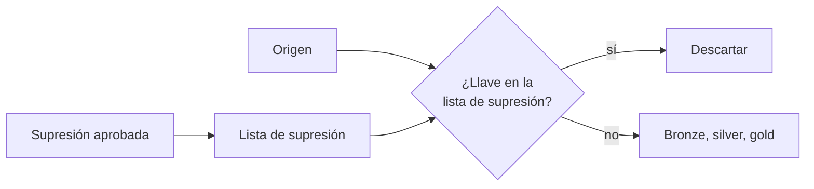
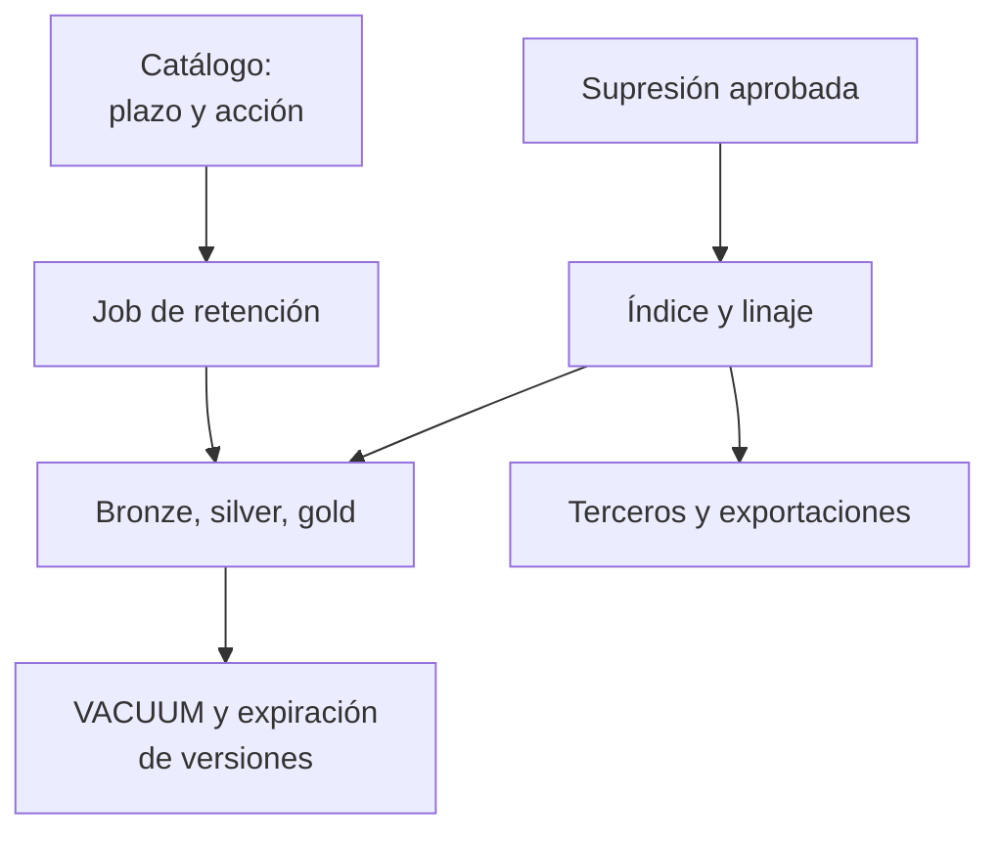

## 1. Resumen

Esta ficha no es asesoría legal: qué datos se conservan, por cuánto tiempo y si una supresión procede lo deciden el área legal y el responsable; aquí se explica cómo ejecutarlo de forma consistente y demostrable.

En una plataforma moderna, un dato personal no está en una tabla: está en el origen, en bronze, silver y gold, en features, en exportaciones, en el historial de versiones (time travel), en respaldos y en sistemas de terceros. Retener y suprimir bien significa que el plazo se aplique sin intervención manual, que una supresión alcance todas las copias que corresponde y que **ningún reprocesamiento la deshaga**.

## 2. Qué es

- **[Obligación legal · art. 3]** **Retención:** cada dato se conserva solo el tiempo necesario para su finalidad y luego se suprime o anonimiza (letra c)).
- **[Obligación legal · art. 2]** **Eliminación:** es la destrucción de los datos, cualquiera sea el procedimiento (letra h)); un borrado lógico que deja el dato recuperable no lo es.
- **[Obligación legal · art. 7]** **Supresión a pedido:** procede por causales; hay excepciones, como una obligación legal de conservar.
- **[Obligación legal · art. 8 ter]** **Bloqueo:** suspensión temporal del tratamiento sin borrar.
- **[Decisión de arquitectura]** **Lista de supresión:** registro de llaves de titulares suprimidos que la ingesta aplica para no reintroducirlos.
- **[Decisión de arquitectura]** **Crypto-shredding:** cifrar los datos de cada titular con una llave propia y destruirla para volver ilegibles todas las copias, incluidos los respaldos.

## 3. Problema que resuelve

**[Buena práctica]** Fallas típicas: el DELETE se ejecuta en silver, pero el dato sigue en bronze, en features y en un CSV exportado; el DELETE funciona, pero el dato sigue recuperable por time travel o en un respaldo; un backfill desde el origen reintroduce a un titular suprimido; la evidencia guarda el RUT del titular, lo que crea un tratamiento nuevo; nadie sabe qué tablas debían borrarse a los 90 días.

## 4. Cómo funciona

1. **[Decisión de arquitectura]** El área legal define plazo y acción (suprimir o anonimizar) por actividad de tratamiento; el catálogo lo propaga a cada tabla.
2. **[Obligación legal · art. 14 quáter]** La protección por defecto considera el plazo de conservación. **[Decisión de arquitectura]** Un job diario aplica la retención: particiones vencidas se eliminan o se anonimizan.
3. **[Obligación legal · art. 14]** Los datos de medidas precontractuales (leads, cotizaciones) tienen plazo propio y se suprimen o anonimizan (letra d)).
4. **[Buena práctica]** Ante una supresión aprobada: identificar al titular con su llave, localizarlo con el índice de titulares y el linaje, separar lo que tiene obligación de conservar y borrar el resto.
5. **[Buena práctica]** Purgar las versiones físicas: VACUUM en Delta, expiración de snapshots en Iceberg, ventana de time travel en BigQuery, versiones de objetos en almacenamiento.
6. **[Decisión de arquitectura]** Agregar la llave del titular a la lista de supresión, que la ingesta y los backfills aplican antes de escribir.
7. **[Obligación legal · art. 11]** Comunicar la supresión a los destinatarios que recibieron los datos.
8. **[Obligación legal · art. 15 bis]** Al terminar el servicio, el encargado suprime o devuelve los datos. **[Buena práctica]** Exigir y guardar la constancia.
9. **[Buena práctica]** Generar evidencia con identificadores internos y conteos por tabla, sin datos del titular.

## 5. Cuándo utilizarlo

- En toda tabla con datos personales, desde su creación.
- Al diseñar la ingesta incremental y los procesos de backfill y restauración.

## 6. Cuándo no utilizarlo

- Para decidir si una supresión procede o si aplica una excepción del art. 7: lo decide el área legal.
- En datos realmente anonimizados (art. 2 k)): ya no son datos personales. Verificarlo antes (`chilean-identifier-pseudonymization`).

## 7. Ejemplo sencillo

| Tabla | Plazo | Al vencer | Excepción |
|---|---|---|---|
| `bronze.reservas` | 90 días | Suprimir | — |
| `silver.pasajeros` | 2 años | Anonimizar | — |
| `gold.facturas` | Según obligación tributaria | Suprimir | Obligación legal: no se borra a pedido |

## 8. Ejemplo de producción

Una aerolínea recibe una solicitud de supresión aprobada por el área legal:

| Paso | Qué hace ingeniería | Resultado |
|---|---|---|
| Identificar | Calcula la llave HMAC del RUT | Llave interna, sin RUT en los logs |
| Localizar | Consulta el índice de titulares y el linaje | 7 tablas, 1 feature store, 1 exportación semanal a un proveedor |
| Clasificar | Separa facturas (obligación legal) del resto | 6 tablas a borrar, 1 a conservar |
| Ejecutar | DELETE por llave | Filas lógicas eliminadas |
| Purgar | VACUUM y expiración de versiones según la ventana configurada | Copias físicas eliminadas al cumplirse la ventana |
| Proteger | Agrega la llave a la lista de supresión | Los backfills la descartan |
| Propagar | Notifica al proveedor de la exportación | Constancia del encargado |
| Evidenciar | Registro con id de solicitud, llave, conteos y fecha | Prueba sin datos del titular |

### Evidencia de cumplimiento

| Evidencia | Dónde queda | Quién la produce |
|---|---|---|
| Plazo y acción por tabla | Catálogo | Área legal, dueño del dato |
| Ejecución diaria de retención | Log del job | Orquestador |
| Registro de cada supresión | Log de solicitudes, sin datos del titular | Pipeline de derechos |
| Historial de VACUUM o expiración | Historial de la tabla, logs de auditoría | Plataforma |
| Prueba de no reintroducción | Test de la CI sobre la ingesta | CI |

## 9. Arquitectura

**La ingesta respeta la supresión.**



**Supresión y retención en cada copia.**



## 10. Código

```python
# Python 3.12+, biblioteca estándar. Supresión consistente en un lakehouse simulado (Bronze, Silver, Gold):
# 1) el titular se identifica con una llave seudónima (HMAC del RUT con una llave separada),
# 2) la supresión borra en todas las capas salvo donde hay una obligación legal de conservar,
# 3) la llave queda en una lista de supresión que la ingesta aplica, para que un backfill no la reintroduzca,
# 4) la evidencia registra conteos e identificadores internos, nunca el RUT.
import hashlib
import hmac
import secrets
from dataclasses import dataclass
from datetime import date

LLAVE_HMAC = secrets.token_bytes(32)   # en producción: desde un KMS o gestor de secretos, nunca en el código


def llave_titular(rut: str) -> str:
    rut_normalizado = rut.replace(".", "").replace("-", "").upper()
    return hmac.new(LLAVE_HMAC, rut_normalizado.encode(), hashlib.sha256).hexdigest()[:16]


@dataclass
class Fila:
    titular: str        # llave seudónima, no el RUT
    dato: str
    fecha: date


@dataclass(frozen=True)
class Tabla:
    nombre: str
    retencion_dias: int
    al_vencer: str                  # "suprimir" o "anonimizar"
    conservacion_legal: bool        # p. ej. documentos tributarios: art. 7 ii (obligación legal)


TABLAS = {
    "bronze.reservas": Tabla("bronze.reservas", 90, "suprimir", False),
    "silver.pasajeros": Tabla("silver.pasajeros", 730, "anonimizar", False),
    "gold.facturas": Tabla("gold.facturas", 2190, "suprimir", True),
}

ORIGEN = [  # lo que devuelve el sistema fuente en un backfill
    ("12.345.678-5", "reserva SCL-LIM", date(2026, 10, 1)),
    ("9.876.543-2", "reserva SCL-PMC", date(2026, 10, 3)),
]

LISTA_SUPRESION: set[str] = set()


def ingestar(origen: list[tuple[str, str, date]]) -> list[Fila]:
    """La ingesta seudonimiza y descarta titulares en la lista de supresión."""
    filas = [Fila(llave_titular(rut), dato, f) for rut, dato, f in origen]
    return [f for f in filas if f.titular not in LISTA_SUPRESION]


def suprimir(datos: dict[str, list[Fila]], rut: str, solicitud: str) -> dict[str, object]:
    t = llave_titular(rut)
    borradas: dict[str, int] = {}
    conservadas: dict[str, int] = {}
    for nombre, filas in datos.items():
        if TABLAS[nombre].conservacion_legal:
            conservadas[nombre] = sum(f.titular == t for f in filas)
            continue
        antes = len(filas)
        datos[nombre] = [f for f in filas if f.titular != t]
        borradas[nombre] = antes - len(datos[nombre])
    LISTA_SUPRESION.add(t)
    # En producción, además: VACUUM / expiración de time travel, backups y exportaciones a terceros.
    return {"solicitud": solicitud, "titular": t, "borradas": borradas,
            "conservadas_por_obligacion_legal": conservadas, "en_lista_supresion": True}


def vencidas(datos: dict[str, list[Fila]], hoy: date) -> dict[str, tuple[int, str]]:
    """Retención como código: filas que superan el plazo y la acción que corresponde."""
    salida: dict[str, tuple[int, str]] = {}
    for nombre, filas in datos.items():
        t = TABLAS[nombre]
        n = sum((hoy - f.fecha).days > t.retencion_dias for f in filas)
        if n:
            salida[nombre] = (n, t.al_vencer)
    return salida


def main() -> None:
    bronze = ingestar(ORIGEN)
    datos = {
        "bronze.reservas": bronze,
        "silver.pasajeros": [Fila(f.titular, "pasajero frecuente", f.fecha) for f in bronze],
        "gold.facturas": [Fila(f.titular, "factura emitida", f.fecha) for f in bronze],
    }
    datos["bronze.reservas"].append(Fila(llave_titular("5.555.555-5"), "reserva antigua", date(2026, 5, 1)))

    evidencia = suprimir(datos, "12.345.678-5", "SOL-2026-0042")   # RUT ficticio
    print("evidencia:", {k: v for k, v in evidencia.items() if k != "titular"})
    print("llave del titular en la evidencia:", len(str(evidencia["titular"])), "caracteres hex, sin RUT")
    assert "12.345.678-5" not in str(evidencia), "la evidencia no debe contener el RUT"

    print("retención vencida al 2026-10-22:", vencidas(datos, date(2026, 10, 22)))

    # Backfill: se vuelve a leer el origen completo.
    datos["bronze.reservas"] = ingestar(ORIGEN)
    reaparece = any(f.titular == evidencia["titular"] for f in datos["bronze.reservas"])
    print("¿el backfill reintroduce al titular?:", reaparece)


if __name__ == "__main__":
    main()
```

El script se **ejecuta en la CI** con la biblioteca estándar y pasa `mypy --strict`. La llave HMAC se genera con `secrets` y los RUT son ficticios. Imprime la evidencia de la supresión (1 fila en `bronze.reservas` y 1 en `silver.pasajeros`, la factura conservada por obligación legal), que la llave del titular es un valor hex de 16 caracteres sin RUT, la reserva de mayo vencida a los 90 días y que el backfill no reintroduce al titular.

## 11. GCP

En GCP, **BigQuery**. Según *Ley 19628 SOBRE PROTECCION DE LOS DATOS PERSONALES* y *Data retention with time travel and fail-safe* (no ejecutado):

| Tema | Comportamiento | Etiqueta |
|---|---|---|
| Time travel | Los datos cambiados o borrados siguen recuperables durante la ventana: 7 días por defecto, configurable entre 2 y 7 | **[Buena práctica]** |
| Fail-safe | 7 días más, no configurables; se recupera con Cloud Customer Care | **[Buena práctica]** |
| Consecuencia | Tras un DELETE, el dato sigue recuperable hasta unos 14 días; la evidencia declara esa ventana | **[Decisión de arquitectura]** |

## 12. AWS

En AWS, **Amazon S3** e **Iceberg**. Según *Ley 19628 SOBRE PROTECCION DE LOS DATOS PERSONALES*, *Managing the lifecycle of objects*, *Deleting object versions from a versioning-enabled bucket* y *Maintenance* (Apache Iceberg) (no ejecutado):

| Tema | Comportamiento | Etiqueta |
|---|---|---|
| Retención de objetos | S3 Lifecycle: acciones de expiración que borran los objetos vencidos | **[Buena práctica]** |
| Versionado | Un DELETE simple agrega un delete marker; `NoncurrentVersionExpiration` borra las versiones no actuales | **[Buena práctica]** |
| Tablas Iceberg | Expirar snapshots; los archivos se borran cuando ningún snapshot los referencia | **[Decisión de arquitectura]** |

## 13. Azure

En Azure, **Delta** en Azure Databricks. Según *Ley 19628 SOBRE PROTECCION DE LOS DATOS PERSONALES*, *Remove unused data files with vacuum* y *VACUUM* (no ejecutado):

| Tema | Comportamiento | Etiqueta |
|---|---|---|
| VACUUM | Borra los archivos fuera del umbral de retención: 7 días por defecto, controlado por `deletedFileRetentionDuration` | **[Buena práctica]** |
| Tras VACUUM | Se pierde el time travel a versiones anteriores al umbral | **[Buena práctica]** |
| Change data feed | Sus datos (`_change_data`) también se eliminan con VACUUM; revisarlos en la supresión | **[Buena práctica]** |

Databricks recomienda una retención de al menos 7 días; bajarla arriesga borrar archivos de jobs en curso. Es preferible declarar esa ventana en la respuesta al titular.

## 14. Buenas prácticas

- **[Decisión de arquitectura]** Usar la llave seudónima del titular como clave de supresión en todas las capas: sin ella, borrar exige buscar el RUT en cada tabla.
- **[Buena práctica]** Particionar por fecha para que la retención sea un DROP de particiones, no un DELETE fila a fila.
- **[Buena práctica]** **Seguridad:** la lista de supresión también es tratamiento: guardar solo la llave seudónima, la fecha y el id de solicitud.
- **[Buena práctica]** **Observabilidad:** métrica de tablas con datos personales sin plazo definido; debe ser cero.
- **[Decisión de arquitectura]** **Respaldos:** si no se pueden editar, documentar el plazo de rotación y reaplicar la lista de supresión en toda restauración, o usar crypto-shredding.
- **[Buena práctica]** **Costo:** el crypto-shredding agrega llaves y latencia; reservarlo para datos sensibles o sistemas con copias imposibles de editar.

## 15. Errores frecuentes

- Borrar en silver y olvidar bronze, features y exportaciones.
- Asumir que un DELETE es una eliminación definitiva sin considerar time travel, VACUUM y respaldos.
- Backfills e ingestas «full refresh» que no aplican la lista de supresión.
- Restaurar un respaldo sin reaplicar las supresiones posteriores.
- Evidencia que guarda el RUT o el nombre del titular.

## 16. Trade-offs

| Opción | A favor | En contra |
|---|---|---|
| DELETE + VACUUM | Simple, nativo | Ventana de recuperación; no alcanza respaldos |
| Crypto-shredding | Alcanza respaldos y copias | Gestión de llaves, latencia, complejidad |
| Anonimizar en vez de borrar | Conserva valor analítico | Exige probar que la anonimización es irreversible |
| Bloqueo | Rápido, reversible | No reemplaza la supresión cuando corresponde |

## 17. Conceptos relacionados

- `chile-data-protection`: ficha padre.
- `data-subject-rights-pipeline`: cómo llega y se valida la solicitud.
- `chilean-identifier-pseudonymization`: HMAC, llaves y anonimización real.
- `processing-activities-inventory`: de dónde vienen plazo y acción.
- `processors-and-international-transfers`: supresión en terceros.
- `crypto-shredding`, `data-retention`, `open-table-formats`: técnicas de 18, 17 y 20.

## 18. Preguntas técnicas abiertas

1. ¿Tus backfills leen una lista de supresión?
2. ¿Cuánto tiempo sigue recuperable un dato borrado en tu plataforma, sumando versiones y respaldos?
3. ¿Qué tablas con datos personales no tienen plazo definido?

## 19. Laboratorio relacionado

Pendiente (F4). Propuesta: tabla Delta con supresión, VACUUM y backfill que respete la lista de supresión.

## 20. Fuentes

- BCN Ley Chile: *Ley 19628 SOBRE PROTECCION DE LOS DATOS PERSONALES* (versión con vigencia diferida desde 2026-12-01).
- Google Cloud: *Data retention with time travel and fail-safe*.
- AWS: *Managing the lifecycle of objects* y *Deleting object versions from a versioning-enabled bucket*.
- Apache Iceberg: *Maintenance*.
- Microsoft Learn: *Remove unused data files with vacuum* y *VACUUM*.

El detalle de cada fuente está en `sources` del frontmatter.

## 21. Fecha de última verificación

2026-10-25: textos legales vueltos a consultar en BCN, sin cambios. Antes, 2026-10-22: artículos consultados ese día en BCN; comportamiento de BigQuery, S3 y Delta según sus páginas. `review_required`: pasa a `verified` solo con la aprobación explícita de Felipe (`owner_approved_at`). Revisión mensual.

## 22. Historial de cambios importantes

- 2026-10-22: creación (upgrade de 19); reemplaza a `erasure-across-copies`, que queda como alias.
- 2026-10-24: `PART_OF` hacia `chile-data-protection` (ADR-024) e `implication` por artículo en `legal_basis` (enmienda de ADR-023). Sin cambios de contenido legal ni de código.
- 2026-10-25: revisión del upgrade (`docs/reviews/cards-f3b-19-upgrade.md`) y auditoría de las etiquetas «Obligación legal»: cada una afirma solo lo que dice su artículo; lo demás pasa a buena práctica o decisión de arquitectura. Textos de BCN y del Senado consultados el 2026-10-25, sin cambios desde el 2026-10-22.
- 2026-10-25: §9 con el estándar de diagramas (máximo 8 nodos, CLAUDE.md): dos diagramas: la ingesta respeta la lista de supresión, y supresión y retención en cada copia.
