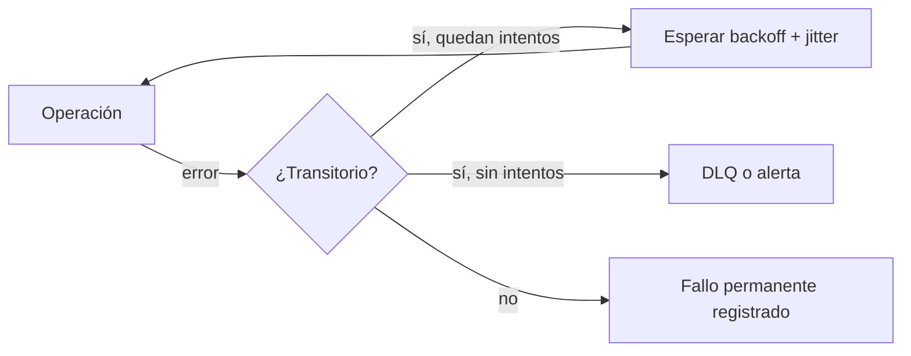

## 1. Resumen

Reintentar es volver a ejecutar una operación que falló, esperando cada vez un poco más (backoff exponencial) y con una variación aleatoria (jitter) para que muchos clientes no reintenten al mismo tiempo. Es la primera defensa ante fallos transitorios, pero solo es segura si la operación es idempotente, y debe tener un límite tras el cual el fallo se trata como permanente.

## 2. Qué es

Es un patrón de resiliencia con cuatro decisiones:

- **qué** se reintenta: solo errores transitorios (timeouts, limitación de tasa, caídas breves);
- **cuántas veces**: un número máximo de intentos o un tiempo total;
- **con qué espera**: fija, lineal o exponencial, con o sin jitter;
- **qué pasa al agotarse**: alertar, apartar a una DLQ o fallar la tarea.

## 3. Problema que resuelve

Las redes, las APIs y los servicios fallan de forma intermitente. Sin reintentos, un fallo de un segundo tumba un pipeline entero. Con reintentos ingenuos (inmediatos y sin límite), un servicio degradado recibe aún más carga y se retrasa su recuperación.

## 4. Cómo funciona

1. Se clasifica el error: transitorio (reintentar) o permanente (no reintentar).
2. Se espera `base * 2^intento`, acotado por un máximo, más un valor aleatorio (jitter).
3. Se reintenta hasta el límite de intentos o de tiempo.
4. Al agotarse, se aplica la política final: DLQ, alerta o fallo visible.

En sistemas de mensajería, el reintento suele hacerlo el broker (reentrega) y no el código del consumidor. Por eso el consumidor debe tolerar recibir el mismo mensaje varias veces.

## 5. Cuándo utilizarlo

- Llamadas a APIs y servicios externos con errores transitorios o limitación de tasa.
- Consumo de colas y tópicos, donde el broker reentrega lo no confirmado.
- Tareas de orquestación que dependen de recursos que pueden no estar listos todavía.

## 6. Cuándo no utilizarlo

- Errores permanentes (datos inválidos, permisos denegados, recurso inexistente): reintentar solo retrasa el fallo y consume recursos.
- Operaciones no idempotentes sin una clave de idempotencia: un reintento tras un timeout puede duplicar el efecto (por ejemplo, un cobro).
- Cadenas de servicios que ya reintentan en cada capa: los reintentos se multiplican.

## 7. Ejemplo sencillo

Una API responde 503 de forma intermitente. El cliente reintenta hasta 5 veces, con esperas de alrededor de 1, 2, 4 y 8 segundos más jitter. Ante un 400 (petición inválida) no reintenta.

## 8. Ejemplo de producción

Un consumidor de Pub/Sub escribe en BigQuery. La suscripción usa backoff exponencial entre 10 y 300 segundos y un dead-letter topic con 10 intentos. El código no reintenta los errores de validación: los confirma y los registra aparte. Deja sin confirmar solo los transitorios, para que Pub/Sub los reentregue. La escritura es un `MERGE` por `message_id`, así que las reentregas no duplican.

## 9. Arquitectura



## 10. Código

```python
# Python 3.12, solo biblioteca estándar: reintento con backoff exponencial y jitter completo.
import random
import time


class TransientError(Exception):
    """Error que vale la pena reintentar (timeout, 429, 503...)."""


def with_retries(operation, max_attempts: int = 5, base: float = 1.0, cap: float = 30.0):
    for attempt in range(1, max_attempts + 1):
        try:
            return operation()
        except TransientError:
            if attempt == max_attempts:
                raise  # agotado: que lo trate la política final (DLQ, alerta)
            time.sleep(random.uniform(0, min(cap, base * 2 ** (attempt - 1))))  # jitter completo
```

La operación debe ser idempotente, o usar una clave de idempotencia, para que reintentarla no duplique su efecto.

## 11. GCP

En **Pub/Sub**, la suscripción define la política de reintento:

- **reentrega inmediata** (por defecto);
- **backoff exponencial**: cada fallo consecutivo alarga la espera entre un mínimo y un máximo configurables, dentro de 0 a 600 segundos.

Se combina con un dead-letter topic para limitar los intentos.

## 12. AWS

En **SQS**, el reintento lo produce el *visibility timeout*: si el consumidor no borra el mensaje antes de que venza (30 segundos por defecto), el mensaje vuelve a ser visible y puede recibirlo otro consumidor. El límite de intentos lo pone la `maxReceiveCount` de la redrive policy hacia la DLQ. El modelo es distinto al de Pub/Sub: el reintento depende del tiempo de invisibilidad, no de una política de backoff de la suscripción.

## 13. Azure

En **Service Bus**, un mensaje se reentrega hasta su *max delivery count*. Superado ese número, pasa a la dead-letter queue con el motivo `MaxDeliveryCountExceeded`. El límite es por número de entregas, igual que en SQS, pero el mecanismo de reentrega es el bloqueo del mensaje (peek-lock), no un visibility timeout.

## 14. Buenas prácticas

- Reintentar solo errores transitorios y con límite.
- Usar backoff exponencial con jitter para no sincronizar a los clientes.
- Reintentar en una sola capa y no en todas.
- Hacer idempotente la operación, o pasar una clave de idempotencia.
- **Observabilidad:** medir intentos por operación, tasa de agotamiento y tiempo total gastado en esperas; un aumento suele anticipar una caída.
- **Seguridad:** no reintentar errores de autenticación o autorización como si fueran transitorios: ocultan un problema de credenciales.
- **Costo:** cada reintento vuelve a consumir cómputo y, en APIs de pago, vuelve a facturar la llamada.

## 15. Errores frecuentes

- Reintentar sin límite ni backoff y amplificar una caída.
- Reintentar errores permanentes.
- Reintentos anidados en cada capa (cliente, SDK, orquestador) que multiplican los intentos.
- Reintentar operaciones no idempotentes y duplicar efectos.

## 16. Trade-offs

Más intentos y esperas más largas aumentan la probabilidad de éxito, a cambio de latencia y de ocultar problemas más tiempo. Pocos intentos fallan antes y de forma visible, pero sufren más los fallos transitorios.

## 17. Conceptos relacionados

- `idempotency`: requisito de un reintento seguro.
- `dead-letter-queue`: destino cuando los reintentos se agotan.
- `pubsub-delivery-semantics`: reentrega y política de reintento en Pub/Sub.
- Con ficha: `python-error-handling-and-retries`.
- `failure-recovery`: cómo se combinan reintentos, checkpoints, DLQ, replay y backfill para volver a un estado correcto.
- Del blueprint, pendiente de ficha: `exactly-once-semantics`.

## 18. Preguntas técnicas abiertas

1. ¿Cómo distinguirías en tu código un error transitorio de uno permanente al llamar a una API externa?
2. ¿Qué problema aparece si el cliente HTTP, el SDK y el orquestador reintentan cada uno por su cuenta?
3. ¿Cómo harías seguro reintentar una operación que cobra dinero?

## 19. Laboratorio relacionado

Pendiente (F4): ingesta API con reintentos (snippet de A-F3.2 y lab de tipo A).

## 20. Fuentes

- Google Cloud: *Subscription retry policy* (Pub/Sub).
- AWS: *Amazon SQS visibility timeout* y *Amazon SQS dead-letter queues*.
- Microsoft Learn: *Service Bus dead-letter queues*.

El detalle de cada fuente está en `sources` del frontmatter.

## 21. Fecha de última verificación

2026-09-30. Pasa a `verified`: revisión B-F3.1 del lote 2 aplicada, sin VERIFY pendientes.

## 22. Historial de cambios importantes

- 2026-09-30: creación (lote 2 de F3).
- 2026-09-30: `verification_status: verified` (revisión B-F3.1 del lote 2 aplicada; sin VERIFY pendientes).
- 2026-10-06: la sección de conceptos relacionados ya no lista como pendiente de ficha a `python-error-handling-and-retries`, que ya tiene ficha.
- 2026-10-11: §17 enlaza `failure-recovery`, que ya tiene ficha (lote F3b-05a); antes figuraba como pendiente de ficha.
- 2026-10-13: `page_title` en cada cita, con el título de la página citada (ADR-012); sin cambios de contenido.
- 2026-10-14: lote F3b-rel (regla del §17): relations incluye `failure-recovery`, `python-error-handling-and-retries`.
