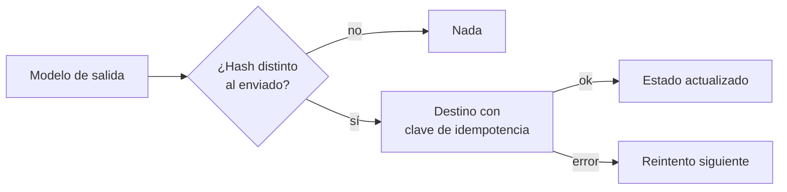

## 1. Resumen

El warehouse calcula cosas que sirven fuera de él: el segmento de cada cliente, un puntaje de riesgo, la última compra. **Reverse ETL** las lleva de vuelta a las herramientas donde se usan: CRM, marketing, soporte o una base de baja latencia para una aplicación. Google lo describe como combinar el análisis de BigQuery con la baja latencia de Bigtable para servir a usuarios de aplicaciones (*Export data to Bigtable (reverse ETL)*).

El problema técnico es el mismo que el de cualquier carga, al revés: enviar **solo lo que cambió**, que un reintento **no duplique** (`idempotency`) y saber qué se envió. El destino no es un warehouse: tiene APIs con límites, errores transitorios y reglas de escritura propias; el copy activity de Fabric hacia Dataverse, por ejemplo, solo admite Upsert (*Configure Dataverse in a copy activity*).

## 2. Qué es

- **Modelo de salida:** una tabla en el warehouse con lo que el destino necesita, con un dueño y un contrato (`data-contracts`).
- **Diferencias:** cada fila tiene un hash; solo se envían las nuevas o cambiadas (`incremental-load`).
- **Clave de idempotencia:** identifica cada envío; si se repite, el destino no aplica dos veces (`upsert`).
- **Estado de sincronización:** qué se envió y con qué hash.
- **Reintento:** lo que falló vuelve a ser candidato en la corrida siguiente.

## 3. Problema que resuelve

El equipo comercial exporta un CSV de segmentos cada lunes y lo sube a mano al CRM. Los segmentos llegan con una semana de atraso y, cuando la subida falla a mitad, nadie sabe qué quedó cargado. Con una sincronización por diferencias, el CRM recibe solo los cambios, los errores se reintentan y una corrida repetida no cambia nada.

## 4. Cómo funciona

1. El warehouse materializa el modelo de salida.
2. Se comparan sus filas con el estado de lo ya enviado.
3. Las nuevas o cambiadas se envían con su clave de idempotencia.
4. Lo aceptado actualiza el estado; lo que falló queda pendiente.
5. La corrida siguiente reintenta lo pendiente y envía los cambios nuevos.

## 5. Cuándo utilizarlo

- Segmentos, puntajes o métricas que tienen que estar en una herramienta operativa.
- Datos que una aplicación sirve con baja latencia.
- Cuando hoy se hace con exportaciones manuales.

## 6. Cuándo no utilizarlo

- Para decisiones en tiempo real dentro de una transacción: el warehouse no es la fuente operativa.
- Para enviar datos personales a una herramienta sin base ni contrato que lo permitan (`processors-and-international-transfers`).
- Como sustituto de una integración de eventos cuando la herramienta necesita cada cambio al instante.

## 7. Ejemplo sencillo

| Corrida | Candidatas | Enviadas | Fallidas |
|---|---|---|---|
| 1 | 3 | 2 | 1 (error transitorio del cliente 2) |
| 2 | 1 | 1 | 0 (reintento) |
| 3 | 0 | 0 | 0 (nada cambió) |
| Tras cambiar el segmento del cliente 3 | 1 | 1 | 0 |

## 8. Ejemplo de producción

Segmentos de clientes hacia el CRM:

- modelo `customer_segments` con dueño y contrato;
- sincronización horaria por diferencias, con estado en el warehouse;
- límite de envíos por minuto según el API del destino;
- alertas por fallos que no se resuelven en tres corridas;
- en la nube (no ejecutado): EXPORT DATA de BigQuery a Bigtable, un flow de Amazon AppFlow a Salesforce o un copy activity de Fabric a Dataverse.

## 9. Arquitectura



## 10. Código

```python
# Python 3.12 y psycopg contra PostgreSQL 17 (ejecutado en la CI con el servicio postgres:17): reverse ETL por
# diferencias. El warehouse calcula un puntaje por cliente; la sincronización envía al CRM solo las filas nuevas o
# cambiadas (por hash), con una clave de idempotencia por fila, y guarda qué envió. Un envío que falla se reintenta en
# la corrida siguiente; repetir la corrida no reenvía nada. El CRM es un objeto en memoria. PG_DSN: base vacía.
import hashlib
import os

import psycopg


class CRM:
    """Destino simulado: rechaza una vez al cliente 2 y descarta envíos repetidos con la misma clave."""

    def __init__(self) -> None:
        self.records: dict[int, str] = {}
        self.seen: set[str] = set()
        self.fail_once = {2}

    def upsert(self, customer_id: int, segment: str, key: str) -> bool:
        if customer_id in self.fail_once:
            self.fail_once.discard(customer_id)
            return False                              # error transitorio del API
        if key not in self.seen:
            self.seen.add(key)
            self.records[customer_id] = segment
        return True


def sync(conn: psycopg.Connection[tuple[object, ...]], crm: CRM) -> dict[str, int]:
    rows = conn.execute("""
        SELECT s.customer_id, s.segment FROM customer_segments s
        LEFT JOIN sync_state st USING (customer_id)
        WHERE st.row_hash IS DISTINCT FROM md5(s.segment) ORDER BY s.customer_id""").fetchall()
    sent = failed = 0
    for customer_id, segment in rows:
        row_hash = hashlib.md5(str(segment).encode()).hexdigest()
        if crm.upsert(int(str(customer_id)), str(segment), key=f"{customer_id}:{row_hash}"):
            conn.execute("INSERT INTO sync_state VALUES (%s, %s) ON CONFLICT (customer_id) "
                         "DO UPDATE SET row_hash = EXCLUDED.row_hash", (customer_id, row_hash))
            sent += 1
        else:
            failed += 1
    return {"candidatas": len(rows), "enviadas": sent, "fallidas": failed}


with psycopg.connect(os.environ["PG_DSN"], autocommit=True) as conn:
    conn.execute("CREATE TABLE customer_segments (customer_id int PRIMARY KEY, segment text NOT NULL)")
    conn.execute("CREATE TABLE sync_state (customer_id int PRIMARY KEY, row_hash text NOT NULL)")
    conn.execute("INSERT INTO customer_segments VALUES (1, 'oro'), (2, 'plata'), (3, 'bronce')")
    crm = CRM()
    print("corrida 1:", sync(conn, crm))
    print("corrida 2:", sync(conn, crm))                    # reintenta solo al cliente 2
    print("corrida 3:", sync(conn, crm))                    # nada cambió: no envía nada
    conn.execute("UPDATE customer_segments SET segment = 'oro' WHERE customer_id = 3")
    print("tras un cambio:", sync(conn, crm))
    print("CRM:", dict(sorted(crm.records.items())))
```

El script se **ejecuta en la CI** contra el PostgreSQL de la CI (una base temporal) y pasa `mypy --strict`. Imprime las cuatro corridas del §7 y el estado final del CRM simulado `{1: 'oro', 2: 'plata', 3: 'oro'}`.

## 11. GCP

En GCP, **EXPORT DATA a Bigtable** desde BigQuery. Según *Export data to Bigtable (reverse ETL)* (no ejecutado):

| | Este concepto | BigQuery a Bigtable |
|---|---|---|
| Destino | Herramienta operativa | Bigtable, para servir con baja latencia |
| Clave | Clave de idempotencia | Columna `rowkey` STRING o BYTES |
| Requisito | — | Reserva Enterprise o Enterprise Plus |

## 12. AWS

En AWS, **Amazon AppFlow**. Según *Step 3: Transfer data from Amazon S3 to a SaaS destination* (no ejecutado):

| | Este concepto | Amazon AppFlow |
|---|---|---|
| Origen | Modelo del warehouse | Datos en Amazon S3 |
| Destino | CRM | Salesforce u otra aplicación SaaS |

## 13. Azure

En Azure, el **copy activity de Fabric hacia Dataverse**. Según *Configure Dataverse in a copy activity* (no ejecutado):

| | Este concepto | Fabric a Dataverse |
|---|---|---|
| Escritura | Upsert idempotente | Upsert obligatorio, con clave alternativa opcional |
| Nulos | Se envía el valor | «Ignore null values» activo por defecto: no pisa con nulos |

## 14. Buenas prácticas

- Un modelo de salida por destino, con dueño y contrato.
- Sincronizar por diferencias y guardar el estado.
- Clave de idempotencia en cada envío.
- **Seguridad:** enviar solo los campos que el destino necesita; las credenciales del API en un gestor de secretos.
- **Observabilidad:** enviadas, fallidas y pendientes por corrida.
- **Costo:** enviar diferencias, no la tabla completa; los APIs cobran o limitan por llamada.

## 15. Errores frecuentes

- Reenviar la tabla completa cada vez.
- Reintentar sin clave de idempotencia y duplicar registros.
- No guardar qué se envió.
- Enviar campos personales que el destino no necesita.

## 16. Trade-offs

Sincronizar más seguido acerca los datos a quien los usa y consume más llamadas al API. Guardar el estado en el warehouse lo deja auditable y agrega una tabla que mantener. Un servicio administrado trae conectores; uno propio da control sobre reintentos y límites.

## 17. Conceptos relacionados

- `etl-vs-elt`: la ida.
- `idempotency` y `upsert`: reenviar sin duplicar.
- `incremental-load`: solo lo que cambió.
- `data-contracts`: lo que el destino espera.
- `processors-and-international-transfers`: herramientas de terceros con datos personales.

## 18. Preguntas técnicas abiertas

1. ¿Qué dato del warehouse se copia hoy a mano a otra herramienta?
2. ¿Qué límites tiene el API del destino?
3. ¿Dónde guardarías el estado de lo enviado?

## 19. Laboratorio relacionado

Pendiente (F4).

## 20. Fuentes

- Google Cloud: *Export data to Bigtable (reverse ETL)*.
- AWS: *Step 3: Transfer data from Amazon S3 to a SaaS destination* (Amazon AppFlow).
- Microsoft Learn: *Configure Dataverse in a copy activity*.

El detalle de cada fuente está en `sources` del frontmatter.

## 21. Fecha de última verificación

2026-10-26. Pasa a `verified` el 2026-10-27: revisión B-F3.1 del lote F3b-22b sin hallazgos en esta ficha (docs/reviews/cards-f3b-22b.md) y CI en verde (run 40596994498).

## 22. Historial de cambios importantes

- 2026-10-26: creación (lote F3b-22b).
- 2026-10-27: `verification_status: verified` (revisión sin hallazgos en esta ficha; CI en verde, run 40596994498).
