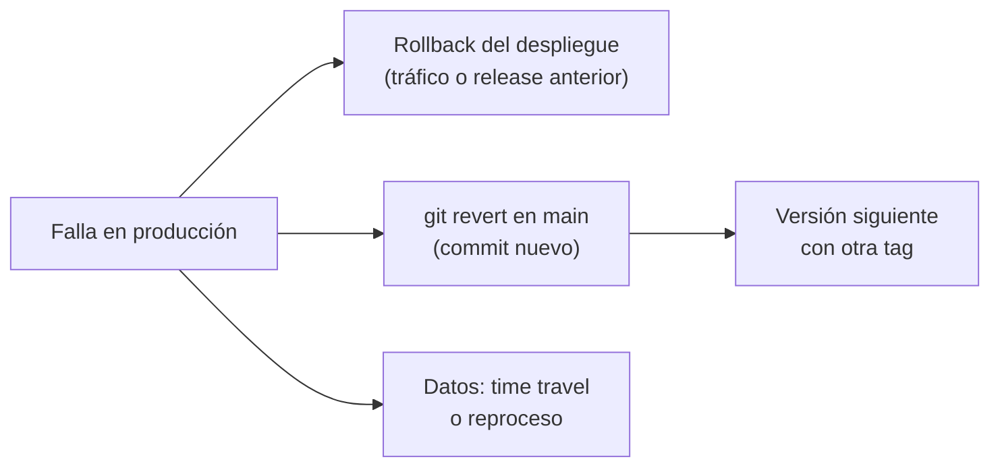

## 1. Resumen

Un rollback vuelve a la última versión buena cuando la nueva falla. Según las páginas citadas, ninguna plataforma «restaura» la versión anterior: todas **agregan algo nuevo** que la reemplaza.

- **Git:** `git revert` registra commits nuevos que deshacen los cambios; la historia no se reescribe.
- **Cloud Deploy:** crea un rollout nuevo a partir de una release anterior.
- **CodeDeploy:** redespliega una revisión anterior como un despliegue nuevo, con su propio ID.
- **Cloud Run:** devuelve el tráfico a una revisión que sigue existiendo.

En datos hay un segundo problema: volver atrás el código **no vuelve atrás los datos** que escribió la versión mala. Para eso hace falta otra herramienta, como el time travel de BigQuery, o reprocesar.

## 2. Qué es

- **Rollback de código:** `git revert` del cambio en main; la versión siguiente lo saca.
- **Rollback de despliegue:** volver a desplegar la revisión o release anterior (Cloud Deploy, CodeDeploy) o moverle el tráfico (Cloud Run).
- **Rollback automático:** CodeDeploy lo dispara cuando un despliegue falla o se cruza un umbral de monitoreo.
- **Rollback de datos:** restaurar tablas a un punto en el tiempo (time travel) o reprocesar (ver `backfill`).

## 3. Problema que resuelve

Una versión nueva de un job empieza a escribir montos multiplicados por 100. Sin un rollback preparado, el equipo debe corregir bajo presión mientras la carga sigue escribiendo. Con uno, se vuelve en minutos a la versión anterior y después se corrige con calma; los datos malos se reparan aparte.

## 4. Cómo funciona

1. Se detecta la falla: una alerta, un test de datos, el monitoreo del canary.
2. Se vuelve atrás el despliegue: `gcloud run services update-traffic … --to-revisions REVISION=100`, un rollback de Cloud Deploy o uno automático de CodeDeploy.
3. Se revierte el cambio en main con `git revert` (con `-m 1` si fue un merge), para que el próximo despliegue no lo traiga de vuelta.
4. Se reparan los datos: restaurar la tabla a un punto en el tiempo dentro de la ventana de time travel, o reprocesar desde la capa cruda.
5. La corrección sale como una versión nueva, con otra tag: `git-tag` aconseja no reutilizar una tag publicada.

## 5. Cuándo utilizarlo

- Ante un error en producción que no se corrige en minutos.
- Rollback automático en servicios con métricas claras de salud.
- Time travel cuando la versión mala sobrescribió o borró datos dentro de la ventana.

## 6. Cuándo no utilizarlo

- Para un cambio de esquema que ya migró los datos: volver al código anterior puede no leer el esquema nuevo.
- `git reset` y force push sobre main en lugar de `git revert`: reescribe la historia compartida.
- Esperar que el rollback del despliegue repare los datos.

## 7. Ejemplo sencillo

La release `v1.1.0` sube un umbral y la carga empieza a descartar filas. Se revierte el merge en main con `git revert -m 1`: `config.py` vuelve a `umbral = 100`, en un commit nuevo. La tag `v1.1.0` no se toca.

## 8. Ejemplo de producción

Una plataforma con:

- rollback del despliegue en un comando, documentado por servicio;
- rollback automático de CodeDeploy atado a una alarma de errores;
- ventana de time travel de siete días en las tablas de negocio de BigQuery;
- `git revert` como la única forma de deshacer en main;
- un procedimiento para los datos: restaurar o reprocesar el periodo afectado.

## 9. Arquitectura



## 10. Código

```bash
# Bash y Git (ejecutado en la CI sobre un repositorio temporal, sin remoto): vuelve atrás un cambio ya integrado en
# main con git revert, que agrega un commit nuevo en lugar de reescribir la historia. Para un merge commit, -m 1 indica
# que el lado principal es el primer padre (main).
set -euo pipefail
git init -q -b main repo && cd repo
printf 'umbral = 100\n' > config.py && git add config.py && git commit -q -m "config inicial"

git switch -q -c feature/umbral
printf 'umbral = 1000\n' > config.py && git commit -q -am "sube el umbral"
git switch -q main
git merge -q --no-ff feature/umbral -m "merge feature/umbral"
git tag -a v1.1.0 -m "release con el umbral nuevo"

# El umbral nuevo rompe la carga en producción: se revierte el merge, no se mueve la tag ni se reescribe main.
git revert --no-edit -m 1 HEAD
cat config.py
git log --format="%s" -3
```

El script se **ejecuta en la CI** (pytest, sobre un repositorio temporal, sin remoto). El test comprueba que `config.py` vuelve al valor anterior, que el revert es un commit nuevo encima del merge y que la tag `v1.1.0` sigue apuntando al merge. Usa `-m 1` como describe la referencia de `git-revert`.

## 11. GCP

En GCP, **Cloud Deploy** y **Cloud Run** para el despliegue, y **BigQuery** para los datos. Las diferencias, según sus páginas:

| | Cloud Deploy | Cloud Run | BigQuery |
|---|---|---|---|
| Qué vuelve atrás | El target, con un rollout nuevo de una release anterior | El tráfico, a una revisión anterior | Los datos de una tabla, a un punto en el tiempo |
| Por defecto | La última release con rollout exitoso | La revisión que se indique | Ventana de siete días, configurable desde dos |

## 12. AWS

En AWS, **CodeDeploy**. Las diferencias con Cloud Deploy, según sus páginas:

| | Cloud Deploy | AWS CodeDeploy |
|---|---|---|
| Mecanismo | Rollout nuevo desde una release anterior | Despliegue nuevo, con ID propio, de una revisión anterior |
| Disparo | Manual (gcloud o consola) | Automático (falla o umbral de monitoreo) o manual |

## 13. Azure

En **Azure Pipelines**, los deployment jobs tienen hooks `on: failure` y `on: success` para pasos de rollback o limpieza. La página pide que, ante una falla, el despliegue pueda restaurar la última versión buena (*Deployment jobs*). En GitLab, los environments sirven para volver a versiones anteriores cuando hay problemas (*Environments*).

## 14. Buenas prácticas

- Un rollback de despliegue por servicio, probado antes de necesitarlo.
- `git revert`, nunca reescribir main.
- Cambios de esquema compatibles hacia atrás, para que la versión anterior siga funcionando.
- Una ventana de time travel acorde al tiempo que tarda en detectarse un error.
- **Seguridad:** quién puede hacer rollback en producción, con el mismo cuidado que quién puede desplegar.
- **Observabilidad:** las alertas que disparan el rollback; un rollback automático necesita una métrica clara.
- **Costo:** una ventana de time travel más larga cuesta almacenamiento con el modelo de facturación físico.

## 15. Errores frecuentes

- Revertir el despliegue y olvidar revertir main: el siguiente despliegue trae el error de vuelta.
- Mover la tag de la versión mala.
- Detectar el error después de la ventana de time travel.
- Revertir un merge sin `-m` y no entender por qué Git lo rechaza.

## 16. Trade-offs

Un rollback rápido reduce el tiempo con el error en producción, a cambio de preparar el procedimiento y mantener la versión anterior desplegable. El rollback automático actúa antes que una persona, pero puede saltar con falsos positivos. Una ventana de time travel larga da más margen para reparar datos, con más costo de almacenamiento.

## 17. Conceptos relacionados

- `deployment-strategies`: cómo se despliega y cómo se vuelve.
- `git-tags-and-releases`: las versiones a las que se vuelve.
- `build-artifacts`: el artifact anterior que se redespliega.
- `backfill`, `failure-recovery` e `idempotency`: reparar los datos sin duplicar.

## 18. Preguntas técnicas abiertas

1. ¿Cuánto tardas hoy en volver a la versión anterior de tu job principal?
2. ¿Qué datos escribiría una versión mala antes de que la detectes?
3. ¿Tu última migración de esquema permite volver al código anterior?

## 19. Laboratorio relacionado

Pendiente (F4).

## 20. Fuentes

- Git: referencias de `git-revert` y `git-tag`.
- Google Cloud: *Roll back a target*, *Rollbacks, gradual rollouts, and traffic migration* y *Data retention with time travel and fail-safe*.
- AWS: *Redeploy and roll back a deployment with CodeDeploy*. Microsoft Learn: *Deployment jobs*. GitLab Docs: *Environments*.

El detalle de cada fuente está en `sources` del frontmatter.

## 21. Fecha de última verificación

2026-10-14. Pasa a `verified`: revisión B-F3.1 del lote F3b-11b aplicada, sin VERIFY pendientes.

## 22. Historial de cambios importantes

- 2026-10-14: creación (lote F3b-11b).
- 2026-10-14: revisión B-F3.1 del lote F3b-11b aplicada (docs/reviews/cards-f3b-11b.md): filas aprobadas sin cambios en esta ficha.
- 2026-10-14: `verification_status: verified` (sin VERIFY pendientes).
