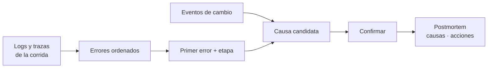

## 1. Resumen

El **análisis de causa raíz** va del síntoma («la publicación se bloqueó») a lo que lo provocó («el origen cambió el tipo de `monto`»). En datos, casi siempre sirve el mismo camino:

1. ordenar los errores en el tiempo y encontrar el **primero**: los siguientes suelen ser consecuencias;
2. ver en qué **etapa** ocurrió;
3. buscar **qué cambió** justo antes: schema, código, configuración, el origen;
4. confirmar la hipótesis y escribirla en un **postmortem** sin culpas, con las causas que contribuyeron y las acciones para que no se repita (*Postmortem Culture: Learning from Failure*, libro de SRE de Google).

El libro habla de causas raíz en plural: un incidente suele tener varias que contribuyen.

## 2. Qué es

- **Síntoma:** lo que vio el consumidor o la alerta.
- **Primer error:** el más temprano de la corrida; los demás suelen derivar de él.
- **Cambio previo:** algo que cambió antes de la corrida que falló.
- **Causa candidata:** una hipótesis que hay que confirmar.
- **Postmortem:** registro del incidente, su impacto, lo hecho para mitigarlo, las causas y las acciones de seguimiento.

## 3. Problema que resuelve

Una corrida termina con tres errores: en `transform`, en `load` y en `publish`. El equipo empieza por el último, «publicación bloqueada», y revisa el gate. Ordenando por tiempo, el primero es en `transform` («monto sin decimales») y 20 minutos antes de la corrida el origen cambió `monto` de `numeric` a `bigint`. La causa candidata aparece en minutos.

## 4. Cómo funciona

1. Reunir logs y trazas de la corrida afectada (por `run_id` o `trace_id`).
2. Filtrar los `ERROR` y ordenarlos por hora.
3. Tomar el primero y su etapa.
4. Buscar eventos de cambio previos a la corrida: schema, despliegues, configuración, origen.
5. Formular la causa candidata y confirmarla (reproducir, revertir, comparar con la corrida anterior).
6. Escribir el postmortem: línea de tiempo, causas, acciones.

## 5. Cuándo utilizarlo

- Después de mitigar todo incidente con impacto.
- Ante errores repetidos aunque no hayan escalado a incidente.

## 6. Cuándo no utilizarlo

- Antes de mitigar, si los consumidores siguen afectados.
- Para buscar a quién culpar: el postmortem blameless apunta a mejorar los servicios.

## 7. Ejemplo sencillo

| Hora | Etapa | Evento |
|---|---|---|
| 05:40 | — | Schema cambió: `monto numeric -> bigint` en `raw_pedidos` |
| 06:00 | extract | Filas leídas |
| 06:02 | transform | ERROR: monto sin decimales, margen 0 |
| 06:03 | load | ERROR: test margen > 0 falló |
| 06:04 | publish | ERROR: publicación bloqueada |

Primer error en `transform`; cambio previo 20 minutos antes. Causa candidata: el cambio de schema, a confirmar.

## 8. Ejemplo de producción

- Logs JSON con `run_id`, `stage` y `trace_id`; eventos de cambio (schema, despliegues) en el mismo lugar.
- Una consulta guardada: «errores de la corrida X ordenados por hora» y «cambios en las 24 h previas».
- Plantilla de postmortem: resumen, impacto, línea de tiempo, causas que contribuyeron, qué funcionó, acciones con dueño y fecha.
- Las acciones del postmortem se siguen hasta cerrarse.

## 9. Arquitectura



## 10. Código

```python
"""Del síntoma a la causa: el primer error de cada corrida, la etapa donde ocurrió y qué cambió justo antes."""
import json
from collections import Counter
from datetime import datetime

LOGS = """\
{"ts": "2026-10-19T06:00", "run": "r19", "stage": "load", "severity": "INFO", "message": "filas escritas", "rows": 1000}
{"ts": "2026-10-20T05:40", "run": "-", "stage": "-", "severity": "INFO", "message": "schema cambió: monto numeric -> bigint", "table": "raw_pedidos"}
{"ts": "2026-10-20T06:00", "run": "r20", "stage": "extract", "severity": "INFO", "message": "filas leídas", "rows": 1000}
{"ts": "2026-10-20T06:02", "run": "r20", "stage": "transform", "severity": "ERROR", "message": "monto sin decimales: margen 0"}
{"ts": "2026-10-20T06:03", "run": "r20", "stage": "load", "severity": "ERROR", "message": "test margen > 0 falló"}
{"ts": "2026-10-20T06:04", "run": "r20", "stage": "publish", "severity": "ERROR", "message": "publicación bloqueada"}
"""
eventos = [json.loads(linea) for linea in LOGS.splitlines()]
errores = [e for e in eventos if e["severity"] == "ERROR"]
primero = min(errores, key=lambda e: e["ts"])
inicio_corrida = min(e["ts"] for e in eventos if e["run"] == primero["run"])
cambios_previos = [e for e in eventos if e["run"] == "-" and e["ts"] < inicio_corrida]

print(f"errores: {len(errores)} en etapas {dict(Counter(e['stage'] for e in errores))}")
print(f"primer error: {primero['stage']} a las {primero['ts'][11:]}: {primero['message']}")
for c in cambios_previos:
    antes = datetime.fromisoformat(inicio_corrida) - datetime.fromisoformat(c["ts"])
    print(f"cambio previo ({int(antes.total_seconds() // 60)} min antes de la corrida): {c['message']} en {c['table']}")
print("síntoma: publicación bloqueada; causa candidata: el cambio de schema; a confirmar en el postmortem")
```

El script se **ejecuta en la CI** y pasa `mypy --strict`. Imprime `errores: 3 en etapas {'transform': 1, 'load': 1, 'publish': 1}`, `primer error: transform a las 06:02: monto sin decimales: margen 0`, `cambio previo (20 min antes de la corrida): schema cambió: monto numeric -> bigint en raw_pedidos` y la causa candidata «a confirmar en el postmortem».

## 11. GCP

En GCP, **Cloud Logging** y **Cloud Trace**. Según *Postmortem Culture: Learning from Failure*, *Structured logging* y *Cloud Trace overview* (no ejecutado):

| | Análisis de causa raíz (este concepto) | Cloud Logging y Cloud Trace |
|---|---|---|
| Ordenar errores | Por hora, en los logs de la corrida | Logs estructurados en `jsonPayload`, con consultas sobre campos |
| Encontrar la etapa | El primer error y su etapa | Cloud Trace mide la latencia de punta a punta y ayuda a encontrar los logs relacionados |
| Postmortem | Parte del proceso | Las páginas citadas no lo tratan |

## 12. AWS

En AWS, **CloudWatch Logs Insights** y **X-Ray**. Según *Postmortem Culture: Learning from Failure*, *Supported logs and discovered fields* y *What is AWS X-Ray?* (no ejecutado):

| | Análisis de causa raíz (este concepto) | CloudWatch Logs Insights y X-Ray |
|---|---|---|
| Consultar logs | Por `run_id` y `severity` | Campos descubiertos en logs JSON, o extraídos con `parse` |
| Recorrido | Etapas de la corrida | X-Ray muestra cada solicitud y sus llamadas a recursos de AWS, servicios, bases de datos y APIs |

## 13. Azure

En Azure, **Azure Monitor Logs**. Según *Postmortem Culture: Learning from Failure* y *Azure Monitor Logs overview* (no ejecutado):

| | Análisis de causa raíz (este concepto) | Azure Monitor Logs |
|---|---|---|
| Dónde están los datos | Logs y eventos de cambio juntos | Un Log Analytics workspace |
| Consultas | Errores por hora, cambios previos | KQL o herramientas basadas en KQL |

## 14. Buenas prácticas

- Empezar por el primer error, no por el último.
- Registrar los cambios (schema, despliegues, configuración) donde están los logs.
- Hablar de causas que contribuyeron, en plural.
- Postmortems sin culpas, con acciones que tengan dueño y fecha.
- **Seguridad:** el postmortem se comparte; sin datos personales ni credenciales.
- **Observabilidad:** cada acción del postmortem que agregue una señal que habría detectado antes el problema.
- **Costo:** retener logs el tiempo suficiente para investigar; menos retención ahorra y puede dejar sin datos el análisis.

## 15. Errores frecuentes

- Arreglar el síntoma (desbloquear la publicación) y no la causa.
- Una sola «causa raíz» cuando hubo varias.
- Postmortems que no se leen ni se siguen.
- Buscar culpables.

## 16. Trade-offs

Un análisis profundo encuentra causas de fondo y toma tiempo; uno superficial cierra rápido y deja que el incidente se repita. Más retención de logs facilita investigar y cuesta almacenamiento.

## 17. Conceptos relacionados

- `incident-response`: la respuesta.
- `observability-logs`: logs JSON.
- `observability-traces`: trazas.
- `schema-change-detection`: una causa frecuente.

## 18. Preguntas técnicas abiertas

1. ¿Tus logs permiten ordenar los errores de una corrida en el tiempo?
2. ¿Dónde quedan registrados los cambios de schema y los despliegues?
3. ¿Las acciones de tu último postmortem se cerraron?

## 19. Laboratorio relacionado

Pendiente (F4).

## 20. Fuentes

- Google, *Site Reliability Engineering*: *Postmortem Culture: Learning from Failure*.
- Google Cloud: *Structured logging* y *Cloud Trace overview*.
- AWS: *Supported logs and discovered fields* y *What is AWS X-Ray?*.
- Microsoft Learn: *Azure Monitor Logs overview*.

El detalle de cada fuente está en `sources` del frontmatter.

## 21. Fecha de última verificación

2026-10-20. `review_required`: pendiente de revisión B-F3.1 del lote F3b-16b.

## 22. Historial de cambios importantes

- 2026-10-20: creación (lote F3b-16b).
