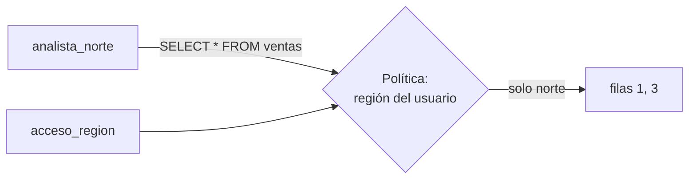

## 1. Resumen

La **seguridad a nivel de fila** (RLS) decide **qué filas** de una tabla ve cada usuario, con una política en la base y no con un `WHERE` en cada consulta. Un analista del norte consulta `SELECT * FROM ventas` y recibe solo las ventas del norte.

En PostgreSQL hay dos reglas que conviene saber antes de usarla (*5.9. Row Security Policies*):

- con RLS activada y **sin política**, no se ve **ninguna** fila (default-deny);
- **superusuarios** y roles con `BYPASSRLS` la saltan siempre; el **dueño** de la tabla también, salvo `FORCE ROW LEVEL SECURITY`.

## 2. Qué es

- **Política:** una condición por fila (`region IN (...)`) que aplica a comandos y roles.
- **Tabla de acceso:** un mapeo usuario → valores permitidos, que la política consulta.
- **Default-deny:** sin política, nada.
- **Bypass:** quienes la saltan; deben ser pocos y conocidos.

## 3. Problema que resuelve

Cada región debe ver solo sus ventas. Sin RLS, hay una vista por región, o un filtro que cada analista debe acordarse de escribir. Con RLS, la tabla es una sola y la base filtra.

## 4. Cómo funciona

1. Se activa RLS en la tabla.
2. Se crea la política, por ejemplo comparando la región con una tabla de acceso por usuario.
3. Cada consulta de un usuario sujeto a RLS se filtra con la política.
4. Superusuarios y dueños (sin `FORCE`) ven todo: no se usan para consultar como analista.

## 5. Cuándo utilizarlo

- Tablas compartidas donde cada grupo ve un subconjunto (región, cliente, unidad de negocio).
- Cuando el filtro debe aplicarse siempre, sin depender de quien consulta.

## 6. Cuándo no utilizarlo

- Para ocultar columnas: eso es `column-level-security`.
- Probando con el usuario dueño o un superusuario: la verá entera y la prueba no sirve.

## 7. Ejemplo sencillo

Ventas 1 y 3 del norte, 2 del sur y 4 del centro:

| Quién | Ve |
|---|---|
| analista norte, con RLS y sin política | nada |
| analista norte, con la política | 1, 3 |
| analista sur | 2 |
| superusuario | 1, 2, 3, 4 (salta RLS) |

## 8. Ejemplo de producción

- RLS en las tablas de consumo compartidas.
- La tabla de acceso por usuario se alimenta del proveedor de identidad.
- `FORCE ROW LEVEL SECURITY` para que el dueño también quede sujeto, y consultas de servicio con roles sujetos a RLS.
- Pruebas automáticas que consultan como cada rol y comparan lo que ve.

## 9. Arquitectura



## 10. Código

```python
# Python 3.12 y psycopg contra PostgreSQL 17 (ejecutado en la CI con el servicio postgres:17): seguridad a nivel de
# fila. Cada analista ve solo las filas de su región; sin política, la tabla con RLS no muestra nada (default-deny).
# PG_HOST, PG_PORT, PG_USER, PG_PASSWORD y PG_DB: base vacía temporal; los roles llevan sufijo y se borran.
import os

import psycopg

S = os.environ["PG_DB"]
NORTE, SUR = f"analista_norte_{S}", f"analista_sur_{S}"

with psycopg.connect(host=os.environ["PG_HOST"], port=os.environ["PG_PORT"], user=os.environ["PG_USER"],
                     password=os.environ["PG_PASSWORD"], dbname=S, autocommit=True) as conn:
    try:
        conn.execute("CREATE TABLE ventas (id int, region text, monto numeric)")
        conn.execute("INSERT INTO ventas VALUES (1, 'norte', 10), (2, 'sur', 20), (3, 'norte', 30), (4, 'centro', 40)")
        conn.execute("CREATE TABLE acceso_region (rol name, region text)")
        conn.execute("INSERT INTO acceso_region VALUES (%s, 'norte'), (%s, 'sur')", (NORTE, SUR))
        for r in (NORTE, SUR):
            conn.execute(f"CREATE ROLE {r}")
            conn.execute(f"GRANT SELECT ON ventas, acceso_region TO {r}")
        conn.execute("ALTER TABLE ventas ENABLE ROW LEVEL SECURITY")

        def ve(rol: str) -> list[int]:
            conn.execute(f"SET ROLE {rol}")
            try:
                return [i for (i,) in conn.execute("SELECT id FROM ventas ORDER BY id").fetchall()]
            finally:
                conn.execute("RESET ROLE")

        print("con RLS y sin política, norte ve:", ve(NORTE))      # default-deny
        conn.execute("CREATE POLICY por_region ON ventas FOR SELECT USING "
                     "(region IN (SELECT region FROM acceso_region WHERE rol = current_user))")
        print("norte ve:", ve(NORTE))
        print("sur ve:", ve(SUR))
        print("superusuario (salta RLS) ve:", [i for (i,) in conn.execute("SELECT id FROM ventas ORDER BY id").fetchall()])
    finally:
        conn.execute("DROP TABLE IF EXISTS ventas, acceso_region")
        for r in (NORTE, SUR):
            conn.execute(f"DROP ROLE IF EXISTS {r}")
```

El script se **ejecuta en la CI contra el servicio postgres:17** y pasa `mypy --strict`. Imprime `con RLS y sin política, norte ve: []`, `norte ve: [1, 3]`, `sur ve: [2]` y que el superusuario ve las cuatro.

## 11. GCP

En GCP, las **row access policies** de BigQuery. Según *5.9. Row Security Policies* e *Introduction to BigQuery row-level security* (no ejecutado):

| | RLS en PostgreSQL | BigQuery |
|---|---|---|
| Objeto | Política por tabla | Row access policies sobre una tabla; puede haber varias |
| Sin acceso | Default-deny si no hay política | Quien no está en la lista permitida no ve filas |
| Junto con | Privilegios de tabla y columna | Policy tags y controles de proyecto, dataset y tabla |

## 12. AWS

En AWS, los **filtros de datos** de Lake Formation. Según *5.9. Row Security Policies* y *Data filtering and cell-level security in Lake Formation* (no ejecutado):

| | RLS en PostgreSQL | Lake Formation |
|---|---|---|
| Dónde | En la tabla | En el permiso sobre la tabla, con un filtro de datos |
| Granularidad | Filas | Filas, columnas y celdas, también en columnas anidadas |

## 13. Azure

En Azure, **RLS de Azure SQL**. Según *5.9. Row Security Policies* y *Row-level security* (no ejecutado):

| | RLS en PostgreSQL | Azure SQL |
|---|---|---|
| Mecanismo | `CREATE POLICY` | Función de predicado aplicada por una security policy |
| Tipos | Por comando (SELECT, INSERT, UPDATE, DELETE) | Predicados de filtro (las filas no se ven) y de bloqueo (las operaciones que lo violan fallan) |

## 14. Buenas prácticas

- Activar RLS y crear la política en el mismo despliegue.
- `FORCE ROW LEVEL SECURITY` donde el dueño consulta.
- Pruebas por rol.
- **Seguridad:** pocos roles con bypass, conocidos y auditados.
- **Observabilidad:** registrar cambios en políticas y en la tabla de acceso.
- **Costo:** políticas con subconsultas se evalúan en cada consulta; indexar la tabla de acceso.

## 15. Errores frecuentes

- Probar con el dueño o un superusuario.
- Activar RLS sin política y dejar a todos sin datos.
- Olvidar que `TRUNCATE` no está sujeto a RLS en PostgreSQL.

## 16. Trade-offs

RLS centraliza el filtro y hace la consulta más lenta si la política es compleja. Una vista por grupo es explícita y se multiplica.

## 17. Conceptos relacionados

- `column-level-security`: columnas.
- `abac`: atributos.
- `bigquery-security`: BigQuery.
- `lake-formation-permissions`: Lake Formation.

## 18. Preguntas técnicas abiertas

1. ¿Qué tablas tuyas tienen un `WHERE` de seguridad que cada analista escribe a mano?
2. ¿Quiénes pueden saltar el filtro en tu base?
3. ¿Pruebas lo que ve cada rol?

## 19. Laboratorio relacionado

Pendiente (F4).

## 20. Fuentes

- PostgreSQL 17: *5.9. Row Security Policies*.
- Google Cloud: *Introduction to BigQuery row-level security*.
- AWS: *Data filtering and cell-level security in Lake Formation*.
- Microsoft Learn: *Row-level security*.

El detalle de cada fuente está en `sources` del frontmatter.

## 21. Fecha de última verificación

2026-10-21. Pasa a `verified`: revisión B-F3.1 del lote F3b-18a aplicada y CI en verde (run 39677322697).

## 22. Historial de cambios importantes

- 2026-10-21: creación (lote F3b-18a).
- 2026-10-21: `verification_status: verified` (revisión aplicada; CI en verde, run 39677322697).
