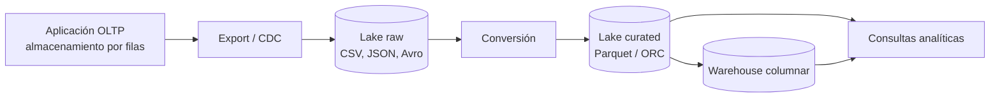

## 1. Resumen

Hay dos formas de poner una tabla en disco. **Por filas:** cada registro completo queda junto. Es ideal para leer o escribir un registro a la vez, el patrón de las bases transaccionales (OLTP), de CSV y de Avro. **Por columnas:** todos los valores de una columna quedan juntos. Es ideal para leer pocas columnas de muchísimas filas, el patrón analítico de BigQuery, Redshift, Parquet y ORC. En un motor que cobra por bytes leídos, esa diferencia es directamente plata.

## 2. Qué es

Es un concepto consolidado de almacenamiento:

| | Por filas | Por columnas |
|---|---|---|
| Qué queda junto | Todos los campos de un registro | Todos los valores de una columna |
| Patrón ideal | Leer o escribir pocos registros completos | Leer pocas columnas de muchas filas |
| Compresión | Moderada (tipos mezclados en cada bloque) | Alta (un solo tipo por bloque) |
| Ejemplos | Tablas relacionales típicas de OLTP (rowstore en SQL Server por defecto), CSV, Avro | BigQuery, Redshift, Parquet, ORC, columnstore de SQL Server |

## 3. Problema que resuelve

Una consulta analítica típica suma o cuenta una o dos columnas sobre millones de filas. Con almacenamiento por filas, el motor lee todos los campos de cada fila aunque use dos. Con almacenamiento columnar, lee solo esas dos columnas. AWS lo ilustra así: en una tabla de 100 columnas, una consulta que usa 5 lee cerca del 5 % de los datos. Además, cada bloque columnar contiene un solo tipo de dato y comprime mejor.

## 4. Cómo funciona

1. **Por filas:** un bloque guarda registros completos uno tras otro. Insertar o actualizar un registro toca un lugar, y leer un registro entero es una sola lectura. Avro, por ejemplo, escribe objetos completos en bloques según un esquema.
2. **Por columnas:** un bloque guarda valores de una sola columna de muchas filas.
   - **Proyección:** se leen solo las columnas de la consulta.
   - **Compresión por columna:** se elige un esquema según el tipo de dato.
   - **Saltar bloques:** en Parquet y ORC, las estadísticas por bloque (mínimo y máximo) permiten descartar bloques sin leerlos (*predicate pushdown*).
3. **Escrituras:** cambiar un registro en un formato columnar toca muchas columnas. Por eso los motores columnares prefieren cargas por lotes, y algunos (como el columnstore de SQL Server) acumulan las filas nuevas en una estructura temporal antes de comprimirlas por columna.

## 5. Cuándo utilizarlo

**Columnar:**
- warehouses y consultas analíticas;
- la zona curada de un data lake (Parquet u ORC);
- tablas anchas de las que cada consulta usa pocas columnas.

**Por filas:**
- bases transaccionales (OLTP) y lectura o escritura de un registro por clave;
- intercambio y streaming de registros completos (Avro en Kafka o Pub/Sub);
- la zona raw del lake, cuando se guarda lo que llega tal cual.

## 6. Cuándo no utilizarlo

- Columnar para una aplicación que actualiza registros sueltos con alta frecuencia: cada escritura cuesta más.
- Por filas para analítica sobre tablas grandes: cada consulta lee todas las columnas.
- Archivos columnares diminutos (miles de Parquet de pocos KB): pierden la ventaja de compresión y de saltar bloques; conviene compactar.

## 7. Ejemplo sencillo

Tabla `pedidos` de 4 columnas y 3 filas:

- **Por filas:** `[A1, 2026-10-01, CL, 1250] [A2, 2026-10-01, PE, 90] [A3, 2026-10-02, CL, 300]`
- **Por columnas:** `id: [A1, A2, A3]`, `fecha: [2026-10-01, 2026-10-01, 2026-10-02]`, `pais: [CL, PE, CL]`, `monto: [1250, 90, 300]`

`SUM(monto)` solo necesita el último bloque de la versión por columnas.

## 8. Ejemplo de producción

Un equipo exporta cada noche una tabla de eventos de 120 columnas a CSV en S3 y la consulta con Athena. Cada consulta escanea el archivo completo. Al convertir la zona curada a Parquet con CTAS, particionada por fecha, las consultas leen solo las columnas usadas de los días filtrados, y Athena salta bloques por estadísticas. La zona raw sigue en el formato original para reprocesar; la curada, en Parquet.

## 9. Arquitectura



## 10. Código

```bash
# BigQuery: el dry run estima los bytes que leería cada consulta, sin ejecutarla ni cobrar.
# Requiere: bq (Google Cloud CLI) autenticado y una tabla proyecto.dwh.eventos con muchas columnas.

# Todas las columnas: se factura la tabla entera.
bq query --dry_run --use_legacy_sql=false \
  'SELECT * FROM `proyecto.dwh.eventos` WHERE fecha = "2026-10-01"'

# Solo dos columnas: se factura solo lo de esas columnas (y de la partición si la tabla está particionada).
bq query --dry_run --use_legacy_sql=false \
  'SELECT pais, SUM(monto) AS total FROM `proyecto.dwh.eventos` WHERE fecha = "2026-10-01" GROUP BY pais'
```

Cada comando informa cuántos bytes procesaría. La diferencia entre ambos es el efecto del almacenamiento columnar. `LIMIT` no la cambia en tablas no clusterizadas: el motor lee las columnas igual.

## 11. GCP

**BigQuery** guarda las tablas por columnas, y en on-demand factura por bytes leídos: elegir columnas es la primera palanca de costo, y un dry run la mide antes de ejecutar. También puede consultar archivos Parquet en Cloud Storage como tablas externas (`CREATE EXTERNAL TABLE ... OPTIONS (format = 'PARQUET', ...)`), como se muestra en `data-lake`.

## 12. AWS

**Redshift** guarda las tablas por columnas, con una codificación de compresión elegida según el tipo de cada columna. **Athena** consulta archivos en S3, y con Parquet u ORC aprovecha compresión por columna, *predicate pushdown* con estadísticas y lectura en paralelo. La conversión desde CSV o JSON se hace con CTAS de Athena o con Glue. A diferencia de BigQuery, en Athena el formato columnar depende de cómo se escribieron los archivos en el lake.

## 13. Azure

En SQL Server y Azure SQL, las tablas son **rowstore** por defecto, y un **índice columnstore agrupado** las guarda por columnas: es el formato preferido para data warehousing. Un columnstore no agrupado sobre una tabla rowstore permite analítica sobre datos operacionales. **Fabric Data Warehouse** guarda todo en tablas Delta, es decir, en Parquet: columnar y abierto, compartido con el resto de Fabric.

## 14. Buenas prácticas

- Columnar (Parquet u ORC) para todo lo que se consulta analíticamente; por filas para lo transaccional y el intercambio de registros.
- Seleccionar solo las columnas necesarias; evitar `SELECT *` en consultas recurrentes.
- Combinar columnar con particionado y clustering: uno reduce columnas, los otros filas.
- Compactar archivos pequeños en el lake.
- **Seguridad:** el formato no protege los datos; en columnar se puede restringir el acceso por columna en el motor (por ejemplo, seguridad a nivel de columna), lo que encaja con datos sensibles en columnas específicas.
- **Observabilidad:** vigilar bytes leídos por consulta y tamaño medio de archivo en el lake; un salto en los bytes indica `SELECT *` o un filtro que se perdió.
- **Costo:** en motores donde el costo depende de los datos leídos (BigQuery on-demand; Athena, donde particionar reduce lo escaneado y el costo), columnar + selección de columnas + particiones es la mayor palanca de ahorro.

## 15. Errores frecuentes

- Guardar la zona curada en CSV o JSON y consultarla todos los días.
- Usar `SELECT *` para "explorar" tablas grandes en un motor que cobra por bytes.
- Creer que `LIMIT 10` abarata una consulta en una tabla no clusterizada.
- Generar miles de archivos Parquet pequeños por partición.
- Usar un formato columnar para un flujo de registros que se actualizan uno a uno.

## 16. Trade-offs

El columnar lee y comprime mucho mejor para analítica, a cambio de escrituras sueltas más caras y de reconstruir el registro completo cuando se necesitan todas las columnas. El formato por filas escribe y lee registros completos con eficiencia, pero escala mal para agregaciones sobre tablas anchas. Muchos sistemas usan los dos: por filas en el origen y en el intercambio, por columnas en el análisis.

## 17. Conceptos relacionados

- `parquet-format`: el formato columnar abierto de referencia.
- `data-warehouse` y `data-lake`: dónde se aplica cada formato.
- `partition-pruning`: la reducción complementaria por filas.
- `oltp-vs-olap`: los perfiles de carga que favorecen cada formato.
- Del blueprint, pendiente de ficha: `avro-format`.

## 18. Preguntas técnicas abiertas

1. ¿Qué formato usarías para mensajes de Kafka y cuál para la tabla curada que los acumula? ¿Por qué?
2. Una consulta en BigQuery con `LIMIT 10` cuesta lo mismo que sin `LIMIT`. ¿Por qué, y qué la abarataría?
3. ¿En qué caso guardarías una tabla analítica por filas?

## 19. Laboratorio relacionado

Pendiente (F4).

## 20. Fuentes

- AWS: *Columnar storage* (Amazon Redshift), *Use columnar storage formats* y *Partition your data* (Amazon Athena).
- Google Cloud: *Overview of BigQuery storage*, *Estimate and control costs*, *Data definition language statements* y *bq command-line tool reference*.
- Apache: *Parquet overview* y *Avro specification*.
- Microsoft Learn: *Columnstore indexes: Overview* y *What is Fabric Data Warehouse?*

El detalle de cada fuente está en `sources` del frontmatter.

## 21. Fecha de última verificación

2026-10-05. En `review_required` hasta la revisión B-F3.1 del lote 6.

## 22. Historial de cambios importantes

- 2026-10-05: creación (lote 6 de F3).
