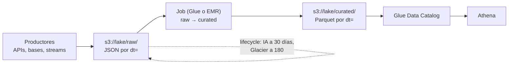

## 1. Resumen

Un data lake en AWS guarda sus archivos en **Amazon S3**: un bucket por entorno, prefijos por zona (`raw/`, `curated/`) y particiones estilo Hive (`dt=2026-10-01/`) que los motores usan para leer solo lo necesario. Según su documentación, S3 tiene:

- **consistencia fuerte de lectura después de escritura**, también al sobrescribir y al borrar;
- un rendimiento de **al menos 3.500 escrituras y 5.500 lecturas por segundo por prefijo**, que escala con más prefijos;
- **acceso público bloqueado** por defecto en buckets nuevos;
- **cifrado SSE-S3** en toda carga nueva desde el 5 de enero de 2023.

Las clases de almacenamiento y las reglas de lifecycle bajan el costo de lo que se lee poco, con duraciones mínimas que hay que respetar.

## 2. Qué es

- **Bucket de propósito general:** el tipo original, recomendado para la mayoría de los casos; el nombre es único en toda la partición de AWS. Hay otros tipos: **directory** (baja latencia y residencia de datos, organizados en directorios), **table** (S3 Tables, tablas Apache Iceberg con mantenimiento automático) y **vector**.
- **Objeto y clave:** S3 es plano; los «directorios» son prefijos de la clave. Un listado con `Delimiter="/"` devuelve los prefijos como `CommonPrefixes`.
- **Zonas del lake:** convenciones de prefijo (`raw/`, `curated/`, `tmp/`), no un concepto de S3.
- **Clases de almacenamiento:** según su tabla al 2026-10-12, con duración mínima:

| Clase | Duración mínima | Observaciones |
|---|---|---|
| `STANDARD` | ninguna | clase por defecto |
| `INTELLIGENT_TIERING` | ninguna | mueve objetos según su acceso; cobra monitoreo por objeto |
| `STANDARD_IA` | 30 días | cobro de recuperación por GB |
| `ONEZONE_IA` | 30 días | una sola zona de disponibilidad |
| `GLACIER_IR` | 90 días | acceso en milisegundos |
| `GLACIER` | 90 días | hay que restaurar antes de leer |
| `DEEP_ARCHIVE` | 180 días | hay que restaurar antes de leer |

- **Lifecycle:** reglas por prefijo o filtro con acciones de **transición** (a otra clase) y de **expiración** (S3 borra el objeto).

## 3. Problema que resuelve

Un lake necesita guardar datos de cualquier formato y volumen, leerlos con varios motores (ver `athena-serverless-queries` y `glue-catalog-and-etl`) y pagar poco por lo que casi no se lee. S3 separa el almacenamiento del cómputo: los datos quedan en un solo lugar y cada motor los lee sin copiarlos.

## 4. Cómo funciona

1. Cada lote se escribe en su partición: `raw/<tabla>/dt=<día>/part-0000.jsonl`. Con una clave fija por día, un reintento **reemplaza** el objeto, no agrega otro.
2. La consistencia fuerte hace que un listado o una lectura posterior vean el objeto nuevo.
3. Un job transforma `raw/` a `curated/` en Parquet, particionado igual.
4. El catálogo (Glue Data Catalog) registra la tabla y sus particiones, y los motores la consultan filtrando por `dt`.
5. El lifecycle mueve `raw/` a clases más baratas y borra `tmp/`.

## 5. Cuándo utilizarlo

- Almacenamiento compartido de un lake o lakehouse en AWS.
- Archivos de cualquier formato, con lecturas por varios motores.
- Datos históricos que deben conservarse a bajo costo.

## 6. Cuándo no utilizarlo

- Lecturas y escrituras de filas sueltas con baja latencia: eso es una base de datos.
- Datos que se leen con mucha concurrencia sobre un solo prefijo sin diseñar los prefijos.
- Mover a `GLACIER` o `DEEP_ARCHIVE` datos que se leen cada semana: hay que restaurarlos antes de leerlos.

## 7. Ejemplo sencillo

Las ventas del 1 de octubre se escriben en `raw/ventas/dt=2026-10-01/part-0000.jsonl`. Si el job falla y se reintenta, escribe la misma clave y el día queda con un solo archivo. Listar `raw/ventas/` con delimitador devuelve `dt=2026-10-01` y los demás días.

## 8. Ejemplo de producción

Un lake de comercio tiene tres prefijos:

- `raw/`: JSON tal como llega, en `STANDARD` 30 días, luego `STANDARD_IA` y a los 180 días `GLACIER`;
- `curated/`: Parquet particionado por día, en `STANDARD`, consultado por Athena;
- `tmp/`: archivos intermedios que el lifecycle borra a los 7 días.

El bucket bloquea el acceso público, tiene versionado y una regla que borra las versiones anteriores a los 30 días. Todo se define en Terraform.

## 9. Arquitectura



## 10. Código

```python
# Python 3.12 y boto3 (ejecutado en la CI contra moto, que simula S3; no se corrió contra AWS).
# Escribe un lote en una partición estilo Hive (dt=AAAA-MM-DD/) y lista las particiones de una tabla.
# Reescribir el mismo lote reemplaza los mismos objetos: re-ejecutar no duplica.
from __future__ import annotations

import datetime as dt
import json
from typing import TYPE_CHECKING

import boto3

if TYPE_CHECKING:
    from mypy_boto3_s3 import S3Client


def partition_prefix(table: str, day: dt.date) -> str:
    """Prefijo de la partición del día: raw/<tabla>/dt=AAAA-MM-DD/."""
    return f"raw/{table}/dt={day.isoformat()}/"


def write_batch(s3: S3Client, bucket: str, table: str, day: dt.date, rows: list[dict[str, object]]) -> str:
    """Escribe el lote como JSON Lines en una clave fija por día: un reintento reemplaza, no agrega."""
    key = partition_prefix(table, day) + "part-0000.jsonl"
    body = "".join(json.dumps(r, ensure_ascii=False) + "\n" for r in rows).encode("utf-8")
    s3.put_object(Bucket=bucket, Key=key, Body=body, ContentType="application/x-ndjson")
    return key


def list_partitions(s3: S3Client, bucket: str, table: str) -> list[str]:
    """Particiones de la tabla: los 'subdirectorios' dt=... que devuelve el listado con Delimiter."""
    paginator = s3.get_paginator("list_objects_v2")
    parts: list[str] = []
    for page in paginator.paginate(Bucket=bucket, Prefix=f"raw/{table}/", Delimiter="/"):
        for cp in page.get("CommonPrefixes", []):
            parts.append(cp["Prefix"].rstrip("/").rsplit("/", 1)[-1])
    return sorted(parts)


def count_objects(s3: S3Client, bucket: str, prefix: str) -> int:
    paginator = s3.get_paginator("list_objects_v2")
    return sum(page.get("KeyCount", 0) for page in paginator.paginate(Bucket=bucket, Prefix=prefix))


if __name__ == "__main__":
    # Contra AWS (no ejecutado): credenciales del entorno y un bucket existente.
    client = boto3.client("s3")
    write_batch(client, "mi-data-lake", "ventas", dt.date(2026, 10, 1), [{"id": 1, "monto": 120}])
    print(list_partitions(client, "mi-data-lake", "ventas"))
```

```hcl
# Terraform (validado en la CI con terraform validate, sin credenciales; no se aplicó): bucket del data lake con
# bloqueo de acceso público, versionado, cifrado por defecto explícito y reglas de lifecycle por prefijo.
# Requiere: provider hashicorp/aws ~> 6.0; nombre de bucket único en la partición.
terraform {
  required_providers {
    aws = {
      source  = "hashicorp/aws"
      version = "~> 6.0"
    }
  }
}

provider "aws" {
  region = "us-east-1"
}

variable "bucket_name" {
  type = string
}

resource "aws_s3_bucket" "lake" {
  bucket = var.bucket_name
}

resource "aws_s3_bucket_public_access_block" "lake" {
  bucket                  = aws_s3_bucket.lake.id
  block_public_acls       = true
  block_public_policy     = true
  ignore_public_acls      = true
  restrict_public_buckets = true
}

resource "aws_s3_bucket_versioning" "lake" {
  bucket = aws_s3_bucket.lake.id
  versioning_configuration {
    status = "Enabled"
  }
}

# SSE-S3 ya es el cifrado base de todo bucket; declararlo deja la decisión escrita (o cambiarla a SSE-KMS).
resource "aws_s3_bucket_server_side_encryption_configuration" "lake" {
  bucket = aws_s3_bucket.lake.id
  rule {
    apply_server_side_encryption_by_default {
      sse_algorithm = "AES256"
    }
  }
}

resource "aws_s3_bucket_lifecycle_configuration" "lake" {
  bucket = aws_s3_bucket.lake.id

  # raw/: se lee poco después de 30 días y casi nunca después de 180.
  rule {
    id     = "raw"
    status = "Enabled"
    filter {
      prefix = "raw/"
    }
    transition {
      days          = 30
      storage_class = "STANDARD_IA"
    }
    transition {
      days          = 180
      storage_class = "GLACIER"
    }
    noncurrent_version_expiration {
      noncurrent_days = 30
    }
  }

  # tmp/: zona de trabajo de los jobs; se borra a los 7 días.
  rule {
    id     = "tmp"
    status = "Enabled"
    filter {
      prefix = "tmp/"
    }
    expiration {
      days = 7
    }
  }

  # Todo el bucket: cargas multiparte incompletas.
  rule {
    id     = "multipart"
    status = "Enabled"
    filter {}
    abort_incomplete_multipart_upload {
      days_after_initiation = 7
    }
  }
}
```

El script en Python 3.12 con boto3 se **ejecuta en la CI contra moto**, que simula S3 en memoria (ADR-011), y pasa `mypy --strict` con `boto3-stubs`. **No se corrió contra AWS.** El test escribe tres lotes (el segundo día dos veces) y comprueba que quedan dos particiones y dos objetos.

El bloque de Terraform se valida en la CI con `terraform validate`, sin credenciales (`make validate-terraform`), y **no se aplicó**. Las transiciones usan las duraciones mínimas de la tabla de clases: 30 días antes de `STANDARD_IA`.

## 11. GCP

No aplica de forma específica: esta ficha describe S3. El equivalente es Cloud Storage (ver `gcs-buckets-and-objects` y `gcs-storage-classes-and-lifecycle`), con otras clases, otros mínimos y otro modelo de nombres; no son lo mismo.

## 12. AWS

**Amazon S3.** Los tipos de bucket, la consistencia, el rendimiento por prefijo, el bloqueo de acceso público, el cifrado por defecto, las clases (tabla consultada el 2026-10-12) y el lifecycle son los de sus páginas. Los precios por clase, solicitud y recuperación se consultan en la página de precios.

## 13. Azure

No aplica de forma específica: Azure Data Lake Storage tiene su propio modelo de cuentas, contenedores y niveles.

## 14. Buenas prácticas

- Prefijos por zona y particiones estilo Hive desde el primer día.
- Claves deterministas por lote para que un reintento reemplace.
- Parquet en las zonas curadas; archivos ni muy chicos ni gigantes.
- Lifecycle por prefijo, revisado como código, y una regla para cargas multiparte incompletas.
- **Seguridad:** mantener Block Public Access activo, declarar el cifrado (SSE-S3 o SSE-KMS) y dar acceso por rol, no por bucket público; el gobierno fino va con Lake Formation (ver `lake-formation-permissions`).
- **Observabilidad:** seguir el tamaño por prefijo y clase, la cantidad de objetos pequeños y las solicitudes; un aumento de recuperaciones indica datos fríos que se leen más de lo previsto.
- **Costo:** clases frías bajan el costo en reposo y suben el de acceso, con duraciones mínimas; los montos se consultan en la página de precios.

## 15. Errores frecuentes

- Escribir cada reintento con un nombre nuevo (UUID) y duplicar el día.
- Miles de archivos pequeños por partición, que vuelven lentas las consultas.
- Mover a `STANDARD_IA` datos que se borran a los pocos días y pagar el mínimo de 30.
- Abrir un bucket al público para «compartir» datos.
- Versionado activo sin regla para las versiones anteriores.

## 16. Trade-offs

S3 es barato, durable y lo leen todos los motores, a cambio de no tener transacciones entre objetos ni esquema: eso lo agregan el catálogo y los formatos de tabla (Iceberg, o table buckets que lo administran). Las clases frías ahorran en reposo y encarecen el acceso. Más prefijos dan más paralelismo, con más objetos que listar.

## 17. Conceptos relacionados

- `data-lake` y `lakehouse`: el patrón que S3 implementa.
- `gcs-buckets-and-objects` y `gcs-storage-classes-and-lifecycle`: el equivalente en GCP, con sus diferencias.
- `partitioning` y `parquet-format`: cómo se organizan los archivos.
- `idempotency`: claves deterministas por lote.
- `glue-catalog-and-etl`, `athena-serverless-queries` y `lake-formation-permissions`: catálogo, consulta y gobierno sobre el lake.

## 18. Preguntas técnicas abiertas

1. ¿Qué prefijos de tu lake se leen menos de una vez al mes?
2. ¿Cómo garantizas que un reintento de carga no duplique archivos?
3. ¿Cuándo usarías table buckets en lugar de Parquet en un bucket de propósito general?

## 19. Laboratorio relacionado

Pendiente (F4).

## 20. Fuentes

- AWS, Amazon S3 User Guide: *What is Amazon S3?*, *Optimizing Amazon S3 performance*, *Blocking public access*, *Configuring default encryption*, *Understanding and managing Amazon S3 storage classes*, *Managing the lifecycle of objects* y *Working with Amazon S3 Tables and table buckets*; *Amazon S3 pricing*.

El detalle de cada fuente está en `sources` del frontmatter.

## 21. Fecha de última verificación

2026-10-12. `review_required`: pendiente de revisión B-F3.1 del lote F3b-09a.

## 22. Historial de cambios importantes

- 2026-10-12: creación (lote F3b-09a).
