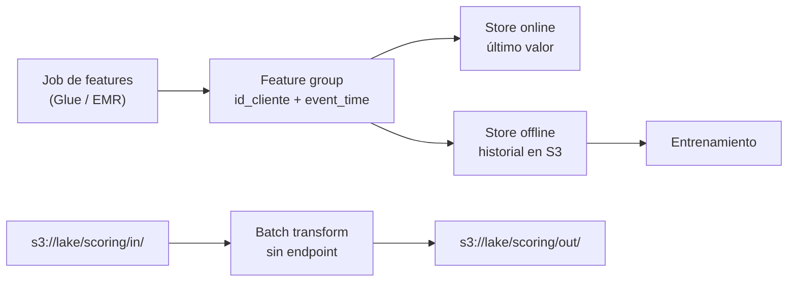

## 1. Resumen

**Amazon SageMaker AI** es el servicio de ML de AWS para construir, entrenar y desplegar modelos. Según su página:

- **el 3 de diciembre de 2024, Amazon SageMaker pasó a llamarse Amazon SageMaker AI**;
- ese mismo día salió la nueva generación de **Amazon SageMaker**, una plataforma unificada de datos, analítica e IA que **incluye** SageMaker AI;
- los namespaces de la API, la CLI y CloudFormation siguen diciendo `sagemaker`.

Por eso «Amazon SageMaker» ya no nombra solo al servicio de ML: esta ficha usa «SageMaker AI» para el servicio.

Para el data engineer, lo relevante es el lado de los datos:

- **Feature Store:** features con identificador de registro y **event time**; store **online** (último valor) y **offline** (historial en S3).
- **Batch transform:** inferencias sobre datasets de S3 sin un endpoint persistente.
- **Pipelines:** automatizar el ciclo de ML.

## 2. Qué es

- **Feature group:** un conjunto de features con:
  - *record identifier:* la feature que identifica el registro (por ejemplo, el cliente);
  - *event time:* cuándo ocurrió el evento; obligatorio en todos los registros;
  - *store online:* solo el registro del último event time, con lecturas de milisegundos;
  - *store offline:* todo el historial, en un bucket de S3, para exploración, entrenamiento y predicción por lotes.
- **Batch transform:** un job que lee un prefijo de S3, infiere con un modelo y escribe en S3, sin endpoint encendido; puede asociar cada registro con su inferencia.
- **Pipelines:** orquestación de workflows de ML, con infraestructura serverless.
- **Nombres:** el servicio es SageMaker AI; «Amazon SageMaker» es hoy la plataforma unificada que lo incluye, junto con SageMaker Lakehouse y Data and AI Governance.

## 3. Problema que resuelve

Los modelos necesitan features consistentes para entrenar y para predecir, y predicciones sobre grandes volúmenes sin servidores encendidos todo el día. El data engineer construye los pipelines que llenan el Feature Store y que preparan las entradas y guardan las salidas del batch transform.

## 4. Cómo funciona

1. El pipeline calcula features por cliente (por ejemplo, compras de 30 días) con su event time.
2. Las ingesta al feature group: el store online queda con el último valor y el offline acumula el historial en S3.
3. El entrenamiento lee el historial del store offline.
4. Para puntuar a todos los clientes, un batch transform lee el prefijo de entrada en S3 y escribe las inferencias en otro prefijo.
5. El pipeline une las inferencias con los clientes y las carga al lake o al warehouse.

## 5. Cuándo utilizarlo

- Features compartidas entre entrenamiento y predicción, con historial.
- Puntuación periódica de muchos registros sin endpoint permanente.
- Equipos de ML que entrenan modelos propios en AWS.

## 6. Cuándo no utilizarlo

- Modelos fundacionales administrados para tareas de texto: Bedrock (ver `bedrock-for-data-engineers`).
- Modelos simples que se pueden entrenar y aplicar con SQL dentro del warehouse.
- Pocas features sin necesidad de servirlas online: una tabla del lake alcanza.

## 7. Ejemplo sencillo

El feature group `clientes-compras` tiene `id_cliente` como identificador y `event_time`. Si llegan dos registros del mismo cliente, el store online conserva el de event time más reciente y el offline guarda los dos.

## 8. Ejemplo de producción

Cada noche:

1. un job de Glue calcula `compras_30d` y `monto_30d` por cliente y los ingesta al feature group;
2. el equipo de ML entrena con el historial del store offline cada semana;
3. un batch transform puntúa a todos los clientes desde `s3://lake/scoring/in/dt=<día>/` hacia `.../out/`, sin endpoint;
4. el pipeline carga las puntuaciones particionadas por día.

## 9. Arquitectura



## 10. Código

```python
# Python 3.12 y boto3 (ejecutado en la CI contra moto, que simula la API de SageMaker AI; no se corrió contra AWS:
# moto acepta las llamadas pero no entrena, no guarda features ni corre inferencias).
# Lo que suele tocar el data engineer: un feature group con identificador de registro y event time, store online y
# offline (este último en S3), y un job de batch transform que lee de S3 y escribe en S3, sin endpoint persistente.
from __future__ import annotations

from typing import TYPE_CHECKING

if TYPE_CHECKING:
    from mypy_boto3_sagemaker import SageMakerClient


def create_customer_features(sm: SageMakerClient, role_arn: str, offline_uri: str) -> str:
    response = sm.create_feature_group(
        FeatureGroupName="clientes-compras",
        RecordIdentifierFeatureName="id_cliente",
        EventTimeFeatureName="event_time",
        FeatureDefinitions=[
            {"FeatureName": "id_cliente", "FeatureType": "String"},
            {"FeatureName": "event_time", "FeatureType": "String"},
            {"FeatureName": "compras_30d", "FeatureType": "Integral"},
            {"FeatureName": "monto_30d", "FeatureType": "Fractional"},
        ],
        OnlineStoreConfig={"EnableOnlineStore": True},
        OfflineStoreConfig={"S3StorageConfig": {"S3Uri": offline_uri}},
        RoleArn=role_arn,
    )
    return response["FeatureGroupArn"]


def start_batch_scoring(sm: SageMakerClient, job: str, model: str, input_uri: str, output_uri: str) -> str:
    """Batch transform sobre un prefijo de S3: una inferencia por línea del CSV de entrada."""
    sm.create_transform_job(
        TransformJobName=job,
        ModelName=model,
        TransformInput={
            "DataSource": {"S3DataSource": {"S3DataType": "S3Prefix", "S3Uri": input_uri}},
            "ContentType": "text/csv",
            "SplitType": "Line",
        },
        TransformOutput={"S3OutputPath": output_uri, "AssembleWith": "Line"},
        TransformResources={"InstanceType": "ml.m5.large", "InstanceCount": 1},
    )
    return job
```

El script en Python 3.12 con boto3 se **ejecuta en la CI contra moto**, que simula la API de SageMaker AI (ADR-011), y pasa `mypy --strict` con `boto3-stubs`. **No se corrió contra AWS:** moto acepta y describe el feature group y el job, pero no guarda features ni corre inferencias. El test comprueba el identificador, el event time y las rutas de S3 del job.

## 11. GCP

No aplica de forma específica: esta ficha describe SageMaker AI. En GCP, la plataforma de IA se trata en `vertex-ai-for-data-engineers`, con otro modelo; no son lo mismo.

## 12. AWS

**Amazon SageMaker AI.** El cambio de nombre y la plataforma unificada son los de su página *What is Amazon SageMaker AI?* y su *Document History*; Feature Store, batch transform y Pipelines, los de sus páginas. La tecnología conserva el slug `aws-sagemaker`, con «Amazon SageMaker» como alias de búsqueda (ADR-010). Los precios se consultan en la página del producto.

## 13. Azure

No aplica de forma específica.

## 14. Buenas prácticas

- Event time real del dato, no la hora de la ingesta.
- Un identificador de registro estable por entidad.
- Batch transform con prefijos de entrada y salida por día, para re-ejecutar sin mezclar.
- Separar el pipeline de features del de entrenamiento.
- **Seguridad:** el rol del feature group y de los jobs con acceso solo a sus prefijos de S3; revisar qué datos personales entran como features.
- **Observabilidad:** seguir la frescura de las features por grupo y los registros sin inferencia en cada lote.
- **Costo:** batch transform evita tener un endpoint encendido cuando no hace falta uno persistente; el Feature Store y los jobs tienen su propio costo. Los montos se consultan en la página del producto.

## 15. Errores frecuentes

- Usar la hora de ingesta como event time y perder el orden real de los eventos.
- Un endpoint encendido todo el día para puntuar una vez por noche.
- Entrenar con features calculadas distinto de las que se sirven.
- Llamar «Amazon SageMaker» al servicio de ML y confundirlo con la plataforma unificada.

## 16. Trade-offs

Feature Store da consistencia entre entrenamiento y predicción y un historial en S3, a cambio de otro servicio que operar y pagar. Batch transform evita endpoints permanentes, sin respuesta inmediata. Para tareas de texto con modelos fundacionales, Bedrock evita entrenar.

## 17. Conceptos relacionados

- `vertex-ai-for-data-engineers`: la plataforma de IA de GCP.
- `bedrock-for-data-engineers`: modelos fundacionales en AWS.
- `s3-data-lake`: el store offline y los datos de batch transform.
- `late-arriving-data`: el event time.
- Del blueprint, pendiente de ficha: `ml-feature-pipeline-architecture` (arquitectura de F4).

## 18. Preguntas técnicas abiertas

1. ¿Qué features de tu plataforma se usan tanto para entrenar como para predecir?
2. ¿Qué event time usarías para cada una?
3. ¿Qué modelos podrías puntuar con batch transform en lugar de un endpoint?

## 19. Laboratorio relacionado

Pendiente (F4).

## 20. Fuentes

- AWS, Amazon SageMaker AI Developer Guide: *What is Amazon SageMaker AI?*, *Document History for Amazon SageMaker AI*, *Create, store, and share features with Feature Store*, *Feature Store concepts*, *Batch transform for inference with Amazon SageMaker AI* y *Pipelines*; página del producto *Amazon SageMaker AI*.

El detalle de cada fuente está en `sources` del frontmatter.

## 21. Fecha de última verificación

2026-10-12. `review_required`: pendiente de revisión B-F3.1 del lote F3b-09b.

## 22. Historial de cambios importantes

- 2026-10-12: creación (lote F3b-09b), con el nombre actual del servicio según su página y «Amazon SageMaker» como alias de búsqueda de la tecnología.
