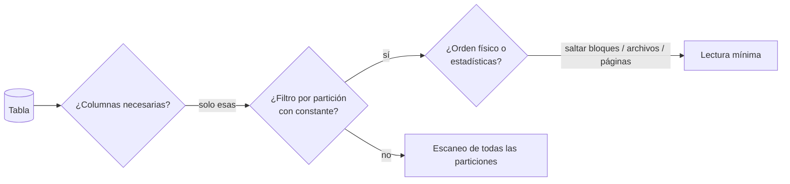

## 1. Resumen

En warehouses y lagos de datos, el costo y el tiempo de una consulta dependen sobre todo de **cuántos datos lee**. Reducir el escaneo tiene tres palancas:

1. **Columnas:** en almacenamiento columnar, cada columna que no se selecciona no se lee. `SELECT *` lee todo.
2. **Filas por partición:** filtrar por la columna de partición con una expresión constante permite saltar particiones completas (ver `partition-pruning`).
3. **Filas dentro de la partición:** el orden físico (clustering en BigQuery, sort keys en Redshift, data clustering en Fabric) y las estadísticas de los archivos (mínimos y máximos en Parquet) permiten saltar bloques o archivos.

`LIMIT` no es una de esas palancas: en BigQuery, un `LIMIT` sobre un `SELECT *` no reduce los datos leídos.

## 2. Qué es

Es un conjunto de técnicas, no una función:

| Técnica | Qué evita leer | Ejemplo |
|---|---|---|
| Proyección de columnas | Columnas | `SELECT id, monto` en lugar de `SELECT *` |
| Poda de particiones | Particiones | `WHERE fecha = '2026-10-07'` sobre una tabla particionada por fecha |
| Orden físico y estadísticas | Bloques, archivos o páginas | Clustering, sort key, data clustering, page index de Parquet |
| Agregar o filtrar antes | Filas que entran a joins | CTE con `GROUP BY` antes del join |
| Materializar | Recalcular sobre la tabla base | Tabla resumen o vista materializada |

## 3. Problema que resuelve

En BigQuery on-demand se paga por bytes leídos, y en cualquier motor el tiempo crece con lo que se lee. Una consulta que lee toda la historia para mostrar el último día cuesta lo mismo cada vez que se ejecuta. Reducir el escaneo baja costo y latencia sin cambiar el resultado.

## 4. Cómo funciona

1. **Columnar:** los formatos y motores columnares guardan cada columna por separado. Redshift Spectrum lo dice explícitamente: con Parquet elimina las columnas innecesarias, y con texto escanea el archivo completo.
2. **Particiones:** el motor compara el filtro con los límites de cada partición. BigQuery exige una expresión constante: una subconsulta como valor no poda.
3. **Bloques y archivos:** Redshift salta bloques fuera del rango de la sort key. Fabric salta archivos gracias al data clustering. Parquet salta páginas con el page index de mínimos y máximos.
4. **Funciones sobre la columna:** `WHERE to_char(fecha, 'YYYY-MM') = '2026-10'` obliga a calcular la función en cada fila y puede impedir la poda. Redshift recomienda evitar funciones en los predicados.

## 5. Cuándo utilizarlo

- Siempre en consultas recurrentes sobre tablas grandes: modelos diarios, tableros, extracciones.
- Al diseñar tablas: elegir partición y orden físico según los filtros reales.
- Al explorar datos: usar vistas previas en lugar de `SELECT * … LIMIT` en BigQuery.

## 6. Cuándo no utilizarlo

- Tablas pequeñas: el diseño físico agrega mantenimiento sin beneficio visible.
- Particionar por columnas que nadie filtra, o con demasiadas particiones pequeñas.
- Optimizar consultas que se ejecutan una vez.

## 7. Ejemplo sencillo

```sql
-- Lee todas las columnas y toda la historia (en BigQuery, LIMIT no lo evita):
SELECT * FROM eventos LIMIT 10;

-- Lee 2 columnas de 1 partición:
SELECT usuario, valor FROM eventos WHERE ocurrido = '2026-10-07';
```

## 8. Ejemplo de producción

Un tablero consultaba `SELECT *` sobre una tabla de eventos de 2 TB para mostrar 6 columnas de los últimos 7 días. Se hicieron tres cambios:

- particionar por `fecha_evento`;
- clusterizar por `tenant_id`, el filtro de todas las consultas;
- reescribir la consulta con las 6 columnas y `WHERE fecha_evento >= CURRENT_DATE() - 7`.

Los bytes por consulta bajaron a una fracción, medida en el historial de jobs. Además se activó *Require partition filter*: las consultas sin filtro de fecha fallan en vez de leer toda la tabla.

## 9. Arquitectura



## 10. Código

```sql
-- PostgreSQL (ejecutado) sobre una tabla particionada por mes.
-- Con filtro constante por la columna de partición: solo se lee la partición de octubre.
EXPLAIN (COSTS OFF)
SELECT count(*) FROM eventos WHERE ocurrido >= '2026-10-05' AND ocurrido < '2026-10-06';
--   ->  Seq Scan on eventos_2026_10 eventos

-- Con una función sobre la columna: se leen las dos particiones.
EXPLAIN (COSTS OFF)
SELECT count(*) FROM eventos WHERE to_char(ocurrido, 'YYYY-MM') = '2026-10';
--   ->  Append
--         ->  Seq Scan on eventos_2026_09 eventos_1
--         ->  Seq Scan on eventos_2026_10 eventos_2

-- BigQuery (sintaxis documentada; no ejecutado aquí): exigir filtro de partición.
-- ALTER TABLE ventas.eventos SET OPTIONS (require_partition_filter = TRUE);
```

Las dos primeras consultas se ejecutaron en PostgreSQL; el plan muestra la diferencia. La opción de BigQuery corresponde a *Require partition filter* de su documentación. No se ejecutó: requiere GCP.

## 11. GCP

**BigQuery** documenta varias prácticas:

- seleccionar solo las columnas necesarias;
- no usar `LIMIT` para abaratar un `SELECT *`, porque se factura la lectura de todos los bytes de la tabla, y usar las vistas previas para explorar;
- filtrar la partición con expresiones constantes;
- exigir el filtro de partición;
- agregar antes de unir.

En tablas no clusterizadas, `LIMIT` no reduce el costo de cómputo. El detalle de BigQuery está en `bigquery-partitioning`, `bigquery-clustering` y `bigquery-cost-model`.

## 12. AWS

En **Redshift**, la sort key permite saltar bloques fuera del rango filtrado; si se consultan sobre todo datos recientes, la columna de tiempo va primero. La guía de consultas recomienda predicados restrictivos y evitar funciones en ellos.

En **Redshift Spectrum** se recomienda:

- Parquet, porque elimina columnas del escaneo;
- particionar por los filtros más comunes;
- archivos de más de 64 MB.

## 13. Azure

**Fabric Warehouse** recomienda filtrar antes de los joins. Ofrece data clustering en `CREATE TABLE` o CTAS, que guarda juntas las filas con valores similares para saltar archivos. Aplica V-Order por defecto, con ordenamiento y compresión al escribir. Son mecanismos distintos de las particiones de BigQuery y de las sort keys de Redshift, aunque persiguen el mismo fin.

## 14. Buenas prácticas

- Nunca `SELECT *` en consultas recurrentes.
- Filtrar la columna de partición directamente, con constantes y sin funciones encima.
- Elegir partición y orden físico con los filtros reales de las consultas más frecuentes.
- Medir bytes o filas leídos antes y después de cada cambio, en el plan o en el historial de jobs.
- **Seguridad:** seleccionar solo las columnas necesarias también reduce la exposición de datos sensibles en resultados y extractos.
- **Observabilidad:** registrar bytes leídos por consulta y alertar por consultas que leen tablas completas.
- **Costo:** en BigQuery on-demand, los bytes leídos son directamente la factura; en los demás motores, el tiempo y la capacidad consumida.

## 15. Errores frecuentes

- `SELECT * … LIMIT 10` para "ver unas filas" en BigQuery.
- Envolver la columna de partición en una función o compararla con una subconsulta.
- Particionar por una columna que las consultas no filtran.
- Archivos muy pequeños en lagos de datos, que agregan sobrecarga de metadatos.

## 16. Trade-offs

El diseño físico (particiones, orden y clustering) reduce el escaneo de muchas consultas a la vez, a cambio de mantenimiento y de favorecer ciertos filtros sobre otros. Las tablas resumen o vistas materializadas reducen aún más, a cambio de almacenamiento y de mantenerlas al día (ver `materialization-strategies`).

## 17. Conceptos relacionados

- `partition-pruning` y `clustering`: las técnicas principales.
- `predicate-pushdown`: llevar el filtro hasta la lectura.
- `row-vs-columnar-formats`: por qué seleccionar columnas importa.
- `query-plans`: cómo verificar lo que se leyó.

## 18. Preguntas técnicas abiertas

1. ¿Cuáles son las 5 consultas que más datos leen en tu warehouse y por qué?
2. ¿Qué columna de partición y de orden elegirías para tu tabla más consultada?
3. ¿Cómo evitarías que alguien lea una tabla completa por error?

## 19. Laboratorio relacionado

Pendiente (F4).

## 20. Fuentes

- Google Cloud: *Optimize query computation*, *Best practices for controlling costs* y *Query partitioned tables* (BigQuery).
- AWS: *Choose the best sort key*, *Amazon Redshift best practices for designing queries* y *Improving Amazon Redshift Spectrum query performance*.
- Microsoft Learn: *Performance guidelines in Fabric Data Warehouse*.
- Apache Parquet: *Page Index*.

El detalle de cada fuente está en `sources` del frontmatter.

## 21. Fecha de última verificación

2026-10-07. Pasa a `verified`: revisión B-F3.1 del lote F3b-02b aplicada, sin VERIFY pendientes.

## 22. Historial de cambios importantes

- 2026-10-05: esqueleto creado desde el blueprint (rama `f/sql`).
- 2026-10-07: ficha completa (lote F3b-02b, dominio 02-sql).
- 2026-10-07: revisión B-F3.1 del lote F3b-02b aplicada (docs/reviews/cards-f3b-02b.md): sin cambios pedidos.
- 2026-10-07: `verification_status: verified` (sin VERIFY pendientes).
