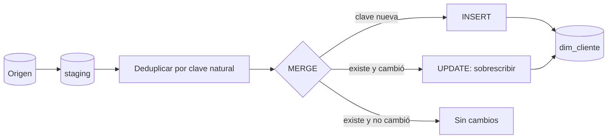

## 1. Resumen

SCD tipo 1 es la forma más simple de mantener una dimensión: cuando cambia un atributo, se **sobrescribe** con el valor nuevo. La dimensión siempre muestra el estado actual y no guarda la historia. Kimball lo resume así: el atributo refleja siempre la asignación más reciente y la técnica destruye la historia.

En SQL es un `MERGE` sobre la clave natural:

- inserta las claves nuevas;
- actualiza solo las filas en que algún atributo cambió.

Para que sea correcto e idempotente, el staging debe traer **una fila por clave** y la comparación debe tratar bien los `NULL`.

## 2. Qué es

Es una de las técnicas del catálogo de SCD (ver `slowly-changing-dimensions`):

| Tipo | Qué hace con un cambio | Historia |
|---|---|---|
| 1 | Sobrescribe el valor | No |
| 2 | Agrega una fila nueva con vigencia (ver `scd-type-2`) | Sí |

La guía de Fabric la recomienda para la mayoría de los atributos que cambian, como el nombre o el email del cliente, y para corregir errores. Una misma dimensión puede tener atributos tipo 1 y tipo 2.

## 3. Problema que resuelve

Los atributos descriptivos cambian (un cliente corrige su email, un producto cambia de nombre) y los reportes deben mostrar el valor vigente. El tipo 1 lo logra sin versionar filas ni complicar los joins: la dimensión tiene una fila por clave.

## 4. Cómo funciona

1. **Staging deduplicado:** una fila por clave natural, la más reciente (ver `deduplication`). Si hay dos, el `MERGE` falla:
   - BigQuery con «UPDATE/MERGE must match at most one source row for each target row»;
   - Redshift con «Found multiple matches to update the same tuple»;
   - T-SQL documenta que no puede actualizar la misma fila dos veces.
2. **`MERGE` por la clave natural:**
   - `WHEN NOT MATCHED` → `INSERT`;
   - `WHEN MATCHED AND <algo cambió>` → `UPDATE`.
3. **"Algo cambió" con `NULL`:** `d.email <> s.email` no detecta el paso a `NULL` (ver `sql-nulls`). Se usa `IS DISTINCT FROM` donde el motor lo admite (PostgreSQL, BigQuery y Fabric Warehouse) o una comparación explícita con `IS NULL` donde no (Redshift).
4. **Idempotencia:** con la condición de cambio, ejecutar dos veces el mismo staging no modifica nada la segunda vez.
5. **Efectos aguas abajo:** Kimball advierte que hay que recalcular los agregados y cubos afectados, porque los hechos pasan a agruparse por el valor nuevo.

## 5. Cuándo utilizarlo

- Atributos cuya historia no se necesita para el análisis: email, teléfono, correcciones de nombre.
- Corrección de errores de carga en atributos descriptivos.
- Dimensiones pequeñas o atributos que se reportan siempre "como están hoy".

## 6. Cuándo no utilizarlo

- Atributos por los que se analiza en el tiempo: segmento, región o categoría, si las ventas pasadas deben quedar con el valor de su momento. Ahí corresponde tipo 2.
- Cuando una auditoría exige saber qué valor tenía el atributo en una fecha.
- Sin deduplicar el staging: el `MERGE` falla o, en motores sin esa validación, el resultado depende del orden.

## 7. Ejemplo sencillo

Un cliente cambia su email de `ana@x.cl` a `ana@nuevo.cl`. Con tipo 1, la fila de la dimensión pasa a tener `ana@nuevo.cl`. Todas sus compras, pasadas y futuras, se ven con el email nuevo.

## 8. Ejemplo de producción

La dimensión de clientes combina tipos:

- **tipo 1:** nombre, email y teléfono;
- **tipo 2:** segmento y región.

Cada noche, el staging del CRM se deduplica por `cliente_id`, quedándose con el registro más reciente. Un `MERGE` aplica los cambios tipo 1 solo a las filas que difieren. Un control cuenta las filas actualizadas por carga; si llega a toda la tabla, alguien cambió el formato en el origen (por ejemplo, mayúsculas en los emails) y la carga se revisa antes de publicar.

## 9. Arquitectura



## 10. Código

```sql
-- PostgreSQL (ejecutado): SCD tipo 1 idempotente.
MERGE INTO dim_cliente AS d
USING stg_cliente AS s ON d.cliente_id = s.cliente_id
WHEN MATCHED AND (d.nombre IS DISTINCT FROM s.nombre OR d.email IS DISTINCT FROM s.email) THEN
  UPDATE SET nombre = s.nombre, email = s.email, actualizado_en = now()
WHEN NOT MATCHED THEN
  INSERT (cliente_id, nombre, email, actualizado_en)
  VALUES (s.cliente_id, s.nombre, s.email, now());

-- Redshift (no admite IS DISTINCT FROM; sintaxis documentada de MERGE, no ejecutado aquí):
-- condición de cambio con NULL explícito, probada en PostgreSQL (ver sql-nulls):
--   WHEN MATCHED AND COALESCE(d.email <> s.email, (d.email IS NULL) <> (s.email IS NULL)) THEN UPDATE …
```

Con un staging de 3 clientes (uno con email nuevo, uno igual y uno nuevo con email `NULL`):

- la primera ejecución afecta 2 filas: actualiza el email cambiado e inserta el cliente nuevo;
- la segunda ejecución con el mismo staging afecta 0 filas;
- con la misma clave dos veces en el staging, PostgreSQL falla con *MERGE command cannot affect row a second time*.

## 11. GCP

**BigQuery** implementa el patrón con `MERGE` (`WHEN MATCHED`, `WHEN NOT MATCHED` y `WHEN NOT MATCHED BY SOURCE`). Falla en tiempo de ejecución si una fila del destino coincide con más de una del origen, así que el staging debe deduplicarse antes. Admite `IS DISTINCT FROM` para la condición de cambio (ver `sql-nulls`).

## 12. AWS

**Redshift** tiene `MERGE` con `WHEN MATCHED` y `WHEN NOT MATCHED`, y falla con «Found multiple matches to update the same tuple» ante duplicados en el origen. Ofrece un modo simplificado, `REMOVE DUPLICATES`, que exige columnas iguales en origen y destino. Como no admite `IS DISTINCT FROM`, la condición de cambio se escribe con `IS NULL` explícitos.

## 13. Azure

`MERGE` de **T-SQL** aplica al pool SQL dedicado de Synapse y a Warehouse en Fabric. No puede actualizar la misma fila más de una vez y exige el punto y coma final. En Fabric Warehouse, `IS DISTINCT FROM` está documentado. La guía de modelado dimensional de Fabric recomienda el tipo 1 para la mayoría de los atributos que cambian y para corregir errores.

## 14. Buenas prácticas

- Deduplicar el staging por clave natural antes del `MERGE`.
- Actualizar solo cuando algún atributo cambió, con una comparación segura con `NULL`.
- Documentar qué atributos son tipo 1 y cuáles tipo 2.
- Recalcular agregados derivados cuando cambian atributos usados para agrupar, como advierte Kimball.
- **Seguridad:** sobrescribir borra el valor anterior; si un cambio de atributo debe ser auditable (por ejemplo, un dato de contacto), registrar el cambio en una tabla de auditoría aparte.
- **Observabilidad:** registrar filas insertadas y actualizadas por carga; un salto en las actualizaciones indica un cambio de formato en el origen.
- **Costo:** la condición de cambio evita reescribir filas iguales; en motores que facturan o bloquean por filas modificadas, también reduce el costo de cada carga.

## 15. Errores frecuentes

- Staging con duplicados por clave y `MERGE` que falla o depende del orden.
- Condición de cambio con `<>`, que pierde los pasos a `NULL`.
- `UPDATE` sin condición, que reescribe toda la dimensión en cada carga.
- Usar tipo 1 en atributos por los que se analiza la historia.
- Olvidar que los reportes del pasado cambian cuando cambia un atributo tipo 1.

## 16. Trade-offs

El tipo 1 es simple y mantiene una fila por clave, a cambio de perder la historia y de que los reportes pasados cambien. El tipo 2 conserva la historia a cambio de más filas, vigencias y joins por fecha. Combinar ambos en la misma dimensión es habitual y la guía de Fabric lo menciona.

## 17. Conceptos relacionados

- `slowly-changing-dimensions`: el catálogo de tipos.
- `scd-type-2`: versionar en lugar de sobrescribir.
- `upsert` y `sql-merge`: la operación SQL.
- `deduplication`: staging con una fila por clave.
- `sql-nulls`: comparar con `NULL`.

## 18. Preguntas técnicas abiertas

1. ¿Qué atributos de tu dimensión de clientes son tipo 1 y cuáles necesitan historia?
2. ¿Cómo detectarías que una carga tipo 1 está sobrescribiendo más filas de lo normal?
3. ¿Qué agregados tendrías que recalcular si cambia un atributo tipo 1?

## 19. Laboratorio relacionado

Pendiente (F4).

## 20. Fuentes

- Kimball Group: *Type 1: Overwrite* (referencia conceptual, Nivel 4).
- Microsoft Learn: *Dimensional modeling in Fabric Data Warehouse: Dimension tables*, *MERGE (Transact-SQL)* e *IS [NOT] DISTINCT FROM (Transact-SQL)*.
- Google Cloud: *DML syntax* (BigQuery).
- AWS: *MERGE* y *Unsupported PostgreSQL functions* (Amazon Redshift).
- PostgreSQL: *MERGE*.

El detalle de cada fuente está en `sources` del frontmatter.

## 21. Fecha de última verificación

2026-10-07. En `review_required` hasta la revisión B-F3.1 del lote F3b-02c.

## 22. Historial de cambios importantes

- 2026-10-05: esqueleto creado desde el blueprint (rama `f/sql`).
- 2026-10-07: ficha completa (lote F3b-02c, dominio 02-sql).
