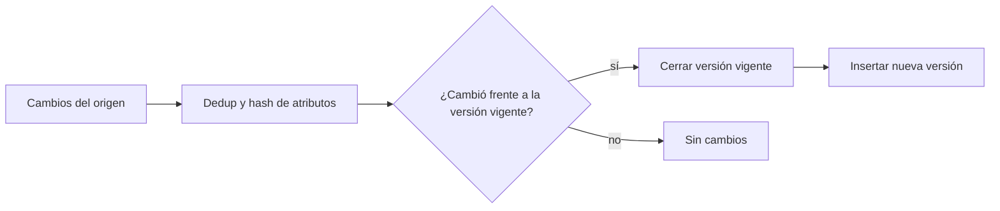

## 1. Resumen

SCD Type 2 conserva la historia de una dimensión. Cada vez que cambia un atributo relevante, cierra la fila vigente (fecha "hasta") e inserta una nueva con los valores actuales. Así, un hecho de marzo se une con el cliente tal como era en marzo, no como es hoy.

## 2. Qué es

Es uno de los tipos de *Slowly Changing Dimensions* del modelado dimensional de Kimball, un concepto consolidado de la literatura, no una característica de un producto. Cada versión es una fila con su propia surrogate key, más columnas de vigencia (`valid_from`, `valid_to`) y un indicador de versión actual (`is_current`).

## 3. Problema que resuelve

Si la dimensión se sobrescribe (SCD tipo 1), los informes históricos cambian retroactivamente: las ventas del año pasado aparecen asignadas a la región actual del cliente. SCD2 permite responder "¿cómo era el dato cuando ocurrió el hecho?".

## 4. Cómo funciona

1. Se detecta el cambio comparando el registro entrante con la versión vigente: por atributos o por un hash de los atributos seguidos.
2. Se **cierra** la versión vigente: `valid_to = momento del cambio` e `is_current = false`.
3. Se **inserta** la nueva versión: `valid_from = momento del cambio`, `valid_to = null` (o una fecha lejana) e `is_current = true`.
4. Los hechos guardan la surrogate key de la versión vigente al momento del hecho.

**Convención de vigencia:** el intervalo es semiabierto, `[valid_from, valid_to)`. `valid_from` es inclusivo y `valid_to` es exclusivo, así que la versión vieja cierra en el mismo instante en que abre la nueva sin solaparse. Una versión vigente en el instante `t` cumple `valid_from <= t AND (valid_to IS NULL OR t < valid_to)`.

## 5. Cuándo utilizarlo

- Atributos de dimensión cuyo cambio debe respetarse en el histórico: región, segmento, plan comercial.
- Auditoría: reconstruir el estado de una entidad en una fecha.
- Fuentes CDC que ya entregan cada versión con su timestamp.

## 6. Cuándo no utilizarlo

- Atributos que pueden corregirse sin conservar historia (una errata en un nombre): tipo 1.
- Atributos que cambian muy seguido (un contador, la última visita): la dimensión explota en versiones. Mejor un hecho o una minidimensión.
- Cuando nadie consulta la historia: añade complejidad a cada join.

## 7. Ejemplo sencillo

El cliente 42 pasa de la región "Norte" a "Sur" el 2026-09-15 (vigencias `[valid_from, valid_to)`):

| sk | cliente_id | región | valid_from | valid_to | is_current |
|---|---|---|---|---|---|
| 101 | 42 | Norte | 2025-01-10 | 2026-09-15 | false |
| 187 | 42 | Sur | 2026-09-15 | null | true |

## 8. Ejemplo de producción

La dimensión de clientes se alimenta con CDC. Cada lote se deduplica por cliente, quedándose con el último cambio de cada atributo seguido. Se compara por hash contra la versión vigente y se aplica en una transacción que cierra e inserta. Un control diario verifica que cada cliente tenga exactamente una versión vigente y que las vigencias no se superpongan.

## 9. Arquitectura



## 10. Código

```sql
-- BigQuery (ejecutable adaptando nombres), en una transacción de varias sentencias.
-- Requiere: dim_cliente(sk STRING, cliente_id STRING, region STRING, valid_from TIMESTAMP,
--           valid_to TIMESTAMP, is_current BOOL) y cambios(cliente_id, region, cambiado_en TIMESTAMP),
--           con un cambio por cliente (deduplicado antes).
BEGIN TRANSACTION;

-- 1. Cerrar la versión vigente de los clientes con cambio real.
UPDATE `proyecto.dataset.dim_cliente` d
SET valid_to = c.cambiado_en, is_current = FALSE
FROM `proyecto.dataset.cambios` c
WHERE d.cliente_id = c.cliente_id AND d.is_current AND d.region != c.region;

-- 2. Insertar la nueva versión para clientes nuevos o recién cerrados.
INSERT INTO `proyecto.dataset.dim_cliente` (sk, cliente_id, region, valid_from, valid_to, is_current)
SELECT GENERATE_UUID(), c.cliente_id, c.region, c.cambiado_en, NULL, TRUE
FROM `proyecto.dataset.cambios` c
LEFT JOIN `proyecto.dataset.dim_cliente` d
  ON d.cliente_id = c.cliente_id AND d.is_current
WHERE d.cliente_id IS NULL;

COMMIT TRANSACTION;
```

## 11. GCP

En **BigQuery** se implementa con dos sentencias en una transacción (como arriba) o con un `MERGE` sobre un origen preparado. En ambos casos el lote debe traer un cambio por clave: el `MERGE` de BigQuery falla si una fila del destino coincide con varias de origen.

## 12. AWS

En **Redshift** el patrón es el mismo y su `MERGE` también falla si el lote trae varias filas de origen para una misma fila del destino. La diferencia está en el modo simplificado `REMOVE DUPLICATES`: si la dimensión tuviera por error dos versiones vigentes que coinciden con la misma fila de origen, las eliminaría y conservaría una, en silencio. En SCD2 no conviene ese modo; hay que validar la unicidad de la versión vigente antes de aplicar.

## 13. Azure

En Synapse (dedicated SQL pool) y Fabric Warehouse, el `MERGE` de T-SQL da error si varias filas de origen coinciden con una del destino, como en BigQuery. El patrón y los controles son los mismos, con sintaxis T-SQL.

## 14. Buenas prácticas

- Definir explícitamente qué atributos disparan una nueva versión (y usar hash para compararlos).
- Usar la fecha del cambio en el origen, no la de la carga, para `valid_from`.
- Controlar que haya exactamente una versión vigente por clave y que no haya huecos ni superposiciones.
- Particionar o clusterizar la dimensión por `is_current` o por la clave natural si es grande.
- **Seguridad:** SCD2 conserva cada versión de los atributos: si incluyen datos personales, una solicitud de borrado o una política de retención afecta a todas las versiones, no solo a la vigente.
- **Costo:** la dimensión crece con cada cambio de los atributos seguidos; elegir esos atributos con cuidado controla el tamaño.

## 15. Errores frecuentes

- Crear una versión nueva en cada carga aunque nada haya cambiado (sin comparar atributos).
- Usar la fecha de carga como vigencia: los reprocesos desplazan la historia.
- Unir hechos con la dimensión solo por clave natural, lo que trae todas las versiones y duplica los hechos.
- Procesar varios cambios de la misma clave en un lote sin ordenarlos.

## 16. Trade-offs

Historia fiel y auditable, a cambio de dimensiones más grandes, joins por rango de vigencia o surrogate key, y cargas más complejas. El tipo 1 es trivial pero reescribe el pasado; otros tipos (3, 4, 6) cubren casos intermedios.

## 17. Conceptos relacionados

- `sql-merge`: herramienta de implementación.
- `change-data-capture`: fuente natural de versiones.
- `incremental-load`: la carga SCD2 es una carga incremental.
- Del blueprint, pendientes de ficha: `slowly-changing-dimensions`, `scd-type-1`, `surrogate-keys`, `dimension-tables`.

## 18. Preguntas técnicas abiertas

1. ¿Qué harías si un lote trae tres cambios del mismo cliente en el mismo día?
2. ¿Cómo corregirías una versión cargada con una vigencia equivocada sin romper los hechos ya asociados?
3. ¿Qué controles automáticos pondrías sobre una dimensión SCD2 en producción?

## 19. Laboratorio relacionado

Pendiente (F4): lab de tipo A sobre SCD2 con MERGE (§25).

## 20. Fuentes

- Google Cloud: *DML statements in GoogleSQL* (BigQuery).
- AWS: *MERGE* (Amazon Redshift).
- Microsoft Learn: *MERGE (Transact-SQL)*.

El detalle de cada fuente está en `sources` del frontmatter.

## 21. Fecha de última verificación

2026-09-30. La ficha queda en `review_required` hasta la revisión humana (B-F3.1).

## 22. Historial de cambios importantes

- 2026-09-30: creación (lote 1 de F3).
- 2026-09-30: revisión B-F3.1 aplicada (docs/reviews/cards-lote1.md): relaciones completas, seguridad, observabilidad y costo, notas de fuentes y ejemplos corregidos.
- 2026-09-30: corregido el comportamiento de `MERGE` en Redshift ante duplicados (detectado al preparar el lote 2): falla con varias filas de origen por fila destino; la eliminación de duplicados del destino es solo del modo `REMOVE DUPLICATES`.
