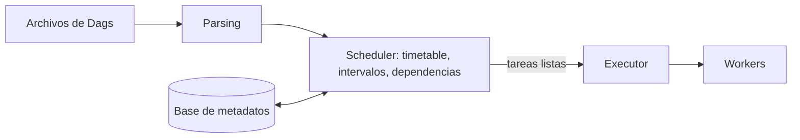

## 1. Resumen

El scheduler es el componente que decide cuándo se ejecuta un pipeline y dispara cada tarea cuando sus dependencias están completas. En Airflow hay un detalle que confunde a todos al principio: un Dag diario corre **al terminar** el día que procesa, no al empezar, para que los datos de ese día estén completos. Elegir el disparador correcto (horario, intervalo con estado o evento) es parte del diseño del pipeline.

## 2. Qué es

Es el "reloj y despachador" del orquestador:

- **cuándo:** a partir del schedule (cron, intervalo, preset) o de un evento;
- **qué:** crea la ejecución del pipeline (Dag run) para un intervalo;
- **en qué orden:** dispara las tareas cuyas dependencias se cumplieron y las entrega al executor.

## 3. Problema que resuelve

Ejecutar pipelines con cron del sistema operativo no sabe de dependencias entre tareas, de reintentos, de intervalos de datos ni de qué ejecuciones fallaron. Un scheduler de orquestación relaciona cada ejecución con el período de datos que procesa y solo avanza cuando lo anterior terminó.

## 4. Cómo funciona

En **Airflow**:

1. El scheduler corre como un servicio persistente y usa el **executor** configurado para ejecutar las tareas.
2. Recoge los resultados del parsing de los Dags y revisa, una vez por minuto por defecto, qué tareas puede disparar.
3. El primer Dag run sale del `start_date`; los siguientes, del **timetable** (cron, `timedelta` o presets como `@daily`).
4. Con cron o `timedelta`, el run de un intervalo se dispara **cuando el intervalo termina**: el `@daily` del 30 de septiembre corre después de las 23:59 de ese día.
5. Airflow admite **más de un scheduler** a la vez, por rendimiento y resiliencia, coordinados a través de la base de metadatos.

## 5. Cuándo utilizarlo

- Pipelines por período (diarios, horarios) con dependencias entre tareas.
- Cuando importa saber qué intervalo procesó cada ejecución y cuál falló.
- Cuando hay que combinar horarios con eventos (llegada de archivos).

## 6. Cuándo no utilizarlo

- Procesamiento continuo de eventos con baja latencia: corresponde un consumidor de streaming, no un Dag cada minuto.
- Tareas sueltas sin dependencias que solo invocan un servicio: un scheduler serverless (por ejemplo, EventBridge Scheduler) es más simple.
- Usar `@continuous` o intervalos muy cortos como sustituto de streaming.

## 7. Ejemplo sencillo

Un Dag con `schedule="@daily"` y `start_date` el 1 de septiembre: el run del 1 de septiembre se dispara el 2 de septiembre a las 00:00, cuando el día 1 terminó, y procesa el intervalo del día 1.

## 8. Ejemplo de producción

- **Ventas:** un Dag `0 3 * * *` (todos los días a las 03:00) da tiempo a que los sistemas de origen cierren el día.
- **Archivos externos:** en lugar de un horario fijo que adivina cuándo llegan, un evento de llegada de archivo dispara la carga.
- **Ejecución:** el entorno administrado corre dos schedulers para resiliencia.
- **Alertas:** una alerta avisa si un Dag run no empezó en la hora esperada, porque un scheduler caído no produce errores en las tareas: simplemente no las dispara.

## 9. Arquitectura



## 10. Código

```python
# Airflow 3: tres formas de expresar el schedule; el run de cada intervalo se dispara al terminar el intervalo.
# Requiere: apache-airflow 3.x.
from datetime import datetime, timedelta

from airflow.sdk import dag, task


@dag(schedule="0 3 * * *", start_date=datetime(2026, 9, 1), catchup=False)   # cron: todos los días a las 03:00
def ventas_cron():
    @task
    def cargar(*, ds: str) -> None:
        print(f"procesa el intervalo lógico {ds}")

    cargar()


@dag(schedule="@daily", start_date=datetime(2026, 9, 1), catchup=False)      # preset
def ventas_preset():
    @task
    def cargar(*, ds: str) -> None:
        print(f"procesa el intervalo lógico {ds}")

    cargar()


@dag(schedule=timedelta(hours=6), start_date=datetime(2026, 9, 1), catchup=False)  # cada 6 horas
def eventos_cada_6h():
    @task
    def cargar(*, ds: str) -> None:
        print(f"procesa el intervalo lógico {ds}")

    cargar()


ventas_cron()
ventas_preset()
eventos_cada_6h()
```

Cada tarea usa la fecha lógica del intervalo (`ds`) y no la hora actual, así repetir una ejecución procesa siempre el mismo período.

## 11. GCP

En **Managed Service for Apache Airflow (ex Cloud Composer)**, los schedulers parsean los Dags, programan los Dag runs según el intervalo y encolan las tareas para los workers; los triggerers vigilan las tareas diferidas. El comportamiento de scheduling es el de Airflow; el servicio administra los componentes.

## 12. AWS

En **Amazon MWAA** el scheduler es el de Airflow, administrado, con workers en contenedores que escalan y métricas y logs en CloudWatch. Para invocaciones simples sin Dag, **EventBridge Scheduler** es un scheduler serverless con expresiones cron y rate, ejecuciones únicas, ventanas de entrega flexibles y límites de reintento. No conoce dependencias entre tareas ni intervalos de datos: dispara un destino a una hora.

## 13. Azure

**Data Factory** usa **triggers**: *schedule* (horario de reloj), *tumbling window* (intervalos periódicos con estado, parecido al data interval de Airflow) y *event-based* (por ejemplo, llegada de un archivo). Un pipeline puede tener varios triggers y un trigger, varios pipelines, salvo el tumbling window.

## 14. Buenas prácticas

- Programar según cuándo los datos del intervalo están completos, no según cuándo "conviene".
- Tareas que usen la fecha lógica del intervalo, nunca "ahora".
- Preferir disparadores por evento cuando la llegada de los datos es irregular.
- Alertar por ejecuciones que no empezaron, no solo por tareas fallidas.
- **Seguridad:** el scheduler ejecuta código de los Dags con las credenciales del entorno; restringir quién puede subir Dags.
- **Observabilidad:** vigilar la salud del scheduler y el retraso entre la hora prevista y el inicio real.
- **Costo:** intervalos muy cortos multiplican ejecuciones y consumo de workers; ajustar la frecuencia al uso real de los datos.

## 15. Errores frecuentes

- Esperar que un `@daily` corra al empezar el día que procesa.
- Usar la hora actual dentro de la tarea en lugar del intervalo lógico.
- Programar a una hora fija una carga cuyo archivo llega a horas variables.
- No monitorear el scheduler y descubrir días después que no corrió.

## 16. Trade-offs

Los horarios fijos son simples y predecibles, pero fallan si los datos llegan tarde. Los disparadores por evento reaccionan a la llegada real, a cambio de más piezas (notificaciones, filtros) y de manejar eventos duplicados o tardíos.

## 17. Conceptos relacionados

- `dag`: lo que el scheduler ejecuta.
- `catchup`: la política para intervalos pendientes.
- `backfill`: ejecuciones de intervalos pasados.
- Con ficha: `data-orchestration`, `airflow-architecture`.
- `pipeline-dependencies`: dependencias entre tareas y dependencias de datos entre flujos.

## 18. Preguntas técnicas abiertas

1. ¿A qué hora programarías un Dag diario cuyos datos de origen cierran a las 02:00?
2. ¿Cómo detectarías que el scheduler dejó de disparar ejecuciones?
3. ¿Cuándo usarías un trigger por evento en lugar de un horario?

## 19. Laboratorio relacionado

Pendiente (F4): snippet "DAG de Airflow" (A-F3.2) y lab de tipo A.

## 20. Fuentes

- Apache Airflow: *Scheduler*, *Cron & Time Intervals* y *Dag Runs*.
- Google Cloud: *Environment architecture* (Managed Service for Apache Airflow).
- AWS: *What is Amazon MWAA?* y *What is Amazon EventBridge Scheduler?*.
- Microsoft Learn: *Pipeline execution and triggers* (Data Factory).

El detalle de cada fuente está en `sources` del frontmatter.

## 21. Fecha de última verificación

2026-10-01. Pasa a `verified`: revisión B-F3.1 del lote 4 aplicada, sin VERIFY pendientes.

## 22. Historial de cambios importantes

- 2026-10-01: creación (lote 4 de F3).
- 2026-10-01: `verification_status: verified` (revisión B-F3.1 del lote 4 aplicada; sin VERIFY pendientes).
- 2026-10-06: la sección de conceptos relacionados ya no lista como pendientes de ficha a `data-orchestration`, `airflow-architecture`, que ya tienen ficha.
- 2026-10-11: §17 enlaza `pipeline-dependencies`, que ya tiene ficha (lote F3b-05a); antes figuraba como pendiente de ficha.
- 2026-10-13: `page_title` en cada cita, con el título de la página citada (ADR-012); sin cambios de contenido.
- 2026-10-14: lote F3b-rel (regla del §17): relations incluye `airflow-architecture`, `data-orchestration`, `pipeline-dependencies`.
