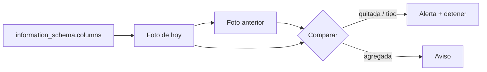

## 1. Resumen

Un **cambio de schema** es que una tabla tenga hoy columnas, tipos o restricciones distintos de los de ayer: una columna nueva, una que desaparece, un `numeric` que pasa a `bigint`, una columna que deja de admitir nulos. Detectarlo es **comparar fotos del schema** entre corridas, con lo que la base expone en su `information_schema`.

No es lo mismo que validar registros contra un schema declarado (`schema-validation`) ni que las reglas de compatibilidad entre versiones (`schema-evolution`). Aquí la pregunta es: ¿qué cambió desde la última vez, aunque nadie avisara?

## 2. Qué es

- **Foto del schema:** por columna, el nombre, el tipo y si admite nulos (*35.17. columns*).
- **Cambio agregado:** columna en la foto nueva y no en la anterior.
- **Cambio quitado:** al revés.
- **Cambio modificado:** misma columna, distinto tipo o nulabilidad.

## 3. Problema que resuelve

El equipo de la aplicación quita la columna `cupon` y cambia `monto` de `numeric` a `bigint`. El pipeline sigue corriendo, pero el modelo de descuentos ahora da cero y los montos pierden los decimales. Con una comparación de fotos después de cada carga, el cambio aparece el mismo día con su detalle: `quitada cupon`, `cambió monto: numeric -> bigint`.

## 4. Cómo funciona

1. Después de cada carga, se leen `column_name`, `data_type` e `is_nullable` de `information_schema.columns` para la tabla.
2. Se compara con la foto de la corrida anterior.
3. Cada diferencia se clasifica: agregada, quitada o modificada.
4. Las quitadas y los cambios de tipo alertan; las agregadas se registran y se avisan.
5. La foto nueva queda como referencia para la próxima corrida.

## 5. Cuándo utilizarlo

- En tablas de orígenes que no controla el equipo de datos.
- Antes de transformar: un cambio detectado a tiempo evita propagar datos rotos.
- Junto con un contrato de datos, para ver si el productor lo respetó.

## 6. Cuándo no utilizarlo

- Como reemplazo de un contrato: detectar después no es acordar antes.
- Ignorando las columnas agregadas: un campo nuevo puede cambiar el significado de otro.

## 7. Ejemplo sencillo

Foto de ayer: `id int`, `monto numeric`, `tienda text` (admite nulos), `cupon text`. Hoy:

| Cambio | Detalle |
|---|---|
| agregada | `canal text` |
| cambió | `monto`: `numeric` → `bigint` |
| cambió | `tienda`: admite nulos → no admite |
| quitada | `cupon` |

Comparar la foto de hoy consigo misma no da cambios.

## 8. Ejemplo de producción

- Una tabla de metadatos guarda la foto de cada tabla de origen por fecha.
- Un paso después de la ingesta compara contra la última foto.
- Quitadas y cambios de tipo detienen la transformación de esa tabla y alertan al dueño del origen; agregadas se avisan en el canal del equipo.
- Las fotos sirven para auditar desde cuándo cambió cada tabla.

## 9. Arquitectura



## 10. Código

```python
# Python 3.12 y psycopg contra PostgreSQL 17 (ejecutado en la CI con el servicio postgres:17): se guarda una foto del
# schema desde information_schema.columns y se compara con la de la corrida anterior.
# PG_HOST, PG_PORT, PG_USER, PG_PASSWORD y PG_DB apuntan a una base vacía que el test crea y borra.
import os

import psycopg

Foto = dict[str, tuple[str, str]]   # columna -> (tipo, admite nulos)


def foto(conn: psycopg.Connection[tuple[str, str, str]], tabla: str) -> Foto:
    filas = conn.execute("SELECT column_name, data_type, is_nullable FROM information_schema.columns "
                         "WHERE table_schema = 'public' AND table_name = %s ORDER BY ordinal_position", (tabla,))
    return {c: (t, n) for c, t, n in filas.fetchall()}


def comparar(antes: Foto, ahora: Foto) -> list[str]:
    cambios = [f"agregada {c} {ahora[c][0]}" for c in ahora.keys() - antes.keys()]
    cambios += [f"quitada {c}" for c in antes.keys() - ahora.keys()]
    cambios += [f"cambió {c}: {antes[c]} -> {ahora[c]}" for c in antes.keys() & ahora.keys() if antes[c] != ahora[c]]
    return sorted(cambios)


with psycopg.connect(host=os.environ["PG_HOST"], port=os.environ["PG_PORT"], user=os.environ["PG_USER"],
                     password=os.environ["PG_PASSWORD"], dbname=os.environ["PG_DB"], autocommit=True) as conn:
    conn.execute("CREATE TABLE pedidos (id int PRIMARY KEY, monto numeric(10, 2), tienda text, cupon text)")
    ayer = foto(conn, "pedidos")
    conn.execute("ALTER TABLE pedidos ADD COLUMN canal text")             # el productor agrega una columna
    conn.execute("ALTER TABLE pedidos ALTER COLUMN monto TYPE bigint")      # cambia un tipo
    conn.execute("ALTER TABLE pedidos ALTER COLUMN tienda SET NOT NULL")    # y una restricción
    conn.execute("ALTER TABLE pedidos DROP COLUMN cupon")                  # y quita otra
    hoy = foto(conn, "pedidos")
    print("sin cambios contra sí misma:", comparar(hoy, foto(conn, "pedidos")) == [])

for cambio in comparar(ayer, hoy):
    print(cambio)
```

El script se **ejecuta en la CI contra el servicio postgres:17**, en una base vacía que el test crea y borra, y pasa `mypy --strict`. Imprime `sin cambios contra sí misma: True` y los cuatro cambios: `agregada canal text`, `cambió monto: ('numeric', 'YES') -> ('bigint', 'YES')`, `cambió tienda: ('text', 'YES') -> ('text', 'NO')` y `quitada cupon`.

## 11. GCP

En GCP, **BigQuery** expone el schema en `INFORMATION_SCHEMA.COLUMNS`. Según *35.17. columns* y *COLUMNS view* (no ejecutado):

| | PostgreSQL (`information_schema.columns`) | BigQuery (`INFORMATION_SCHEMA.COLUMNS`) |
|---|---|---|
| Qué tiene | Todas las columnas que el usuario puede ver | Una fila por columna (campo) de cada tabla |
| Permisos | Ser dueño o tener algún privilegio sobre la tabla | `bigquery.tables.get` y `bigquery.tables.list` |
| Comparación | La hace el pipeline | Igual: la vista da la foto; comparar es tarea del equipo |

## 12. AWS

En AWS, los **crawlers de AWS Glue** mantienen el schema del Data Catalog. Según *Preventing a crawler from changing an existing schema* y *Data Quality Definition Language (DQDL) reference* (no ejecutado):

| | Comparar fotos (esta ficha) | Crawler de Glue | Glue Data Quality |
|---|---|---|---|
| Ante un cambio | Se detecta y se alerta | Por defecto actualiza el schema del Data Catalog para que coincida con la fuente; se puede impedir | Tipos de regla como `SchemaMatch`, `ColumnExists` y `ColumnDataType` |
| Riesgo | — | Que el catálogo cambie en silencio | Hay que escribir las reglas |

## 13. Azure

En Azure, **Azure Data Factory** maneja el schema drift en mapping data flows. Según *Schema drift in mapping data flow* (no ejecutado):

| | Comparar fotos (esta ficha) | Schema drift en ADF |
|---|---|---|
| Objetivo | Detectar y avisar | Que el data flow siga funcionando cuando el origen cambia |
| Columnas nuevas | Se reportan | Con Allow schema drift pasan hasta el sink, como string por defecto salvo Infer drifted column types |

No son lo mismo: permitir el drift deja pasar el cambio; detectar lo hace visible.

## 14. Buenas prácticas

- Guardar la foto completa (nombre, tipo, nulabilidad, posición) con fecha.
- Alertar por quitadas y cambios de tipo; avisar por agregadas.
- Revisar que un crawler o un drift permitido no oculten cambios.
- **Seguridad:** leer `information_schema` necesita acceso a la tabla; la cuenta de monitoreo, solo metadatos.
- **Observabilidad:** historial de fotos para saber desde cuándo cambió una tabla.
- **Costo:** consultar metadatos es barato; no hace falta leer filas.

## 15. Errores frecuentes

- Comparar solo nombres y no tipos.
- Dejar que el catálogo se actualice solo y no enterarse.
- Comparar contra el schema de hace un mes y no contra el de la corrida anterior.

## 16. Trade-offs

Detener ante un cambio protege a los consumidores y atrasa la publicación. Dejar pasar el drift mantiene el pipeline andando y propaga cambios no revisados. Comparar en cada corrida cuesta poco y no reemplaza acordar los cambios antes.

## 17. Conceptos relacionados

- `schema-evolution`: cambios compatibles.
- `data-observability`: el panorama.
- `schema-validation`: validar contra un schema declarado.
- `data-contracts`: acordar antes.
- `glue-catalog-and-etl`: Data Catalog y crawlers.

## 18. Preguntas técnicas abiertas

1. ¿Te enterarías hoy si una columna de origen cambia de tipo?
2. ¿Tu catálogo se actualiza solo con los cambios del origen?
3. ¿Qué cambios deberían detener tu pipeline?

## 19. Laboratorio relacionado

Pendiente (F4).

## 20. Fuentes

- PostgreSQL 17: *35.17. columns*.
- Google Cloud: *COLUMNS view*.
- AWS: *Preventing a crawler from changing an existing schema* y *Data Quality Definition Language (DQDL) reference*.
- Microsoft Learn: *Schema drift in mapping data flow*.

El detalle de cada fuente está en `sources` del frontmatter.

## 21. Fecha de última verificación

2026-10-20. Pasa a `verified`: revisión B-F3.1 del lote F3b-16a sin hallazgos en esta ficha, sin VERIFY pendientes.

## 22. Historial de cambios importantes

- 2026-10-20: creación (lote F3b-16a).
- 2026-10-20: revisión B-F3.1 del lote F3b-16a (docs/reviews/cards-f3b-16a.md), sin hallazgos que corregir.
- 2026-10-20: `verification_status: verified` (sin VERIFY pendientes).
