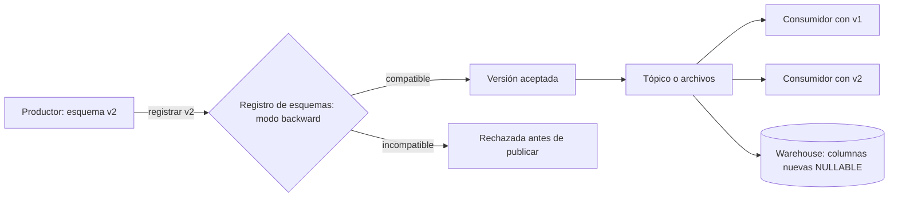

## 1. Resumen

Evolución de esquema es cambiar la estructura de los datos (agregar, quitar, renombrar o cambiar el tipo de campos) sin romper a quien los produce ni a quien los consume. Algunos cambios son seguros casi siempre, como agregar un campo opcional; otros rompen a alguien, como quitar un campo obligatorio o cambiar un tipo. Los registros de esquemas y las reglas de compatibilidad (backward, forward, full) permiten decidir qué cambio se acepta antes de que llegue a producción.

## 2. Qué es

Es la gestión de los cambios de esquema entre dos partes:

- **productor** (escritor): escribe datos con un esquema;
- **consumidor** (lector): los lee con su propio esquema, que puede ser más viejo o más nuevo.

Los modos de compatibilidad, con los nombres de Glue Schema Registry y Event Hubs:

- **backward:** el consumidor con el esquema **nuevo** lee datos escritos con el **anterior** (permite borrar campos y agregar campos opcionales);
- **forward:** el consumidor con el esquema **anterior** lee datos escritos con el **nuevo** (permite agregar campos y borrar opcionales);
- **full:** ambas cosas.

## 3. Problema que resuelve

El sistema de origen agrega una columna, un equipo renombra un campo de un evento, un tipo pasa de entero a decimal. Sin reglas, el pipeline falla a medianoche, o peor: no falla y carga nulos o valores truncados. La evolución de esquema controlada convierte esos cambios en decisiones explícitas y verificables.

## 4. Cómo funciona

- **Reglas del formato:** en Avro, los datos se leen con el esquema del escritor y el del lector. Un campo que el escritor tiene y el lector no, se ignora. Un campo que el lector tiene con valor por defecto y el escritor no, toma el default. Si el lector espera un campo sin default que el escritor no tiene, es un error.
- **Registro de esquemas:** cada versión se registra con un modo de compatibilidad, y el registro **rechaza** una versión nueva que lo viole antes de que alguien la use.
- **Reglas del destino:** cada data warehouse admite ciertos cambios. BigQuery, por ejemplo, permite agregar columnas `NULLABLE` o `REPEATED`, pero no `REQUIRED`, y no admite cambiar el tipo de una columna desde la consola, `bq` ni la API.

Regla práctica que se desprende de lo anterior: **agregar campos opcionales** (con default o nulos) es el cambio más seguro; quitar campos obligatorios, renombrar y cambiar tipos requieren coordinación.

## 5. Cuándo utilizarlo

- Siempre que un esquema tenga más de un consumidor o cambie con el tiempo.
- En eventos y mensajes (Kafka, Event Hubs, Kinesis) producidos por otros equipos.
- En pipelines CDC, donde los cambios de la base de origen llegan sin aviso.

## 6. Cuándo no utilizarlo

- En datos de un solo uso, producidos y consumidos por el mismo proceso a la vez: basta con versionar el código.
- Como excusa para aceptar cualquier cambio: "sin compatibilidad" (`NONE`) debería ser una excepción documentada, no la configuración por defecto.

## 7. Ejemplo sencillo

El evento `pedido_creado` agrega el campo opcional `cupon`, con valor por defecto nulo. Los consumidores viejos lo ignoran; los nuevos lo leen, y en los mensajes viejos lo ven como nulo. Es un cambio compatible en ambos sentidos.

## 8. Ejemplo de producción

Los eventos de pedidos se publican en Avro con un registro de esquemas en modo backward. Un equipo intenta agregar el campo obligatorio `zona_envio` sin default: el registro rechaza la versión. Lo vuelven a proponer como opcional con default y se acepta. En el data warehouse, la columna se agrega como `NULLABLE`. La carga diaria usa `ALLOW_FIELD_ADDITION` para que las columnas nuevas no rompan la carga, y una alerta avisa cuando aparece una columna nueva, para revisar el modelo.

## 9. Arquitectura



## 10. Código

```json
{
  "type": "record",
  "name": "PedidoCreado",
  "fields": [
    {"name": "pedido_id", "type": "string"},
    {"name": "monto", "type": "double"},
    {"name": "cupon", "type": ["null", "string"], "default": null}
  ]
}
```

```sql
-- BigQuery: agregar la columna nueva como NULLABLE (una columna REQUIRED nueva no se admite).
-- IF NOT EXISTS: si la columna ya existe, la sentencia no tiene efecto; repetir la migración es seguro.
ALTER TABLE `proyecto.dwh.pedidos` ADD COLUMN IF NOT EXISTS cupon STRING;
```

El campo `cupon` es opcional (unión con `null`) y tiene `default: null`. Un lector con este esquema que lee datos escritos sin ese campo usa el default, y un lector con el esquema anterior ignora el campo.

## 11. GCP

En **BigQuery** se pueden agregar columnas a una tabla (vacías, o al sobrescribir o agregar datos con un job de carga o de consulta); las nuevas deben ser `NULLABLE` o `REPEATED`, nunca `REQUIRED`. Al agregar datos que traen columnas nuevas se usa `--schema_update_option=ALLOW_FIELD_ADDITION`. Se puede renombrar con `ALTER TABLE RENAME COLUMN`. Cambiar el tipo de una columna no se admite desde la consola, `bq` ni la API.

## 12. AWS

**AWS Glue Schema Registry** admite Avro, JSON y Protobuf con los modos `BACKWARD` (recomendado), `BACKWARD_ALL`, `FORWARD`, `FORWARD_ALL`, `FULL`, `FULL_ALL`, `NONE` y `DISABLED`. Los modos `_ALL` comparan contra **todas** las versiones anteriores y no solo contra la última. En el lake, **Athena** indica que Parquet y ORC admiten evolución de esquema (agregar, quitar o modificar columnas con el tiempo).

## 13. Azure

El **Schema Registry de Event Hubs** admite evolución de esquemas **solo para Avro**, con compatibilidad backward, forward o ninguna. Con `None`, el registro no hace ninguna comprobación al actualizar un esquema. La documentación enumera esos tres modos: no incluye los `_ALL` ni `FULL` de Glue, ni evolución para JSON o Protobuf.

## 14. Buenas prácticas

- Preferir cambios aditivos: campos opcionales con default o nulos.
- Registrar los esquemas y fijar un modo de compatibilidad por tema o tabla, con `NONE` como excepción documentada.
- Coordinar los cambios que rompen (quitar obligatorios, renombrar, cambiar tipos) con una versión nueva del tema o de la tabla y un período de convivencia.
- Hacer que las migraciones de esquema del destino sean repetibles.
- **Seguridad:** controlar quién puede registrar versiones de esquema; un cambio de esquema es un cambio de contrato.
- **Observabilidad:** alertar cuando aparece una columna o un campo nuevo, cuando una versión es rechazada y cuando crecen los nulos en un campo recién agregado.
- **Costo:** un cambio de tipo en el destino suele exigir reescribir la tabla completa; preferir columnas nuevas antes que reescrituras.

## 15. Errores frecuentes

- Agregar un campo obligatorio sin default y romper a los lectores de datos viejos.
- Renombrar un campo creyendo que es un cambio menor: para la mayoría de los lectores es borrar uno y agregar otro.
- Cargar con detección automática de esquema sin alertas, y descubrir tarde que una columna cambió de tipo.
- Dejar el registro en `NONE` "por ahora".

## 16. Trade-offs

Una compatibilidad estricta (full, `_ALL`) protege a todos los consumidores, a cambio de restringir mucho qué cambios se aceptan. Una compatibilidad laxa facilita cambiar rápido, a cambio de más riesgo de romper consumidores. Aceptar columnas nuevas automáticamente evita fallos de carga, pero puede dejar entrar cambios que nadie revisó.

## 17. Conceptos relacionados

- `change-data-capture`: los cambios de esquema del origen llegan por CDC.
- `parquet-format`: esquemas distintos entre archivos de una tabla.
- `data-pipeline`: cada etapa produce y consume un esquema.
- Con ficha: `avro-format`, `data-contracts`.
- Del blueprint, pendiente de ficha: `schema-registry`.

## 18. Preguntas técnicas abiertas

1. ¿Cómo renombrarías un campo usado por cinco consumidores sin romper ninguno?
2. ¿Qué modo de compatibilidad elegirías para un tema con consumidores que se actualizan a ritmos distintos?
3. ¿Qué harías si el origen cambia el tipo de una columna de entero a texto?

## 19. Laboratorio relacionado

Pendiente (F4): lab de tipo B sobre una carga que falla por un cambio de esquema.

## 20. Fuentes

- Apache Avro: *Specification* (resolución de esquemas).
- Google Cloud: *Modifying table schemas* y *Data definition language* (BigQuery).
- AWS: *AWS Glue Schema registry* y *Use columnar storage formats* (Athena).
- Microsoft Learn: *Schema Registry in Azure Event Hubs*.

El detalle de cada fuente está en `sources` del frontmatter.

## 21. Fecha de última verificación

2026-10-01. Pasa a `verified`: revisión B-F3.1 del lote 3 aplicada, sin VERIFY pendientes.

## 22. Historial de cambios importantes

- 2026-09-30: creación (lote 3 de F3).
- 2026-10-01: `verification_status: verified` (revisión B-F3.1 del lote 3 aplicada; sin VERIFY pendientes).
- 2026-10-06: la sección de conceptos relacionados ya no lista como pendientes de ficha a `avro-format`, `data-contracts`, que ya tienen ficha.
- 2026-10-13: `page_title` en cada cita, con el título de la página citada (ADR-012); sin cambios de contenido.
- 2026-10-14: lote F3b-rel (regla del §17): relations incluye `avro-format`, `data-contracts`.
