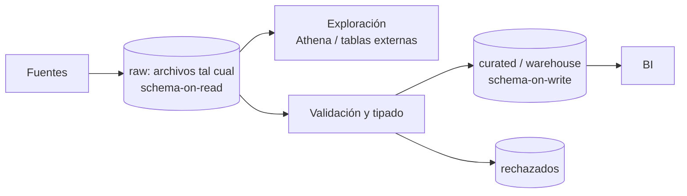

## 1. Resumen

El esquema (columnas y tipos) se puede imponer en dos momentos:

- **Schema-on-write:** al escribir. La carga valida los datos contra el esquema de la tabla y rechaza lo que no cumple. Es el modelo de las bases transaccionales y de los warehouses.
- **Schema-on-read:** al leer. Los archivos se guardan tal como llegan y el esquema se proyecta en la consulta. Es el modelo de Athena sobre S3 o de las tablas externas.

El primero detecta los problemas temprano; el segundo acepta todo y los descubre después. Los lakehouses combinan archivos abiertos con un esquema aplicado al escribir en la tabla.

## 2. Qué es

Es un concepto consolidado sobre el momento de validar la estructura:

| | Schema-on-write | Schema-on-read |
|---|---|---|
| Cuándo se valida | Al cargar | Al consultar |
| Qué pasa con un dato que no cumple | Se rechaza (o falla la carga) | Se guarda; el problema aparece al consultar |
| Costo de cambiar el esquema | Migración de la tabla | Cambiar la definición; los archivos no cambian |
| Ejemplos | OLTP, BigQuery y Redshift al cargar | Athena sobre S3, tablas externas, archivos raw |

Athena lo describe explícitamente: guarda el esquema en el catálogo y lo proyecta sobre los datos al ejecutar la consulta, sin cargar ni transformar.

## 3. Problema que resuelve

Elegir conscientemente el momento evita dos errores. Si se impone el esquema demasiado pronto, una fuente nueva o cambiante obliga a parar la ingesta hasta definir todo. Si se impone demasiado tarde, se acumulan archivos con formatos mezclados que nadie puede consultar con confianza, y los errores aparecen en el tablero, no en la carga.

## 4. Cómo funciona

1. **Schema-on-write:**
   - la tabla tiene un esquema definido, explícito o tomado de formatos autodescriptivos (Parquet, Avro, ORC);
   - la carga convierte y valida;
   - los registros que no cumplen se rechazan o hacen fallar el job, según el umbral (`--max_bad_records` en BigQuery).
2. **Schema-on-read:**
   - los archivos se guardan sin validar;
   - un catálogo define tabla, columnas, formato y ubicación;
   - el motor interpreta los archivos con esa definición en cada consulta.

   Borrar la tabla borra la definición, no los datos.
3. **Mixto (lo habitual):** schema-on-read en la zona raw (aceptar lo que llega) y schema-on-write en curated y en el warehouse, donde el pipeline valida y tipa antes de publicar.

## 5. Cuándo utilizarlo

**Schema-on-write:**
- tablas que consume BI o que alimentan decisiones;
- OLTP y datos con integridad exigida;
- cuando conviene fallar temprano.

**Schema-on-read:**
- zona raw del lake;
- exploración de fuentes nuevas;
- datos semiestructurados cuyo esquema todavía no está claro;
- consultas puntuales sobre archivos sin cargarlos.

## 6. Cuándo no utilizarlo

- Schema-on-read para las tablas de consumo: cada consulta reinterpreta y los errores llegan al usuario final.
- Schema-on-write rígido en la zona de aterrizaje de una fuente que cambia seguido: se pierden datos o se detiene la ingesta.

## 7. Ejemplo sencillo

Llega un archivo con una columna `monto` que trae `"N/D"` en algunas filas.

- **Schema-on-write:** la carga a una tabla con `monto NUMERIC` rechaza esas filas (o falla, según el umbral) y lo sabes en el momento.
- **Schema-on-read:** el archivo se guarda sin problema; el error aparece recién cuando una consulta intenta interpretar `monto` como número, y lo sabes cuando alguien mira el resultado.

## 8. Ejemplo de producción

Un equipo aterriza los exports de socios en S3 (raw) y los registra en el catálogo de Glue: Athena permite explorarlos de inmediato, sin cargarlos (schema-on-read). Un job diario lee esos archivos, valida contra un esquema acordado, aparta los rechazados y escribe la capa curated en Parquet con esquema definido (schema-on-write). Los tableros solo leen la capa curated. Cuando un socio agrega una columna, raw la recibe sin problemas y curated la incorpora tras revisarla.

## 9. Arquitectura



## 10. Código

```sql
-- Athena (schema-on-read): la tabla es solo una definición sobre archivos en S3; nada se carga ni valida.
-- Requiere: archivos Parquet en s3://empresa-lake/raw/pedidos/ y una base de datos raw en el Glue Data Catalog.
CREATE EXTERNAL TABLE IF NOT EXISTS raw.pedidos (
  pedido_id string,
  monto     string,          -- se deja como texto: en raw se acepta lo que llegue
  creado_en string
)
STORED AS PARQUET
LOCATION 's3://empresa-lake/raw/pedidos/';
```

```bash
# BigQuery (schema-on-write): el esquema se impone al cargar; con --max_bad_records=0 (valor por defecto)
# basta una fila inválida para que falle el job completo.
# Requiere: bq autenticado y el dataset curated existente.
bq load --source_format=CSV --skip_leading_rows=1 --replace=true \
  --schema=pedido_id:STRING,monto:NUMERIC,creado_en:TIMESTAMP \
  --max_bad_records=0 \
  curated.pedidos gs://empresa-lake/raw/pedidos/2026-10-04.csv
```

## 11. GCP

En **BigQuery** conviven los dos modelos. Las tablas nativas aplican el esquema al cargar: definido al crear la tabla o en el `bq load`, autodetectado, o tomado de formatos autodescriptivos como Avro, Parquet y ORC. Las **tablas externas** consultan archivos de Cloud Storage sin cargarlos. El umbral `--max_bad_records` decide cuánto se tolera antes de fallar la carga.

## 12. AWS

**Athena** es el ejemplo canónico de schema-on-read: guarda el esquema en el **Glue Data Catalog**, lo proyecta sobre los datos de S3 al consultar, y borrar la tabla solo borra la metadata. **Redshift**, en cambio, carga con `COPY` en una tabla que ya debe existir en la base, con su esquema definido. La misma organización usa los dos según la zona.

## 13. Azure

En **Microsoft Fabric**, un lakehouse separa `Files` (datos tal cual, sin esquema de tabla) y `Tables` (tablas Delta con columnas y tipos registrados). Es la combinación de los dos modelos en un solo lugar. El Warehouse de Fabric, con T-SQL, aplica el esquema al escribir, como un warehouse tradicional.

## 14. Buenas prácticas

- Schema-on-read en la zona de aterrizaje y schema-on-write en las capas que se consumen.
- Definir el esquema de las tablas publicadas en código (DDL o modelos) y versionarlo.
- Umbral explícito de registros inválidos y rechazados guardados con su motivo.
- Preferir formatos autodescriptivos (Parquet, Avro) aun en raw: llevan su esquema.
- **Seguridad:** la zona schema-on-read suele tener datos sin clasificar; restringir su acceso más que el de las capas validadas.
- **Observabilidad:** contar rechazados por carga y vigilar columnas nuevas o desaparecidas en raw.
- **Costo:** schema-on-read evita cargar, pero cada consulta lee e interpreta los archivos; para uso recurrente, cargar o convertir a formatos columnares suele salir más barato.

## 15. Errores frecuentes

- Tableros que leen directamente la zona raw con schema-on-read.
- Esquema rígido en la ingesta que descarta columnas nuevas sin avisar.
- Tipar todo como texto "para que no falle" y trasladar el problema a cada consulta.
- Borrar una tabla externa creyendo que se borran los datos, o al revés.

## 16. Trade-offs

Schema-on-write da calidad y consultas confiables, a cambio de rigidez y de definir el esquema antes de cargar. Schema-on-read da flexibilidad y rapidez de aterrizaje, a cambio de errores tardíos y de reinterpretar en cada lectura. La combinación por zonas toma lo mejor de cada uno.

## 17. Conceptos relacionados

- `data-lake` y `data-warehouse`: dónde suele aplicarse cada modelo.
- `lakehouse`: esquema al escribir sobre archivos abiertos.
- `schema-evolution`: cómo cambian los esquemas.
- `oltp-vs-olap`: el esquema en escritura de OLTP.

## 18. Preguntas técnicas abiertas

1. ¿Qué umbral de registros inválidos aceptarías en la carga de una tabla de ventas?
2. ¿En qué momento de tu pipeline conviene pasar de schema-on-read a schema-on-write?
3. ¿Qué harías con una columna nueva que aparece en raw?

## 19. Laboratorio relacionado

Pendiente (F4).

## 20. Fuentes

- AWS: *Create tables in Athena* y *CREATE TABLE* (Amazon Athena); *COPY* (Amazon Redshift).
- Microsoft Learn: *Online transaction processing (OLTP)* y *What is a lakehouse?*
- Google Cloud: *Specify a schema*, *bq command-line tool reference* e *Introduction to external data sources* (BigQuery).

El detalle de cada fuente está en `sources` del frontmatter.

## 21. Fecha de última verificación

2026-10-05. En `review_required` hasta la revisión B-F3.1 del lote F3b-01a.

## 22. Historial de cambios importantes

- 2026-10-05: creación (lote F3b-01a, dominio 01-fundamentals).
- 2026-10-06: revisión B-F3.1 del lote F3b-01a aplicada (docs/reviews/cards-f3b-01a.md): COPY de Redshift con fuente.
