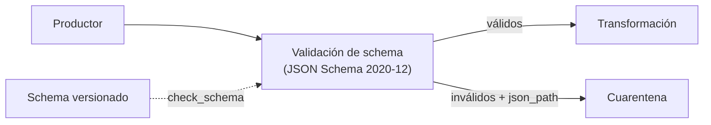

## 1. Resumen

Validar el schema es comprobar, registro por registro, que lo que llega tiene la forma acordada: campos obligatorios, tipos, rangos, valores permitidos y ningún campo de más. Es el control más barato de un pipeline y el primero: un registro que no cumple el schema no debería llegar a la transformación.

Esta ficha usa **JSON Schema 2020-12** con la biblioteca **jsonschema** de Python. Tres detalles evitan sorpresas:

- el **schema mismo** se valida primero (`check_schema`);
- se piden **todos los errores** con su ruta (`iter_errors`), no solo el primero;
- **`format`** (por ejemplo, `date`) es una anotación: no se comprueba salvo que se active.

## 2. Qué es

- **Schema:** la descripción de la forma válida de un registro.
- **Instancia:** el registro que se valida.
- **Keywords de validación:** `type`, `required`, `enum`, `minimum`, `pattern`, `additionalProperties`, entre otros (*JSON Schema Validation*).
- **Error de validación:** qué keyword falló y en qué ruta de la instancia (*Handling Validation Errors*).
- **Metaschema:** el schema de los schemas; `check_schema` lo usa para detectar un schema mal escrito.

## 3. Problema que resuelve

Una API de pedidos empieza a mandar `"monto": "120"` como texto y un campo nuevo `canal`. El pipeline los acepta, la suma de montos falla tres etapas después y nadie sabe desde cuándo. Con validación de schema en la entrada, el primer registro con `monto` de texto se rechaza con `$.monto type`, y el campo nuevo aparece como `additionalProperties`: el cambio se ve el mismo día.

## 4. Cómo funciona

1. El schema se escribe una vez, con la versión declarada en `$schema`.
2. `Draft202012Validator.check_schema(SCHEMA)` lo valida contra el metaschema.
3. Por cada registro, `iter_errors` entrega todos los errores; cada uno trae `json_path` y `validator`.
4. Los registros con errores van a un destino aparte (cuarentena o dead-letter), con el detalle; los válidos siguen.
5. Si los formatos importan (fechas, emails), se pasa `format_checker`: por defecto, `format` no se hace cumplir (*JSON Schema Validation*, *Schema Validation*).

## 5. Cuándo utilizarlo

- En el borde de la ingesta: APIs, eventos, archivos JSON de terceros.
- Cuando el schema se comparte con el productor (un contrato de datos).
- Antes de cualquier regla de negocio: si la forma está mal, no tiene sentido evaluar lo demás.

## 6. Cuándo no utilizarlo

- Como único control de calidad: un registro con la forma correcta puede tener valores inexactos o duplicados.
- Para reglas entre registros o entre tablas (unicidad, consistencia con un maestro): no son de schema.
- Con un schema tan laxo (todo opcional, extra permitido) que no rechaza nada.

## 7. Ejemplo sencillo

Un schema de pedidos con `id` (patrón `P` y dígitos), `monto` (número no negativo), `moneda` (`CLP` o `USD`) y `fecha` (`format: date`), sin campos extra. Cuatro registros:

| Registro | Errores |
|---|---|
| `P1` | ninguno |
| `P2` | `$.moneda enum`; `$.monto minimum` |
| `P3` | `$ additionalProperties` (trae `canal`) |
| `P4` | `$ required` (falta `monto`); `$.fecha format` (`2026-02-30`) |

La fecha imposible `2026-02-30` pasa sin `format_checker` y falla con él.

## 8. Ejemplo de producción

Eventos de pedidos desde una API de terceros:

- el schema JSON se versiona en el repositorio y se revisa en cada PR, con `check_schema` en la CI;
- el consumidor valida cada evento con `format_checker`;
- los inválidos van a una tabla de cuarentena con `json_path`, `validator` y el evento original;
- una métrica cuenta rechazos por keyword: un salto en `additionalProperties` avisa de un cambio del productor.

## 9. Arquitectura



## 10. Código

```python
"""Valida registros JSON contra un JSON Schema 2020-12 y reporta cada error con su ruta."""
from typing import Any

from jsonschema import Draft202012Validator

SCHEMA: dict[str, Any] = {
    "$schema": "https://json-schema.org/draft/2020-12/schema",
    "type": "object",
    "required": ["id", "monto", "moneda", "fecha"],
    "properties": {
        "id": {"type": "string", "pattern": "^P[0-9]+$"},
        "monto": {"type": "number", "minimum": 0},
        "moneda": {"enum": ["CLP", "USD"]},
        "fecha": {"type": "string", "format": "date"},
    },
    "additionalProperties": False,
}
REGISTROS: list[dict[str, Any]] = [
    {"id": "P1", "monto": 120, "moneda": "CLP", "fecha": "2026-10-20"},
    {"id": "P2", "monto": -1, "moneda": "EUR", "fecha": "2026-10-20"},
    {"id": "P3", "monto": 10, "moneda": "CLP", "fecha": "2026-10-20", "canal": "web"},
    {"id": "P4", "moneda": "CLP", "fecha": "2026-02-30"},
]

Draft202012Validator.check_schema(SCHEMA)   # primero, el schema mismo es válido
sin_formato = Draft202012Validator(SCHEMA)
con_formato = Draft202012Validator(SCHEMA, format_checker=Draft202012Validator.FORMAT_CHECKER)

for registro in REGISTROS:
    errores = sorted(con_formato.iter_errors(registro), key=lambda e: (e.json_path, e.validator))
    detalle = [f"{e.json_path} {e.validator}" for e in errores]
    print(f"{registro['id']}: {'ok' if not detalle else '; '.join(detalle)}")

fecha_imposible = {"id": "P5", "monto": 1, "moneda": "CLP", "fecha": "2026-02-30"}
print(f"2026-02-30 sin format_checker: válido={sin_formato.is_valid(fecha_imposible)}")
print(f"2026-02-30 con format_checker: válido={con_formato.is_valid(fecha_imposible)}")
```

El script se **ejecuta en la CI** con la biblioteca `jsonschema` que ya instala el proyecto (`requirements.txt`). Imprime `P2: $.moneda enum; $.monto minimum`, `P3: $ additionalProperties`, `P4: $ required; $.fecha format`, y que `2026-02-30` es válido sin `format_checker` y no válido con él. No pasa por `mypy --strict`: `jsonschema` no trae sus tipos y el proyecto no instala stubs aparte.

## 11. GCP

En GCP, **Pub/Sub** valida los mensajes contra el schema del tema. Según *JSON Schema Validation*, *Schema Validation* y *Schema overview* (no ejecutado):

| | JSON Schema con jsonschema | Pub/Sub |
|---|---|---|
| Formatos | JSON Schema (aquí, draft 2020-12) | Avro y Protocol Buffer |
| Dónde se valida | En el código del consumidor o del productor | En el servicio, al publicar: un mensaje que no cumple el schema no se publica |
| Qué no valida | `format`, salvo que se active | Los valores por defecto de Avro |

## 12. AWS

En AWS, **AWS Glue Schema Registry**. Según *Schema Validation* y *AWS Glue Schema registry* (no ejecutado):

| | JSON Schema con jsonschema | Glue Schema Registry |
|---|---|---|
| Formatos | JSON Schema 2020-12 con `Draft202012Validator` | Avro, JSON Schema (Draft-04, 06 y 07, con la biblioteca Everit) y Protobuf |
| Versiones del schema | Las maneja el equipo en el repositorio | Modos de compatibilidad entre versiones (BACKWARD, FORWARD, FULL, NONE, entre otros) |
| Consecuencia | Un schema escrito para 2020-12 hay que revisarlo antes de registrarlo | La página nombra Draft-04, 06 y 07; no nombra 2020-12 |

## 13. Azure

En Azure, el **Schema Registry de Event Hubs**. Según *Schema Validation* y *Schema Registry in Azure Event Hubs* (no ejecutado):

| | JSON Schema con jsonschema | Schema Registry de Event Hubs |
|---|---|---|
| Formatos | JSON Schema 2020-12 | Avro, JSON Schema y Protocol Buffers |
| Compatibilidad | La maneja el equipo | Se fija por schema group; la evolución de schemas solo se admite para Avro |

## 14. Buenas prácticas

- Declarar `$schema` y validar el schema con `check_schema` en la CI.
- `additionalProperties: false` cuando el contrato es cerrado; si no, decidirlo explícitamente.
- Activar `format_checker` si los formatos importan.
- Guardar `json_path` y `validator` de cada rechazo.
- **Seguridad:** el registro rechazado puede traer datos personales; la cuarentena tiene los mismos permisos que la tabla de destino.
- **Observabilidad:** contar rechazos por keyword y por versión del schema.
- **Costo:** validar en el borde evita reprocesar lotes enteros después.

## 15. Errores frecuentes

- Suponer que `format: date` rechaza fechas imposibles sin activar el checker.
- Quedarse con el primer error (`validate`) y perder los demás.
- Un schema inválido que nadie validó y que acepta todo.
- Escribir el schema en un draft y registrarlo en un servicio que documenta otros.

## 16. Trade-offs

Un schema estricto detecta antes los cambios del productor y rechaza más; uno laxo acepta cambios sin aviso. Validar en el servicio (Pub/Sub) protege a todos los consumidores pero limita los formatos; validar en el código da más control y hay que hacerlo en cada consumidor.

## 17. Conceptos relacionados

- `data-contracts`: el contrato que el schema hace verificable.
- `schema-evolution`: cambios de schema.
- `data-validation-with-pydantic`: validación con modelos tipados.
- `avro-format`: schemas Avro.
- `dead-letter-queue`: destino de los rechazados.
- `data-quality-dimensions`: la validez como dimensión.
- `quality-gate`: dónde va la validación en el pipeline.

## 18. Preguntas técnicas abiertas

1. ¿Tus schemas declaran qué versión de JSON Schema usan?
2. ¿Qué pasa hoy con un campo nuevo que manda el productor?
3. ¿Tu validador comprueba los formatos o solo los anota?

## 19. Laboratorio relacionado

Pendiente (F4).

## 20. Fuentes

- JSON Schema: *JSON Schema Validation: A Vocabulary for Structural Validation of JSON* (Draft 2020-12).
- jsonschema (Python): *Schema Validation* y *Handling Validation Errors*.
- Google Cloud: *Schema overview* (Pub/Sub).
- AWS: *AWS Glue Schema registry*.
- Microsoft Learn: *Schema Registry in Azure Event Hubs*.

El detalle de cada fuente está en `sources` del frontmatter.

## 21. Fecha de última verificación

2026-10-20. Pasa a `verified`: revisión B-F3.1 del lote F3b-15a sin hallazgos, sin VERIFY pendientes.

## 22. Historial de cambios importantes

- 2026-10-20: creación (lote F3b-15a).
- 2026-10-20: revisión B-F3.1 del lote F3b-15a (docs/reviews/cards-f3b-15a.md), sin hallazgos que corregir.
- 2026-10-20: `verification_status: verified` (sin VERIFY pendientes).
