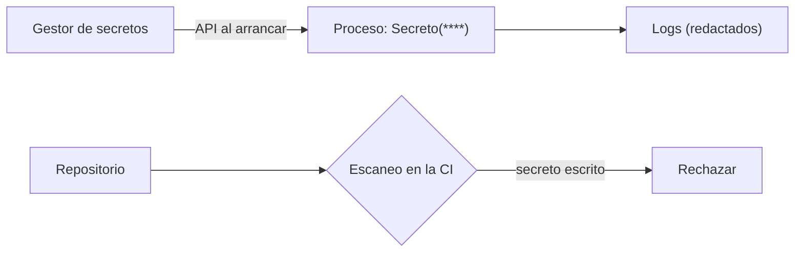

## 1. Resumen

Un **secreto** (contraseña, token, API key) se guarda en un **gestor de secretos**, llega al proceso **en tiempo de ejecución** y nunca queda en el código, en el repositorio ni en los logs. En el código de un pipeline eso se traduce en cuatro reglas:

- **leerlo al arrancar** (del gestor, o del entorno si la plataforma lo inyecta así) y fallar si falta;
- **no mostrarlo**: ni en `repr`, ni en un log, ni en un mensaje de error;
- **buscar secretos escritos** en el repositorio, en la CI;
- **rotarlos**, o mejor, no tenerlos: las credenciales temporales de la plataforma (`service-accounts`) no son secretos que guardar.

`gcp-secret-manager-usage`, `key-vault-secrets` y `ci-cd-secrets` tratan cada herramienta; esta ficha, lo que hace el código.

## 2. Qué es

- **Gestor de secretos:** guarda, controla el acceso, versiona y rota secretos.
- **Entrega:** el proceso lee el valor del gestor por su API, o la plataforma lo inyecta como variable de entorno o archivo montado. La guía de Secret Manager dice «Avoid passing secrets to your application through the file system or through the environment variables», salvo en algunas integraciones de productos, como las serverless (*Secret Manager best practices*).
- **Redacción:** reemplazar el valor por `****` donde pueda aparecer.
- **Escaneo:** buscar patrones de secretos en el código antes de que lleguen al repositorio.

## 3. Problema que resuelve

La contraseña de la base de origen está en `config.py`, en el repositorio, desde hace dos años; todos los que clonaron el repo la tienen, y un log de error la imprimió en un ticket. Con el secreto en el gestor, el código lo lee al arrancar, el log lo tapa y la CI rechaza el `config.py` viejo.

## 4. Cómo funciona

1. El secreto vive en el gestor, con acceso solo para la cuenta del pipeline.
2. El proceso lo lee del gestor por su API (o la plataforma lo inyecta, si no hay otra vía).
3. El código lo envuelve en un tipo que no se imprime y lo lee una vez al arrancar; si falta, termina.
4. Un filtro de logging redacta su valor por si alguien lo pasa a un mensaje.
5. La CI busca patrones como `password = "..."` en el código.
6. El gestor lo rota; el proceso lo vuelve a leer al reiniciar.

## 5. Cuándo utilizarlo

- Para toda credencial que no pueda reemplazarse por una identidad de la plataforma.
- En la CI, junto con escaneo del repositorio.

## 6. Cuándo no utilizarlo

- Para claves de cifrado: van en un KMS (`key-management`), no en un gestor de secretos.
- Cuando la plataforma da credenciales temporales: mejor usarlas que guardar un secreto.

## 7. Ejemplo sencillo

| Prueba | Resultado |
|---|---|
| `repr` del secreto | `Secreto(****)` |
| Un log que intenta imprimirlo | `conectando con password=****` |
| Falta `API_TOKEN` | el proceso no arranca |
| Escaneo del repositorio | `viejo.py` tiene un secreto escrito |

## 8. Ejemplo de producción

- Un secreto por sistema y entorno, en el gestor; acceso por cuenta de servicio.
- Lectura por la API del gestor al arrancar el job; nada en archivos de configuración versionados.
- Filtro de redacción en el logger común de los pipelines.
- Escaneo de secretos en la CI y en un hook de pre-commit.
- Rotación automática en el gestor y reinicio de los procesos que lo usan.

## 9. Arquitectura



## 10. Código

```python
"""Un secreto llega al proceso por el entorno (lo pone el gestor de secretos o la plataforma), nunca escrito en el código.

Si falta, el proceso falla al arrancar; no aparece en repr ni en logs; y se valida que el repositorio no tenga secretos.
"""
import logging
import os
import re
import secrets
import sys
from io import StringIO


class Secreto:
    def __init__(self, valor: str) -> None:
        self._valor = valor

    def revelar(self) -> str:
        return self._valor

    def __repr__(self) -> str:
        return "Secreto(****)"

    __str__ = __repr__


def requerido(nombre: str) -> Secreto:
    valor = os.environ.get(nombre)
    if not valor:
        raise SystemExit(f"falta la variable {nombre}: el proceso no arranca sin ella")
    return Secreto(valor)


class Redactar(logging.Filter):
    def __init__(self, *valores: str) -> None:
        super().__init__()
        self.valores = valores

    def filter(self, record: logging.LogRecord) -> bool:
        mensaje = record.getMessage()
        for v in self.valores:
            mensaje = mensaje.replace(v, "****")
        record.msg, record.args = mensaje, ()
        return True


os.environ["DB_PASSWORD"] = secrets.token_urlsafe(24)   # en producción lo pone la plataforma, no el código
clave = requerido("DB_PASSWORD")
salida = StringIO()
log = logging.getLogger("pipeline")
handler = logging.StreamHandler(salida)
handler.addFilter(Redactar(clave.revelar()))
log.addHandler(handler)
log.setLevel(logging.INFO)

print("repr del secreto:", repr(clave))
log.info("conectando con password=%s", clave.revelar())     # un descuido: el filtro lo tapa
print("log:", salida.getvalue().strip())
try:
    requerido("API_TOKEN")
except SystemExit as exc:
    print("sin API_TOKEN:", exc)

PATRON = re.compile(r"(?i)(password|secret|token)\s*=\s*['\"][^'\"]{8,}['\"]")
archivos = {"config.py": 'DB_HOST = "db"\nDB_PASSWORD = os.environ["DB_PASSWORD"]\n',
            "viejo.py": 'password = "SuperSecreta2024"\n'}
print("archivos con secretos escritos:", [n for n, texto in archivos.items() if PATRON.search(texto)])
sys.stdout.flush()
```

El script se **ejecuta en la CI** y pasa `mypy --strict`. Imprime `repr del secreto: Secreto(****)`, el log redactado `conectando con password=****`, el error por la variable que falta y `archivos con secretos escritos: ['viejo.py']`. El secreto de prueba se genera con el módulo `secrets` (*secrets*), no con `random`. El ejemplo lo lee de una variable de entorno para no depender de un gestor real; en producción, la guía de Secret Manager dice «Avoid passing secrets to your application through the file system or through the environment variables» y recomienda la API; la excepción son algunas integraciones de productos, como las serverless (*Secret Manager best practices*).

## 11. GCP

En GCP, **Secret Manager**. Según *secrets*, *Secret Manager overview* y *Secret Manager best practices* (no ejecutado):

| | Código (este ejemplo) | Secret Manager |
|---|---|---|
| Dónde vive | Variable de entorno | Secretos con versiones; se referencian por número de versión, no por el alias `latest` |
| Entrega | Variable de entorno | «Avoid passing secrets to your application through the file system or through the environment variables»; usar la API con las bibliotecas cliente. Excepción: algunas integraciones de productos, como las serverless, pueden pasarlos por archivos o variables de entorno |
| Acceso | La cuenta del proceso | IAM con mínimo privilegio; separar aplicaciones y entornos en proyectos distintos |

## 12. AWS

En AWS, **AWS Secrets Manager**. Según *secrets*, *What is AWS Secrets Manager?* y *Rotate AWS Secrets Manager secrets* (no ejecutado):

| | Código (este ejemplo) | AWS Secrets Manager |
|---|---|---|
| Ciclo de vida | El proceso lo lee al arrancar | Administra, recupera y rota secretos durante su ciclo de vida |
| Rotación | Reiniciar el proceso | Rotar es actualizar el secreto en el gestor y en la base o el servicio; admite rotación automática |

## 13. Azure

En Azure, **Azure Key Vault**. Según *secrets* y *About Azure Key Vault* (no ejecutado):

| | Código (este ejemplo) | Azure Key Vault |
|---|---|---|
| Qué guarda | Un secreto | Secretos, claves y certificados, con control de acceso |

## 14. Buenas prácticas

- Nada de secretos en el código, el repositorio ni las imágenes.
- Fallar al arrancar si falta un secreto.
- Redactar en logs; tipos que no se imprimen.
- Escaneo de secretos en la CI. La guía de GitHub Actions advierte que la redacción busca coincidencias exactas, así que no conviene usar JSON o YAML como secreto (*Secure use reference*).
- **Seguridad:** credenciales temporales donde la plataforma las da; secretos solo donde no hay alternativa.
- **Observabilidad:** auditoría de lecturas del gestor.
- **Costo:** un secreto filtrado obliga a rotar en todos lados; prevenir cuesta menos.

## 15. Errores frecuentes

- Un `.env` con secretos en el repositorio.
- Imprimir el objeto de configuración completo al arrancar.
- Secretos que nunca rotan.

## 16. Trade-offs

Un gestor de secretos centraliza y audita, y agrega una dependencia al arrancar. Leer por la API evita que el valor quede en el entorno del proceso, a cambio de acoplar el código al cliente del gestor. Las credenciales temporales eliminan la rotación y atan el proceso a la plataforma.

## 17. Conceptos relacionados

- `ci-cd-secrets`: secretos en la CI.
- `service-accounts`: identidades sin secretos.
- `gcp-secret-manager-usage`, `key-vault-secrets`: cada herramienta.
- `key-management`: claves de cifrado.

## 18. Preguntas técnicas abiertas

1. ¿Hay secretos en el historial de tu repositorio?
2. ¿Tus logs pueden imprimir una credencial?
3. ¿Cuándo rotó por última vez la contraseña de tu base de origen?

## 19. Laboratorio relacionado

Pendiente (F4).

## 20. Fuentes

- Python 3.12: *secrets — Generate secure random numbers for managing secrets*.
- Google Cloud: *Secret Manager overview* y *Secret Manager best practices*.
- AWS: *What is AWS Secrets Manager?* y *Rotate AWS Secrets Manager secrets*.
- Microsoft Learn: *About Azure Key Vault*.
- GitHub: *Secure use reference*.

El detalle de cada fuente está en `sources` del frontmatter.

## 21. Fecha de última verificación

2026-10-21. `review_required`: pendiente de revisión B-F3.1 del lote F3b-18b.

## 22. Historial de cambios importantes

- 2026-10-21: creación (lote F3b-18b).
- 2026-10-21: revisión B-F3.1 (`cards-f3b-18b.md`): la indicación de Secret Manager sobre archivos y variables de entorno se cita textual, con la excepción de las integraciones serverless.
