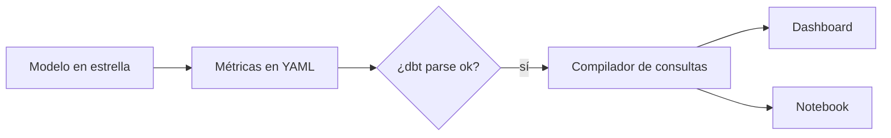

## 1. Resumen

Tres dashboards muestran «ingresos» con tres números distintos porque cada uno tiene su SQL: uno resta devoluciones, otro no, otro filtra pedidos anulados. Una **semantic layer** define cada métrica **una vez**, versionada junto al modelo, y todas las herramientas la consultan en lugar de reescribirla. dbt lo dice así: centralizar las definiciones asegura acceso consistente desde las herramientas aguas abajo (*dbt Semantic Layer*).

`semantic-models` explica la estructura del modelo (entidades, dimensiones, medidas). Esta ficha es la **capa de métricas gobernadas** encima: quién define, dónde vive, cómo se valida y cómo se consulta. Lo que evoluciona (capas semánticas para agentes) está en el dominio 23.

## 2. Qué es

- **Métrica definida una vez:** nombre, fórmula, agregación y dimensiones permitidas.
- **Tipos:** simples (una medida), de razón (numerador entre denominador), acumuladas o derivadas.
- **Versionada:** vive en el repositorio con el modelo (`analytics-engineering`).
- **Validada:** el build falla si una métrica referencia una medida o dimensión que no existe.
- **Consultada por nombre:** la herramienta pide «ingresos por región» y la capa arma el SQL.

## 3. Problema que resuelve

Finanzas y comercial discuten en cada comité porque sus ingresos no calzan. Con la métrica definida una vez, la discusión pasa a ser sobre la definición, que es una línea de código revisable, y no sobre qué dashboard tiene razón.

## 4. Cómo funciona

1. El modelo en estrella está construido y probado (`star-schema`).
2. Se declaran semantic models (entidades, dimensiones, medidas) y métricas en YAML.
3. El build valida las referencias y genera un manifiesto semántico.
4. Cada herramienta pide métricas por dimensión; la capa compila el SQL.
5. Un cambio de definición pasa por revisión como cualquier código.

## 5. Cuándo utilizarlo

- Métricas que se usan en varios dashboards, notebooks o herramientas.
- Cuando dos equipos reportan números distintos para lo mismo.
- Antes de exponer métricas a asistentes en lenguaje natural.

## 6. Cuándo no utilizarlo

- Con un solo dashboard y una sola consulta: la capa cuesta más de lo que ordena.
- Sobre un modelo sin probar: la capa repite rápido un número equivocado.

## 7. Ejemplo sencillo

| Consulta | Resultado |
|---|---|
| Métricas definidas | `cantidad_pedidos`, `ingresos`, `ticket_promedio` |
| Ingresos y ticket por región (dashboard) | norte: 160.0 y 80.0; sur: 40.0 y 40.0 |
| La misma consulta desde un notebook | Mismo resultado |
| Pedir `margen` | Rechazada: métrica no definida |

## 8. Ejemplo de producción

Métricas comerciales:

- semantic models y métricas en el proyecto dbt, con dueño por métrica;
- validación en cada pull request (`dbt parse` y build);
- BI y notebooks que consultan por nombre de métrica;
- catálogo con la definición publicada (`metadata-management`);
- en la nube (no ejecutado): dbt Semantic Layer, LookML en Looker, Topics de Amazon Quick o semantic models de Power BI en Fabric.

## 9. Arquitectura



## 10. Código

```python
# Python 3.12, dbt Core 1.12 y dbt-postgres 1.11 contra PostgreSQL 17 (ejecutado en la CI; ADR-018): una capa de
# métricas gobernadas. Las métricas se definen una vez en el proyecto dbt (semantic model y metrics); dbt parse las
# valida y deja target/semantic_manifest.json. Un compilador propio, de juguete, lee ese manifiesto y arma el SQL de
# cualquier consulta «métricas por dimensión»: el dashboard y el notebook piden lo mismo y obtienen lo mismo. Una
# métrica que no está definida se rechaza. PG_HOST, PG_PORT, PG_USER, PG_PASSWORD y PG_DB: base vacía de la CI.
from __future__ import annotations

import json
import os
import sys
import tempfile
from pathlib import Path
from typing import Any

import psycopg
from dbt.cli.main import dbtRunner

FILES = {
    "dbt_project.yml": "name: ventas\nversion: '1.0.0'\nprofile: ventas\n",
    "profiles.yml": """
ventas:
  target: ci
  outputs:
    ci:
      type: postgres
      host: "{{ env_var('PG_HOST') }}"
      port: "{{ env_var('PG_PORT') | int }}"
      user: "{{ env_var('PG_USER') }}"
      password: "{{ env_var('PG_PASSWORD') }}"
      dbname: "{{ env_var('PG_DB') }}"
      schema: analytics
      threads: 1
""",
    "seeds/raw_pedidos.csv": "pedido_id,fecha,region,monto\n1,2026-10-01,norte,100\n2,2026-10-01,sur,40\n3,2026-10-02,norte,60\n",
    "models/pedidos.sql": "select pedido_id, fecha::date as fecha, region, monto::numeric from {{ ref('raw_pedidos') }}\n",
    "models/time_spine_daily.sql": "select d::date as date_day from generate_series('2026-01-01'::date, '2026-12-31'::date, interval '1 day') as d\n",
    "models/metricas.yml": """
models:
  - name: time_spine_daily                 # MetricFlow exige un time spine diario
    time_spine: {standard_granularity_column: date_day}
    columns: [{name: date_day, granularity: day}]
semantic_models:
  - name: pedidos
    model: ref('pedidos')
    defaults: {agg_time_dimension: fecha}
    entities: [{name: pedido, type: primary, expr: pedido_id}]
    dimensions:
      - {name: region, type: categorical}
      - {name: fecha, type: time, type_params: {time_granularity: day}}
    measures:
      - {name: monto_total, agg: sum, expr: monto}
      - {name: pedidos, agg: count, expr: pedido_id}
metrics:
  - {name: ingresos, label: Ingresos, type: simple, type_params: {measure: monto_total}}
  - {name: cantidad_pedidos, label: Pedidos, type: simple, type_params: {measure: pedidos}}
  - name: ticket_promedio
    label: Ticket promedio
    type: ratio
    type_params: {numerator: ingresos, denominator: cantidad_pedidos}
""",
}
AGG = {"sum": "sum({})", "count": "count({})"}


def compile_query(manifest: dict[str, Any], metrics: list[str], by: str) -> str:
    """Arma SQL para métricas simples y de razón de un único semantic model (el compilador real es MetricFlow)."""
    (sm,) = manifest["semantic_models"]                               # un único semantic model
    measures = {m["name"]: AGG[m["agg"]].format(m["expr"]) for m in sm["measures"]}
    defined = {m["name"]: m for m in manifest["metrics"]}

    def expr(name: str) -> str:
        if name not in defined:
            raise KeyError(f"métrica no definida: {name}")
        params: dict[str, Any] = defined[name]["type_params"]
        if defined[name]["type"] == "simple":
            return str(measures[params["measure"]["name"]])
        return f"{expr(params['numerator']['name'])}::numeric / nullif({expr(params['denominator']['name'])}, 0)"

    relation = str(sm["node_relation"]["relation_name"])
    cols = ", ".join(f"round({expr(m)}, 2) as {m}" for m in metrics)
    return f"select {by}, {cols} from {relation} group by {by} order by {by}"


project = Path(sys.argv[1] if len(sys.argv) > 1 else tempfile.mkdtemp())
for name, text in FILES.items():
    (project / name).parent.mkdir(parents=True, exist_ok=True)
    (project / name).write_text(text.lstrip("\n"), encoding="utf-8")
args = ["--project-dir", str(project), "--profiles-dir", str(project), "--quiet"]
runner = dbtRunner()
assert runner.invoke(["build", *args]).success
assert runner.invoke(["parse", *args]).success                       # valida semantic models y métricas
manifest = json.loads((project / "target" / "semantic_manifest.json").read_text(encoding="utf-8"))
print("métricas definidas:", sorted(m["name"] for m in manifest["metrics"]))

dashboard = compile_query(manifest, ["ingresos", "ticket_promedio"], by="region")
notebook = compile_query(manifest, ["ingresos", "ticket_promedio"], by="region")
with psycopg.connect(host=os.environ["PG_HOST"], port=os.environ["PG_PORT"], user=os.environ["PG_USER"],
                     password=os.environ["PG_PASSWORD"], dbname=os.environ["PG_DB"]) as conn:
    a = [(r, float(i), float(t)) for r, i, t in conn.execute(dashboard).fetchall()]
    b = [(r, float(i), float(t)) for r, i, t in conn.execute(notebook).fetchall()]
print("dashboard:", a)
print("mismo resultado en el notebook:", a == b)
try:
    compile_query(manifest, ["margen"], by="region")
except KeyError as exc:
    print("rechazada:", exc.args[0])
```

El script se **ejecuta en la CI con dbt Core 1.12 y dbt-postgres 1.11 contra el servicio postgres:17** (ADR-018) y pasa `mypy --strict`. `dbt parse` valida el semantic model, las tres métricas y el time spine diario que MetricFlow exige. El compilador lee `semantic_manifest.json` y arma el SQL; imprime las cuatro líneas del §7. El compilador es de juguete (métricas simples y de razón sobre un único semantic model): el compilador real de dbt es MetricFlow, que no se ejecuta aquí.

## 11. GCP

En GCP, **LookML** de Looker. Según *Introduction to LookML* (no ejecutado):

| | Este concepto | LookML |
|---|---|---|
| Definición | YAML de dbt | Modelo LookML |
| Consulta | Compilador | Looker construye el SQL contra la base |
| Reutilización | Una definición por métrica | Cada expresión SQL se escribe una vez, en un lugar |

## 12. AWS

En AWS, **Topics** de Amazon Quick; la página aún escribe «Quick Sight» en el texto. Según *How Topics work - Amazon Quick* (no ejecutado):

| | Este concepto | Topics de Amazon Quick |
|---|---|---|
| Qué se define | Métricas y dimensiones | Metadata semántica: descripciones, sinónimos, tipos semánticos y campos calculados |
| Origen de la metadata | El proyecto dbt | Quick Sight, AWS Glue Data Catalog o Databricks Unity Catalog |

## 13. Azure

En Azure, los **semantic models de Power BI** en Microsoft Fabric. Según *Power BI semantic models in Microsoft Fabric* (no ejecutado):

| | Este concepto | Power BI semantic model |
|---|---|---|
| Qué es | Capa de métricas | Descripción lógica de un dominio con métricas y terminología de negocio |
| Modelo | Estrella | Típicamente un esquema en estrella con hechos y dimensiones |

## 14. Buenas prácticas

- Una definición por métrica, con dueño.
- Cambios de definición por pull request y con aviso a los consumidores.
- Validar en la CI antes de publicar.
- **Seguridad:** las métricas heredan los permisos del modelo; no exponer por la capa lo que el usuario no puede leer.
- **Observabilidad:** métricas más consultadas y consultas que fallan.
- **Costo:** precalcular las métricas más consultadas en lugar de recalcularlas en cada dashboard.

## 15. Errores frecuentes

- Definir la misma métrica en la capa y en cada dashboard.
- Cambiar una definición sin versionarla ni avisar.
- Capas semánticas sobre modelos sin tests.
- Llamar «semantic layer» a una lista de consultas guardadas.

## 16. Trade-offs

Una sola definición da consistencia y obliga a acordar entre equipos. Una capa atada a una herramienta es simple dentro de ella y difícil de reutilizar fuera; una capa independiente sirve a varias herramientas y suma una pieza a operar.

## 17. Conceptos relacionados

- `semantic-models`: la estructura.
- `analytics-engineering` y `star-schema`: el modelo debajo.
- `metadata-management`: las definiciones publicadas.
- Pendiente de ficha: `emerging-semantic-layers` (dominio 23).

## 18. Preguntas técnicas abiertas

1. ¿Qué métrica de tu empresa tiene más de una definición?
2. ¿Quién debería ser el dueño de esa métrica?
3. ¿Qué herramientas consultarían la capa?

## 19. Laboratorio relacionado

Pendiente (F4).

## 20. Fuentes

- dbt: *dbt Semantic Layer* y *MetricFlow time spine*.
- Google Cloud: *Introduction to LookML*.
- AWS: *How Topics work - Amazon Quick*.
- Microsoft Learn: *Power BI semantic models in Microsoft Fabric*.

El detalle de cada fuente está en `sources` del frontmatter.

## 21. Fecha de última verificación

2026-10-26. `review_required`: pendiente de revisión B-F3.1 del lote F3b-22b.

## 22. Historial de cambios importantes

- 2026-10-26: creación (lote F3b-22b).
- 2026-10-27: revisión B-F3.1 del lote F3b-22b aplicada (docs/reviews/cards-f3b-22b.md): el producto se nombra «Amazon Quick» y se aclara que la página aún usa «Quick Sight» en el texto; `page_title` «How Topics work - Amazon Quick».
