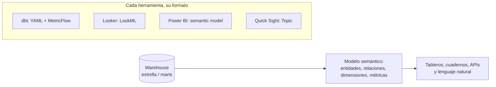

## 1. Resumen

«Modelo semántico» designa en cada herramienta algo distinto, aunque con una idea común: describir **una vez**, sobre las tablas, qué entidades hay, cómo se relacionan y cómo se calculan las métricas, para que todos los consumidores obtengan los mismos números. Esta ficha no los trata como lo mismo. Cada significado se atribuye a su herramienta:

- **Power BI:** el semantic model es la fuente de datos lista para reportes.
- **dbt:** los semantic models alimentan MetricFlow y el Semantic Layer.
- **Looker:** el modelo se escribe en LookML.
- **Amazon Quick Sight:** el Topic es su «capa semántica multi-dataset».

## 2. Qué es

Lo común:

- **entidades y relaciones:** qué tablas se unen y por qué claves;
- **dimensiones:** por qué se puede agrupar o filtrar;
- **métricas o medidas:** cómo se agrega cada número.

Esas definiciones viven en la herramienta y no en cada consulta.

Lo propio de cada herramienta, según su documentación:

- **Power BI:**
  - un semantic model es una fuente de datos lista para reportes y visualización;
  - salvo los de streaming, usa las tecnologías de modelado de Analysis Services;
  - la documentación usa a veces «semantic model» y «model» como sinónimos.
- **dbt:**
  - los semantic models son nodos de un grafo semántico, conectados por entidades;
  - se definen en YAML sobre los modelos dbt y son la base de MetricFlow, que impulsa el Semantic Layer y resuelve los joins al consultar una métrica.
- **Looker:**
  - LookML es un lenguaje de dependencias, independiente del dialecto SQL;
  - el modelo declara explores con sus joins, y las vistas declaran dimensiones y medidas.
- **Amazon Quick Sight:**
  - un **Topic** reúne hasta 12 datasets en un modelo unificado, con relaciones para hacer joins en tiempo de ejecución;
  - cada dataset conserva su granularidad, sin desnormalizar.

## 3. Problema que resuelve

Sin una definición compartida, cada tablero calcula «ventas netas» a su manera: con o sin devoluciones, con o sin impuestos, uniendo tablas de formas distintas. Un modelo semántico centraliza esas decisiones. La documentación de dbt lo dice en esos términos: centralizar las definiciones de métricas da acceso consistente en las herramientas posteriores. También evita que cada consumidor tenga que saber cómo se unen las tablas.

## 4. Cómo funciona

1. Se parte de tablas bien modeladas: normalmente una estrella o marts con claves claras.
2. Se declaran las entidades o claves de join y las relaciones entre tablas: `entity` en dbt, `join` con `sql_on` en LookML, relaciones del modelo en Power BI, relaciones del Topic en Quick Sight.
3. Se declaran las dimensiones (categóricas y de tiempo) y las métricas o medidas con su agregación.
4. El consumidor pide «monto total por región y mes». La herramienta arma la consulta con los joins y la agregación definidos y la ejecuta.
5. Cambiar una definición en un solo lugar cambia todos los reportes que la usan.

Una consecuencia de diseño que documenta dbt: con su Semantic Layer conviene mantener los marts **normalizados**, porque la capa semántica hace de motor de desnormalización. Sin capa semántica, la guía recomienda marts anchos y desnormalizados (ver `one-big-table`).

## 5. Cuándo utilizarlo

- Cuando varias herramientas o equipos consumen las mismas métricas y los números tienen que coincidir.
- Para que usuarios de negocio exploren sin escribir joins.
- Como base de consultas en lenguaje natural sobre los datos: Quick Sight usa los Topics en su chat.

## 6. Cuándo no utilizarlo

- Sobre tablas mal modeladas: la capa semántica no arregla un grano mal definido ni claves duplicadas.
- Para métricas que solo usa un análisis puntual: definirlas en la capa compartida agrega gobierno sin beneficio.
- Esperando portabilidad entre herramientas: cada una tiene su propio formato (YAML de dbt, LookML, modelo de Power BI, Topic de Quick Sight), y mover las definiciones implica reescribirlas.

## 7. Ejemplo sencillo

«Monto total» definido una vez como `sum(monto)` sobre `fact_ventas`, con `dim_tienda` unida por `tienda_id`. Un tablero pide monto por región y la herramienta genera el join y la suma. Otro tablero obtiene el mismo número.

## 8. Ejemplo de producción

Una empresa con dbt y una herramienta de BI define sus métricas centrales (ventas netas, margen, clientes activos) en semantic models de dbt, sobre marts normalizados. La herramienta de BI y un cuaderno de análisis consultan esas métricas por el Semantic Layer, y los números coinciden. Un equipo que usa Power BI publica su propio semantic model para un área. Ese equipo documenta qué métricas replica del modelo central y las compara cada mes, porque son dos definiciones en dos herramientas.

## 9. Arquitectura



## 10. Código

```yaml
# dbt (formato de semantic models de dbt v1.12 y posteriores; no ejecutado: requiere un proyecto dbt
# con MetricFlow; solo se validó que el YAML sea sintácticamente correcto).
models:
  - name: fact_ventas
    description: "Una fila por línea de ticket."
    semantic_model:
      enabled: true
      agg_time_dimension: fecha
    columns:
      - name: venta_linea_id
        entity:
          type: primary
          name: venta_linea
      - name: tienda_id
        entity:
          type: foreign
          name: tienda
      - name: fecha
        granularity: day
        dimension:
          type: time
    metrics:
      - name: monto_total
        description: "Suma del monto de las líneas vendidas."
        type: simple
        label: Monto total
        agg: sum
        expr: monto
  - name: dim_tienda
    semantic_model:
      enabled: true
    columns:
      - name: tienda_id
        entity:
          type: primary
          name: tienda
      - name: region
        dimension:
          type: categorical
          name: region
```

```text
# LookML (sintaxis de la página *Introduction to LookML*; no ejecutado: requiere una instancia de Looker).
explore: fact_ventas {
  join: dim_tienda {
    sql_on: ${fact_ventas.tienda_id} = ${dim_tienda.tienda_id} ;;
  }
}

view: fact_ventas {
  dimension: venta_linea_id { primary_key: yes type: number sql: ${TABLE}.venta_linea_id ;; }
  dimension: tienda_id { type: number sql: ${TABLE}.tienda_id ;; }
  dimension_group: fecha { type: time timeframes: [date, month] sql: ${TABLE}.fecha ;; }
  measure: monto_total { type: sum sql: ${TABLE}.monto ;; }
}

view: dim_tienda {
  dimension: tienda_id { primary_key: yes type: number sql: ${TABLE}.tienda_id ;; }
  dimension: region { sql: ${TABLE}.region ;; }
}
```

Ninguno de los dos bloques se ejecutó. El primero sigue el formato de semantic models de dbt v1.12 y posteriores (columnas con `entity`, `dimension` y métricas `simple`). Solo se validó que el YAML sea sintácticamente correcto. El segundo usa la sintaxis de la página *Introduction to LookML* (`explore` con `join` y `sql_on`, `view` con `dimension`, `dimension_group` y `measure`). Ejecutarlos requiere un proyecto dbt con MetricFlow y una instancia de Looker. Ambos describen el mismo modelo: ventas con tienda y una métrica de monto total.

## 11. GCP

En **Looker**, el modelo semántico se escribe en **LookML**: un archivo de modelo declara explores y sus joins, y las vistas declaran dimensiones y medidas. LookML es independiente del dialecto SQL y busca evitar repetir SQL (estilo DRY).

## 12. AWS

En **Amazon Quick** (el servicio que incluye **Amazon Quick Sight**, antes Amazon QuickSight), la documentación llama a los **Topics** la «capa semántica multi-dataset». Un Topic reúne hasta 12 datasets con relaciones definidas, y Quick Sight hace joins internos en tiempo de ejecución, tanto en análisis como en el chat. Diferencia con dbt y Looker: el Topic agrega instrucciones para el motor de IA y está pensado también para consultas en lenguaje natural.

## 13. Azure

En **Power BI**, un semantic model es la fuente de datos lista para reportes. Salvo los de streaming, usa las tecnologías de modelado de Analysis Services. La guía de esquema estrella de Power BI explica por qué ese diseño importa para sus modelos semánticos, y señala que una medida en Power BI tiene una definición distinta, aunque parecida, a la del esquema estrella.

## 14. Buenas prácticas

- Modelo semántico sobre tablas con grano y claves claros; corregir el modelo de datos antes que la capa semántica.
- Una definición por métrica, con dueño y descripción.
- Si hay más de una herramienta con su propio modelo, documentar qué métricas se replican y compararlas periódicamente.
- Versionar las definiciones (YAML de dbt, LookML) en el repositorio, con revisión de cambios.
- **Seguridad:** la capa semántica es un punto natural para aplicar acceso por fila o columna (Quick Sight lo ofrece a nivel de dataset); revisar que la capa no exponga columnas que las tablas protegen.
- **Observabilidad:** comparar los números de la capa semántica con consultas directas sobre las tablas para las métricas críticas; una relación mal definida cambia totales sin dar error.
- **Costo:** cada consulta de la capa genera SQL contra el warehouse; métricas muy usadas sobre tablas grandes pueden justificar agregados o tablas materializadas debajo.

## 15. Errores frecuentes

- Suponer que «semantic model» significa lo mismo en dbt, Power BI, Looker y Quick Sight.
- Definir la misma métrica en dos herramientas y no compararlas nunca.
- Construir la capa semántica sobre tablas con grano mixto o claves duplicadas.
- Desnormalizar los marts en una OBT y además definir relaciones en la capa semántica: se duplica la lógica.

## 16. Trade-offs

Un modelo semántico da números consistentes y autoservicio sin joins. A cambio, cada herramienta tiene su formato, sus capacidades y su costo de mantenimiento, y mover las definiciones de una a otra implica reescribirlas. Centralizar métricas exige gobierno: alguien decide qué es «ventas netas» y cuándo cambia. Con capa semántica, los marts pueden quedar más normalizados, y sin ella la desnormalización vuelve a las tablas.

## 17. Conceptos relacionados

- `star-schema` y `kimball-methodology`: el modelo de datos debajo de la capa semántica.
- `one-big-table`: la alternativa sin capa semántica.
- `data-contracts`: definiciones acordadas con los consumidores.
- Del blueprint (dominio 22), pendiente de ficha: `semantic-layer`, la capa de métricas gobernadas.

## 18. Preguntas técnicas abiertas

1. ¿Qué métrica de tu organización tiene hoy más de una definición y en qué herramientas?
2. ¿Dejarías tus marts normalizados con capa semántica o anchos sin ella? ¿Qué consumidores lo deciden?
3. ¿Cómo verificarías que dos herramientas con su propio modelo semántico dan el mismo número?

## 19. Laboratorio relacionado

Pendiente (F4).

## 20. Fuentes

- dbt: *Semantic models*, *dbt Semantic Layer* y *Tactical terminology*.
- Google Cloud: *Introduction to LookML* (Looker).
- Microsoft Learn: *Semantic Models in the Power BI Service* y *Understand star schema and the importance for Power BI*.
- AWS: *Working with Amazon Quick Sight Topics* y *Working with datasets* (Amazon Quick).

El detalle de cada fuente está en `sources` del frontmatter.

## 21. Fecha de última verificación

2026-10-11. Pasa a `verified`: revisión B-F3.1 del lote F3b-04a aplicada, sin VERIFY pendientes.

## 22. Historial de cambios importantes

- 2026-10-10: creación (lote F3b-04a).
- 2026-10-11: revisión B-F3.1 del lote F3b-04a aplicada (docs/reviews/cards-f3b-04a.md): filas aprobadas sin cambios en esta ficha.
- 2026-10-11: `verification_status: verified` (sin VERIFY pendientes).
- 2026-10-13: `page_title` en cada cita, con el título de la página citada (ADR-012); sin cambios de contenido.
- 2026-10-25: §9 con el estándar de diagramas (máximo 8 nodos, CLAUDE.md): los consumidores en un nodo; la etiqueta del modelo en 2 líneas; el título del subgraph va entre comillas (con la coma, Mermaid no lo dibujaba).
