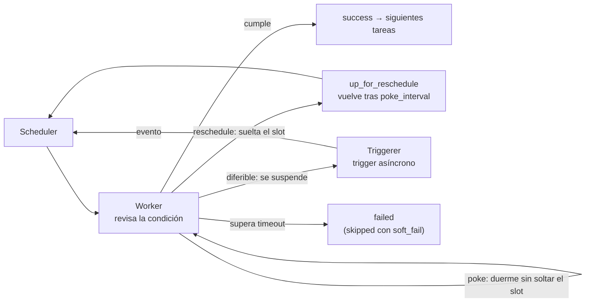

## 1. Resumen

Un **sensor** es una tarea que no transforma nada: **espera** a que algo ocurra (que exista un archivo, que un job termine, que llegue una hora) y, cuando ocurre, termina bien y deja correr a las siguientes. Si no ocurre dentro de su `timeout`, falla. En Airflow 3.3.2, el sensor puede esperar de tres formas:

- **poke** (por defecto): ocupa un slot de worker todo el tiempo;
- **reschedule**: lo ocupa solo mientras revisa;
- **diferible**: la espera pasa al triggerer y la tarea no ocupa slot de worker.

La diferencia importa porque un sensor pasa la mayor parte del tiempo sin hacer nada.

## 2. Qué es

- **Sensor:** subclase de operador cuya única tarea es esperar una condición. En el provider standard hay varios, como `FileSensor`, `BashSensor`, `PythonSensor` o `TimeSensor`.
- **Parámetros comunes** (de `BaseSensorOperator`):
  - `poke_interval`: segundos entre revisiones;
  - `timeout`: tiempo máximo, medido **desde el primer intento**, no por revisión;
  - `mode`: `poke` o `reschedule`;
  - `soft_fail`: al vencer el timeout, la tarea queda `skipped` en vez de `failed`;
  - `exponential_backoff` y `max_wait`: espaciar las revisiones de forma creciente, con un tope.
- **Diferible (`deferrable=True`):** el sensor se suspende y un **trigger** asíncrono hace la espera en el componente triggerer; al cumplirse, la tarea se reanuda.

## 3. Problema que resuelve

Muchos pasos dependen de algo externo al orquestador: el archivo del proveedor, el fin de un job en otro sistema. Sin un sensor, se programa por horario y se espera que el dato esté. Con un sensor:

- el paso siguiente corre cuando el dato existe, no a una hora supuesta;
- si el dato no llega, el fallo es explícito (`timeout`) y alerta como cualquier otro;
- con reschedule o con un sensor diferible, la espera no ocupa un worker que otra tarea podría usar.

## 4. Cómo funciona

1. La corrida del Dag llega al sensor y este revisa la condición.
2. Si se cumple, termina con éxito.
3. Si no, depende del modo:
   - **poke:** duerme `poke_interval` segundos sin soltar el slot y vuelve a revisar;
   - **reschedule:** suelta el slot, queda en `up_for_reschedule` y Airflow lo vuelve a ejecutar tras `poke_interval`;
   - **diferible:** queda en `deferred` y el trigger espera en el triggerer.
4. Si se supera `timeout` desde el primer intento, el sensor falla con `AirflowSensorTimeout` y no reintenta; con `soft_fail=True`, queda `skipped`.
5. Aparte, `execution_timeout` limita cada revisión individual; si una revisión tarda demasiado, falla con `AirflowTaskTimeout` y esa sí puede reintentarse.

## 5. Cuándo utilizarlo

- Esperar un archivo o una marca de «listo» de un sistema externo dentro de un Dag programado.
- Esperar el fin de un job que corre fuera del orquestador.
- **Reschedule** cuando se revisa cada pocos minutos; **poke** solo si se revisa cada pocos segundos y la latencia importa (la documentación lo plantea como un trade-off de latencia).
- **Diferible** cuando hay muchas esperas largas y los slots de worker son el cuello de botella.

## 6. Cuándo no utilizarlo

- Si el Dag entero debe arrancar cuando llega el evento, no hace falta un Dag programado con un sensor al inicio: ver `event-driven-orchestration`.
- No usar `poke` con esperas largas: ocupa un worker sin hacer nada.
- No dejar un sensor sin un `timeout` explícito y acorde a lo que el negocio tolera.

## 7. Ejemplo sencillo

El archivo del proveedor suele llegar entre las 2:00 y las 4:00. El sensor revisa cada 10 minutos con un `timeout` de 6 horas:

- llega a los 95 minutos: el sensor termina en la revisión 11 y la carga corre;
- no llega: tras 6 horas el sensor falla y alerta;
- con `soft_fail=True`: la tarea queda `skipped`, útil solo si «no hay archivo hoy» es un caso normal.

## 8. Ejemplo de producción

El Dag `espera_archivos_proveedor` necesita dos archivos del proveedor antes de cargar:

- `esperar_ventas` en modo **reschedule**, cada 10 minutos, con un timeout de 6 horas y `soft_fail=False`, porque sin ventas no hay reporte;
- `esperar_catalogo` **diferible**: la espera la hace el triggerer y no ocupa un slot de worker.

La carga depende de ambos. En un entorno con muchos Dags esperando a la vez, los sensores diferibles evitan que las esperas agoten los workers. A cambio, requieren un triggerer en marcha (ver `airflow-architecture`).

## 9. Arquitectura



## 10. Código

```python
# Airflow 3.3.2 (cargado en la CI con DagBag, sin errores de import; las tareas no se ejecutan): el mismo tipo de
# espera con un sensor en modo reschedule y con uno diferible.
import datetime

from airflow.providers.standard.operators.empty import EmptyOperator
from airflow.providers.standard.sensors.filesystem import FileSensor
from airflow.sdk import DAG

with DAG(
    dag_id="espera_archivos_proveedor",
    start_date=datetime.datetime(2026, 10, 1),
    schedule="@daily",
    catchup=False,
):
    # reschedule: ocupa un slot de worker solo mientras revisa; entre revisiones lo libera.
    esperar_ventas = FileSensor(
        task_id="esperar_ventas",
        filepath="/datos/proveedor/{{ ds }}/ventas.listo",
        mode="reschedule",
        poke_interval=10 * 60,       # revisa cada 10 minutos
        timeout=6 * 60 * 60,         # 6 horas desde el primer intento (no por revisión)
        soft_fail=False,             # al vencer, failed; con True quedaría skipped
    )
    # diferible: la espera corre en el triggerer y la tarea no ocupa un slot de worker mientras tanto.
    esperar_catalogo = FileSensor(
        task_id="esperar_catalogo",
        filepath="/datos/proveedor/{{ ds }}/catalogo.listo",
        deferrable=True,
        poke_interval=10 * 60,
        timeout=6 * 60 * 60,
    )
    cargar = EmptyOperator(task_id="cargar")
    [esperar_ventas, esperar_catalogo] >> cargar
```

```python
# Python 3.12, solo biblioteca estándar (ejecutado; mypy --strict sin errores): la lógica de espera de un sensor
# con un reloj simulado, en minutos. El timeout se mide desde el primer intento; soft_fail cambia failed por
# skipped. Simulación didáctica: el sensor real lo ejecuta Airflow.
from collections.abc import Callable


def esperar(llego: Callable[[int], bool], poke_interval: int, timeout: int, soft_fail: bool = False) -> tuple[str, int]:
    minuto, revisiones = 0, 0                # minuto 0 = primer intento
    while True:
        revisiones += 1
        if llego(minuto):
            return "success", revisiones
        if minuto + poke_interval > timeout:
            return ("skipped" if soft_fail else "failed"), revisiones
        minuto += poke_interval


def a_los_95(minuto: int) -> bool:
    return minuto >= 95                      # el archivo aparece 95 minutos después del primer intento


def nunca(minuto: int) -> bool:
    return False


print(esperar(a_los_95, poke_interval=10, timeout=360))                 # ('success', 11)
print(esperar(nunca, poke_interval=10, timeout=360))                    # ('failed', 37)
print(esperar(nunca, poke_interval=10, timeout=360, soft_fail=True))    # ('skipped', 37)
```

El primer bloque es un Dag de **Airflow 3.3.2**. La CI lo carga con `DagBag` en cada push (`make check-airflow-dag`, entorno aparte con la versión fijada). La prueba verifica:

- que no haya errores de import;
- `mode`, `poke_interval`, `timeout` y `soft_fail` del sensor en reschedule;
- `deferrable` del segundo sensor;
- que la carga dependa de los dos.

Las tareas no se ejecutan y el Dag no se cargó en local.

El segundo bloque, en Python 3.12 sin Airflow, está ejecutado y pasa `mypy --strict` sin errores. Es una simulación didáctica de la lógica de espera (timeout desde el primer intento, `soft_fail`), no la implementación de Airflow.

## 11. GCP

No aplica de forma específica: los sensores son de Airflow, y un Airflow administrado los ejecuta igual. Ver `open-source-vs-managed-orchestration`.

## 12. AWS

No aplica de forma específica (ver §11).

## 13. Azure

No aplica de forma específica (ver §11).

## 14. Buenas prácticas

- `timeout` explícito y acorde al negocio en cada sensor.
- Reschedule o diferible para esperas de minutos u horas.
- `soft_fail=True` solo cuando la ausencia del dato es un caso normal, no un fallo.
- `exponential_backoff` con `max_wait` para sistemas externos de disponibilidad irregular.
- Si el evento debe iniciar todo el flujo, evento en vez de sensor (`event-driven-orchestration`).
- **Seguridad:** el sensor revisa con una connection (por ejemplo, `fs_conn_id` en `FileSensor`) con permisos solo de lectura sobre lo que vigila.
- **Observabilidad:** alertar sobre sensores que vencen su timeout y medir cuánto tardan en cumplirse; un sensor que tarda cada día más anticipa un problema del proveedor.
- **Costo:** un sensor en poke ocupa capacidad de worker sin hacer nada; con muchas esperas así, hace falta más capacidad (y se paga) para el mismo trabajo útil.

## 15. Errores frecuentes

- Sensores en modo poke con esperas de horas que agotan los slots de worker.
- Confundir `timeout` (total, desde el primer intento) con `execution_timeout` (por revisión).
- `soft_fail=True` que esconde que el archivo nunca llegó.
- Un sensor al inicio de un Dag programado cada pocos minutos, cuando bastaba disparar el Dag por evento.

## 16. Trade-offs

Poke da la menor latencia y ocupa un slot todo el tiempo. Reschedule libera el slot entre revisiones, con más latencia. Diferible libera el worker mientras espera, a cambio de operar un triggerer y de que el sensor tenga una versión diferible. Iniciar el Dag por evento evita la espera, pero cambia cómo se programa y se observa el flujo.

## 17. Conceptos relacionados

- `orchestration-task`: los tipos de tarea y sus estados.
- `event-driven-orchestration`: iniciar el Dag por evento en vez de esperar dentro de él.
- `airflow-architecture`: el triggerer y los workers.
- `scheduler`: cuándo empieza la corrida en la que espera el sensor.

## 18. Preguntas técnicas abiertas

1. ¿Qué sensor de tu entorno ocupa un worker horas por estar en modo poke?
2. ¿Qué timeout le pondrías al archivo de tu proveedor, y qué haría el equipo si vence?
3. ¿Qué flujo hoy programado con un sensor al inicio convendría disparar por evento?

## 19. Laboratorio relacionado

Pendiente (F4).

## 20. Fuentes

- Apache Airflow 3.3.2: *Sensors*, *Deferrable Operators & Triggers* y *Tasks*.
- Provider standard 1.19.0: *FileSensor* (guía y referencia de API).

El detalle de cada fuente está en `sources` del frontmatter.

## 21. Fecha de última verificación

2026-10-11. Pasa a `verified`: revisión B-F3.1 del lote F3b-06a aplicada, sin VERIFY pendientes.

## 22. Historial de cambios importantes

- 2026-10-11: creación (lote F3b-06a).
- 2026-10-11: revisión B-F3.1 del lote F3b-06a aplicada (docs/reviews/cards-f3b-06a.md): filas aprobadas sin cambios en esta ficha.
- 2026-10-11: `verification_status: verified` (sin VERIFY pendientes).
