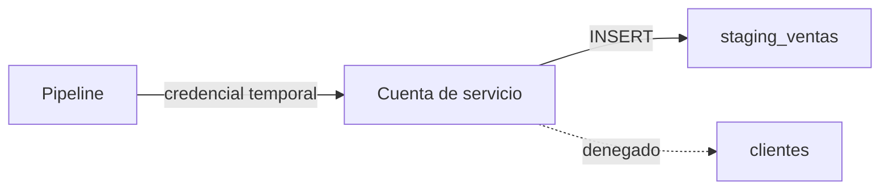

## 1. Resumen

Una **cuenta de servicio** es la identidad de un **proceso**: un pipeline, un job, una función. Tres reglas:

- **una por pipeline**, para que sus permisos y su auditoría sean de ese pipeline;
- **lo justo**: escribe en su staging, lee sus fuentes, y no administra nada;
- **sin secretos en el código**: la credencial la obtiene el proceso del entorno donde corre o de un gestor de secretos; mejor aún, credenciales temporales sin llave (las cuentas de servicio adjuntas en Google Cloud, los roles de AWS, las managed identities de Azure).

## 2. Qué es

- **Identidad de carga de trabajo:** el principal que usa un proceso.
- **Credencial de largo plazo:** una llave o contraseña que hay que guardar y rotar.
- **Credencial temporal:** la entrega la plataforma al proceso; no se guarda.

## 3. Problema que resuelve

Tres pipelines usan la misma cuenta, creada por una persona, con permisos de administrador y una contraseña en un archivo de configuración. Uno de ellos borra una tabla por error y la auditoría no dice cuál. Con una cuenta por pipeline y lo justo, el pipeline que no debía borrar no puede, y la auditoría nombra al culpable.

## 4. Cómo funciona

1. Se crea una cuenta por pipeline, sin atributos de administración.
2. Se le conceden los privilegios mínimos (`least-privilege`).
3. La plataforma le entrega la credencial al proceso; nadie la copia.
4. Se audita lo que hace y se revisan sus permisos.

## 5. Cuándo utilizarlo

- Para todo proceso automático que toca datos.
- En lugar de cuentas de personas para pipelines.

## 6. Cuándo no utilizarlo

- Para personas: una persona usa su identidad.
- Una cuenta compartida entre pipelines «para simplificar».

## 7. Ejemplo sencillo

La cuenta `sa_ingesta_ventas`, sin superusuario, sin crear roles ni bases, con `INSERT` en su staging:

| Acción | Resultado |
|---|---|
| Escribir `staging_ventas` | ok |
| Leer `clientes` | denegado (42501) |
| Crear un rol | denegado (42501) |

## 8. Ejemplo de producción

- Una cuenta por pipeline, declarada en Terraform junto con sus roles.
- En la nube, la cuenta va adjunta al recurso que ejecuta (job, función, contenedor); sin llaves descargadas.
- En bases fuera de la nube, la contraseña viene del gestor de secretos y se rota.
- Alerta si una cuenta de servicio hace algo fuera de su patrón.

## 9. Arquitectura



## 10. Código

```python
# Python 3.12 y psycopg contra PostgreSQL 17 (ejecutado en la CI con el servicio postgres:17): una cuenta de servicio
# por pipeline, sin permisos de persona: escribe en su staging y nada más; no es superusuario ni puede crear roles.
# La credencial llegaría del gestor de secretos al proceso, nunca escrita en el código. PG_*: base vacía temporal.
import os

import psycopg
from psycopg import errors

S = os.environ["PG_DB"]
SA = f"sa_ingesta_ventas_{S}"

with psycopg.connect(host=os.environ["PG_HOST"], port=os.environ["PG_PORT"], user=os.environ["PG_USER"],
                     password=os.environ["PG_PASSWORD"], dbname=S, autocommit=True) as conn:
    try:
        conn.execute("CREATE TABLE staging_ventas (id int, monto numeric)")
        conn.execute("CREATE TABLE clientes (id int, email text)")
        conn.execute(f"CREATE ROLE {SA} NOSUPERUSER NOCREATEROLE NOCREATEDB NOINHERIT")
        conn.execute(f"GRANT INSERT ON staging_ventas TO {SA}")
        atributos = conn.execute("SELECT rolsuper, rolcreaterole, rolcreatedb FROM pg_roles WHERE rolname = %s",
                                 (SA,)).fetchone()
        print(f"superusuario, crea roles, crea bases: {atributos}")

        def intenta(sql: str) -> str:
            conn.execute(f"SET ROLE {SA}")
            try:
                conn.execute(sql)
                return "ok"
            except errors.InsufficientPrivilege as exc:
                return f"denegado ({exc.sqlstate})"
            finally:
                conn.execute("RESET ROLE")

        print("escribe su staging:", intenta("INSERT INTO staging_ventas VALUES (1, 10)"))
        print("lee clientes:", intenta("SELECT * FROM clientes"))
        print("crea un rol:", intenta(f"CREATE ROLE intruso_{S}"))
    finally:
        conn.execute("DROP TABLE IF EXISTS staging_ventas, clientes")
        conn.execute(f"DROP ROLE IF EXISTS {SA}")
```

El script se **ejecuta en la CI contra el servicio postgres:17** y pasa `mypy --strict`. Imprime `superusuario, crea roles, crea bases: (False, False, False)`, `escribe su staging: ok`, y `denegado (42501)` al leer `clientes` y al crear un rol. El ejemplo cambia de rol con `SET ROLE` en lugar de abrir una sesión con credenciales, para no escribir una contraseña.

## 11. GCP

En GCP, **cuentas de servicio**. Según *5.8. Privileges* y *Service accounts overview* (no ejecutado):

| | Rol de servicio en PostgreSQL | Cuenta de servicio de Google Cloud |
|---|---|---|
| Identidad | Un rol | Una cuenta para aplicaciones o cargas de trabajo, identificada por un email |
| Credencial | Contraseña del gestor de secretos | Lo más común: adjuntarla al recurso que ejecuta la aplicación |
| Alcance | Lo concedido | Todo lo que la cuenta tiene permitido |

## 12. AWS

En AWS, **roles de IAM**. Según *5.8. Privileges* e *IAM roles* (no ejecutado):

| | Rol de servicio en PostgreSQL | Rol de IAM |
|---|---|---|
| Credencial | De largo plazo | Ninguna de largo plazo; credenciales temporales al asumir el rol |
| Quién lo usa | El proceso | Usuarios, aplicaciones o servicios que lo asumen |

## 13. Azure

En Azure, **managed identities**. Según *5.8. Privileges* y *What is managed identities for Azure resources?* (no ejecutado):

| | Rol de servicio en PostgreSQL | Managed identity |
|---|---|---|
| Credencial | La administra el equipo | Las aplicaciones obtienen tokens de Microsoft Entra sin administrar credenciales |
| Ciclo de vida | Manual | Asignada por el sistema (se borra con el recurso) o por el usuario (se administra aparte) |

## 14. Buenas prácticas

- Una cuenta por pipeline, con nombre del pipeline.
- Credenciales temporales donde la plataforma las da.
- Sin atributos de administración.
- **Seguridad:** nunca credenciales en el código, en logs ni en el repositorio.
- **Observabilidad:** auditoría por cuenta; alertas por comportamiento fuera de lo normal.
- **Costo:** cuentas sin uso en 90 días se deshabilitan.

## 15. Errores frecuentes

- Pipelines que usan la cuenta de una persona.
- Una llave de cuenta de servicio descargada y copiada.
- Cuentas de servicio con rol de administrador.

## 16. Trade-offs

Una cuenta por pipeline da auditoría y aislamiento a cambio de más cuentas que administrar. Credenciales temporales eliminan la rotación y atan el proceso a la plataforma que las entrega.

## 17. Conceptos relacionados

- `least-privilege`: lo justo.
- `iam-fundamentals`: principales.
- `gcp-iam-for-data`: cuentas de servicio en Google Cloud.
- `ci-cd-secrets`: credenciales en la CI.
- `entra-id-for-data`: managed identities.

## 18. Preguntas técnicas abiertas

1. ¿Cuántos de tus pipelines comparten cuenta?
2. ¿Hay llaves de cuentas de servicio descargadas?
3. ¿Qué cuentas de servicio tienen permisos de administrador?

## 19. Laboratorio relacionado

Pendiente (F4).

## 20. Fuentes

- PostgreSQL 17: *5.8. Privileges*.
- Google Cloud: *Service accounts overview*.
- AWS: *IAM roles*.
- Microsoft Learn: *What is managed identities for Azure resources?*.

El detalle de cada fuente está en `sources` del frontmatter.

## 21. Fecha de última verificación

2026-10-21. Pasa a `verified`: revisión B-F3.1 del lote F3b-18a aplicada y CI en verde (run 39677322697).

## 22. Historial de cambios importantes

- 2026-10-21: creación (lote F3b-18a).
- 2026-10-21: `verification_status: verified` (revisión aplicada; CI en verde, run 39677322697).
