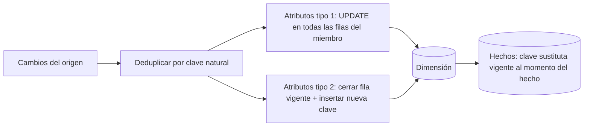

## 1. Resumen

Las dimensiones lentamente cambiantes (SCD) son las técnicas del modelado dimensional para decidir qué hacer cuando cambia un atributo de una dimensión: el segmento de un cliente, la categoría de un producto. La decisión no es técnica sino de negocio, **por atributo**: ¿los hechos pasados deben agruparse por el valor que tenía el atributo entonces, por el actual, o por ambos?

## 2. Qué es

Es un catálogo de técnicas, numeradas por Kimball Group como tipos:

- **Tipo 0:** conservar el valor original; nunca cambia.
- **Tipo 1:** sobrescribir; se pierde la historia.
- **Tipo 2:** agregar una fila nueva con nueva clave sustituta; se conserva toda la historia.
- **Tipo 3:** agregar un atributo con el valor anterior; historia limitada.
- **Tipo 4:** separar los atributos que cambian rápido en una minidimensión.
- **Tipo 6:** tipo 2 más columnas con el valor actual (tipo 1) de los mismos atributos.

Kimball también describe los tipos 5 y 7, combinaciones menos habituales.

## 3. Problema que resuelve

Si un cliente pasa de "Pyme" a "Corporativo", ¿las ventas del año pasado se reportan como Pyme o como Corporativo? Sin una técnica explícita, cada carga sobrescribe lo que tocó y los reportes históricos cambian sin aviso, o la tabla acumula duplicados sin forma de saber cuál es el vigente.

## 4. Cómo funciona

Para cada atributo de la dimensión se elige un tipo:

- **Tipo 1:** `UPDATE` del atributo. Los hechos siguen apuntando a la misma fila, así que todo el pasado pasa a verse con el valor nuevo. Kimball advierte que hay que recalcular los agregados y cubos afectados.
- **Tipo 2:** se cierra la fila vigente y se inserta una nueva, con **nueva clave sustituta**. Los hechos nuevos apuntan a la clave nueva y los viejos conservan la anterior. Kimball pide al menos tres columnas: fecha efectiva, fecha de expiración e indicador de fila vigente.
- **Tipo 3:** se guarda el valor anterior en otra columna (`segmento_anterior`) y se sobrescribe el principal.
- **Tipo 6:** filas tipo 2 más una columna "actual" sobrescrita en todas las filas del mismo miembro. Permite agrupar por el valor histórico o por el actual.

Una misma dimensión combina tipos: por ejemplo, el nombre como tipo 1 (corregir errores) y el segmento como tipo 2 (conservar historia).

## 5. Cuándo utilizarlo

En toda dimensión con atributos que cambian y que se usan para agrupar o filtrar hechos. La pregunta de diseño es por atributo:

- corrección de errores o atributos sin valor histórico: tipo 1;
- atributos por los que se analiza la historia (segmento, región, categoría): tipo 2;
- necesidad de comparar "antes y después" de una reorganización puntual: tipo 3;
- necesidad de ver el pasado con el valor de entonces y con el actual: tipo 6.

## 6. Cuándo no utilizarlo

- En tablas de hechos: los hechos no se "versionan" así, se corrigen con otros mecanismos.
- Para atributos que cambian muy seguido en dimensiones enormes: el tipo 2 multiplica filas; Kimball propone separar esos atributos en una minidimensión (tipo 4).
- Cuando nadie analiza la historia de un atributo: tipo 2 agrega costo sin beneficio.

## 7. Ejemplo sencillo

Cliente 42, segmento "Pyme" desde 2024. En 2026 pasa a "Corporativo".

- Tipo 1: la fila 42 dice "Corporativo"; las ventas de 2024 aparecen como Corporativo.
- Tipo 2: la fila vieja (clave 1001) queda cerrada con "Pyme" y se crea la clave 2310 con "Corporativo"; las ventas de 2024 siguen apuntando a 1001.

## 8. Ejemplo de producción

La dimensión cliente de un data warehouse:

- `nombre` y `email` son tipo 1: se corrigen, no se analizan históricamente.
- `segmento` y `region` son tipo 2, con `valido_desde`, `valido_hasta` e `es_vigente`.
- Se agrega `segmento_actual` (tipo 6) porque finanzas quiere ver la historia con el segmento de hoy.

La carga diaria deduplica los cambios por cliente, aplica el tipo 1 con `UPDATE` y el tipo 2 con cierre e inserción en una transacción. Los hechos que llegan antes que su cliente apuntan a un miembro provisional, que se completa cuando llega el dato.

## 9. Arquitectura



## 10. Código

```sql
-- BigQuery: atributos tipo 1 (email) y tipo 2 (segmento) en la misma carga, en una transacción.
-- Requiere: dim_cliente(cliente_sk, cliente_id, email, segmento, valido_desde, valido_hasta, es_vigente)
-- y stg_cliente con una fila por cliente_id (deduplicada antes).
BEGIN TRANSACTION;

-- Tipo 1: sobrescribir el email en todas las filas del cliente (vigentes e históricas).
UPDATE `proyecto.dwh.dim_cliente` AS d
SET email = s.email
FROM `proyecto.staging.stg_cliente` AS s
WHERE d.cliente_id = s.cliente_id AND d.email != s.email;

-- Tipo 2: cerrar la fila vigente si cambió el segmento...
UPDATE `proyecto.dwh.dim_cliente` AS d
SET valido_hasta = CURRENT_TIMESTAMP(), es_vigente = FALSE
FROM `proyecto.staging.stg_cliente` AS s
WHERE d.cliente_id = s.cliente_id AND d.es_vigente AND d.segmento != s.segmento;

-- ...e insertar la versión nueva (clientes nuevos o con segmento cambiado).
INSERT INTO `proyecto.dwh.dim_cliente` (cliente_sk, cliente_id, email, segmento, valido_desde, valido_hasta, es_vigente)
SELECT GENERATE_UUID(), s.cliente_id, s.email, s.segmento, CURRENT_TIMESTAMP(), NULL, TRUE
FROM `proyecto.staging.stg_cliente` AS s
LEFT JOIN `proyecto.dwh.dim_cliente` AS d
  ON d.cliente_id = s.cliente_id AND d.es_vigente
WHERE d.cliente_id IS NULL;

COMMIT TRANSACTION;
```

Repetir la carga con el mismo staging no cambia nada: el tipo 1 solo actualiza si el email difiere, y el tipo 2 solo cierra e inserta si el segmento vigente difiere. Dentro de la transacción, `CURRENT_TIMESTAMP()` devuelve el mismo instante (el inicio de la transacción), así que el cierre y la apertura coinciden. El detalle del tipo 2 está en `scd-type-2`.

## 11. GCP

En **BigQuery** los tipos 1 y 2 se aplican con `UPDATE`, `INSERT` o `MERGE` dentro de una transacción de varias sentencias. `MERGE` falla si una fila de la dimensión coincide con más de una fila de origen, por eso el staging debe traer una fila por cliente. La clave sustituta puede generarse con `GENERATE_UUID()` (ver `surrogate-keys`).

## 12. AWS

En **Redshift** se aplican con las mismas sentencias; su `MERGE` también falla si varias filas de origen coinciden con una fila del destino. La clave sustituta suele ser una columna `IDENTITY`, cuyos valores son únicos pero no necesariamente consecutivos (ver `surrogate-keys`).

## 13. Azure

La documentación de **Fabric Warehouse** presenta los tipos 1, 2 y 3 como los más comunes, admite combinar tipos 1 y 2 en una dimensión y advierte que el tipo 3 se usa poco, en parte porque es difícil de usar en un modelo semántico. Su ejemplo de tipo 2 usa `RecValidFromKey`, `RecValidToKey`, `RecReason` y `RecIsCurrent`: los mismos elementos que pide Kimball (desde, hasta, vigente), más un motivo del cambio.

## 14. Buenas prácticas

- Decidir el tipo **por atributo**, con el negocio, y documentarlo en el modelo.
- En tipo 2, usar siempre clave sustituta y las columnas desde, hasta y vigente.
- Deduplicar los cambios por clave natural antes de aplicarlos.
- Aplicar tipo 1 y tipo 2 en la misma transacción para no dejar la dimensión a medias.
- **Seguridad:** la historia tipo 2 conserva valores antiguos (direcciones, emails); aplicar las mismas políticas de acceso y retención que a los datos vigentes.
- **Observabilidad:** medir por carga cuántos miembros cambiaron por tipo y alertar si hay más de una fila vigente por clave natural.
- **Costo:** el tipo 2 hace crecer la dimensión con cada cambio; vigilar el tamaño y considerar una minidimensión (tipo 4) para atributos volátiles.

## 15. Errores frecuentes

- Aplicar tipo 1 a atributos por los que se analiza la historia y "reescribir" los reportes pasados.
- Usar la clave natural como clave primaria de una dimensión tipo 2.
- Dejar dos filas vigentes para el mismo miembro tras una carga fallida a medias.
- No recalcular agregados después de un cambio tipo 1.

## 16. Trade-offs

El tipo 1 es simple y compacto pero pierde la historia. El tipo 2 conserva la historia a cambio de más filas, claves sustitutas y cargas más complejas. El tipo 6 da ambas vistas, a cambio de sobrescribir la columna "actual" en todas las filas del miembro en cada cambio.

## 17. Conceptos relacionados

- `scd-type-2`: el SQL del tipo más usado.
- `surrogate-keys`: requisito del tipo 2.
- `late-arriving-data`: hechos que llegan antes que su dimensión.
- `sql-merge`: la sentencia habitual para aplicar cambios.
- Del blueprint, pendientes de ficha: `scd-type-1`, `dimension-tables`, `fact-tables`.

## 18. Preguntas técnicas abiertas

1. ¿Qué tipo usarías para el atributo "región comercial" si ventas se reorganiza una vez al año?
2. ¿Cómo detectarías que una dimensión tipo 2 tiene dos filas vigentes para el mismo cliente?
3. ¿Qué le responderías a finanzas si pide ver el año pasado "con los segmentos de hoy"?

## 19. Laboratorio relacionado

Pendiente (F4): lab de tipo B sobre una dimensión con dos filas vigentes.

## 20. Fuentes

- Kimball Group: *Dimensional Modeling Techniques* (tipos 0, 1, 2, 3, 4 y 6). Referencia conceptual canónica (Nivel 4).
- Microsoft Learn: *Modeling dimension tables in Warehouse* (Fabric).
- Google Cloud: *DML syntax*, *Utility functions* y *Multi-statement transactions* (BigQuery).
- AWS: *MERGE* y *CREATE TABLE* (Redshift).

El detalle de cada fuente está en `sources` del frontmatter.

## 21. Fecha de última verificación

2026-09-30. La ficha queda en `review_required` hasta la revisión humana (B-F3.1).

## 22. Historial de cambios importantes

- 2026-09-30: creación (lote 3 de F3).
