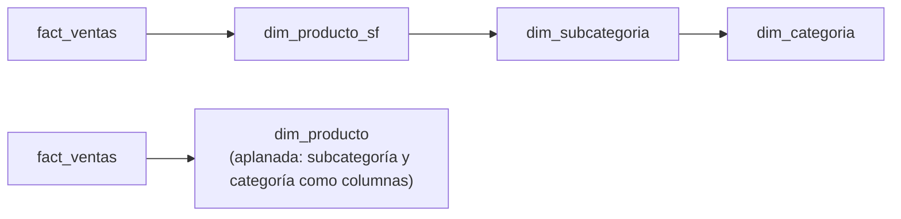

## 1. Resumen

Un esquema copo de nieve es un esquema estrella cuyas dimensiones están **normalizadas**: la jerarquía producto → subcategoría → categoría vive en tres tablas en lugar de en columnas de una sola. La información es la misma que en la estrella aplanada. Cambia cuántos joins hay que hacer y qué tan fácil es de entender:

- Kimball recomienda evitarlo;
- Power BI recomienda en general combinar esas tablas en una sola;
- Azure Databricks dice que tanto la estrella como el copo de nieve rinden bien en su plataforma.

## 2. Qué es

- **Estrella:** hecho en el centro y dimensiones desnormalizadas, cada una en una tabla.
- **Copo de nieve:** las jerarquías de cada dimensión se separan en tablas secundarias unidas por claves. Según Kimball, los atributos de baja cardinalidad, como la categoría, pasan a su propia tabla.
- **Outrigger:** caso particular en que una dimensión referencia otra, como la fecha de apertura de una cuenta. Kimball lo admite con moderación.

## 3. Problema que resuelve

Normalizar las dimensiones evita repetir los atributos de la jerarquía (el nombre de la categoría en cada producto) y deja la jerarquía representada con precisión. Viene de la costumbre de las bases operacionales, y a veces simplemente refleja cómo llegan las tablas de la fuente.

## 4. Cómo funciona

1. Se toma una dimensión con jerarquías de profundidad fija: producto → subcategoría → categoría.
2. Cada nivel pasa a una tabla con su clave, y el nivel inferior guarda la clave del superior.
3. El hecho sigue apuntando a la dimensión de nivel más bajo, el producto.
4. Las consultas que agrupan por un nivel alto, como la categoría, recorren la cadena de joins.

## 5. Cuándo utilizarlo

- Cuando una tabla de jerarquía es en sí misma una dimensión compartida por otras (un outrigger con moderación, como admite Kimball).
- Cuando la fuente ya llega normalizada y la herramienta de consumo aplana el modelo. Por ejemplo, en Power BI se pueden combinar las tablas en una sola tabla de modelo.
- En motores donde la documentación indica que no perjudica, como Azure Databricks, si el equipo prefiere mantener las jerarquías separadas.

## 6. Cuándo no utilizarlo

- Como capa de consumo para usuarios de negocio: Kimball señala que es difícil de entender y navegar.
- En Power BI, imitarlo carga más tablas, alarga la propagación de filtros y no permite jerarquías con columnas de varias tablas.
- Solo para ahorrar almacenamiento de atributos repetidos en dimensiones: la estrella aplanada guarda la misma información y suele consultarse con menos joins.

## 7. Ejemplo sencillo

- **Copo de nieve:** `dim_producto_sf(producto, subcategoria_key)` → `dim_subcategoria(subcategoria, categoria_key)` → `dim_categoria(categoria)`.
- **Estrella:** `dim_producto(producto, subcategoria, categoria)`.

## 8. Ejemplo de producción

El ERP de un mayorista entrega producto, subcategoría y categoría como tablas separadas, y el equipo las carga así en la capa de integración. Para la capa de consumo, publica una `dim_producto` aplanada que reconstruye cada noche con un join de las tres. Los analistas y la herramienta de BI ven una sola tabla. La única excepción es la dimensión de fecha de alta del cliente, que se mantiene como outrigger porque es la misma dimensión de fecha de toda la empresa.

## 9. Arquitectura



## 10. Código

```sql
-- PostgreSQL 17 (ejecutado): la misma dimensión de producto como copo de nieve (normalizada en tres tablas)
-- y aplanada en una sola; la consulta da el mismo resultado con dos joins menos.
CREATE TABLE dim_categoria    (categoria_key integer PRIMARY KEY, categoria text NOT NULL);
CREATE TABLE dim_subcategoria (subcategoria_key integer PRIMARY KEY, subcategoria text NOT NULL,
                               categoria_key integer NOT NULL REFERENCES dim_categoria);
CREATE TABLE dim_producto_sf  (producto_key integer PRIMARY KEY, nombre text NOT NULL,
                               subcategoria_key integer NOT NULL REFERENCES dim_subcategoria);
CREATE TABLE fact_ventas (producto_key integer NOT NULL, monto numeric(12,2) NOT NULL);

INSERT INTO dim_categoria VALUES (1, 'Bebidas'), (2, 'Alimentos');
INSERT INTO dim_subcategoria VALUES (10, 'Café', 1), (11, 'Té', 1), (20, 'Pan', 2);
INSERT INTO dim_producto_sf VALUES (100, 'Café molido', 10), (101, 'Té verde', 11), (200, 'Pan integral', 20);
INSERT INTO fact_ventas VALUES (100, 3000), (101, 1200), (200, 1500), (100, 1000);

-- Copo de nieve: hecho → producto → subcategoría → categoría.
SELECT c.categoria, sum(f.monto) AS monto
FROM fact_ventas f
JOIN dim_producto_sf p USING (producto_key)
JOIN dim_subcategoria s USING (subcategoria_key)
JOIN dim_categoria c USING (categoria_key)
GROUP BY c.categoria ORDER BY c.categoria;
-- Alimentos | 1500.00
-- Bebidas   | 5200.00

-- Estrella: la jerarquía aplanada como columnas de una sola dimensión (misma información).
CREATE TABLE dim_producto AS
SELECT p.producto_key, p.nombre, s.subcategoria, c.categoria
FROM dim_producto_sf p JOIN dim_subcategoria s USING (subcategoria_key) JOIN dim_categoria c USING (categoria_key);

SELECT p.categoria, sum(f.monto) AS monto
FROM fact_ventas f JOIN dim_producto p USING (producto_key)
GROUP BY p.categoria ORDER BY p.categoria;
-- Alimentos | 1500.00
-- Bebidas   | 5200.00
```

Ejecutado en PostgreSQL 17.11 local, en un esquema desechable. Las dos consultas devuelven lo mismo: la estrella resuelve con un join lo que el copo de nieve resuelve con tres. Que la dimensión aplanada contenga la misma información es lo que afirma Kimball. En este ejemplo se construye con un `CREATE TABLE AS` sobre el copo de nieve. Esta ficha no mide el rendimiento.

## 11. GCP

Esta ficha no cita una fuente de Google Cloud sobre copo de nieve. Para la recomendación de BigQuery sobre desnormalizar con campos anidados, ver `denormalization`.

## 12. AWS

Esta ficha no cita una fuente de AWS sobre copo de nieve. Para la distribución de dimensiones pequeñas en Redshift, ver `physical-data-model`.

## 13. Azure

Dos documentos de Microsoft dan matices distintos, cada uno sobre su herramienta:

- **Azure Databricks:** recomienda evitar modelos muy normalizados (3NF) en un lakehouse, y dice que estrella y copo de nieve rinden bien en su plataforma.
- **Power BI:** si la fuente es un copo de nieve, en general conviene combinar las tablas en una sola tabla de modelo. Imitarlo carga más tablas, alarga la propagación de filtros, muestra más tablas a los autores y no permite jerarquías entre tablas.

Ambos consejos son compatibles: el copo de nieve puede vivir en el almacenamiento, y el modelo que ven los usuarios conviene aplanarlo.

## 14. Buenas prácticas

- Publicar dimensiones aplanadas en la capa de consumo, aunque el almacenamiento las tenga normalizadas.
- Usar outriggers solo cuando la tabla referenciada es una dimensión compartida.
- Si se mantiene el copo de nieve, documentar la cadena de joins y ofrecer una vista aplanada.
- **Seguridad:** más tablas significa más objetos a los que dar o quitar permisos; una vista aplanada con solo las columnas necesarias simplifica el control de acceso del consumo.
- **Observabilidad:** comprobar que cada producto tenga subcategoría y cada subcategoría categoría (sin huérfanos); un nivel faltante hace desaparecer filas en un `JOIN` interno.
- **Costo:** en herramientas de BI que cargan el modelo en memoria, como Power BI, más tablas y columnas de relación aumentan el tamaño del modelo, según su guía.

## 15. Errores frecuentes

- Exponer a los usuarios la cadena de tablas normalizadas y esperar que la naveguen.
- Joins internos en la cadena que pierden productos sin subcategoría.
- Normalizar dimensiones pequeñas «por buenas prácticas» de bases operacionales.
- Crear jerarquías en Power BI sobre columnas de tablas distintas, algo que su guía dice que no es posible.

## 16. Trade-offs

El copo de nieve evita repetir atributos de la jerarquía y la representa con precisión. A cambio, agrega joins y tablas, y es más difícil de usar. Según Kimball y Power BI, puede afectar el rendimiento. Azure Databricks indica que en su plataforma estrella y copo de nieve rinden bien. La estrella aplanada repite datos pero es más simple de consultar.

## 17. Conceptos relacionados

- `star-schema`: la alternativa recomendada para el consumo.
- `dimension-tables`: dónde ocurre la normalización.
- `normalization` y `denormalization`: las dos direcciones.
- `kimball-methodology`: el contexto del diseño dimensional.

## 18. Preguntas técnicas abiertas

1. ¿Qué dimensión de tu modelo llega normalizada desde la fuente y cómo la publicas?
2. ¿Cuándo una tabla de jerarquía merece ser un outrigger y no columnas aplanadas?
3. ¿Cómo detectarías productos que desaparecen de un reporte por un nivel faltante en la cadena?

## 19. Laboratorio relacionado

Pendiente (F4).

## 20. Fuentes

- Kimball Group: *Snowflaked Dimensions* y *Outrigger Dimensions* (Nivel 4, conceptual).
- Microsoft Learn: *Understand star schema and the importance for Power BI* y *Data modeling* (Azure Databricks).

El detalle de cada fuente está en `sources` del frontmatter.

## 21. Fecha de última verificación

2026-10-11. Pasa a `verified`: revisión B-F3.1 del lote F3b-04a aplicada, sin VERIFY pendientes.

## 22. Historial de cambios importantes

- 2026-10-10: creación (lote F3b-04a).
- 2026-10-11: revisión B-F3.1 del lote F3b-04a aplicada (docs/reviews/cards-f3b-04a.md): filas aprobadas sin cambios en esta ficha.
- 2026-10-11: `verification_status: verified` (sin VERIFY pendientes).
