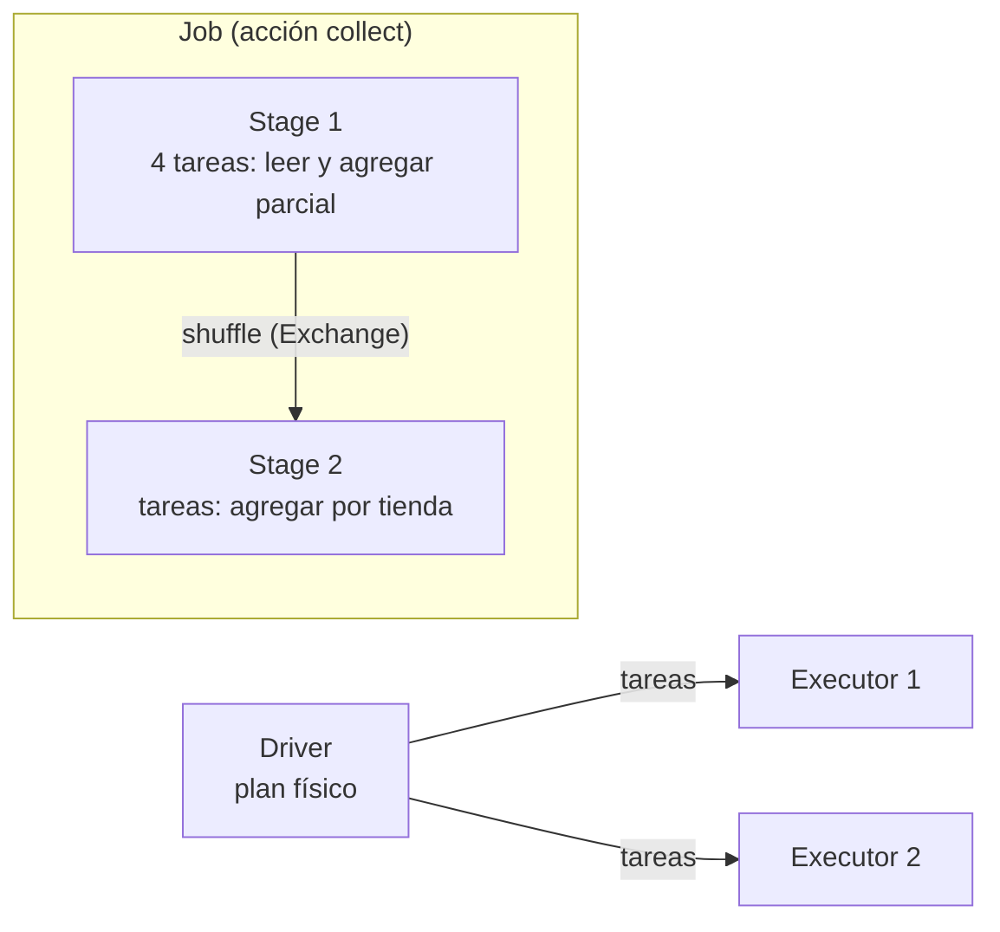

## 1. Resumen

Spark separa **qué** se calcula (el plan) de **cómo** se reparte el trabajo. El **driver** corre el programa, arma el plan y manda **tareas** a los **executors**, procesos que corren en los nodos del clúster.

La jerarquía de trabajo, según el glosario de Spark:

- **job:** se lanza con cada acción (`collect`, `save`);
- **stage:** cada job se divide en stages que dependen entre sí; el corte entre stages es un **shuffle**;
- **task:** una por partición; «A unit of work that will be sent to one executor».

El shuffle redistribuye datos entre executors y es caro: disco, serialización y red. **AQE** (activado por defecto desde Spark 3.2.0) reoptimiza el plan con estadísticas reales de ejecución, por ejemplo juntando particiones chicas después de un shuffle.

## 2. Qué es

- **Driver:** el proceso que corre `main()` y crea el `SparkContext`.
- **Executor:** un proceso por aplicación en un nodo worker; corre tareas y guarda datos en memoria o disco.
- **Operación con shuffle:** agrupar por clave o unir (`groupByKey`, `reduceByKey`, joins) redistribuye datos entre particiones; el plan la muestra como un stage nuevo.
- **Operación sin shuffle:** filtrar o proyectar trabaja dentro de cada partición.
- **Exchange:** el operador del plan físico que representa el shuffle.
- **AQE:** reoptimización durante la ejecución con estadísticas reales.

## 3. Problema que resuelve

Un job de agregación tarda una hora y nadie sabe por qué. Mirando el plan y los stages se ve que un `groupBy` provoca un shuffle de todo el dataset y que uno de los stages tiene una tarea mucho más lenta que las demás (una partición con skew). Entender el modelo de ejecución convierte «Spark es lento» en una causa concreta: demasiados shuffles, particiones mal dimensionadas, una clave caliente.

## 4. Cómo funciona

1. El programa define transformaciones; nada corre hasta una acción.
2. Con la acción, el driver arma el plan físico y lanza un job.
3. El job se corta en stages en cada shuffle (cada `Exchange`).
4. Cada stage corre una tarea por partición en los executors.
5. Entre stages, los datos se escriben y se leen por clave (shuffle).
6. Con AQE, después de cada shuffle Spark mira las estadísticas reales y ajusta el resto del plan.

## 5. Cuándo utilizarlo

- Para diagnosticar jobs lentos: contar shuffles, mirar tareas por stage y buscar skew.
- Para dimensionar particiones y executors.
- Antes de reescribir un job: muchas veces alcanza con evitar un shuffle.

## 6. Cuándo no utilizarlo

- Para micro-optimizar consultas chicas: el costo fijo de Spark domina.
- Desactivar AQE por costumbre: es el valor por defecto y suele mejorar el plan.
- Fijar `spark.sql.shuffle.partitions` a mano sin mirar los datos.

## 7. Ejemplo sencillo

Cien mil ventas en 4 particiones, agrupadas por tienda. La agregación necesita un shuffle: el plan tiene un `Exchange hashpartitioning`, el job tiene al menos dos stages y el primero corre 4 tareas, una por partición de entrada. Después de ejecutar, el plan adaptativo final muestra que AQE juntó las particiones chicas del shuffle.

## 8. Ejemplo de producción

Un job diario que une ventas con un catálogo de productos:

- el catálogo es chico: un broadcast join evita el shuffle de las ventas (AQE puede elegirlo solo);
- las ventas se escriben particionadas por fecha;
- la interfaz web del driver muestra las tareas y los executors; una tarea mucho más lenta que las demás del mismo stage suele ser skew;
- AQE divide las particiones con skew en vez de reescribir el job.

## 9. Arquitectura



## 10. Código

```python
# Python 3.12 y PySpark 4.2.0 en modo local (ejecutado en la CI con Java 17): una agregación por clave produce un job
# con al menos dos stages, separados por un shuffle. El plan físico muestra el Exchange; el status tracker, los stages y sus tareas
# (una por partición); con AQE, el plan final junta las particiones chicas del shuffle.
import contextlib
import io

from pyspark.sql import SparkSession
from pyspark.sql import functions as F

spark = (SparkSession.builder.master("local[2]").config("spark.sql.shuffle.partitions", "8")
         .config("spark.sql.adaptive.enabled", "true").config("spark.ui.showConsoleProgress", "false").getOrCreate())
spark.sparkContext.setLogLevel("ERROR")
sc = spark.sparkContext

ventas = spark.range(0, 100_000, numPartitions=4).withColumn("tienda", F.col("id") % 3)
por_tienda = ventas.groupBy("tienda").agg(F.count("*").alias("ventas"))   # wide: necesita un shuffle

sc.setJobGroup("agregacion", "ventas por tienda")
rows = sorted((r.tienda, r.ventas) for r in por_tienda.collect())
print(f"resultado: {rows}")

stages = sorted({s for job in sc.statusTracker().getJobIdsForGroup("agregacion")
                 for s in sc.statusTracker().getJobInfo(job).stageIds})
tasks = [sc.statusTracker().getStageInfo(s).numTasks for s in stages if sc.statusTracker().getStageInfo(s)]
print(f"stages: {'2 o más' if len(tasks) >= 2 else len(tasks)}; tareas del primer stage: {tasks[0]} (una por partición de entrada)")

buffer = io.StringIO()
with contextlib.redirect_stdout(buffer):
    por_tienda.explain()   # plan físico; tras ejecutar, el plan adaptativo final
plan = buffer.getvalue()
print("Exchange en el plan:", "Exchange hashpartitioning" in plan)
print("plan adaptativo final:", "AdaptiveSparkPlan isFinalPlan=true" in plan)
print("AQE juntó particiones del shuffle:", "coalesced" in plan)
spark.stop()
```

El script se **ejecuta en la CI con PySpark 4.2.0 en modo local y Java 17**. Imprime el resultado, que el job tiene al menos dos stages y que el primero corre 4 tareas, y que el plan físico tiene un `Exchange hashpartitioning` y un plan adaptativo final. El número exacto de stages puede cambiar con AQE y el test no lo fija. La última línea dice si AQE juntó particiones del shuffle; el test no la exige, porque depende de las estadísticas de ejecución.

## 11. GCP

En GCP, Spark corre en **Managed Service for Apache Spark**. Según *Compare Managed Service for Apache Spark serverless and cluster deployments* (no ejecutado):

| | Spark propio | Managed Service for Apache Spark |
|---|---|---|
| Dónde corren driver y executors | En el clúster que opera el equipo | En un clúster administrado (antes Dataproc on Compute Engine) o en un despliegue serverless (antes Google Cloud Serverless for Apache Spark) |

## 12. AWS

En AWS, Spark corre en **Amazon EMR**. Según *Understand node types* y *Amazon EMR release 7.14.0* (no ejecutado):

| | Spark propio | Amazon EMR |
|---|---|---|
| Nodos | Los define el equipo | Primario (administra el clúster), core (guardan datos en HDFS y corren tareas, como executors de Spark) y task (solo cómputo, también Spot) |
| Versión | Spark 4.2.0 en esta ficha | La release 7.14.0 trae Spark 3.5.8-amzn-0 (consultado el 2026-10-12) |

## 13. Azure

En Azure, Spark corre en **Azure Databricks**. Según *What is Azure Databricks?* (no ejecutado):

| | Spark propio | Azure Databricks |
|---|---|---|
| Infraestructura | La opera el equipo | Databricks administra y despliega la infraestructura en la cuenta de nube |

## 14. Buenas prácticas

- Leer el plan (`explain`) antes de optimizar.
- Evitar shuffles innecesarios: filtrar y proyectar antes de agrupar o unir; broadcast para tablas chicas.
- Mantener AQE activado.
- **Seguridad:** el driver ve las credenciales del job; los executors, solo lo que necesitan.
- **Observabilidad:** la interfaz web del driver (puerto 4040) con tareas, executors y almacenamiento; tareas lentas dentro de un stage.
- **Costo:** el shuffle es disco y red; menos shuffles es menos tiempo de clúster.

## 15. Errores frecuentes

- `collect()` de un DataFrame grande al driver.
- Un `groupBy` por una clave con un valor muy frecuente (skew).
- Particiones de entrada demasiado chicas o demasiado grandes.
- Copiar código de Spark 4.2 a un clúster con Spark 3.5 sin revisar la versión.

## 16. Trade-offs

Más particiones dan más paralelismo y más tareas que coordinar. El shuffle permite agregar y unir datos distribuidos, a cambio de disco y red. AQE mejora el plan sin cambiar el código, con decisiones que se toman en ejecución y que hay que mirar en el plan final.

## 17. Conceptos relacionados

- `pyspark-dataframes`: la API.
- `spark-structured-streaming`: el mismo modelo en micro-batches.
- `query-plans`: leer un plan físico.
- `partitioning`: particiones y paralelismo.
- `emr-spark-clusters`: Spark en AWS.
- `azure-databricks-lakehouse`: Spark en Azure.

## 18. Preguntas técnicas abiertas

1. ¿Cuántos shuffles tiene tu job más caro y cuáles se pueden evitar?
2. ¿Qué stage tarda más y por qué?
3. ¿Qué versión de Spark corre en tu plataforma?

## 19. Laboratorio relacionado

Pendiente (F4).

## 20. Fuentes

- Apache Spark 4.2.0: *Cluster Mode Overview*, *RDD Programming Guide* y *Performance Tuning*.
- Google Cloud: *Compare Managed Service for Apache Spark serverless and cluster deployments*.
- AWS: *Understand node types* y *Amazon EMR release 7.14.0*.
- Microsoft Learn: *What is Azure Databricks?*.

El detalle de cada fuente está en `sources` del frontmatter.

## 21. Fecha de última verificación

2026-10-20. `review_required`: pendiente de revisión B-F3.1 del lote F3b-20a.

## 22. Historial de cambios importantes

- 2026-10-20: creación (lote F3b-20a).
